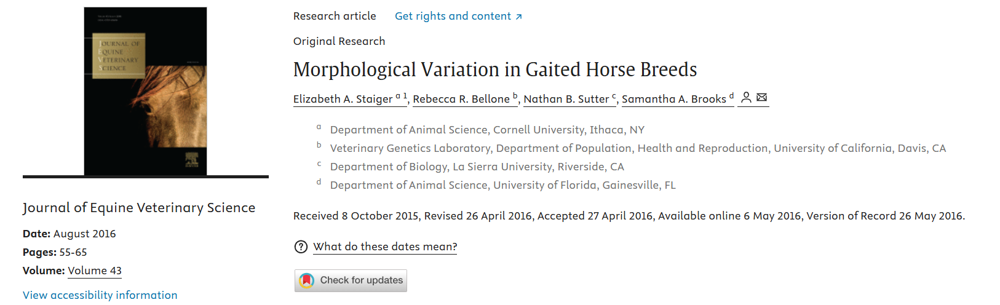
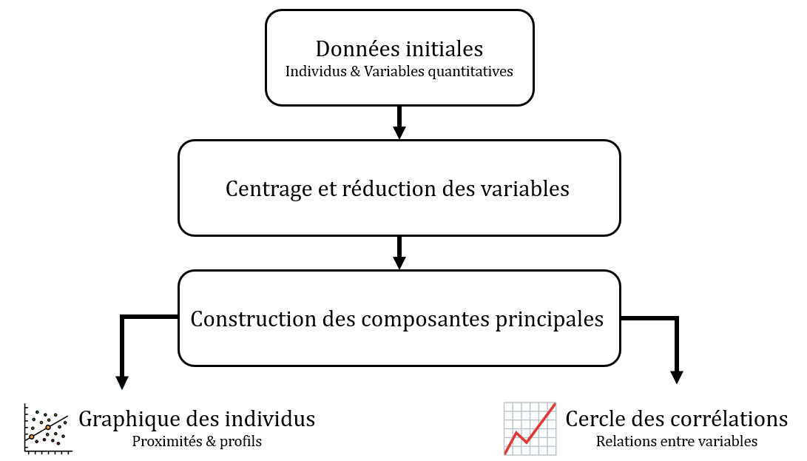

```{r setup}
#| include: false
#| echo: false
#| message: false
#| warning: false

library(MASS)
library(ggplot2)
library(plotly)
library(dplyr)
library(patchwork)
library(kableExtra)
library(pdftools)

library(palmerpenguins)

```

## 🔍 Introduction : L'Analyse en Composantes Principales (ACP), qu'est-ce que c'est ?

```{=html}
<div style="height:2px;"></div>
```

> L'[Analyse en Composantes Principales (ACP)]{.smallcaps} est une méthode statistique exploratoire permettant de [résumer et visualiser plusieurs variables quantitatives simultanément]{.smallcaps}, en conservant un maximum de leur variabilité.

```{=html}
<div style="height:7px;"></div>
```

. . .

| Question de recherche | Objectif de l'ACP |
|------------------------------------|------------------------------------|
| Peut-on identifier des appartements similaires à partir de leur superficie, de leur nombre de pièces et de leur DPE ? | Exploration des individus |
| Peut-on résumer les mesures morphologiques (bec, nageoires, masse) de plusieurs manchots ? | Réduction de dimension |
| Quelles mesures corporelles sont associées entre elles chez les bovins ? | Exploration des variables |
| Peut-on visualiser les différences morphologiques entre plusieurs races de chevaux ? | Visualisation des données |

. . .

```{=html}
<div style="height:10px;"></div>
```

::: callout-note
L'ACP est une [méthoe variable réponsede non supervisée]{.smallcaps} : elle explore la structure des données.
:::

## 🐧 Application : Présentation des données

```{=html}
<div style="height:5px;"></div>
```

[[Jeu de données utilisé :]{.underline}]{.smallcaps} Mesures morphologiques de $344$ manchots appartenant à $3$ espèces (Adélie, Chinstrap et Gentoo), disponibles dans le package R `palmerpenguins` [@palmerpenguins].

. . .

```{=html}
<div style="height:40px;"></div>
```

:::::: columns
:::: {.column width="55%"}
- 4 mesures morphologiques quantitatives $X$ :

  | Type de mesure   | Variables                   |
  |------------------|-----------------------------|
  | Bec              | Longueur et profondeur (mm) |
  | Nageoires        | Longueur (mm)               |
  | Masse corporelle | Masse (g)                   |

- 1 variable qualitative d'espèce :

::: {style="font-size: 0.9em; text-align: center;"}
Adélie / Chinstrap / Gentoo
:::
::::

::: {.column width="45%"}
```{r}
#| echo: false
#| message: false
#| warning: false

data_penguins <- penguins %>%
  select(
    species,
    bill_length_mm,
    bill_depth_mm,
    flipper_length_mm,
    body_mass_g
  )

knitr::kable(
  head(data_penguins, 10),
  digits = 2,
  col.names = c(
    "Espèce",
    "Bec L.",
    "Bec P.",
    "Nageoire",
    "Masse"
  )
)
```
:::
::::::

## 🐧 Application : Question de recherche

:::: center-text
::: highlight-box
**Peut-on résumer les mesures morphologiques des manchots pour visualiser leurs ressemblances et leurs différences selon les espèces ?**
:::
::::

## 📖 Objectifs du cours

```{=html}
<br>
<br>
<div style="height:5px;"></div>
```

1.  Pourquoi utiliser l'Analyse en Composantes Principales ? (Définition & Objectifs)

. . .

```{=html}
<div style="height:5px;"></div>
```

2.  Comment construire une ACP ? (Intuition & Théorie)

. . .

```{=html}
<div style="height:5px;"></div>
```

3.  Comment interpréter les résultats d'une ACP ? (Individus & Variables)

. . .

```{=html}
<div style="height:5px;"></div>
```

4.  En pratique : Réaliser une ACP avec R sur les données de manchots

. . .

```{=html}
<div style="height:5px;"></div>
```

5.  Conclusion & Exemple concret d'une contribution en sciences vétérinaires


```{r}
#| echo: false
#| message: false
#| warning: false
#| results: asis


pdf <- "documents/document.pdf"

dir.create("slides", showWarnings = FALSE)

pages <- pdf_convert(
  pdf,
  format = "png",
  dpi = 200,
  verbose = FALSE,
  filenames = sprintf(
    "slides/page-%03d.png",
    seq_len(pdf_info(pdf)$pages)
  )
)

for (page in pages) {
  cat(
    '\n\n## {background-image="', page,
    '" background-size="contain"}\n\n',
    sep = ""
  )
}

```

## 📝 À quoi sert l'ACP ?

```{=html}
<div style="height:25px;"></div>
```

[[**Utilisations principales :**]{.underline}]{.smallcaps}

- [Résumer plusieurs variables quantitatives]{.smallcaps} - *Peut-on résumer les différentes mesures morphologiques des bovins en quelques indicateurs ?*

  $\longrightarrow$ Réalisation d'une [réduction de dimension]{.smallcaps}.

```{=html}
<div style="height:5px;"></div>
```

. . .

- [Identifier des individus aux profils similaires]{.smallcaps} - *Peut-on identifier des chevaux présentant des morphologies similaires ?*

  $\longrightarrow$ Étude du [graphique des individus]{.smallcaps}.

```{=html}
<div style="height:5px;"></div>
```

. . .

- [Étudier les relations entre les variables]{.smallcaps} - *La longueur des nageoires et la masse corporelle des manchots sont-elles corrélées ?*

  $\longrightarrow$ Étude du [cercle des corrélations]{.smallcaps}.

## 📑 Exemple d'utilisation en sciences vétérinaires

```{=html}
<div style="height:20px;"></div>
```

[[**Exemple issu de :**]{.underline}]{.smallcaps} @staiger2016

```{=html}
<div style="height:15px;"></div>
```

{fig-align="center" out-width="120%"}

```{=html}
<div style="height:30px;"></div>
```

::: callout-note
Dans l'ACP présentée dans cet article, les auteur.es montrent que les variations morphologiques des chevaux peuvent être résumées par quelques axes, représentant notamment la taille globale et l'épaisseur corporelle.
:::

## 🎯 Conclusion

<br>

{fig-align="center" out-width="200%"}

<br> <br>

📌 [[**Programme du prochain cours :**]{.underline}]{.smallcaps} Classification non supervisée.

## Références
