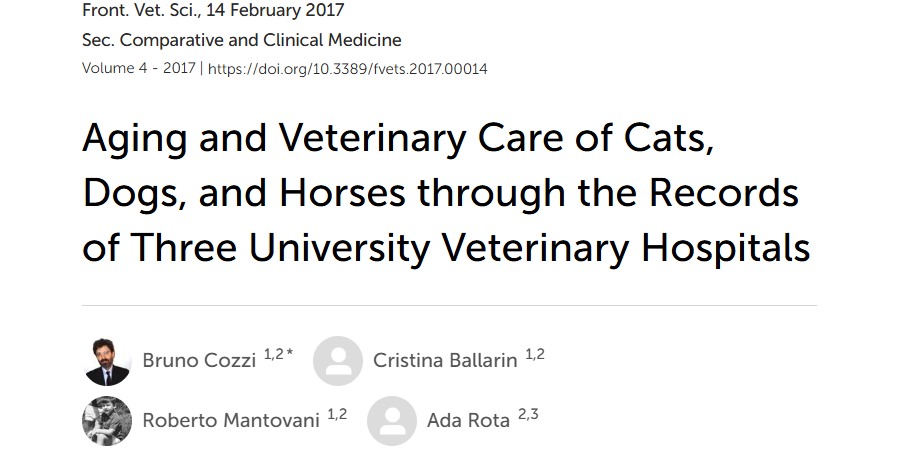
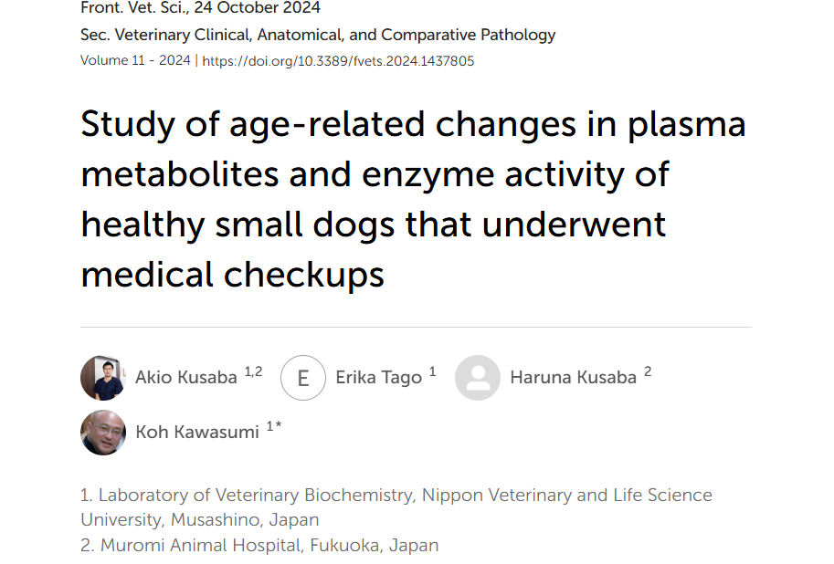
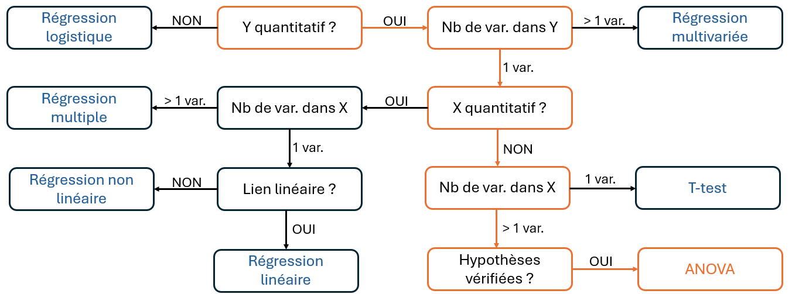

```{r setup}

library(readxl)
library(ggplot2)
library(tidyr)
library(plotly)
library(dplyr)
library(patchwork)
library(car)
```

## 🔍 Introduction : L'ANOVA, qu'est-ce que c'est ?

```{=html}
<div style="height:5px;"></div>
```

> L'[analyse de variance]{.smallcaps} (ANOVA) permet de déterminer l'influence de $k$ modalités d'une ou plusieurs variables explicatives (appelées [facteurs]{.smallcaps}) sur la moyenne d'une variable quantitative à expliquer $Y$.

```{=html}
<div style="height:10px;"></div>
```

. . .

| Questions de recherche | Facteur(s) {modalités} | $Y$ = variable expliquée |
|------------------------|------------------------|------------------------|
| Le type d'alimentation (granules, foin, ...) [influence]{.smallcaps}-t-il la vitesse de croissance de l'animal ? | Type d'alimentation {granules, foin, ...} | Vitesse de croissance |
| Le quartier a-t-il un [effet]{.smallcaps} sur le prix d'un logement ? | Quartier {Capitole, Purpan, ...} | Prix du logement |
| La durée de guérison de la souris [diffère]{.smallcaps}-t-elle selon son sexe et/ou le type de traitement reçu ? | Sexe {M stérilisé ou non / F stérilisé ou non} +/$\times$ Type de traitement reçu {Traitement A, B ou C} | Durée de guérison |

. . .

::: callout-note
L'objectif de l'ANOVA est de comparer les moyennes de $Y$ pour chacun des groupes ($=$ facteur $\times$ modalité) afin de voir si le(s) facteur(s) étudié(s) a(ont) une influence sur $Y$.
:::

## 🔍 Introduction : L'ANOVA, qu'est-ce que c'est ? {data-visibility="uncounted"}

```{=html}
<div style="height:5px;"></div>
```

> L'[analyse de variance]{.smallcaps} (ANOVA) permet de déterminer l'influence de $k$ modalités d'une ou plusieurs variables explicatives (appelées [facteurs]{.smallcaps}) sur la moyenne d'une variable quantitative à expliquer $Y$.

```{=html}
<div style="height:10px;"></div>
```

::: {#tableau-focus}
| Questions de recherche | Facteur(s) {modalités} | $Y$ = variable expliquée |
|------------------------|------------------------|------------------------|
| Le type d'alimentation (granules, foin, ...) [influence]{.smallcaps}-t-il la vitesse de croissance de l'animal ? | Type d'alimentation {granules, foin, ...} | Vitesse de croissance |
| Le quartier a-t-il un [effet]{.smallcaps} sur le prix d'un logement ? | Quartier {Capitole, Purpan, ...} | Prix du logement |
| La durée de guérison de la souris [diffère]{.smallcaps}-t-elle selon son sexe et/ou le type de traitement reçu ? | Sexe {M stérilisé ou non /F stérilisé ou non} +/$\times$ Type de traitement reçu {Traitement A, B ou C} | Durée de guérison |
:::

```{=html}
<div style="height:10px;"></div>
```

. . .

::: small-box
Dans ce cours, on va se concentrer sur l'[ANOVA à un facteur]{.smallcaps} :

Quel est l'effet d'**UN facteur** **à** $k$ **modalités** sur **UNE variable** $Y$.
:::

## 🐈 Application : Présentation des données

```{=html}
<div style="height:5px;"></div>
```

[[Jeu de données utilisé :]{.underline}]{.smallcaps} Statut reproductif et âge des animaux, collectés dans l'hôpital vétérinaire universitaires de Bologne (Italie) [@cozzi2017].

. . .

::::::::: columns
::::: {.column width="60%"}
```{=html}
<div style="height:35px;"></div>
```

- $3 452$ chats étudiés

::: fragment
- $Y =$ âge de l'animal lors de sa visite
:::

::: fragment
- Facteur $=$ Statut reproductif de l'animal à $4$ modalités

| Modalité | Définition                               | Nombre d'individus |
|----------|------------------------------------------|--------------------|
| F        | Femelle [**non**]{.smallcaps} stérilisée | 2 702              |
| M        | Mâle [**non**]{.smallcaps} stérilisé     | 2 724              |
| S        | Femelle stérilisée                       | 3 963              |
| C        | Mâle stérilisé                           | 3 1 063            |
:::
:::::

::::: {.column width="40%"}
:::: columns
::: fragment
```{r}
#| echo: false
#| message: false
#| warning: false

dataset <- read_excel("dataset_Cozzi_et_al.XLSX")

cats <- dataset %>%
  dplyr::filter(Specie == "Cat", 
          Hospital == "Bologna") %>%      
  dplyr::mutate(ID = seq(1, length(Sex))) %>%
  dplyr::select(ID, Sex, Age) %>% 
  dplyr::filter(!is.na(Sex))

cats$Sex <- factor(cats$Sex)


colors_groups <- c(
  "C" = "#0072B2",  # bleu
  "F" = "#E69F00",  # orange
  "M" = "#D55E00",  # vermillon
  "S" = "#F0E442"   # jaune
)

knitr::kable(head(cats, 10))
```
:::
::::
:::::
:::::::::

## 🐈 Application : Question de recherche

:::: center-text
::: highlight-box
**Y a-t-il un effet du statut reproductif de l'animal sur son âge au moment de sa consultation ?**
:::
::::

## 📖 Objectifs du cours

<br>

<br>

1.  L'ANOVA, un test d'hypothèse ? (Rappel, Définition & Exemple)

. . .

```{=html}
<div style="height:5px;"></div>
```

2.  Comment faire une ANOVA et interpréter ses effets ? (F-statistique et p-value)

. . .

```{=html}
<div style="height:5px;"></div>
```

3.  Application aux données de chats avec R

. . .

```{=html}
<div style="height:5px;"></div>
```

4.  Conclusion & Exemples concrets de contributions en sciences vétérinaire

## 1️⃣ L'ANOVA, un test d'hypothèse ? Rappels sur les tests

```{=html}
<div style="height:5px;"></div>
```

> L'ANOVA permet de [tester]{.smallcaps} si au moins une des $k$ modalités d'un facteur a une moyenne différente des autres.

```{=html}
<div style="height:5px;"></div>
```

::: {style="border: 2px solid #D9E1F2; border-radius: 25px; background: white; box-shadow: 0 2px 8px rgba(100,120,150,0.10); overflow: hidden; padding: 20px;font-size: 0.75em;padding-top: 1px;padding-bottom: 5px;"}
[[Hypothèses (test bilatéral):]{.underline}]{.smallcaps}

$$\small H_0:\mu=\mu_0 \qquad\qquad\qquad H_1:\mu\neq\mu_0$$
:::

```{=html}
<div style="height:20px;"></div>
```

::::::::: columns
:::: {.column width="33%"}
::: {style="border: 2px solid #D9E1F2; border-radius: 25px; background: white; box-shadow: 0 2px 8px rgba(100,120,150,0.10); overflow: hidden; padding: 20px;font-size: 0.75em;padding-top: 1px;padding-bottom: 5px;"}
[[erreurs :]{.underline}]{.smallcaps}

```{=html}
<div style="height:22.75px;"></div>
```

|   | **Ne pas rejeter** $\small H_0$ | **Rejeter** $\small H_0$ |
|------------------------|------------------------|------------------------|
| $\small H_0$ **vraie** | ✅ Bonne décision | ❌ **Type I :** $\small \alpha$ |
| $\small H_0$ **fausse** | ❌ **Type II :** $\small \beta$ | ✅ Bonne décision |

$$\small    \alpha    =        P(\text{rejeter }H_0\mid H_0\text{ vraie})$$

$$\small    \beta    =        P(\text{ne pas rejeter }H_0\mid H_0\text{ fausse})$$
:::
::::

:::: {.column width="33%"}
::: {style="border: 2px solid #D9E1F2; border-radius: 25px; background: white; box-shadow: 0 2px 8px rgba(100,120,150,0.10); overflow: hidden; padding: 20px;font-size: 0.75em;padding-top:1px;padding-bottom: 5px;"}
[[Statistique de test :]{.underline}]{.smallcaps}

```{=html}
<div style="height:0.03px;"></div>
```

$$\small T = \frac{\bar X-\mu_0}{s/\sqrt n}$$

> La statistique de test mesure l'écart à $\small H_0$ relativement à la variabilité de l'estimation.

$$\small H_0 \quad \Longrightarrow \quad T\sim \mathcal{N}(0, 1)$$
:::
::::

:::: {.column width="33%"}
::: {style="border: 2px solid #D9E1F2; border-radius: 25px; background: white; box-shadow: 0 2px 8px rgba(100,120,150,0.10); overflow: hidden; padding: 20px;font-size: 0.75em;padding-top: 1px;padding-bottom: 5px;"}
[[p-value et décision :]{.underline}]{.smallcaps}

```{=html}
<div style="height:0.014px;"></div>
```

$$\small p = P_{H_0} \left( |T|\geq |T_{\mathrm{obs}}| \right)$$

> La p-valeur est le plus petit risque pour lequel on rejetterait $\small H_0$.

$$\small p<\alpha \quad\Longrightarrow\quad \text{rejet de }H_0$$

$$\small p\geq\alpha\quad\Longrightarrow\quad\text{non-rejet de }H_0$$
:::
::::
:::::::::

## 1️⃣ Quel rapport entre l'ANOVA et un test bilatéral ?

```{=html}
<div style="height:5px;"></div>
```

> L'ANOVA permet de [tester]{.smallcaps} si au moins une des $k$ modalités d'un facteur a une moyenne différente des autres.

```{=html}
<div style="height:5px;"></div>
```

::: {style="border: 2px solid #D9E1F2; border-radius: 25px; background: white; box-shadow: 0 2px 8px rgba(100,120,150,0.10); overflow: hidden; padding: 20px;font-size: 0.75em;padding-top: 1px;padding-bottom: 5px;"}
[[Hypothèses :]{.underline}]{.smallcaps}

$$\small H_0:\mu_1=\mu_2=\cdots=\mu_J \qquad\qquad\qquad H_1:\text{au moins deux moyennes diffèrent} $$
:::

```{=html}
<div style="height:20px;"></div>
```

::::::::: columns
:::: {.column width="33%"}
::: {style="border: 2px solid #D9E1F2; border-radius: 25px; background: white; box-shadow: 0 2px 8px rgba(100,120,150,0.10); overflow: hidden; padding: 20px;font-size: 0.75em;padding-top: 1px;padding-bottom: 5px;"}
[[erreurs :]{.underline}]{.smallcaps}

```{=html}
<div style="height:22.75px;"></div>
```

|   | **Ne pas rejeter** $\small H_0$ | **Rejeter** $\small H_0$ |
|------------------------|------------------------|------------------------|
| $\small H_0$ **vraie** | ✅ Bonne décision | ❌ **Type I :** $\small \alpha$ |
| $\small H_0$ **fausse** | ❌ **Type II :** $\small \beta$ | ✅ Bonne décision |

$$\small    \alpha    =        P(\text{rejeter }H_0\mid H_0\text{ vraie})$$

$$\small    \beta    =        P(\text{ne pas rejeter }H_0\mid H_0\text{ fausse})$$
:::
::::

:::: {.column width="33%"}
::: {style="border: 2px solid #D9E1F2; border-radius: 25px; background: white; box-shadow: 0 2px 8px rgba(100,120,150,0.10); overflow: hidden; padding: 20px;font-size: 0.75em;padding-top:1px;padding-bottom: 5px;"}
[[Statistique de test :]{.underline}]{.smallcaps}

```{=html}
<div style="height:0.03px;"></div>
```

$$
\small F= \frac{\text{variabilité entre les groupes}}
{\text{variabilité au sein des groupes}}
$$

> [Nouvelle statistique de test adaptée aux données.]{.smallcaps}

$$
\small H_0\Longrightarrow F\sim\mathcal{F}_{J-1,N-J}
$$
:::
::::

:::: {.column width="33%"}
::: {style="border: 2px solid #D9E1F2; border-radius: 25px; background: white; box-shadow: 0 2px 8px rgba(100,120,150,0.10); overflow: hidden; padding: 20px;font-size: 0.75em;padding-top: 1px;padding-bottom: 5px;"}
[[p-value et décision :]{.underline}]{.smallcaps}

```{=html}
<div style="height:0.014px;"></div>
```

$$\small p = P_{H_0} \left( F \geq F_{\mathrm{obs}} \right)$$

$$\small p<\alpha \quad\Longrightarrow\quad \text{rejet de }H_0$$

$$\small p\geq\alpha\quad\Longrightarrow\quad\text{non-rejet de }H_0$$
:::
::::
:::::::::

## 1️⃣L'ANOVA, un test d'hypothèse ? Exemple

<br>

```{r}
#| echo: false
#| message: false
#| warning: false
#| fig-height: 11.5
#| fig-width: 19
#| fig-align: center

ggplot(
  cats,
  aes(y = Age, x = Sex, colour = Sex, fill = Sex)
) +

  geom_boxplot(
    alpha = 0.5,
    outlier.alpha = 0,
    linewidth = 1.25
  ) +

  geom_jitter(
    width = 0.25
  ) +

  scale_x_discrete(
    limits = c("C", "F", "M", "S")
  ) +

  # Couleurs des groupes
  scale_colour_manual(
    values = colors_groups
  ) +

  scale_fill_manual(
    values = colors_groups
  ) +

  # Moyenne de chaque groupe
  stat_summary(
    aes(x = Sex, y = Age),
    fun = mean,
    geom = "point",
    shape = 16,
    colour = "black",
    size = 7,
    inherit.aes = FALSE
  ) +

  # Moyenne globale
  geom_hline(
    aes(
      yintercept = mean(cats$Age, na.rm = TRUE),
      linetype = "Moyenne globale"
    ),
    colour = "black",
    linewidth = 1.5
  ) +
  
  # Légende de la moyenne par groupe
  geom_point(
    aes(
      x = NA,
      y = NA,
      shape = "Moyenne du groupe"
    ),
    colour = "black",
    inherit.aes = FALSE
  ) +

  scale_shape_manual(
    name = NULL,
    values = c("Moyenne du groupe" = 16)
  ) +

  scale_linetype_manual(
    name = NULL,
    values = c("Moyenne globale" = "dashed")
  ) +

  guides(
    shape = guide_legend(
      override.aes = list(size = 7)
    ),
    linetype = guide_legend(
      override.aes = list(linewidth = 2.5)
    )
  ) +

  theme_classic() +

  theme(
    axis.text = element_text(size = 28),
    axis.title = element_text(size = 28),

    legend.text = element_text(size = 28),
    legend.title = element_text(size = 28),

    legend.key.width = unit(2.5, "cm"),
    legend.key.height = unit(1.5, "cm"),

    plot.margin = margin(5, 5, 5, 5)
  )


```

## 1️⃣ Les hypothèses à vérifier avant le test

<br>

::: callout-note
Comme toujours avant un test, il faut s'assurer que les données présentent les bonnes propriétés pour garantir la validité des résultats et des conclusions.
:::

<br>

1.  [[indépendance :]{.underline}]{.smallcaps} Les $\epsilon_{ij}$ sont indépendants $\longrightarrow$ Les $Y_{ij}$ sont indépendants

|  |
|:----------------------------------------------------------------------:|
| La mesure prise sur un individu n'a pas d'influence sur celle prise sur un autre. |

## 1️⃣ Les hypothèses à vérifier avant le test

<br>

2.  [[normalité des résidus :]{.underline}]{.smallcaps} Pour chaque groupe $j$, $\epsilon_{ij}\sim\mathcal{N}(0,\sigma^2)$ $\longrightarrow$ $Y_{ij}\sim\mathcal{N}(\mu_j,\sigma^2)$

::::: columns
::: {.column width="50%"}
```{r}
#| echo: false
#| message: false
#| warning: false

set.seed(123)

# -------------------------
# Paramètres
# -------------------------

n <- 30

mu_group <- c(
  "A" = 6,
  "B" = 10,
  "C" = 14
)

sigma <- 1.5

colors_groups_ex <- c(
  "A" = "#0072B2",
  "B" = "#E69F00",
  "C" = "#D55E00"
)


# -------------------------
# Données normales
# -------------------------

data_normal <- data.frame(
  Group = rep(c("A", "B", "C"), each = n)
)

data_normal$Group <- factor(
  data_normal$Group,
  levels = c("A", "B", "C")
)

data_normal$x <- match(
  as.character(data_normal$Group),
  c("A", "B", "C")
)

data_normal$mu_j <- mu_group[
  as.character(data_normal$Group)
]

data_normal$Y <- rnorm(
  nrow(data_normal),
  mean = data_normal$mu_j,
  sd = sigma
)

# Jitter horizontal
data_normal$x_plot <- data_normal$x +
  runif(nrow(data_normal), -0.18, 0.18)


# -------------------------
# Distributions normales
# pour chaque groupe
# -------------------------

normal_curves <- do.call(
  rbind,
  lapply(1:3, function(j) {

    mu_j <- mu_group[j]

    y_grid <- seq(
      mu_j - 4 * sigma,
      mu_j + 4 * sigma,
      length.out = 300
    )

    dens <- dnorm(
      y_grid,
      mean = mu_j,
      sd = sigma
    )

    # Largeur de la cloche
    dens_scaled <- dens / max(dens) * 0.40

    data.frame(
      Group = names(mu_group)[j],
      X = j + dens_scaled,
      Y = y_grid
    )
  })
)


# -------------------------
# Moyennes
# -------------------------

means_group <- data.frame(
  Group = c("A", "B", "C"),
  x = 1:3,
  xend = 1:3 + 0.40,
  y = mu_group,
  yend = mu_group,
  label = c(
    "mu[A]",
    "mu[B]",
    "mu[C]"
  )
)


# -------------------------
# Graphique
# -------------------------

ggplot() +

  # Points
  geom_point(
    data = data_normal,
    aes(
      x = x_plot,
      y = Y,
      colour = Group
    ),
    alpha = 0.65,
    size = 5
  ) +

  # Distributions normales
  geom_path(
    data = normal_curves,
    aes(
      x = X,
      y = Y,
      group = Group
    ),
    colour = "black",
    linewidth = 1.5
  ) +

  # Moyenne de chaque groupe
  geom_segment(
    data = means_group,
    aes(
      x = x,
      xend = xend,
      y = y,
      yend = yend
    ),
    colour = "black",
    linetype = "dashed",
    linewidth = 1.2
  ) +

  # mu_A, mu_B, mu_C
  geom_text(
    data = means_group,
    aes(
      x = x,
      y = y,
      label = label
    ),
    parse = TRUE,
    colour = "black",
    size = 8,
    nudge_x = -0.15,
    nudge_y = 0.6
  ) +

  scale_colour_manual(
    values = colors_groups_ex
  ) +

  scale_x_continuous(
    breaks = 1:3,
    labels = c("A", "B", "C")
  ) +

  coord_cartesian(
    xlim = c(0.5, 3.6),
    ylim = c(0, 20)
  ) +

  labs(
    title = "Cas normal",
    x = "Groupe",
    y = "Y"
  ) +

  theme_minimal(base_size = 20) +

  theme(
    plot.title = element_text(
      size = 28,
      face = "bold",
      hjust = 0.5
    ),
    axis.title = element_text(size = 24),
    axis.text = element_text(size = 20),
    legend.position = "none"
  )
```
:::

::: {.column width="50%"}
```{r}
#| echo: false
#| message: false
#| warning: false

set.seed(123)

# -------------------------
# Paramètres
# -------------------------

n <- 30

mu_group <- c(
  "A" = 6,
  "B" = 10,
  "C" = 14
)

sigma <- 1.5

colors_groups_ex <- c(
  "A" = "#0072B2",
  "B" = "#E69F00",
  "C" = "#D55E00"
)


# -------------------------
# Données NON normales
# -------------------------

data_non_normal <- data.frame(
  Group = rep(c("A", "B", "C"), each = n)
)

data_non_normal$Group <- factor(
  data_non_normal$Group,
  levels = c("A", "B", "C")
)

data_non_normal$x <- match(
  as.character(data_non_normal$Group),
  c("A", "B", "C")
)

data_non_normal$mu_j <- mu_group[
  as.character(data_non_normal$Group)
]


# -------------------------
# Erreurs non normales
# -------------------------

eps <- rexp(
  nrow(data_non_normal),
  rate = 1 / sigma
) - sigma

data_non_normal$Y <-
  data_non_normal$mu_j + eps


# Jitter horizontal
data_non_normal$x_plot <- data_non_normal$x +
  runif(nrow(data_non_normal), -0.18, 0.18)


# -------------------------
# Distributions non normales
# pour chaque groupe
# -------------------------

non_normal_curves <- do.call(
  rbind,
  lapply(1:3, function(j) {

    mu_j <- mu_group[j]

    y_grid <- seq(
      mu_j - sigma,
      mu_j + 5 * sigma,
      length.out = 300
    )

    dens <- dexp(
      y_grid - mu_j + sigma,
      rate = 1 / sigma
    )

    # Largeur de la distribution
    dens_scaled <- dens / max(dens) * 0.40

    data.frame(
      Group = names(mu_group)[j],
      X = j + dens_scaled,
      Y = y_grid
    )
  })
)


# -------------------------
# Moyennes
# -------------------------

means_group <- data.frame(
  Group = c("A", "B", "C"),
  x = 1:3,
  xend = 1:3 + 0.40,
  y = mu_group,
  yend = mu_group,
  label = c(
    "mu[A]",
    "mu[B]",
    "mu[C]"
  )
)


# -------------------------
# Graphique
# -------------------------

ggplot() +

  # Points
  geom_point(
    data = data_non_normal,
    aes(
      x = x_plot,
      y = Y,
      colour = Group
    ),
    alpha = 0.65,
    size = 5
  ) +

  # Distributions non normales
  geom_path(
    data = non_normal_curves,
    aes(
      x = X,
      y = Y,
      group = Group
    ),
    colour = "black",
    linewidth = 1.5
  ) +

  # Moyenne de chaque groupe
  geom_segment(
    data = means_group,
    aes(
      x = x,
      xend = xend,
      y = y,
      yend = yend
    ),
    colour = "black",
    linetype = "dashed",
    linewidth = 1.2
  ) +

  # mu_A, mu_B, mu_C
  geom_text(
    data = means_group,
    aes(
      x = x,
      y = y,
      label = label
    ),
    parse = TRUE,
    colour = "black",
    size = 8,
    nudge_x = -0.15,
    nudge_y = 0.6
  ) +

  scale_colour_manual(
    values = colors_groups_ex
  ) +

  scale_x_continuous(
    breaks = 1:3,
    labels = c("A", "B", "C")
  ) +

  coord_cartesian(
    xlim = c(0.5, 3.6),
    ylim = c(0, 20)
  ) +

  labs(
    title = "Cas non normal",
    x = "Groupe",
    y = "Y"
  ) +

  theme_minimal(base_size = 20) +

  theme(
    plot.title = element_text(
      size = 28,
      face = "bold",
      hjust = 0.5
    ),
    axis.title = element_text(size = 24),
    axis.text = element_text(size = 20),
    legend.position = "none"
  )
```
:::
:::::

|  |
|:----------------------------------------------------------------------:|
| Pour un groupe $j$ donné, les points observés $y$ sont distribués selon une distribution Normale centrée sur la moyenne du groupe. |

## 1️⃣ Les hypothèses à vérifier avant le test

<br>

3.  [[homoscédasticité :]{.underline}]{.smallcaps} La variance des $\epsilon_{ij}$ est la même dans tous les groupes $\longrightarrow$ La variance des $Y_{ij}$ est la même dans tous les groupes

::::: columns
::: {.column width="50%"}
```{r}
#| echo: false
#| message: false
#| warning: false

set.seed(123)

n <- 30

mu_group <- c(
  "A" = 6,
  "B" = 10,
  "C" = 14
)

sigma <- 1.5

colors_groups_ex <- c(
  "A" = "#0072B2",
  "B" = "#E69F00",
  "C" = "#D55E00"
)


# -------------------------
# Données
# -------------------------

data <- data.frame(
  Group = rep(c("A", "B", "C"), each = n)
)

data$Group <- factor(
  data$Group,
  levels = c("A", "B", "C")
)

data$mu_j <- mu_group[
  as.character(data$Group)
]


# -------------------------
# Variance constante
# -------------------------

eps <- rnorm(
  nrow(data),
  mean = 0,
  sd = sigma
)

# Même variance dans chaque groupe
eps <- ave(
  eps,
  data$Group,
  FUN = function(z) {
    (z - mean(z)) / sd(z) * sigma
  }
)

data$Y <- data$mu_j + eps


# -------------------------
# Min et max observés
# dans chaque groupe
# -------------------------

width_data <- aggregate(
  Y ~ Group,
  data = data,
  FUN = function(y) c(
    min = min(y),
    max = max(y)
  )
)

width_data <- do.call(
  data.frame,
  width_data
)

names(width_data) <- c(
  "Group",
  "Y_min",
  "Y_max"
)


# -------------------------
# Graphique
# -------------------------

ggplot(
  data,
  aes(
    x = Group,
    y = Y,
    colour = Group
  )
) +

  # Étendue min-max avec extrémités horizontales
  geom_errorbar(
    data = width_data,
    aes(
      x = Group,
      ymin = Y_min,
      ymax = Y_max
    ),
    width = 0.35,
    colour = "black",
    linetype = "dashed",
    linewidth = 1.3,
    inherit.aes = FALSE
  ) +

  # Observations
  geom_jitter(
    width = 0.18,
    alpha = 0.75,
    size = 5
  ) +

  scale_colour_manual(
    values = colors_groups_ex
  ) +

  coord_cartesian(
    ylim = c(0, 20)
  ) +

  labs(
    title = "Cas homoscédastique",
    x = "Groupe",
    y = "Y"
  ) +

  theme_minimal(base_size = 20) +

  theme(
    plot.title = element_text(
      size = 28,
      face = "bold",
      hjust = 0.5
    ),
    axis.title = element_text(size = 24),
    axis.text = element_text(size = 20),
    legend.position = "none"
  )
```
:::

::: {.column width="50%"}
```{r}
#| echo: false
#| message: false
#| warning: false

set.seed(123)

n <- 30

mu_group <- c(
  "A" = 6,
  "B" = 10,
  "C" = 14
)

sigma_group <- c(
  "A" = 0.6,
  "B" = 1.5,
  "C" = 3.0
)

colors_groups_ex <- c(
  "A" = "#0072B2",
  "B" = "#E69F00",
  "C" = "#D55E00"
)


# -------------------------
# Données
# -------------------------

data <- data.frame(
  Group = rep(c("A", "B", "C"), each = n)
)

data$Group <- factor(
  data$Group,
  levels = c("A", "B", "C")
)

data$mu_j <- mu_group[
  as.character(data$Group)
]

data$sigma_j <- sigma_group[
  as.character(data$Group)
]


# -------------------------
# Variance différente
# selon le groupe
# -------------------------

eps <- rnorm(
  nrow(data),
  mean = 0,
  sd = data$sigma_j
)

data$Y <- data$mu_j + eps


# -------------------------
# Min et max observés
# dans chaque groupe
# -------------------------

width_data <- aggregate(
  Y ~ Group,
  data = data,
  FUN = function(y) c(
    min = min(y),
    max = max(y)
  )
)

width_data <- do.call(
  data.frame,
  width_data
)

names(width_data) <- c(
  "Group",
  "Y_min",
  "Y_max"
)


# -------------------------
# Graphique
# -------------------------

ggplot(
  data,
  aes(
    x = Group,
    y = Y,
    colour = Group
  )
) +

  # Étendue min-max avec extrémités horizontales
  geom_errorbar(
    data = width_data,
    aes(
      x = Group,
      ymin = Y_min,
      ymax = Y_max
    ),
    width = 0.35,
    colour = "black",
    linetype = "dashed",
    linewidth = 1.3,
    inherit.aes = FALSE
  ) +

  # Observations
  geom_jitter(
    width = 0.18,
    alpha = 0.75,
    size = 5
  ) +

  scale_colour_manual(
    values = colors_groups_ex
  ) +

  coord_cartesian(
    ylim = c(0, 20)
  ) +

  labs(
    title = "Cas hétéroscédastique",
    x = "Groupe",
    y = "Y"
  ) +

  theme_minimal(base_size = 20) +

  theme(
    plot.title = element_text(
      size = 28,
      face = "bold",
      hjust = 0.5
    ),
    axis.title = element_text(size = 24),
    axis.text = element_text(size = 20),
    legend.position = "none"
  )
```
:::
:::::

|                                                              |
|:------------------------------------------------------------:|
| La dispersion des $Y$ est constante quel que soit le groupe. |

## 1️⃣ Vérification des hypothèses sur les données de chats

```{=html}
<div style="height:5px;"></div>
```

:::::::: columns
:::::: {.column width="50%"}
<br> <br>

::: fragment
- [[Indépendance :]{.underline}]{.smallcaps} ⚠️ Supposée : chaque visite est une nouvelle observation indépendante.
:::

```{=html}
<div style="height:5px;"></div>
```

::: fragment
- [[Normalité :]{.underline}]{.smallcaps} ✅ Dans chaque groupe, les âges sont normalement distribués.

```{=html}
<div style="height:5px;"></div>
```
:::

::: fragment
- [[Homoscédasticité :]{.underline}]{.smallcaps} ✅ La dispersion des âges est similaire entre les groupes.
:::
::::::

::: {.column width="50%"}
```{r}
#| echo: false
#| message: false
#| warning: false
#| fig-height: 10

# --------------------------------------------------
# Préparation des données
# --------------------------------------------------
colors_groups <- c(
  "C" = "#0072B2",  # bleu
  "F" = "#E69F00",  # orange
  "M" = "#D55E00",  # vermillon
  "S" = "#F0E442"   # jaune
)

cats_plot <- cats %>%
  filter(
    !is.na(Age),
    !is.na(Sex)
  ) %>%
  mutate(
    Sex = factor(
      Sex,
      levels = c("C", "F", "M", "S")
    ),
    x = as.numeric(Sex)
  ) 

cats_plot <- cats_plot %>%
  mutate(
    color = colors_groups[as.character(Sex)]
  )


# --------------------------------------------------
# Statistiques par groupe
# --------------------------------------------------

group_stats <- cats_plot %>%
  group_by(Sex) %>%
  summarise(
    x = first(x),
    mu = mean(Age),
    sigma = sd(Age),
    Y_min = min(Age),
    Y_max = max(Age),
    .groups = "drop"
  ) %>%
  mutate(
    label = paste0("mu[", Sex, "]")
  )


# --------------------------------------------------
# Densités normales
# --------------------------------------------------

dens_data <- do.call(
  rbind,
  lapply(seq_len(nrow(group_stats)), function(j) {

    mu_j <- group_stats$mu[j]
    sigma_j <- group_stats$sigma[j]
    x_j <- group_stats$x[j]

    y_norm <- seq(
      mu_j - 4 * sigma_j,
      mu_j + 4 * sigma_j,
      length.out = 300
    )

    dens <- dnorm(
      y_norm,
      mean = mu_j,
      sd = sigma_j
    )

    dens_scaled <- dens / max(dens) * 0.35

    data.frame(
      Sex = group_stats$Sex[j],
      x_curve = x_j + dens_scaled,
      Age = y_norm
    )
  })
)


# --------------------------------------------------
# Graphique
# --------------------------------------------------

ggplot() +

  # Dispersion min-max : noir
  geom_errorbar(
    data = group_stats,
    aes(
      x = Sex,
      ymin = Y_min,
      ymax = Y_max
    ),
    width = 0.30,
    colour = "black",
    linetype = "dashed",
    linewidth = 1.5
  ) +

  # Observations : couleur propre à chaque groupe
  geom_jitter(
  data = cats_plot,
  aes(
    x = Sex,
    y = Age,
    colour = color
  ),
  width = 0.18,
  alpha = 0.15,
  size = 4
) +

scale_colour_identity() +

  # Loi normale : noir
  geom_path(
    data = dens_data,
    aes(
      x = x_curve,
      y = Age,
      group = Sex
    ),
    colour = "black",
    linewidth = 2
  ) +

  # Moyenne de chaque groupe : trait horizontal pointillé
  geom_segment(
    data = group_stats,
    aes(
      x = x - 0.25,
      xend = x + 0.35,
      y = mu,
      yend = mu
    ),
    colour = "black",
    linetype = "dashed",
    linewidth = 1.8
  ) +
  
  # mu_C, mu_F, mu_M, mu_S
  geom_text(
    data = group_stats,
    aes(
      x = x,
      y = mu,
      label = label
    ),
    parse = TRUE,
    colour = "black",
    size = 10,
    fontface = "bold",
    nudge_x = -0.35,
    nudge_y = 0.7
  )  +

  labs(
    x = "Statut reproductif",
    y = "Âge"
  ) +

  theme_minimal(base_size = 22) +

  theme(
    axis.title = element_text(size = 26),
    axis.text = element_text(size = 22),
    legend.position = "none"
  )

```
:::
::::::::

## 2️⃣ Pourquoi "Analyse de [*variance*]{.smallcaps}" : Intuition

```{=html}
<div style="height:15px;"></div>
```

> Comment déterminer si les moyennes des groupes estimées sont [suffisamment]{.smallcaps} différentes pour conclure à un effet significatif ?

. . .

::::: columns
::: {.column width="50%"}
```{r}
#| echo: false
#| message: false
#| warning: false
#| fig-height: 5

set.seed(123)

# Nombre d'observations par groupe
n <- 50

# Moyennes des groupes
mu <- c(A = 5, B = 7, C = 9)

# Écarts symétriques autour de 0
z <- seq(-1, 1, length.out = n)

# Données : forte variabilité intra-groupe
data_non_sig <- data.frame(
  groupe = rep(c("A", "B", "C"), each = n),
  y = c(
    mu["A"] + 15 * z,
    mu["B"] + 15 * z,
    mu["C"] + 15 * z
  )
)

# Moyennes estimées
means_non_sig <- data_non_sig %>%
  group_by(groupe) %>%
  summarise(mu_hat = mean(y), .groups = "drop") %>%
  mutate(
    label = paste0(
      "hat(mu)[", groupe, "] == ", round(mu_hat, 1)
    )
  )

# Test ANOVA
# summary(aov(y ~ groupe, data = data_non_sig))

# Graphique
ggplot(data_non_sig, aes(x = groupe, y = y, colour = groupe)) +
  
  geom_jitter(
    width = 0.15,
    size = 4,
    alpha = 0.7
  ) +
  
  # Moyennes
  geom_crossbar(
    data = means_non_sig,
    aes(
      x = groupe,
      y = mu_hat,
      ymin = mu_hat,
      ymax = mu_hat
    ),
    inherit.aes = FALSE,
    width = 0.5,
    linewidth = 1.7,
    colour = "black"
  ) +
  
  # Valeur des moyennes
  geom_text(
    data = means_non_sig,
    aes(
      x = groupe,
      y = mu_hat,
      label = label
    ),
    inherit.aes = FALSE,
    parse = TRUE,
     nudge_x = -0.4,
    nudge_y = 0.7,
    size = 7,
    colour = "black"
  ) +
  
  scale_colour_manual(
    values = c(
      "A" = "#0072B2",
      "B" = "#E69F00",
      "C" = "#009E73"
    )
  ) +
  
  coord_cartesian(ylim = c(-12, 24)) +
  
  labs(
    title = "Test ANOVA non significatif",
    x = "Groupe",
    y = "Y"
  ) +
  
  theme_minimal(base_size = 24) +
  
  theme(
    legend.position = "none",
    plot.title = element_text(
      size = 26,
      face = "bold",
      hjust = 0.5
    ),
    axis.title = element_text(size = 26),
    axis.text = element_text(size = 22)
  )
```
:::

::: {.column width="50%"}
```{r}
#| echo: false
#| message: false
#| warning: false
#| fig-height: 5


set.seed(123)

# Nombre d'observations par groupe
n <- 50

# Exactement les mêmes moyennes
mu <- c(A = 5, B = 7, C = 9)

# Écarts symétriques autour de 0
z <- seq(-1, 1, length.out = n)

# Données : faible variabilité intra-groupe
data_sig <- data.frame(
  groupe = rep(c("A", "B", "C"), each = n),
  y = c(
    mu["A"] + 1 * z,
    mu["B"] + 1 * z,
    mu["C"] + 1 * z
  )
)

# Moyennes estimées
means_sig <- data_sig %>%
  group_by(groupe) %>%
  summarise(mu_hat = mean(y), .groups = "drop") %>%
  mutate(
    label = paste0(
      "hat(mu)[", groupe, "] == ", round(mu_hat, 1)
    )
  )

# Graphique
ggplot(data_sig, aes(x = groupe, y = y, colour = groupe)) +
  
  geom_jitter(
    width = 0.15,
    size = 4,
    alpha = 0.7
  ) +
  
  # Moyennes
  geom_crossbar(
    data = means_sig,
    aes(
      x = groupe,
      y = mu_hat,
      ymin = mu_hat,
      ymax = mu_hat
    ),
    inherit.aes = FALSE,
    width = 0.5,
    linewidth = 1.7,
    colour = "black"
  ) +
  
  # Valeur des moyennes
  geom_text(
    data = means_sig,
    aes(
      x = groupe,
      y = mu_hat,
      label = label
    ),
    inherit.aes = FALSE,
    parse = TRUE,
    nudge_x = -0.4,
    nudge_y = 0.7,
    size = 7,
    colour = "black"
  ) +
  
  scale_colour_manual(
    values = c(
      "A" = "#0072B2",
      "B" = "#E69F00",
      "C" = "#009E73"
    )
  ) +
  
  coord_cartesian(ylim = c(-12, 24)) +
  
  labs(
    title = "Test ANOVA significatif",
    x = "Groupe",
    y = "Y"
  ) +
  
  theme_minimal(base_size = 24) +
  
  theme(
    legend.position = "none",
    plot.title = element_text(
      size = 26,
      face = "bold",
      hjust = 0.5
    ),
    axis.title = element_text(size = 26),
    axis.text = element_text(size = 22)
  )
```
:::
:::::

. . .

::: callout-warning
[**Comparer uniquement les moyennes ne suffit pas,**]{.smallcaps} il faut également prendre en compte la [variabilité des observations]{.smallcaps}.
:::

## 2️⃣️ Variabilités intra- et inter-groupes

```{=html}
<div style="height:10px;"></div>
```

::::::::: columns
::::: {.column width="50%"}
[[Somme des carrés intra-groupe :]{.underline}]{.smallcaps}

```{r}
#| echo: false
#| message: false
#| warning: false
#| fig-height: 5

set.seed(123)

n <- 12
mu <- c(A = 5, B = 7, C = 9)

# Données
data_var <- data.frame(
  groupe = rep(c("A", "B", "C"), each = n),
  y = c(
    mu["A"] + rnorm(n, 0, 1.5),
    mu["B"] + rnorm(n, 0, 1.5),
    mu["C"] + rnorm(n, 0, 1.5)
  )
)

data_var$groupe <- factor(
  data_var$groupe,
  levels = c("A", "B", "C")
)

# Position des observations
data_var <- data_var %>%
  group_by(groupe) %>%
  mutate(
    x_group = as.numeric(groupe),
    x = x_group + seq(-0.18, 0.18, length.out = n())
  ) %>%
  ungroup()

# Moyennes des groupes
means_var <- data_var %>%
  group_by(groupe) %>%
  summarise(
    x_group = first(x_group),
    mu_hat = mean(y),
    .groups = "drop"
  )

# Moyenne globale
mu_global <- mean(data_var$y)

# Ajout de la moyenne du groupe à chaque observation
data_var <- data_var %>%
  left_join(
    means_var %>% select(groupe, mu_hat),
    by = "groupe"
  )

ggplot() +

  # Écarts intra-groupes
  geom_segment(
    data = data_var,
    aes(
      x = x,
      xend = x,
      y = mu_hat,
      yend = y
    ),
    colour = "#E69F00",
    linewidth = 1.2,
    alpha = 0.65
  ) +

  # Observations
  geom_point(
    data = data_var,
    aes(
      x = x,
      y = y,
      colour = groupe
    ),
    size = 4
  ) +

  # Moyennes des groupes
  geom_segment(
    data = means_var,
    aes(
      x = x_group - 0.28,
      xend = x_group + 0.28,
      y = mu_hat,
      yend = mu_hat
    ),
    colour = "black",
    linewidth = 2
  ) +

  # Moyenne globale
  geom_hline(
    yintercept = mu_global,
    linetype = "dashed",
    linewidth = 1.3,
    colour = "grey30"
  ) +

  # Labels moyennes des groupes
  geom_text(
    data = means_var,
    aes(
      x = x_group + 0.4,
      y = mu_hat,
      label = paste0("hat(mu)[", groupe, "]")
    ),
    parse = TRUE,
    size = 10,
    colour = "black"
  ) +

  # Label moyenne globale
  annotate(
    "text",
    x = 3.5,
    y = mu_global + 0.25,
    label = "bar(y)",
    parse = TRUE,
    size = 10,
    colour = "grey20"
  ) +

  scale_colour_manual(
    values = c(
      "A" = "#0072B2",
      "B" = "#D55E00",
      "C" = "#009E73"
    )
  ) +

  scale_x_continuous(
    breaks = c(1, 2, 3),
    labels = c("A", "B", "C")
  ) +

  coord_cartesian(
    xlim = c(0.6, 3.45)
  ) +

  labs(
    x = "Groupe",
    y = "Y"
  ) +

  theme_minimal(base_size = 20) +

  theme(
    legend.position = "none",
    axis.title = element_text(size = 22),
    axis.text = element_text(size = 19)
  )
```

::: {style="font-size: 0.85em; margin-top: -20px;"}
$$
\color{#E69F00}{
SC_{\mathrm{intra}}
=
\sum_{j=1}^{J}
\sum_{i=1}^{n_j}
\left(y_{ij}-\hat{\mu}_j\right)^2
}
$$
:::

::: {style="font-size: 0.75em; text-align:center;"}
$\longrightarrow$ **NON expliquée par le facteur** : écarts des observations à la moyenne de leur groupe.
:::
:::::

::::: {.column width="50%"}
[[Somme des carrés inter-groupe :]{.underline}]{.smallcaps}

```{r}
#| echo: false
#| message: false
#| warning: false
#| fig-height: 5

ggplot() +

  # Observations
  geom_point(
    data = data_var,
    aes(
      x = x,
      y = y,
      colour = groupe
    ),
    size = 4,
    alpha = 0.65
  ) +

  # Écarts inter-groupes
  geom_segment(
    data = means_var,
    aes(
      x = x_group,
      xend = x_group,
      y = mu_global,
      yend = mu_hat
    ),
    colour = "#CC79A7",
    linewidth = 3
  ) +

  # Moyennes des groupes
  geom_segment(
    data = means_var,
    aes(
      x = x_group - 0.28,
      xend = x_group + 0.28,
      y = mu_hat,
      yend = mu_hat
    ),
    colour = "black",
    linewidth = 2
  ) +

  # Moyenne globale
  geom_hline(
    yintercept = mu_global,
    linetype = "dashed",
    linewidth = 1.3,
    colour = "grey30"
  ) +

  # Labels moyennes des groupes
  geom_text(
    data = means_var,
    aes(
      x = x_group + 0.4,
      y = mu_hat,
      label = paste0("hat(mu)[", groupe, "]")
    ),
    parse = TRUE,
    size = 10,
    colour = "black"
  ) +

  # Label moyenne globale
  annotate(
    "text",
    x = 3.5,
    y = mu_global + 0.25,
    label = "bar(y)",
    parse = TRUE,
    size = 10,
    colour = "grey20"
  ) +

  scale_colour_manual(
    values = c(
      "A" = "#0072B2",
      "B" = "#D55E00",
      "C" = "#009E73"
    )
  ) +

  scale_x_continuous(
    breaks = c(1, 2, 3),
    labels = c("A", "B", "C")
  ) +

  coord_cartesian(
    xlim = c(0.6, 3.45)
  ) +

  labs(
    x = "Groupe",
    y = "Y"
  ) +

  theme_minimal(base_size = 20) +

  theme(
    legend.position = "none",
    axis.title = element_text(size = 22),
    axis.text = element_text(size = 19)
  )
```

::: {style="font-size: 0.85em; margin-top: -20px;"}
$$
\color{#CC79A7}{
SC_{\mathrm{inter}}
=
\sum_{j=1}^{J}
n_j
\left(\hat{\mu}_j-\bar y\right)^2
}
$$
:::

::: {style="font-size: 0.75em; text-align:center;"}
$\longrightarrow$ **Expliquée par le facteur** : écarts des moyennes des groupes à la moyenne globale.
:::
:::::
:::::::::

## 2️⃣ Statistique de Fisher

::: callout-warning
Il faut diviser la somme des carrés (SC) par son [degrés de liberté (=]{.smallcaps} nombre d'informations indépendantes utilisées pour effectuer un calcul) pour avoir des quantités ***comparables***.
:::

::::::: columns
:::: {.column width="50%"}
[[Variabilité (Carré Moyen) intra-groupe :]{.underline}]{.smallcaps}

::: {style="font-size: 0.85em; margin-top: -20px;"}
$$
\color{#E69F00}{
CM_{\mathrm{intra}}
=
\frac{\sum\limits_{j=1}^{J}
\sum\limits_{i=1}^{n_j}
\left(y_{ij}-\hat{\mu}_j\right)^2}{N-J}
 = \frac{SC_{\mathrm{intra}}}{N-J}.}
$$
:::
::::

:::: {.column width="50%"}
[[Variabilité (Carré Moyen) inter-groupe :]{.underline}]{.smallcaps}

::: {style="font-size: 0.85em; margin-top: -20px;"}
$$
\color{#CC79A7}{
CM_{\mathrm{inter}}
=
\frac{\sum\limits_{j=1}^{J}
n_j
\left(\hat{\mu}_j-\bar y\right)^2
}{J - 1} = \frac{SC_{\mathrm{inter}}}{J-1}.}
$$
:::
::::
:::::::

```{=html}
<div style="height:5px;"></div>
```

. . .

[Statistique de Fisher]{.smallcaps}

: La **statistique de Fisher** cherche à déterminer si les différences observées entre les moyennes des groupes sont suffisamment importantes, en comparant les variabilités:

  $$
  F
  =
  \frac{
  \color{#CC79A7}{CM_{\mathrm{inter}}}
  }{
  \color{#E69F00}{CM_{\mathrm{intra}}}
  } = {\small \frac{\text{variabilité entre les groupes}}{\text{variabilité au sein des groupes}}}.
  $$

## 2️⃣ Calcul de la statistique de Fisher - Exemple[^1]

[^1]: Ici, le nombre d'observations a été réduit à $40$ pour plus de lisibilité.

```{=html}
<div style="height:5px;"></div>
```

::::::::: columns
::::: {.column width="50%"}
::: {style="text-align:center;"}
[[Variabilité intra-groupe :]{.underline}]{.smallcaps}
:::

```{r}
#| echo: false
#| message: false
#| warning: false
#| fig-height: 4.25

## CALCULS : 
# Données utilisées pour l'ANOVA
cats_anova <- cats %>%
    dplyr::filter(!is.na(Age), !is.na(Sex))

# Nombre total d'observations
N <- nrow(cats_anova)

# Nombre de groupes
J <- nlevels(droplevels(cats_anova$Sex))

# Moyenne globale
mu_global <- mean(cats_anova$Age)

# Moyennes et effectifs par groupe
means_cats <- cats_anova %>%
    dplyr::group_by(Sex) %>%
    dplyr::summarise(
        n_j = dplyr::n(),
        mu_hat = mean(Age),
        .groups = "drop"
    )

# ---------------------------------------------------
# Somme des carrés intra-groupe
# ---------------------------------------------------

cats_anova <- cats_anova %>%
    dplyr::left_join(
        means_cats %>% dplyr::select(Sex, mu_hat),
        by = "Sex"
    )

SC_intra <- sum(
    (cats_anova$Age - cats_anova$mu_hat)^2
)

# Carré moyen intra-groupe
CM_intra <- SC_intra / (N - J)


# ---------------------------------------------------
# Somme des carrés inter-groupe
# ---------------------------------------------------

SC_inter <- sum(
    means_cats$n_j *
        (means_cats$mu_hat - mu_global)^2
)

# Carré moyen inter-groupe
CM_inter <- SC_inter / (J - 1)


# ---------------------------------------------------
# Statistique de Fisher
# ---------------------------------------------------

F_obs <- CM_inter / CM_intra


# Moyennes par groupe calculées sur l'ensemble des données
means_cats <- cats %>%
  dplyr::filter(!is.na(Age), !is.na(Sex)) %>%
  dplyr::group_by(Sex) %>%
  dplyr::summarise(
    mu_hat = mean(Age),
    .groups = "drop"
  ) %>%
  dplyr::mutate(
    x_group = as.numeric(Sex)
  )

# Sous-échantillon uniquement pour la représentation graphique :
# 10 chats par groupe = 40 chats au total
set.seed(123)

cats_plot <- cats %>%
  dplyr::filter(!is.na(Age), !is.na(Sex)) %>%
  dplyr::group_by(Sex) %>%
  dplyr::slice_sample(n = 10) %>%
  dplyr::ungroup() %>%
  dplyr::mutate(
    x_group = as.numeric(Sex),
    x = jitter(x_group, amount = 0.18)
  ) %>%
  dplyr::left_join(
    means_cats %>% dplyr::select(Sex, mu_hat),
    by = "Sex"
  )

# Graphique de la variabilité intra-groupe
ggplot() +

  # Écarts entre chaque observation et la moyenne de son groupe
  geom_segment(
    data = cats_plot,
    aes(
      x = x,
      xend = x,
      y = mu_hat,
      yend = Age
    ),
    colour = "#E69F00",
    linewidth = 1.2,
    alpha = 0.8
  ) +

  # Observations
  geom_point(
    data = cats_plot,
    aes(
      x = x,
      y = Age,
      colour = Sex
    ),
    size = 4
  ) +

  # Moyenne de chaque groupe
  geom_segment(
    data = means_cats,
    aes(
      x = x_group - 0.28,
      xend = x_group + 0.28,
      y = mu_hat,
      yend = mu_hat
    ),
    colour = "black",
    linewidth = 2
  ) +

  # Labels des moyennes
  geom_text(
    data = means_cats,
    aes(
      x = x_group + 0.4,
      y = mu_hat,
      label = paste0("hat(mu)[", Sex, "]")
    ),
    parse = TRUE,
    size = 10,
    colour = "black"
  ) +

  # Couleurs des groupes
  scale_colour_manual(
    values = colors_groups
  ) +

  # Axe des x
  scale_x_continuous(
    breaks = seq_along(levels(cats$Sex)),
    labels = levels(cats$Sex)
  ) +

  coord_cartesian(
    xlim = c(0.6, length(levels(cats$Sex)) + 0.5)
  ) +

  labs(
    x = "Statut reproductif",
    y = "Âge"
  ) +

  theme_minimal(base_size = 20) +

  theme(
    legend.position = "none",
    axis.title = element_text(size = 22),
    axis.text = element_text(size = 19)
  )
```

::: {style="font-size: 0.75em; margin-top: -20px;"}
$$
\color{#E69F00}{
CM_{\mathrm{intra}}
=
\frac{\sum\limits_{j=1}^{J}
\sum\limits_{i=1}^{n_j}
\left(y_{ij}-\hat{\mu}_j\right)^2}{N-J} = \frac{290266.3}{12853 - 4} = 22.59.}
$$
:::
:::::

::::: {.column width="50%"}
::: {style="text-align:center;"}
[[Variabilité inter-groupe :]{.underline}]{.smallcaps}
:::

```{r}
#| echo: false
#| message: false
#| warning: false
#| fig-height: 4.25

# Moyennes par groupe calculées sur l'ensemble des données
means_cats <- cats %>%
  dplyr::filter(!is.na(Age), !is.na(Sex)) %>%
  dplyr::group_by(Sex) %>%
  dplyr::summarise(
    mu_hat = mean(Age),
    .groups = "drop"
  ) %>%
  dplyr::mutate(
    x_group = as.numeric(Sex)
  )

# Moyenne globale calculée sur l'ensemble des données
mu_global <- cats %>%
  dplyr::filter(!is.na(Age), !is.na(Sex)) %>%
  dplyr::summarise(
    mu_global = mean(Age)
  ) %>%
  dplyr::pull(mu_global)

# Sous-échantillon uniquement pour la représentation graphique :
# 10 chats par groupe = 40 chats au total
set.seed(123)

cats_plot <- cats %>%
  dplyr::filter(!is.na(Age), !is.na(Sex)) %>%
  dplyr::group_by(Sex) %>%
  dplyr::slice_sample(n = 10) %>%
  dplyr::ungroup() %>%
  dplyr::mutate(
    x_group = as.numeric(Sex),
    x = jitter(x_group, amount = 0.18)
  )

# Graphique de la variabilité inter-groupe
ggplot() +

  # Observations
  geom_point(
    data = cats_plot,
    aes(
      x = x,
      y = Age,
      colour = Sex
    ),
    size = 4
  ) +

  # Écarts entre la moyenne globale et les moyennes des groupes
  geom_segment(
    data = means_cats,
    aes(
      x = x_group,
      xend = x_group,
      y = mu_global,
      yend = mu_hat
    ),
    colour = "#CC79A7",
    linewidth = 3
  ) +

  # Moyenne de chaque groupe
  geom_segment(
    data = means_cats,
    aes(
      x = x_group - 0.28,
      xend = x_group + 0.28,
      y = mu_hat,
      yend = mu_hat
    ),
    colour = "black",
    linewidth = 2
  ) +

  # Moyenne globale
  geom_hline(
    yintercept = mu_global,
    linetype = "dashed",
    linewidth = 1.3,
    colour = "grey30"
  ) +

  # Labels des moyennes des groupes
  geom_text(
    data = means_cats,
    aes(
      x = x_group + 0.4,
      y = mu_hat,
      label = paste0("hat(mu)[", Sex, "]")
    ),
    parse = TRUE,
    size = 10,
    colour = "black"
  ) +

  # Label de la moyenne globale
  annotate(
    "text",
    x = length(levels(cats$Sex)) + 0.25,
    y = mu_global + 0.4,
    label = "bar(y)",
    parse = TRUE,
    size = 6,
    colour = "grey20"
  ) +

  # Couleurs des groupes
  scale_colour_manual(
    values = colors_groups
  ) +

  # Axe des x
  scale_x_continuous(
    breaks = seq_along(levels(cats$Sex)),
    labels = levels(cats$Sex)
  ) +

  coord_cartesian(
    xlim = c(0.6, length(levels(cats$Sex)) + 0.5)
  ) +

  labs(
    x = "Statut reproductif",
    y = "Âge"
  ) +

  theme_minimal(base_size = 20) +

  theme(
    legend.position = "none",
    axis.title = element_text(size = 22),
    axis.text = element_text(size = 19)
  )
```

::: {style="font-size: 0.75em; margin-top: -20px;"}
$$
\color{#CC79A7}{
CM_{\mathrm{inter}}
=
\frac{\sum\limits_{j=1}^{J}
n_j
\left(\hat{\mu}_j-\bar y\right)^2
}{J - 1} = \frac{77187.72}{4-1} = 25729.24.}
$$
:::
:::::
:::::::::

::: {style="text-align:center;font-size: 0.9em;"}
[[Statistique de Fisher]{.underline}]{.smallcaps} [:]{.underline} $\quad F_{\mathrm{obs}} = \frac{\color{#CC79A7}{CM_{\mathrm{inter}}}
}{\color{#E69F00}{CM_{\mathrm{intra}}}} = \frac{\color{#CC79A7}{25729.24}
}{\color{#E69F00}{22.59}} = 1138.94 {\small \color{#4D4D4D}{\quad >> 1 \Longrightarrow CM_{\mathrm{inter}} >> CM_{\mathrm{intra}}.}}$
:::

## 2️⃣ Choix du risque de première espèce $\alpha$

```{=html}
<div style="height:15px;"></div>
```

::: {style="border: 2px solid #D9E1F2; border-radius: 25px; background: white; box-shadow: 0 2px 8px rgba(100,120,150,0.10); overflow: hidden; padding: 20px;font-size: 0.75em;padding-top: 1px;padding-bottom: 5px;"}
[[Rappel du test d'hypothèse :]{.underline}]{.smallcaps}

$$\small H_0:\mu_C=\mu_F=\mu_M=\mu_S \qquad\qquad\qquad H_1:\text{au moins deux moyennes diffèrent} $$
:::

```{=html}
<div style="height:15px;"></div>
```

|   | **Ne pas rejeter** $\small H_0$ | **Rejeter** $\small H_0$ |
|------------------------|------------------------|------------------------|
| $\small H_0$ **vraie** | ✅ Bonne décision | ❌ **Type I :** $\small \alpha$ |
| $\small H_0$ **fausse** | ❌ **Type II :** $\small \beta$ | ✅ Bonne décision |

> $\alpha$ est le [risque de première espèce]{.smallcaps} : le risque de conclure à un effet du statut reproductif sur l'âge alors qu'en réalité cet effet n'existe pas.

$$\small    \alpha    =        P(\text{rejeter }H_0\mid H_0\text{ vraie})$$

::: callout-note
En pratique, on prend généralement $\alpha = 0.05 (5\%)$ ou $\alpha = 0.01 (1\%)$.
:::

## 2️⃣ Calcul de la p-value et conclusion - Définition

```{=html}
<div style="height:5px;"></div>
```

$$\text{Sous } H_0 \quad : \quad \mu_1=\mu_2=\cdots=\mu_J
\qquad\Longrightarrow\qquad
F\sim\mathcal F_{J-1,N-J}.$$

:::::: columns
:::: {.column width="55%"}
[[p-value]{.underline}]{.smallcaps}

La [p-value]{.smallcaps} correspond à la probabilité, **sous** $H_0$, d'observer une statistique $F$ au moins aussi grande que celle obtenue :

$$
p
=
\mathbb{P}_{H_0}
\left(
F\geq F_{\mathrm{obs}}\right)
$$

```{=html}
<div style="height:20px;"></div>
```

::: fragment
$\longrightarrow$ Graphiquement, la p-value correspond à **l'aire sous la courbe située à droite de** $F_{\mathrm{obs}}$.
:::
::::

::: {.column width="45%"}
```{r}
#| echo: false
#| message: false
#| warning: false
#| fig-height: 5
#| fig-width: 6

# Paramètres de la loi de Fisher
ddl1 <- 3
ddl2 <- 30

# Valeurs de X
x <- seq(0.01, 6, length.out = 800)

# Densité de Fisher f(x)
density_F <- df(
  x,
  df1 = ddl1,
  df2 = ddl2
)

# Probabilité P(X > x)
prob_sup <- pf(
  x,
  df1 = ddl1,
  df2 = ddl2,
  lower.tail = FALSE
)

# Informations affichées au survol
hover_info <- paste0(
  "X = ", round(x, 3),
  "<br>Densité = ", round(density_F, 3),
  "<br>P(X > ", round(x, 3), ") = ", round(prob_sup, 4)
)

# Graphique
plot_ly(
  x = x,
  y = density_F,
  type = "scatter",
  mode = "lines",
  
  line = list(
    color = "#4D4D4D",
    width = 3
  ),
  
  text = hover_info,
  hoverinfo = "text"
  
) %>%
  
  layout(
    
    xaxis = list(
      title = "Statistique F",
      range = c(0, 6),
      tickfont = list(size = 18),
      titlefont = list(size = 20)
    ),
    
    yaxis = list(
      title = "Densité",
      rangemode = "tozero",
      tickfont = list(size = 18),
      titlefont = list(size = 20)
    ),
    
    showlegend = FALSE,
    
    # Permet de tracer des lignes à la main
    dragmode = "drawline",
    
    newshape = list(
      line = list(
        color = "#E69F00",
        width = 3
      )
    ),
    
    margin = list(
      l = 70,
      r = 20,
      b = 60,
      t = 20
    )
  ) %>%
  
  config(
    displayModeBar = TRUE,
    
    modeBarButtonsToAdd = list(
      "drawopenpath",
      "eraseshape"
    ),
    
    displaylogo = FALSE
  )
```
:::
::::::

. . .

[[**Conclusion :**]{.underline}]{.smallcaps} Si $p < \alpha$ on rejette $H_0$, sinon on ne rejette pas $H_0$ (on ne peut pas conclure).

## 2️⃣ Calcul de la p-value et conclusion - Exemple

```{=html}
<div style="height:20px;"></div>
```

:::::::: columns
:::::: {.column width="55%"}
```{=html}
<div style="height:25px;"></div>
```

::: fragment
- [[degrés de libertés :]{.underline}]{.smallcaps} $J = 4$ et $N = 12853$\
  $\longrightarrow \quad F \sim \mathcal{F}_{3, 12849}$.
:::

```{=html}
<div style="height:5px;"></div>
```

::: fragment
- [[Statistique observée :]{.underline}]{.smallcaps} $F_{\mathrm{obs}} = \frac{\color{#CC79A7}{CM_{\mathrm{inter}}}}{\color{#E69F00}{CM_{\mathrm{intra}}}} = 1138.94$.
:::

```{=html}
<div style="height:5px;"></div>
```

::: fragment
- [[p-value :]{.underline}]{.smallcaps} $p = \mathbb{P}_{H_0}\left(F\geq F_{\mathrm{obs}}\right) = \mathbb{P}_{H_0}\left(F \geq 1138.94 \right) \approx 0$.
:::
::::::

::: {.column width="45%"}
```{r}
#| echo: false
#| message: false
#| warning: false
#| fig-height: 5
#| fig-width: 6
#| fig-align: right


# ---------------------------------------------------------
# Paramètres
# ---------------------------------------------------------

N <- 12853
J <- 4

ddl1 <- J - 1       # 3
ddl2 <- N - J       # 12849

F_obs <- 1138.94

# ---------------------------------------------------------
# Distribution de Fisher sous H0
# ---------------------------------------------------------

x <- seq(0.001, 6, length.out = 2000)

df_fisher <- data.frame(
  x = x,
  density = df(x, df1 = ddl1, df2 = ddl2)
)

# ---------------------------------------------------------
# Graphique
# ---------------------------------------------------------

ggplot(df_fisher, aes(x = x, y = density)) +

  # Loi de Fisher
  geom_line(
    colour = "#4D4D4D",
    linewidth = 1.4
  ) +

  # Flèche montrant que F_obs est très loin à droite
  annotate(
    "segment",
    x = 4.7,
    xend = 5.9,
    y = 0.08,
    yend = 0.08,
    colour = "#E69F00",
    linewidth = 1.8,
    arrow = arrow(
      length = unit(0.3, "cm"),
      type = "closed"
    )
  ) +

  # Texte F_obs
  annotate(
    "text",
    x = 5.3,
    y = 0.14,
    label = expression(F[obs] == 1138.94),
    colour = "#E69F00",
    size = 6
  ) +

  labs(
    x = "Statistique F",
    y = "Densité"
  ) +

  coord_cartesian(
    xlim = c(0, 6),
    clip = "off"
  ) +

  theme_minimal(base_size = 20) +

  theme(
    axis.title = element_text(size = 22),
    axis.text = element_text(size = 18),
    panel.grid.minor = element_blank(),
    plot.margin = margin(10, 20, 10, 10)
  )
```
:::
::::::::

. . .

::: {style="margin-top: -15px;"}
[[**Conclusion :**]{.underline}]{.smallcaps} $p \approx 0 < \alpha$ $\Longrightarrow$ on rejette $H_0 : \mu_C = \mu_F = \mu_M = \mu_S$, donc l'âge moyen au moment de la consultation **diffère [significativement]{.smallcaps}** selon le statut reproductif des chats.
:::

## ➕ Bonus : l'ANOVA est en fait un modèle linéaire

```{=html}
<div style="height:15px;"></div>
```

[[Modèle d'analyse de variance]{.underline}]{.smallcaps}

: Considérons un individu $i$ appartenant au groupe $j$ (facteur $\times$ modalité) et une variable quantitative $Y$ mesurée sur cet individu. Le [modèle d'analyse de variance]{.smallcaps} décrit la valeur de $Y_{ij}$ sous la forme:

  $$
   \underbrace{Y_{ij}}_{\text{valeur observée}} =
   \underbrace{\color{#CC79A7}{\mu}}_{\text{moyenne globale de $Y$}} +
   \underbrace{\color{#009E73}{\alpha_j}}_{\text{effet du groupe $j$}} +
   \underbrace{\epsilon_{ij}}_{\text{variabilité individuelle (bruit aléatoire)}}
  $$

La moyenne de $Y$ dans le groupe $j$ est donnée par $\mu_j = \color{#CC79A7}{\mu} + \color{#009E73}{\alpha_j}.$

```{=html}
<div style="height:15px;"></div>
```

::: callout-warning
**Modèle ≠ méthode :** le [modèle ANOVA]{.smallcaps} décrit la structure des données. La [méthode ANOVA]{.smallcaps} permet d'ajuster ce modèle, de décomposer la variabilité et de tester les effets du facteur.
:::

## ➕ Bonnus : Écriture du modèle de l'ANOVA : Exemple[^2]

[^2]: Ici, le nombre d'observations a été réduit à $40$ pour plus de lisibilité.

::::: columns
::: {.column width="50%"}
<br>

<br>

<br>

<br>

$$
Y_{ij} = \underbrace{\color{#CC79A7}{\mu} + \color{#009E73}{\alpha_j}}_{= \mu_j {\small \text{ (moyenne du groupe } j)}} + \epsilon_{ij}.
$$
:::

::: {.column width="50%"}
```{r}
#| echo: false
#| message: false
#| warning: false
#| fig-height: 6.75
#| fig-width: 7.25

# ---------------------------------------------------------
# 1. Moyenne globale et moyennes des groupes
# ---------------------------------------------------------

mu <- mean(cats$Age, na.rm = TRUE)

means_group <- cats %>%
  group_by(Sex) %>%
  summarise(
    mu_j = mean(Age, na.rm = TRUE),
    .groups = "drop"
  ) %>%
  mutate(
    mu = mu,
    alpha_j = mu_j - mu,
    
    # Position numérique des groupes
    x = match(
      as.character(Sex),
      c("C", "F", "M", "S")
    )
  )


# ---------------------------------------------------------
# 2. Sous-échantillon uniquement pour l'affichage
# ---------------------------------------------------------

set.seed(123)

cats_plot <- cats %>%
  group_by(Sex) %>%
  slice_sample(n = 40) %>%
  ungroup() %>%
  left_join(
    means_group %>% select(Sex, mu_j),
    by = "Sex"
  ) %>%
  mutate(
    
    # Position du groupe
    x = match(
      as.character(Sex),
      c("C", "F", "M", "S")
    ),
    
    # Petit jitter horizontal
    x_jitter = x + runif(
      n(),
      min = -0.20,
      max = 0.20
    ),
    
    # Informations au survol
    tooltip = paste0(
      "<b>Chat :</b> ", ID,
      "<br><b>Groupe :</b> ", Sex,
      "<br><i>Y</i><sub>ij</sub> = ", round(Age, 2),
      "<br>μ<sub>j</sub> = ", round(mu_j, 2),
      "<br>μ= ", round(mu, 2)
    )
  )


# ---------------------------------------------------------
# 3. Création du graphique
# ---------------------------------------------------------

fig <- plot_ly()


# ---------------------------------------------------------
# Observations
# ---------------------------------------------------------

fig <- fig %>%
  add_markers(
    data = cats_plot,
    x = ~x_jitter,
    y = ~Age,
    color = ~Sex,
    colors = colors_groups,
    
    marker = list(
      size = 8,
      opacity = 0.6
    ),
    
    text = ~tooltip,
    hoverinfo = "text",
    
    showlegend = FALSE
  )

# ---------------------------------------------------------
# 4. Moyenne globale : mu
# ---------------------------------------------------------

fig <- fig %>%
  add_segments(
    x = 0.5,
    xend = 4.5,
    y = mu,
    yend = mu,
    
    line = list(
      color = "#CC79A7",
      width = 3,
      dash = "dash"
    ),
    
    hoverinfo = "skip",
    showlegend = FALSE
  )


# ---------------------------------------------------------
# 5. Effets alpha_j
#
# Chaque segment va de mu à mu_j
# ---------------------------------------------------------

for (i in seq_len(nrow(means_group))) {
  
  fig <- fig %>%
    add_segments(
      x = means_group$x[i],
      xend = means_group$x[i],
      
      y = mu,
      yend = means_group$mu_j[i],
      
      line = list(
        color = "#009E73",
        width = 5
      ),
      
      hoverinfo = "skip",
      showlegend = FALSE
    )
}


# ---------------------------------------------------------
# 6. Moyennes mu_j
# ---------------------------------------------------------

fig <- fig %>%
  add_markers(
    data = means_group,
    x = ~x,
    y = ~mu_j,
    
    marker = list(
      size = 14,
      color = "black"
    ),
    
    hoverinfo = "skip",
    showlegend = FALSE
  )


# ---------------------------------------------------------
# 7. Annotations
# ---------------------------------------------------------

annotations <- list()


# ----- mu -----

annotations[[1]] <- list(
  x = 4.30,
  y = mu + 0.4,
  
  text = "μ",
  
  showarrow = FALSE,
  
  font = list(
    size = 30,
    color = "#CC79A7"
  )
)


# ---------------------------------------------------------
# mu_j et alpha_j
# ---------------------------------------------------------

for (i in seq_len(nrow(means_group))) {
  
  groupe <- as.character(means_group$Sex[i])
  
  
  # ----- mu_j -----
  
  annotations[[length(annotations) + 1]] <- list(
    x = means_group$x[i] + 0.17,
    y = means_group$mu_j[i] + 0.35,
    
    text = paste0(
      "μ<sub>",
      groupe,
      "</sub>"
    ),
    
    showarrow = FALSE,
    
    font = list(
      size = 27,
      color = "black"
    )
  )
  
  
  # ----- alpha_j -----
  
  annotations[[length(annotations) + 1]] <- list(
    x = means_group$x[i] - 0.18,
    
    # EXACTEMENT au milieu du segment vert
    y = (
      mu +
      means_group$mu_j[i]
    ) / 2,
    
    text = paste0(
      "α<sub>",
      groupe,
      "</sub>"
    ),
    
    showarrow = FALSE,
    
    xanchor = "right",
    
    font = list(
      size = 27,
      color = "#009E73"
    )
  )
}


# ---------------------------------------------------------
# 8. Mise en forme
# ---------------------------------------------------------

fig <- fig %>%
  layout(
    
    # ---------------------------------------------
    # Axe X
    # ---------------------------------------------
    
    xaxis = list(
      
      title = list(
        text = "Statut reproductif",
        font = list(size = 28)
      ),
      
      # Axe numérique mais affichage C F M S
      tickmode = "array",
      tickvals = c(1, 2, 3, 4),
      ticktext = c("C", "F", "M", "S"),
      
      tickfont = list(size = 26),
      
      # IMPORTANT :
      # laisse de la place de chaque côté
      range = c(0.35, 4.65),
      
      showline = TRUE,
      linewidth = 2,
      linecolor = "black",
      
      showgrid = FALSE,
      zeroline = FALSE,
      
      fixedrange = TRUE
    ),
    
    
    # ---------------------------------------------
    # Axe Y
    # ---------------------------------------------
    
    yaxis = list(
      
      title = list(
        text = "Âge",
        font = list(size = 28)
      ),
      
      tickfont = list(size = 26),
      
      showline = TRUE,
      linewidth = 2,
      linecolor = "black",
      
      showgrid = FALSE,
      zeroline = FALSE,
      
      # Marge verticale autour des données
      range = c(
        min(cats_plot$Age, na.rm = TRUE) - 1,
        max(cats_plot$Age, na.rm = TRUE) + 1
      ),
      
      fixedrange = TRUE
    ),
    
    
    # ---------------------------------------------
    # Annotations
    # ---------------------------------------------
    
    annotations = annotations,
    
    
    # ---------------------------------------------
    # Marges
    # ---------------------------------------------
    
    margin = list(
      l = 100,
      r = 80,
      b = 100,
      t = 50
    ),
    
    
    # ---------------------------------------------
    # Tooltip
    # ---------------------------------------------
    
    hoverlabel = list(
      font = list(size = 20),
      align = "left"
    ),
    
    
    # Fond blanc
    plot_bgcolor = "white",
    paper_bgcolor = "white"
  )


# ---------------------------------------------------------
# 9. Affichage
# ---------------------------------------------------------

fig %>%
  config(
    displayModeBar = FALSE,
    responsive = TRUE
  )

```
:::
:::::

## 🐈 Application aux données de chats avec R

<br>

<br>

[[**To Do :**]{.underline}]{.smallcaps}

1.  Box-plot (boîte à moustache) pour voir à quoi ressemble nos données

    <br>

. . .

2.  Vérification des hypothèses de normalité et d'homoscédasticité

    <br>

. . .

3.  Déroulé de l'ANOVA et conclusion

## 🐈 Application aux données de chats - Boxplot

<br>

::::: columns
::: {.column width="45%"}
```{=html}
<div style="height:55px;"></div>
```

``` r
ggplot(
  cats,
  aes(y = Age, x = Sex, colour = Sex, fill = Sex)
) +
  geom_boxplot(
    alpha = 0.5,
    outlier.alpha = 0,
    linewidth = 1.25
  ) +
  geom_jitter(
    width = 0.25
  ) +
  scale_x_discrete(
    limits = c("C", "F", "M", "S")
  )
  
```
:::

::: {.column width="55%"}
```{r}
#| echo: false
#| message: false
#| warning: false
#| fig-height: 8

ggplot(
  cats,
  aes(y = Age, x = Sex, colour = Sex, fill = Sex)
) +

  geom_boxplot(
    alpha = 0.5,
    outlier.alpha = 0,
    linewidth = 1.25
  ) +

  geom_jitter(
    width = 0.25
  ) +

  scale_x_discrete(
    limits = c("C", "F", "M", "S")
  ) +

  # Couleurs des groupes
  scale_colour_manual(
    values = colors_groups
  ) +

  scale_fill_manual(
    values = colors_groups
  ) +
  theme_classic() +

  theme(
    axis.text = element_text(size = 28),
    axis.title = element_text(size = 28),

    legend.text = element_text(size = 28),
    legend.title = element_blank(),

    legend.key.width = unit(2.5, "cm"),
    legend.key.height = unit(1.5, "cm"),

    plot.margin = margin(5, 5, 5, 5)
  ) +
  labs(
    x = "Statut reproductif", 
    y = "Âge"
  )
```
:::
:::::

## 🐈 Application aux données de chats - Vérif. des hypothèses - 1

<br>
<br>
<br>


- [[Normalité :]{.underline}]{.smallcaps} En pratique, on utilise le test de Shapiro-Wilk défini tel que : \n

::: {style="font-size: 0.85em; text-align:center;"}
$H_0$ : Les résidus sont normalement distribués *vs.* $H_1$ : Les résidus ne sont pas normalement distribués
:::
$\Longrightarrow$ [Objectif :]{.underline} Ne pas rejeter $H_0$ (i.e avoir une p-value \> 0.05)

<br>

::::: columns
::: {.column width="50%"}
```{=html}
<div style="height:15px;"></div>
```

``` r
anova <- aov(cats$Age ~ cats$Sex) 

shapiro.test(anova$residuals)
```
:::

::: {.column width="50%"}
```{r}
anova <- aov(cats$Age ~ cats$Sex) 

shapiro.test(anova$residuals)

```
:::
:::::

## 🐈 Application aux données de chats - Vérif. des hypothèses - 2

<br>
<br>


- [[Homoscédasticité :]{.underline}]{.smallcaps} En pratique, on utilise le test de Levene défini tel que : \n

::: {style="font-size: 0.85em; text-align:center;"}
$H_0$ : Les données sont homogènement réparties *vs.* $H_1$ : Les données ne sont pas homogènement réparties
:::

$\Longrightarrow$ [Objectif :]{.underline} Ne pas rejeter $H_0$ (i.e avoir une p-value \> 0.05)

<br>

::::: columns
::: {.column width="50%"}
```{=html}
<div style="height:15px;"></div>
```

``` r
leveneTest(Age ~ Sex, data = cats)
```
:::

::: {.column width="50%"}
```{r}

leveneTest(Age ~ Sex, data = cats)

```
:::
:::::

## 🐈 Application aux données de chats - ANOVA & Conclusion

<br>
<br>
<br>
<br>

::::: columns
::: {.column width="50%"}
```{=html}
<div style="height:15px;"></div>
```

``` r
aov <- aov(cats$Age ~ cats$Sex)
summary(aov)
```
:::

::: {.column width="50%"}
```{r}
aov <- aov(cats$Age ~ cats$Sex)
summary(aov)
```
:::
:::::

<br>

::: small-box
On peut conclure a un effet significatif du sexe sur l'âge moyen de visite (p-value \< $5\%$).
:::

## 📝 À quoi sert l'ANOVA ?

<br>

[[**Utilisations principales :**]{.underline}]{.smallcaps}

- [Déterminer si un facteur est associé à des différences entre les moyennes de plusieurs groupes]{.smallcaps} - *L'âge moyen des chats au moment de leur consultation diffère-t-il selon leur statut reproductif ?*

  $\longrightarrow$ Réalisation d'un [test ANOVA]{.smallcaps}.

  <br>

. . .

- [Identifier les groupes dont les moyennes diffèrent significativement]{.smallcaps} - *Quels statuts reproductifs sont associés à des âges moyens significativement différents ?*

  $\longrightarrow$ Réalisation de [tests post-hoc (ex. : test de Tukey)]{.smallcaps}.

## 📑Exemple d'utilisation en sciences vétérinaires - 1

```{=html}
<div style="height:15px;"></div>
```

[[**Exemple issu de :**]{.underline}]{.smallcaps} @cozzi2017

```{=html}
<div style="height:10px;"></div>
```

{fig-align="center"}

```{=html}
<div style="height:25px;"></div>
```

::: callout-note
Dans l’ANOVA présentée dans cet article, on montre que : les animaux stérilisés sont significativement plus âgés lors de leur consultation que les animaux non stérilisés ($p<0.01$).
:::

::: {style="font-size: 0.85em;"}
$\Longrightarrow$ Bonne nouvelle : on obtient la même conclusion que dans l'article 🎉
:::

## 📑Exemple d'utilisation en sciences vétérinaires - 2

```{=html}
<div style="height:15px;"></div>
```

[[**Exemple issu de :**]{.underline}]{.smallcaps} @kusaba2024

```{=html}
<div style="height:10px;"></div>
```

{fig-align="center"}

```{=html}
<div style="height:25px;"></div>
```

::: callout-note
Dans les ANOVA présentées dans cet article, on montre que certains biomarqueurs sanguins (adiponectine et activités enzymatiques GPx, SOD et MDH) présentent des différences significatives entre les groupes d'âge chez les chiens ($p < 0.05$).
:::

## 🎯 Conclusion

<br>

{fig-align="center"}

<br> <br>

📌 [[**programme du prochain cours :**]{.underline}]{.smallcaps} Test de Tukey & ANOVA à 2 facteurs.

## Références
