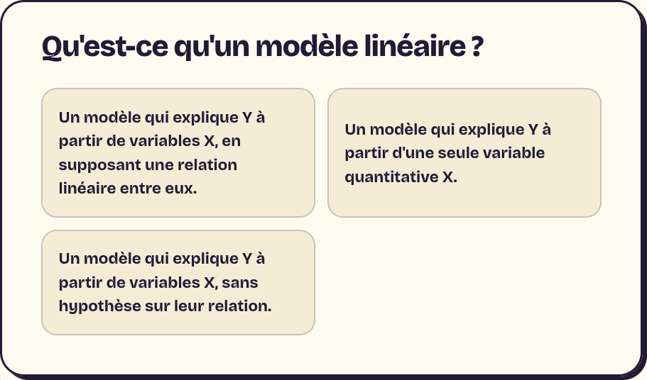
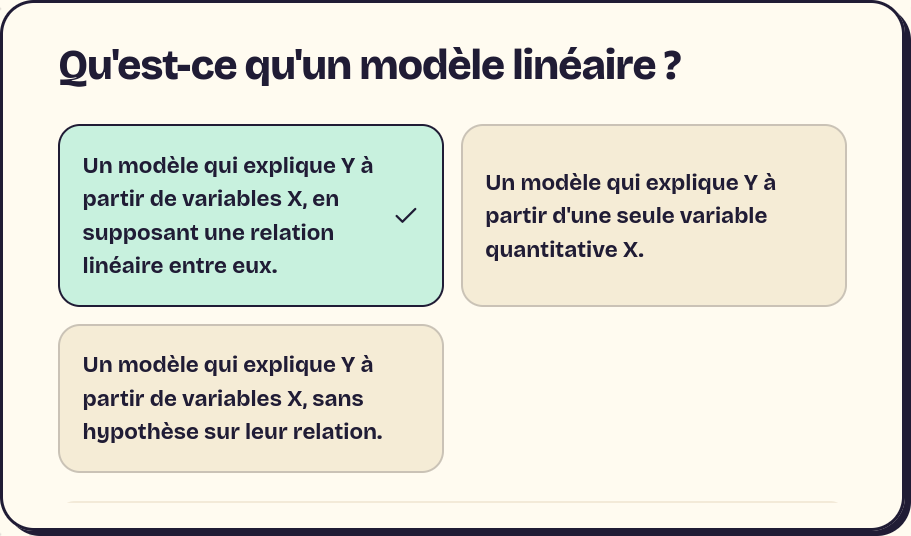
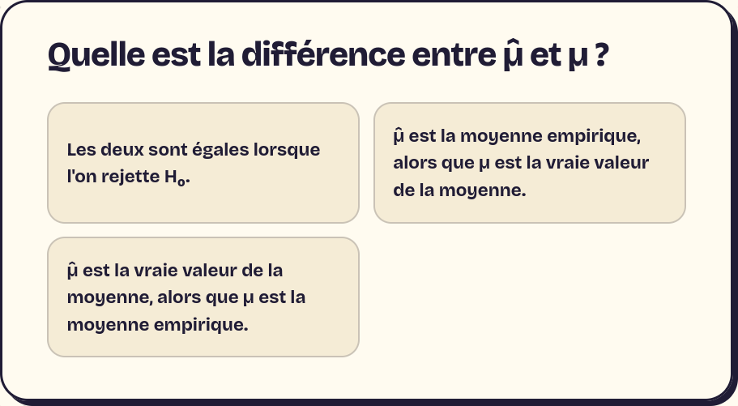
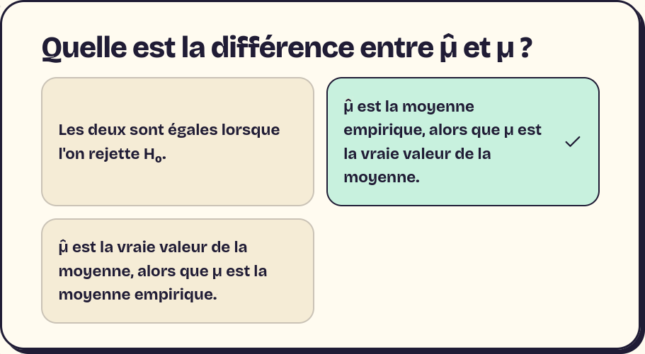
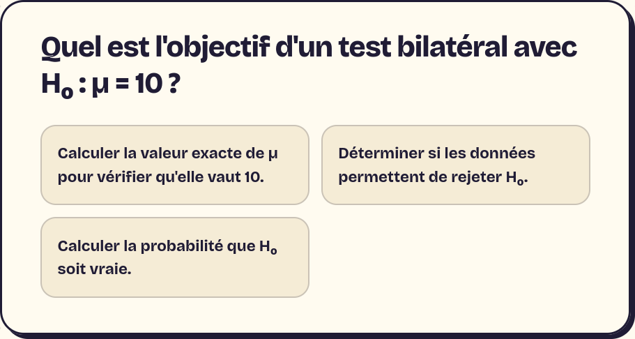
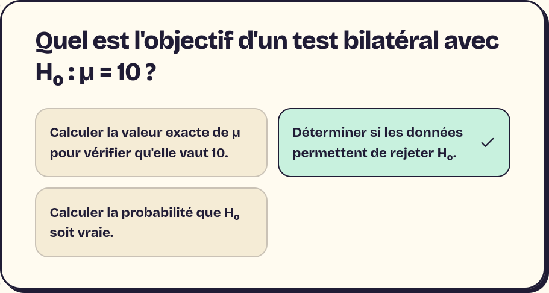
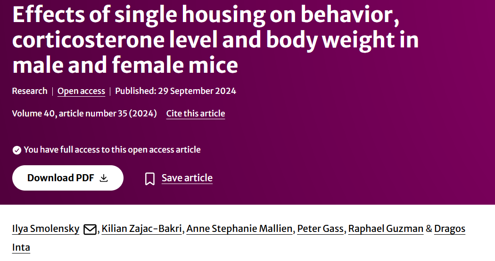
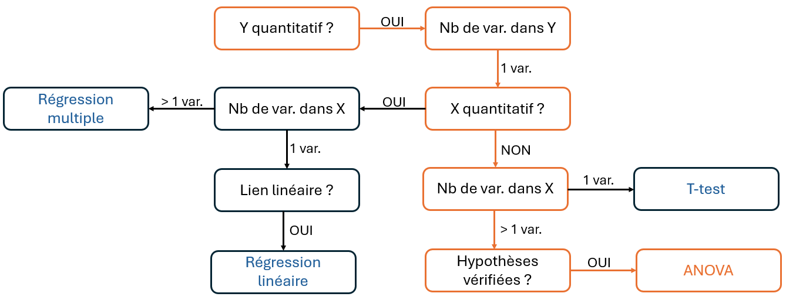

```{r setup}

library(readxl)
library(ggplot2)
library(tidyr)
library(plotly)
library(dplyr)
library(patchwork)
library(car)
```

## 🧩 Positionnement du cours dans le module

```{=html}
<br>
<br>
<div style="height:45px;"></div>
```

- Modèle linéaire simple

```{=html}
<div style="height:5px;"></div>
```

- Modèle linéaire multiple

```{=html}
<div style="height:5px;"></div>
```

- Intervalles de confiance et de fluctuation

```{=html}
<div style="height:5px;"></div>
```

- Tests d'hypothèses

. . .

```{=html}
<div style="height:5px;"></div>
```

$\longrightarrow$ **Analyse de variance (ANOVA) à 1 et 2 facteurs**

## 💭 Avant de commencer - Quiz 1

::::: r-stack
::: {.fragment fragment-index="0"}
{fig-align="center" width="80%"}
:::

::: {.fragment fragment-index="1"}
{fig-align="center" width="80%"}
:::
:::::

::: {.highlight-box .fragment fragment-index="1" style="margin-top:0;"}
Un modèle linéaire explique une variable réponse $Y$ à partir de variables explicatives $X$, en supposant une relation linéaire.
:::


## 💭 Avant de commencer - Quiz 2

::::: r-stack
::: {.fragment fragment-index="1"}
{fig-align="center" width="80%"}
:::

::: {.fragment fragment-index="2"}
{fig-align="center" width="80%"}
:::
:::::

::: {.highlight-box .fragment fragment-index="2" style="margin-top:0; padding:5px 30px;"}
Soit $Y = (y_1, ..., y_N)$ un vecteur de données.

<ul style="margin:0;">

<li style="margin:0;">

$\mu$ est la *vraie* valeur de la moyenne

</li>

<li style="margin:0;">

$\hat{\mu}$ est une *estimation* de la valeur de la moyenne, telle que $\hat{\mu} = \frac{1}{N} \sum_\limits{i = 1}^N y_i$.

</li>

</ul>
:::

## 💭 Avant de commencer - Quiz 3

::::: r-stack
::: {.fragment fragment-index="1"}
{fig-align="center" width="80%"}
:::

::: {.fragment fragment-index="2"}
{fig-align="center" width="80%"}
:::
:::::

::: {.highlight-box .fragment fragment-index="2" style="margin-top:0;"}
Le test permet de déterminer si les données apportent suffisamment d'éléments pour rejeter $H_0$ au profit de $\mu\neq10$.
:::

## 💭 Avant de commencer - Rappels sur les tests

```{=html}
<div style="height:5px;"></div>
```

> Observer les différences entre les groupes ne suffit pas : un [test d'hypothèse]{.smallcaps} permet de déterminer si elles sont significatives.

. . .

```{=html}
<div style="height:15px;"></div>
```

::: {style="border: 2px solid #D9E1F2; border-radius: 25px; background: white; box-shadow: 0 2px 8px rgba(100,120,150,0.10); overflow: hidden; padding: 20px;font-size: 0.75em;padding-top: 1px;padding-bottom: 5px;"}
[[Hypothèses (test bilatéral):]{.underline}]{.smallcaps}

$$\small H_0:\mu= 10 \qquad\qquad\qquad H_1:\mu\neq 10$$
:::

```{=html}
<div style="height:20px;"></div>
```

::::::::: columns
:::: {.column width="33%"}
::: {style="border: 2px solid #D9E1F2; border-radius: 25px; background: white; box-shadow: 0 2px 8px rgba(100,120,150,0.10); overflow: hidden; padding: 20px;font-size: 0.75em;padding-top: 1px;padding-bottom: 5px;"}
[[erreurs :]{.underline}]{.smallcaps}

```{=html}
<div style="height:22.75px;"></div>
```

|   | **Ne pas rejeter** $\small H_0$ | **Rejeter** $\small H_0$ |
|--------------------|--------------------------|--------------------------|
| $\small H_0$ **vraie** | ✅ Bonne décision | ❌ **Type I :** $\small \alpha$ |
| $\small H_0$ **fausse** | ❌ **Type II :** $\small \beta$ | ✅ Bonne décision |

$$\small    \alpha    =        P(\text{rejeter }H_0\mid H_0\text{ vraie})$$

$$\small    \beta    =        P(\text{ne pas rejeter }H_0\mid H_0\text{ fausse})$$
:::
::::

:::: {.column width="33%"}
::: {style="border: 2px solid #D9E1F2; border-radius: 25px; background: white; box-shadow: 0 2px 8px rgba(100,120,150,0.10); overflow: hidden; padding: 20px;font-size: 0.75em;padding-top:1px;padding-bottom: 5px;"}
[[Statistique de test :]{.underline}]{.smallcaps}

```{=html}
<div style="height:0.03px;"></div>
```

$$\small T = \frac{\bar X-\mu_0}{s/\sqrt n}$$

> La statistique de test mesure l'écart à $\small H_0$ relativement à la variabilité de l'estimation.

$$\small H_0 \quad \Longrightarrow \quad T\sim\mathcal{t}_{n-1}$$
:::
::::

:::: {.column width="33%"}
::: {style="border: 2px solid #D9E1F2; border-radius: 25px; background: white; box-shadow: 0 2px 8px rgba(100,120,150,0.10); overflow: hidden; padding: 20px;font-size: 0.75em;padding-top: 1px;padding-bottom: 5px;"}
[[p-value et décision :]{.underline}]{.smallcaps}

```{=html}
<div style="height:0.014px;"></div>
```

$$\small p = P_{H_0} \left( |T|\geq |T_{\mathrm{obs}}| \right)$$

> La p-valeur est le plus petit risque pour lequel on rejetterait $\small H_0$.

$$
\small
\begin{cases}
p < \alpha & \Longrightarrow \text{rejet de } H_0\\
p \geq \alpha & \Longrightarrow \text{non-rejet de } H_0
\end{cases}
$$
:::
::::
:::::::::

## 💭 Avant de commencer - Combien de temps passez-vous sous la douche ?

::::: columns
::: {.column width="50%"}
{fig-align="center" width="100%"}
:::

::: {.column .fragment width="50%" style="margin-top: 5%;"}
```{r}

#| echo: false
#| message: false
#| warning: false

library(dplyr)
library(plotly)

# Données
df <- data.frame(
  Cheveux = rep(c("Court", "Mi-long", "Long"), each = 10),
  Chant = rep(rep(c("Non", "Oui"), each = 5), 3),
  Temps = c(
     4,  5,  6,  7,  8,  # Court × Non
     7,  9, 10, 11, 13,  # Court × Oui
     6,  8,  9, 10, 12,  # Mi-long × Non
    10, 12, 14, 16, 18,  # Mi-long × Oui
     8, 10, 12, 14, 16,  # Long × Non
    17, 19, 22, 24, 28   # Long × Oui
  )
) %>%
  mutate(
    Cheveux = factor(
      Cheveux,
      levels = c("Court", "Mi-long", "Long")
    ),
    Chant = factor(Chant, levels = c("Non", "Oui")),
    Groupe = paste(Cheveux, Chant, sep = " × ")
  )

# Groupes
groupes_cheveux <- c("Court", "Mi-long", "Long")

groupes_chant <- c("Non", "Oui")

groupes_interaction <- c(
  "Court × Non",
  "Court × Oui",
  "Mi-long × Non",
  "Mi-long × Oui",
  "Long × Non",
  "Long × Oui"
)

# Fonction pour ajouter les boxplots
ajouter_boxplots <- function(p, variable, groupes, visible) {

  for (g in groupes) {

    d <- df[df[[variable]] == g, ]

    p <- p %>%
      add_trace(
        x = rep(g, nrow(d)),
        y = d$Temps,
        type = "box",
        boxpoints = "all",
        jitter = 0.15,
        pointpos = 0,
        marker = list(color = "#0072B2", size = 9),
        line = list(color = "#0072B2"),
        name = g,
        visible = visible,
        hovertemplate = paste0(
          g, "<br>Temps : %{y} min<extra></extra>"
        )
      )
  }

  p
}

# Graphique
p <- plot_ly()

p <- ajouter_boxplots(p, "Cheveux", groupes_cheveux, TRUE)
p <- ajouter_boxplots(p, "Chant", groupes_chant, FALSE)
p <- ajouter_boxplots(p, "Groupe", groupes_interaction, FALSE)

# Menu déroulant
p <- p %>%
  layout(
    updatemenus = list(list(
      type = "dropdown",
      x = 0.65,
      y = 0.99,
      xanchor = "left",
      yanchor = "top",
      buttons = list(
        list(
          label = "Cheveux",
          method = "update",
          args = list(
            list(visible = c(
              rep(TRUE, 3),
              rep(FALSE, 8)
            )),
            list(xaxis = list(
              title = "",
              categoryorder = "array",
              categoryarray = groupes_cheveux,
              tickangle = 0
            ))
          )
        ),
        list(
          label = "Chant",
          method = "update",
          args = list(
            list(visible = c(
              rep(FALSE, 3),
              rep(TRUE, 2),
              rep(FALSE, 6)
            )),
            list(xaxis = list(
              title = "",
              categoryorder = "array",
              categoryarray = groupes_chant,
              tickangle = 0
            ))
          )
        ),
        list(
          label = "Cheveux × Chant",
          method = "update",
          args = list(
            list(visible = c(
              rep(FALSE, 5),
              rep(TRUE, 6)
            )),
            list(xaxis = list(
              title = "",
              categoryorder = "array",
              categoryarray = groupes_interaction,
              tickangle = -45
            ))
          )
        )
      )
    )),
    xaxis = list(
      title = "",
      categoryorder = "array",
      categoryarray = groupes_cheveux
    ),
    yaxis = list(
      title = "Temps sous la douche (min)",
      range = c(0, 35),
      dtick = 5
    ),
    showlegend = FALSE,
    margin = list(t = 30, b = 90, l = 65, r = 20),
    boxgap = 0,
    width = 500
  )

p
```
:::
:::::

## 🔍 Introduction : L'ANOVA, qu'est-ce que c'est ?

```{=html}
<div style="height:20px;"></div>
```

> L'[analyse de variance]{.smallcaps} (ANOVA) permet de déterminer l'influence de $k$ modalités d'une ou plusieurs variables explicatives (appelées [facteurs]{.smallcaps}) sur la moyenne d'une variable quantitative à expliquer $Y$.

```{=html}
<div style="height:35px;"></div>
```

. . .

| Questions de recherche | Facteur(s) {modalités} | $Y$ = variable expliquée |
|----------------------------|----------------------------|----------------|
| L'espérance de vie d'un animal diffère-t-elle selon son sexe ? | Sexe {M stérilisé ou non / F stérilisé ou non} | Espérance de vie |
| Le type d'alimentation et le médicament donné influencent-ils la durée de guérison de l'animal ? | Type d'alimentation {granules, foin, ...} & Médicament {A, B} | Durée de guérison |
| La ville et le quartier ont-ils un effet sur le prix d'un logement ? | Ville {Montpellier, Paris, Toulouse} & Type de quartier {Hyper-centre, Universités, Périphérie} | Prix du logement |

. . .

```{=html}
<div style="height:25px;"></div>
```

::: callout-note
L'objectif de l'ANOVA est de comparer les moyennes de $Y$ pour chacun des groupes ($=$ facteur $\times$ modalité) afin de voir si les facteurs étudiés ont une influence sur $Y$.
:::

## 🔍 Introduction : L'ANOVA, qu'est-ce que c'est ?

```{=html}
<div style="height:20px;"></div>
```

> L'[analyse de variance]{.smallcaps} (ANOVA) permet de déterminer l'influence de $k$ modalités d'une ou plusieurs variables explicatives (appelées [facteurs]{.smallcaps}) sur la moyenne d'une variable quantitative à expliquer $Y$.

```{=html}
<div style="height:35px;"></div>
```

::: {style="text-align: center;"}
*« Je m'intéresse au comportement social des souris. J'ai constitué plusieurs groupes de souris, mâles et femelles, vivant seules ou en communauté, et j'ai mesuré le temps qu'elles passent en contact avec leurs congénères. Comment comprendre ce qui influence leur comportement social ? »*
:::

```{=html}
<div style="height:10px;"></div>
```

<table>
  <thead>
    <tr>
      <th>Facteur</th>
      <th>Modalité</th>
      <th>Variable expliquée $Y$</th>
    </tr>
  </thead>
  <tbody>
    <tr>
      <td rowspan="2" class="fragment" data-fragment-index="2" style="vertical-align: middle;">Sexe</td>
      <td class="fragment" data-fragment-index="3" style="vertical-align:middle; border-left: 1px dashed lightgray;">Femelle</td>
      <td rowspan="4" style="vertical-align:middle; text-align:center; border-left: 1px solid lightgray" class="fragment" data-fragment-index="1">
        Durée de contact avec les congénères
      </td>
    </tr>
    <tr>
      <td class="fragment" data-fragment-index="3" style="vertical-align:middle; border-left: 1px dashed lightgray;">Mâle</td>
    </tr>
    <tr>
      <td rowspan="2" class="fragment" data-fragment-index="4" style="vertical-align: middle;">Type d'hébergement</td>
      <td class="fragment" data-fragment-index="5" style="vertical-align:middle; border-left: 1px dashed lightgray;">Seule</td>
    </tr>
    <tr>
      <td class="fragment" data-fragment-index="5" style="vertical-align:middle; border-left: 1px dashed lightgray; border-bottom: 1px solid;">En communauté</td>
    </tr>
  </tbody>
</table>


## 🐁 Application : Présentation des données

```{=html}
<div style="height:5px;"></div>
```

[[Jeu de données utilisé :]{.underline}]{.smallcaps} Sexe, habitat et durée de contact avec des congénères de $40$ souris, collectés à l'Université de Bâle (Suisse) [@smolensky2024].

. . .

:::::::: columns
:::: {.column width="61%"}
```{=html}
<div style="height:30px;"></div>
```

- $Y =$ Durée de contact avec leurs congénères

::: fragment
- Facteurs :
  - *Housing* $=$ Type d'hébergement à $2$ modalités
  - *Sex* $=$ Sexe à $2$ modalités

| Facteur | Modalité | Définition | Nb. d'individus |
|:---|:---|:---|:---:|
| *Housing* (H) | *Group*  | Souris vivant en communauté | 20 |
| *Housing* (H) | *Single*  | Souris vivant seule | 20 |
| *Sex*   (S) | *Male*  | Souris mâle | 20 |
| *Sex*  (S) | *Female* | Souris femelle | 20 |
:::
::::

::::: {.column width="39%"}
:::: columns
```{=html}
<div style="height:43px;"></div>
```

::: fragment
```{r}
#| echo: false
#| message: false
#| warning: false

data_mice <- read_excel("data_mice.xlsx", sheet = "Social interaction")

### ON COMPLETE LES DONNES
data_mice$Sex[c(2:20)] <- "Male"
data_mice$Sex[c(22:40)] <- "Female"

data_mice$Housing[c(2:10, 22:30)] <- "Group"
data_mice$Housing[c(12:20, 32:40)] <- "Single"

data_mice <- data_mice %>%
  mutate(
    Sex = dplyr::recode(Sex,
                 "Female" = "Femelle",
                 "Male" = "Mâle"),
    Housing = dplyr::recode(Housing,
                     "Group" = "Groupe",
                     "Single" = "Seul.e")
  ) %>%
  mutate(
    Sex = factor(Sex, levels = c("Mâle", "Femelle")),
    Housing = factor(Housing, levels = c("Groupe", "Seul.e"))
  ) %>%
  dplyr::select(Mouse, Sex, Housing, contact_time)

colors_groups <- c(
  "Mâle" = "#009E73",          # vert
  "Femelle" = "#E69F00",        # orange
  "Groupe" = "#0072B2",  # bleu
  "Seul.e" = "#CC79A7"  # violet
)

knitr::kable(data_mice[c(20:23, 17:19, 38:40), ])
```
:::
::::
:::::
::::::::

## 🐁 Application : Question de recherche

:::: center-text
::: highlight-box
**Le sexe et le type d'hébergement des souris ont-ils un effet sur la durée de leurs interactions sociales ? La différence entre les mâles et les femelles dépend-elle du type d'habitat ?**
:::
::::

## 📖 Objectifs du cours

```{=html}

<div style="height:30px;"></div>

<ol style="margin:0;">

  <li style="margin-bottom:35px;">
    Comment tester les effets d'un seul facteur ?
    <ul style="margin-left:40px;">
      <li>L'intuition derrière l'ANOVA</li>
      <li>Définition et conduite de l'ANOVA à 1 facteur</li>
    </ul>
  </li>

  <li class="fragment" style="margin-bottom:35px;">
    Comment tester l'interaction entre deux facteurs ? (ANOVA à 2 facteurs)
    <ul style="margin-left:40px;">
      <li>Pourquoi tester l'interaction ?</li>
      <li>Définition et conduite de l'ANOVA à 2 facteurs</li>
    </ul>
  </li>

  <li class="fragment" style="margin-bottom:35px;">
    Quelles sont les hypothèses à vérifier avant de réaliser une ANOVA ?
  </li>

  <li class="fragment" style="margin-bottom:35px;">
    Application aux données de souris avec R
  </li>

  <li class="fragment">
    Bonus, Exemple de contributions en sciences vétérinaires &amp; Conclusion
  </li>

</ol>
```

## 📖 Objectifs du cours

```{=html}

<div style="height:30px;"></div>

<ol style="margin:0;">

  <li style="margin-bottom:35px; color:black;">
    <strong>Comment tester les effets d'un seul facteur ?</strong>
    <ul style="margin-left:40px; font-weight:normal;">
      <li>L'intuition derrière l'ANOVA</li>
      <li>Définition et conduite de l'ANOVA à 1 facteur</li>
    </ul>
  </li>

  <li style="margin-bottom:35px; color:#A1A1AA;">
    Comment tester l'interaction entre deux facteurs ? (ANOVA à 2 facteurs)
    <ul style="margin-left:40px;">
      <li>Pourquoi tester l'interaction ?</li>
      <li>Définition et conduite de l'ANOVA à 2 facteurs</li>
    </ul>
  </li>

  <li style="margin-bottom:35px; color:#A1A1AA;">
    Quelles sont les hypothèses à vérifier avant de réaliser une ANOVA ?
  </li>

  <li style="margin-bottom:35px; color:#A1A1AA;">
    Application aux données de souris avec R
  </li>

  <li style="color:#A1A1AA;">
    Bonus, Exemple de contributions en sciences vétérinaires &amp; Conclusion
  </li>

</ol>
```

## 1️⃣ Notations

[[**Nombre de modalités par facteur :**]{.underline}]{.smallcaps} 

- $N = 40$ : nombre total d'observations. 

- $N_H=2$ : nombre de modalités du facteur *Housing* et $N_S=2$ : nombre de modalités du facteur *Sex*.

```{=html}
<div style="height:20px;"></div>
```

::::: columns
::: {.column width="50%"}
[[**Moyennes théoriques (population) :**]{.underline}]{.smallcaps}

- $\mu^H_i$ : moyenne pour la $i$^ème^ modalité de *Housing*.

- $\mu^S_j$ : moyenne pour la $j$^ème^ modalité de *Sex*.

- $\mu$ : moyenne globale.

$$
\mu = \frac{1}{N_H+N_S}
\left(
\sum_{i=1}^{N_H}\mu_i^H
+
\sum_{j=1}^{N_S}\mu_j^S
\right)
$$
:::

::: {.column width="50%"}
[[**Moyennes empiriques (échantillon) :**]{.underline}]{.smallcaps}

- $\widehat{\mu}^H_i$ : moyenne empirique pour la $i$^ème^ modalité de *Housing*.

- $\widehat{\mu}^S_j$ : moyenne empirique pour la $j$^ème^ modalité de *Sex*.

- $\widehat{\mu}$ : moyenne globale empirique.

$$
\widehat{\mu} = \frac{1}{N_H+N_S}
\left(
\sum_{i=1}^{N_H}\widehat{\mu}_i^H
+
\sum_{j=1}^{N_S}\widehat{\mu}_j^S
\right)
$$
:::
:::::

## 1️⃣ Introduction à l'ANOVA à 1 facteur - Intuition

```{=html}
<div style="height:2px;"></div>
```

[[Questions :]{.underline}]{.smallcaps}

- Y a-t-il un effet du sexe sur la durée de contact ?
- Y a-t-il un effet de l'hébergement sur la durée de contact ?

```{r}
#| echo: false
#| message: false
#| warning: false
#| include: false


# Couleurs adaptées aux nouvelles modalités
colors_groups <- c(
  "Mâle" = "#0072B2",
  "Femelle" = "#E69F00",
  "Groupe" = "#009E73",
  "Seul.e" = "#CC79A7"
)

# 1. Sexe
p_sex <- ggplot(
  data_mice,
  aes(x = Sex, y = contact_time, fill = Sex)
) +
  geom_boxplot(width = 0.6, alpha = 0.5, outlier.shape = NA) +
  geom_jitter(
    aes(colour = Sex),
    width = 0.12, size = 3, alpha = 0.7
  ) +
  stat_summary(
    fun = mean, geom = "point",
    shape = 18, size = 4, colour = "black"
  ) +
  scale_fill_manual(values = colors_groups) +
  scale_colour_manual(values = colors_groups) +
  labs(title = "Sexe", x = NULL, y = "Durée de contact") +
  theme_minimal(base_size = 24) +
  theme(legend.position = "none")


# 2. Hébergement
p_housing <- ggplot(
  data_mice,
  aes(x = Housing, y = contact_time, fill = Housing)
) +
  geom_boxplot(width = 0.6, alpha = 0.5, outlier.shape = NA) +
  geom_jitter(
    aes(colour = Housing),
    width = 0.12, size = 3, alpha = 0.7
  ) +
  stat_summary(
    fun = mean, geom = "point",
    shape = 18, size = 4, colour = "black"
  ) +
  scale_fill_manual(values = colors_groups) +
  scale_colour_manual(values = colors_groups) +
  labs(title = "Hébergement", x = NULL, y = NULL) +
  theme_minimal(base_size = 24) +
  theme(legend.position = "none")


# 3. Sexe × Hébergement
p_interaction <- ggplot(
  data_mice,
  aes(x = Housing, y = contact_time, fill = Sex)
) +
  geom_boxplot(
    position = position_dodge(width = 0.8),
    width = 0.65, alpha = 0.5,
    outlier.shape = NA
  ) +
  geom_point(
    aes(colour = Sex),
    position = position_jitterdodge(
      jitter.width = 0.12,
      dodge.width = 0.8
    ),
    size = 3, alpha = 0.7
  ) +
  stat_summary(
    fun = mean, geom = "point",
    shape = 18, size = 4, colour = "black",
    position = position_dodge(width = 0.8)
  ) + guides(
  fill = "none",
  colour = guide_legend(
    title = NULL,
    override.aes = list(size = 5, alpha = 1)
  )
) +
  scale_fill_manual(values = colors_groups) +
  scale_colour_manual(values = colors_groups, guide = "none") +
  labs(
    title = "Sexe × Hébergement",
    x = NULL, y = NULL, fill = "Sexe"
  ) +
  theme_minimal(base_size = 24) +
  theme(legend.position = "bottom")


```

::::: columns
::: {.column width="50%"}
```{r}
#| echo: false
#| fig-height: 3.5
#| fig-width: 3.75
#| fig-align: center

p_sex
```
:::

::: {.column width="50%"}
```{r}
#| echo: false
#| fig-height: 3.5
#| fig-width: 3.75
#| fig-align: center

p_housing
```
:::
:::::

. . .

::: {.small-box style="margin-top: -17px;"}
**Les moyennes entre les groupes sont toutes différentes, mais est-ce suffisant pour conclure à un effet ?**
:::

## 1️⃣ Pourquoi parle-t-on d'analyse de variance ?

```{=html}
<div style="height:2px;"></div>
```

> Pourquoi observer des différences entre les moyennes ne suffit-il pas pour conclure à un effet du facteur ?

. . .

```{r}
#| echo: false
#| message: false
#| warning: false
#| fig-width: 10
#| fig-height: 4

set.seed(123)

n <- 25

# Génération de données de moyenne fixée
simuler <- function(mu, sigma) {
  z <- rnorm(n)
  mu + sigma * as.numeric(scale(z))
}

# Construction des données
creer_donnees <- function(sigma, mu_julien) {
  data.frame(
    Groupe = factor(
      rep(c("G1", "G2"), each = n, times = 2),
      levels = c("G1", "G2")
    ),
    Personne = rep(c("Inès", "Julien"), each = 2*n),
    Y = c(
      simuler(8, sigma),
      simuler(12, sigma),
      simuler(mu_julien[1], sigma),
      simuler(mu_julien[2], sigma)
    )
  )
}

# Forte variabilité
data_forte <- creer_donnees(
  sigma = 3.5,
  mu_julien = c(11, 9)
)

# Faible variabilité
data_faible <- creer_donnees(
  sigma = 0.8,
  mu_julien = c(8.2, 12.2)
)

# Fonction graphique
plot_variabilite <- function(data) {

  data <- data %>%
    mutate(
      x = as.numeric(Groupe),
      x_jitter = x + runif(n(), -0.18, 0.18)
    )

  p <- plot_ly()

  # Observations
  for (pers in c("Inès", "Julien")) {

    d <- filter(data, Personne == pers)

    p <- add_markers(
      p,
      x = d$x_jitter,
      y = d$Y,
      name = pers,
      marker = list(
        color = ifelse(
          pers == "Inès",
          "#0072B2", "#E69F00"
        ),
        size = 8,
        opacity = 0.6
      ),
      visible = pers == "Inès",
      showlegend = FALSE,
      hoverinfo = "skip"
    )
  }

  # Moyennes avant et après ajout des données
  for (ajout in c(FALSE, TRUE)) {

    d <- if (ajout) {
      data
    } else {
      filter(data, Personne == "Inès")
    }

    moyennes <- d %>%
      group_by(Groupe) %>%
      summarise(
        x = first(x),
        mu_hat = mean(Y),
        .groups = "drop"
      ) %>%
      mutate(
        label = paste0(
          "$\\widehat{\\mu}_{", x, "} = ",
          sprintf("%.1f", mu_hat),
          "$"
        )
      )

    # Traits horizontaux
    for (j in seq_len(nrow(moyennes))) {

      m <- moyennes[j, ]

      p <- add_segments(
        p,
        x = m$x - 0.25,
        xend = m$x + 0.25,
        y = m$mu_hat,
        yend = m$mu_hat,
        line = list(
          color = "black",
          width = 3
        ),
        visible = !ajout,
        showlegend = FALSE,
        hoverinfo = "skip"
      )
    }

    # Valeurs des moyennes
    p <- add_text(
      p,
      x = moyennes$x + 0.30,
      y = moyennes$mu_hat,
      text = moyennes$label,
      textposition = "middle right",
      textfont = list(
        size = 18,
        color = "black"
      ),
      visible = !ajout,
      showlegend = FALSE,
      hoverinfo = "skip"
    )
  }

  p %>%
    layout(
      xaxis = list(
        title = "Groupe",
        tickmode = "array",
        tickvals = c(1, 2),
        ticktext = c("G1", "G2"),
        range = c(0.5, 2.9),
        fixedrange = TRUE
      ),
      yaxis = list(
        title = "Y",
        range = c(0, 25),
        dtick = 5,
        fixedrange = TRUE
      )
    )
}

# Construction des deux graphiques
p1 <- plot_variabilite(data_forte)
p2 <- plot_variabilite(data_faible)

# Visibilité des traces
vis_ines <- rep(
  c(TRUE, FALSE, TRUE, TRUE, TRUE,
    FALSE, FALSE, FALSE),
  2
)

vis_julien <- rep(
  c(TRUE, TRUE, FALSE, FALSE, FALSE,
    TRUE, TRUE, TRUE),
  2
)

# Graphique interactif
subplot(
  p1, p2,
  nrows = 1,
  shareY = TRUE,
  titleX = TRUE,
  titleY = TRUE,
  margin = 0.06
) %>%
  layout(

   annotations = list(
    list(
      text = "<b>Forte variabilité</b>",
      x = 0.5,
      y = 1.06,
      xref = "x domain",
      yref = "paper",
      xanchor = "center",
      showarrow = FALSE,
      font = list(size = 20)
    ),
    list(
      text = "<b>Faible variabilité</b>",
      x = 0.5,
      y = 1.06,
      xref = "x2 domain",
      yref = "paper",
      xanchor = "center",
      showarrow = FALSE,
      font = list(size = 20)
    )
  ),

    updatemenus = list(list(
      type = "buttons",
      direction = "right",
      x = 0.5,
      xanchor = "center",
      y = 1.20,
      yanchor = "bottom",
      buttons = list(
        list(
          label = "50 mesures d'Inès",
          method = "restyle",
          args = list("visible", vis_ines)
        ),
        list(
          label = "+ 50 mesures de Julien",
          method = "restyle",
          args = list("visible", vis_julien)
        )
      )
    )),

    font = list(size = 16),
    showlegend = FALSE,
    margin = list(
      t = 80,
      b = 45,
      l = 55,
      r = 15
    )
  ) %>%
  config(
    displayModeBar = FALSE,
    mathjax = "cdn"
  )
```

::: {style="font-size:0.65em; text-align:center;"}
[● Mesures d'Inès]{style="color:#0072B2;"}     [● Mesures de Julien]{style="color:#E69F00;"}
:::

```{=html}
<div style="height:2px;"></div>
```

. . .

::: callout-warning
[**Comparer uniquement les moyennes ne suffit pas,**]{.smallcaps} il faut également prendre en compte la [variabilité des observations au sein des groupes]{.smallcaps}.
:::

## 1️⃣ L'ANOVA à 1 facteur : Un test d'hyp. - Définition

```{=html}
<div style="height:30px;"></div>
```

ANOVA à 1 facteur

: L'[ANOVA à un facteur]{.smallcaps} est une méthode statistique reposant sur un test d'hypothèses pour déterminer si un facteur a un effet significatif sur la variable étudiée.

```{=html}
<div style="height:25px;"></div>
```

::: {style="border: 2px solid #D9E1F2; border-radius: 25px; background: white; box-shadow: 0 2px 8px rgba(100,120,150,0.10); overflow: hidden; padding: 20px;font-size: 0.75em;padding-top: 1px;padding-bottom: 5px;"}
[[Hypothèses :]{.underline}]{.smallcaps}

$$
\small
\begin{aligned}
\text{Housing :}\qquad
H_0^H &: \mu_1^H=\mu_2^H
\qquad H_1^H : \mu_1^H\neq\mu_2^H\\[8pt]
\text{Sex :}\qquad
H_0^S &: \mu_1^S=\mu_2^S
\qquad H_1^S : \mu_1^S\neq\mu_2^S
\end{aligned}
$$
:::

```{=html}
<div style="height:10px;"></div>
```

::::::::: columns
:::: {.column width="33%"}
::: {style="border: 2px solid #D9E1F2; border-radius: 25px; background: white; box-shadow: 0 2px 8px rgba(100,120,150,0.10); overflow: hidden; padding: 20px;font-size: 0.75em;padding-top: 1px;padding-bottom: 5px;"}
[[erreurs :]{.underline}]{.smallcaps}

$$\small \alpha = P(\text{rejeter }H_0\mid H_0\text{ vraie})$$

$$\small \beta = P(\text{ne pas rejeter }H_0\mid H_0\text{ fausse})$$
:::
::::

:::: {.column width="33%"}
::: {style="border: 2px solid #D9E1F2; border-radius: 25px; background: white; box-shadow: 0 2px 8px rgba(100,120,150,0.10); overflow: hidden; padding: 20px;font-size: 0.75em;padding-top:1px;padding-bottom: 5px;"}
[[Statistique de test :]{.underline}]{.smallcaps}

```{=html}
<div style="height:0.03px;"></div>
```

$$
\small F= \frac{\text{variabilité entre les groupes}}
{\text{variabilité au sein des groupes}}
$$

$$
\small
\begin{aligned}
H_0^H &\Longrightarrow F_H\sim\mathcal{F}_{N_H-1,N-N_H}\\
H_0^S &\Longrightarrow F_S\sim\mathcal{F}_{N_S-1,N-N_S}
\end{aligned}
$$
:::
::::

:::: {.column width="33%"}
::: {style="border: 2px solid #D9E1F2; border-radius: 25px; background: white; box-shadow: 0 2px 8px rgba(100,120,150,0.10); overflow: hidden; padding: 20px;font-size: 0.75em;padding-top: 1px;padding-bottom: 5px;"}
[[p-value et décision :]{.underline}]{.smallcaps}

```{=html}
<div style="height:0.014px;"></div>
```

$$\small p = P_{H_0} \left( F \geq F_{\mathrm{obs}} \right)$$

$$
\small
\begin{cases}
p < \alpha & \Longrightarrow \text{rejet de } H_0\\
p \geq \alpha & \Longrightarrow \text{non-rejet de } H_0
\end{cases}
$$
:::
::::
:::::::::

## 1️⃣ Réaliser une ANOVA à 1 facteur

<br> <br>

```{=html}
<div style="height:35px;"></div>
```

[[**To Do :**]{.underline}]{.smallcaps}

1.  Définir les hypothèses

```{=html}
<div style="height:10px;"></div>
```

2.  Calculer la statistique de test

```{=html}
<div style="height:10px;"></div>
```

3.  Obtenir la p-value

```{=html}
<div style="height:10px;"></div>
```

4.  Quid du risque $\alpha$ ?

## 1️⃣ 1^ère^ étape : Définir les hypothèses

```{=html}
<div style="height:10px;"></div>
```

> L'[ANOVA à un facteur]{.smallcaps} permet de tester l'effet d'un seul facteur sur la variable étudiée. On étudie donc séparément l'effet de l'hébergement et celui du sexe.

```{=html}
<div style="height:15px;"></div>
```

[[Hypothèses testées :]{.underline}]{.smallcaps}

**Facteur *Housing* - Hébergement :**

$$
H_0^H : \mu_1^H=\mu_2^H
\qquad \text{vs.} \qquad
H_1^H : \mu_1^H\neq\mu_2^H
$$

::: {style="font-size: 0.85em;"}
- $H_0^H$ : la durée moyenne de contact est la même pour les souris hébergées en groupe ou seules.
- $H_1^H$ : la durée moyenne de contact n'est pas la même selon le type d'hébergement.
:::

. . .

**Facteur *Sex* - Sexe :**

$$
H_0^S : \mu_1^S=\mu_2^S
\qquad \text{vs.} \qquad
H_1^S : \mu_1^S\neq\mu_2^S
$$

::: {style="font-size: 0.85em;"}
- $H_0^S$ : la durée moyenne de contact est la même chez les mâles et les femelles.
- $H_1^S$ : la durée moyenne de contact n'est pas la même selon le sexe.
:::

## 1️⃣ 2^ème^ étape : Décomposer la variabilité des observations

```{=html}
<div style="height:1px;"></div>
```

> Les observations varient à la fois **entre les groupes** et **au sein de chaque groupe**.

::: grande-fig
```{r}
#| echo: false
#| message: false
#| warning: false
#| fig-height: 5
#| fig-width: 12
#| fig-align: center
#| out-width: "100%"

data_var <- data_mice %>%
  filter(!is.na(Housing), !is.na(contact_time)) %>%
  group_by(Housing) %>%
  mutate(
    moyenne_groupe = mean(contact_time),
    x_groupe = as.numeric(Housing),
    x = x_groupe + seq(-0.22, 0.22, length.out = n())
  ) %>%
  ungroup()

moyenne_globale <- mean(data_var$contact_time)

moyennes <- data_var %>%
  distinct(Housing, x_groupe, moyenne_groupe) %>%
  mutate(
    label = paste0("hat(mu)[", x_groupe, "]^H")
  )

ggplot() +

  # Moyenne globale
  geom_hline(
    yintercept = moyenne_globale,
    linetype = "dashed",
    colour = "grey35",
    linewidth = 1.2
  ) +

  # Écarts entre moyennes des groupes et moyenne globale
  geom_segment(
    data = moyennes,
    aes(
      x = x_groupe,
      xend = x_groupe,
      y = moyenne_globale,
      yend = moyenne_groupe
    ),
    colour = "#0072B2",
    linewidth = 2.5
  ) +

  # Écarts entre observations et moyennes des groupes
  geom_segment(
    data = data_var,
    aes(
      x = x,
      xend = x,
      y = moyenne_groupe,
      yend = contact_time
    ),
    colour = "#E69F00",
    linewidth = 0.9,
    alpha = 0.8
  ) +

  # Observations
  geom_point(
    data = data_var,
    aes(x = x, y = contact_time, colour = Housing),
    size = 3.5
  ) +

  # Moyennes des groupes
  geom_segment(
    data = moyennes,
    aes(
      x = x_groupe - 0.27,
      xend = x_groupe + 0.27,
      y = moyenne_groupe,
      yend = moyenne_groupe
    ),
    colour = "black",
    linewidth = 1.7
  ) +

  # Notations des moyennes des groupes
  geom_text(
    data = moyennes,
    aes(
      x = x_groupe + 0.30,
      y = moyenne_groupe,
      label = label
    ),
    parse = TRUE,
    hjust = 0,
    size = 14,
    colour = "black"
  ) +

  # Notation de la moyenne globale
  annotate(
    "text",
    x = 2.65,
    y = moyenne_globale-20,
    label = "hat(mu)",
    parse = TRUE,
    size = 14,
    colour = "grey35",
    vjust = -0.5
  ) +

  scale_colour_manual(
    values = colors_groups[c("Groupe", "Seul.e")]
  ) +

  scale_x_continuous(
    breaks = 1:2,
    labels = c("Groupe", "Seul.e"),
    limits = c(0.5, 2.8)
  ) +

  labs(
    title = "Effet du type d'hébergement",
    x = "Type d'hébergement",
    y = "Durée de contact"
  ) +

  theme_minimal(base_size = 28) +
theme(
  legend.position = "none",
  plot.title = element_text(
    size = 30,
    face = "bold",
    hjust = 0.5
  ),
  axis.title = element_text(size = 28),
  axis.text = element_text(size = 26)
)
```
:::

::: {style="font-size: 0.8em; text-align: center; margin-top:-45px;"}
[**bleu :**]{style="color:#0072B2;"} variabilité entre les groupes (*expliquée*) & [**orange :**]{style="color:#E69F00;"} variabilité au sein des groupes (*résiduelle*)
:::

. . .

```{=html}
<div style="height:2px;"></div>
```

::: small-box
L'ANOVA cherche à déterminer si la variabilité entre les groupes est importante par rapport à celle au sein des groupes.
:::

## 1️⃣ 3^ème^ étape : Variabilité expliquée par le facteur *Housing*

```{=html}
<div style="height:10px;"></div>
```

> On mesure les écarts entre les **moyennes des modalités** et la **moyenne globale**.

```{=html}
<div style="height:20px;"></div>
```

::::::::: columns
::::: {.column width="50%"}
::: {style="text-align:center; font-size:0.95em;"}
[[Effet du facteur *Housing* :]{.underline}]{.smallcaps}
:::

```{r}
#| echo: false
#| message: false
#| warning: false
#| fig-height: 5.6

data_H <- data_mice %>%
  filter(!is.na(Housing), !is.na(contact_time))

means_H <- data_H %>%
  group_by(Housing) %>%
  summarise(
    mu = mean(contact_time),
    n_H = n(),
    .groups = "drop"
  ) %>%
  mutate(
    x = as.numeric(Housing),
    label = paste0("hat(mu)[", x, "]^H")
  )

mu_global <- mean(data_H$contact_time)

ggplot(means_H, aes(x = x, y = mu)) +

  # Moyenne globale
  geom_hline(
    yintercept = mu_global,
    linetype = "dashed",
    colour = "grey40",
    linewidth = 1.1
  ) +

  # Écarts entre les moyennes
  geom_segment(
    aes(xend = x, y = mu_global, yend = mu),
    colour = "#0072B2",
    linewidth = 2.5
  ) +

  # Moyennes des modalités
  geom_point(
    colour = "#0072B2",
    size = 5
  ) +

  # Notations des moyennes des modalités
  geom_text(
    aes(x = x + 0.12, label = label),
    parse = TRUE,
    hjust = 0,
    size = 14,
    colour = "#0072B2"
  ) +

  # Notation de la moyenne globale
  annotate(
    "text",
    x = 2.45,
    y = mu_global,
    label = "hat(mu)",
    parse = TRUE,
    size = 14,
    colour = "grey40",
    vjust = -0.5
  ) +

  scale_x_continuous(
    breaks = 1:2,
    labels = c("Groupe", "Seul.e"),
    limits = c(0.5, 2.7)
  ) + 
  scale_y_continuous(
  expand = expansion(mult = c(0.20, 0.25))
) +

coord_cartesian(clip = "off") +

  labs(
    x = "Type d'hébergement",
    y = "Durée moyenne de contact"
  ) +

  theme_minimal(base_size = 28) +
  theme(
    axis.title = element_text(size = 26),
    axis.text = element_text(size = 28)
  )
```

::: {style="font-size:0.8em; text-align:center;"}
Plus les moyennes des modalités s'éloignent de la moyenne globale, plus la **variabilité expliquée** est importante.
:::
:::::

::::: {.column width="50%"}
. . .

::: {style="text-align:center; font-size:0.95em;"}
[[Calcul de la somme des carrés expliquée :]{.underline}]{.smallcaps}
:::

On note $n_i^H$ le nombre d'observations pour la $i$^ème^ modalité de *Housing*.

$$
\color{#0072B2}{
\boxed{
SC_H = \sum_{i=1}^{N_H}
n_i^H\left(\widehat{\mu}_i^H-\widehat{\mu}\right)^2
}
}
$$

```{=html}
<div style="height:15px;"></div>
```

```{r}
#| echo: false

SC_H <- sum(means_H$n_H * (means_H$mu - mu_global)^2)
```

::: {style="text-align:center;"}
$\color{#0072B2}{\boldsymbol{SC_H = `r round(SC_H, 2)`}}$
:::
:::::
:::::::::

## 1️⃣ 3^ème^ étape : Variabilité résiduelle

```{=html}
<div style="height:10px;"></div>
```

> La **variabilité résiduelle** correspond à la partie de la variabilité des observations qui n'est **pas expliquée par le modèle**.

```{=html}
<div style="height:20px;"></div>
```

::::::::: columns
::::: {.column width="50%"}
::: {style="text-align:center; font-size:0.95em;"}
[[Variabilité au sein des groupes :]{.underline}]{.smallcaps}
:::

```{r}
#| echo: false
#| message: false
#| warning: false
#| fig-height: 5.6

data_res_H <- data_mice %>%
  filter(!is.na(Housing), !is.na(contact_time)) %>%
  group_by(Housing) %>%
  mutate(
    mu_H = mean(contact_time),
    x_group = as.numeric(Housing),
    x = x_group + seq(-0.22, 0.22, length.out = n())
  ) %>%
  ungroup()

means_res_H <- data_res_H %>%
  distinct(Housing, x_group, mu_H) %>%
  mutate(
    label = paste0("hat(mu)[", x_group, "]^H")
  )

ggplot() +

  # Écarts entre les observations et leur moyenne
  geom_segment(
    data = data_res_H,
    aes(x = x, xend = x, y = mu_H, yend = contact_time),
    colour = "#E69F00",
    linewidth = 1.2,
    alpha = 0.75
  ) +

  # Observations
  geom_point(
    data = data_res_H,
    aes(x = x, y = contact_time, colour = Housing),
    size = 3.5
  ) +

  # Moyennes des groupes
  geom_segment(
    data = means_res_H,
    aes(
      x = x_group - 0.28,
      xend = x_group + 0.28,
      y = mu_H,
      yend = mu_H
    ),
    colour = "black",
    linewidth = 1.8
  ) +

  # Notations des moyennes
  geom_text(
    data = means_res_H,
    aes(
      x = x_group + 0.30,
      y = mu_H,
      label = label
    ),
    parse = TRUE,
    hjust = 0,
    size = 9,
    colour = "black"
  ) +

  scale_colour_manual(
    values = colors_groups[c("Groupe", "Seul.e")]
  ) +

  scale_x_continuous(
    breaks = 1:2,
    labels = c("Groupe", "Seul.e"),
    limits = c(0.5, 2.8)
  ) +

  labs(
    x = "Type d'hébergement",
    y = "Durée de contact"
  ) +

  theme_minimal(base_size = 22) +
  theme(
    legend.position = "none",
    axis.title = element_text(size = 24),
    axis.text = element_text(size = 22)
  )
```

::: {style="font-size:0.8em; text-align:center;"}
Plus les observations s'éloignent de la moyenne de leur groupe, plus la **variabilité résiduelle** est importante.
:::
:::::

::::: {.column width="50%"}
. . .

::: {style="text-align:center; font-size:0.95em;"}
[[Calcul de la somme des carrés résiduelle :]{.underline}]{.smallcaps}
:::

On note $Y_{ik}$ la $k$^ème^ observation de la $i$^ème^ modalité de *Housing*.

$$
\color{#E69F00}{
\boxed{
SC^H_{\mathrm{res}} =
\sum_{i=1}^{N_H}\sum_{k=1}^{n_i^H}
\left(Y_{ik}-\widehat{\mu}_i^H\right)^2
}
}
$$

```{=html}
<div style="height:15px;"></div>
```

```{r}
#| echo: false

SC_res <- sum(
  (data_res_H$contact_time - data_res_H$mu_H)^2
)
```

::: {style="text-align:center;"}
$\color{#E69F00}{\boldsymbol{SC^H_{\mathrm{res}} = `r round(SC_res, 2)`}}$
:::
:::::
:::::::::

## 1️⃣ 3^ème^ étape : Statistique de Fisher

::: callout-warning
Pour comparer les variabilités, on divise chaque somme des carrés (SC) par ses **degrés de liberté**. On obtient ainsi un **carré moyen (CM)**.
:::

```{=html}
<div style="height:20px;"></div>
```

::: {style="font-size: 0.9em;"}
| Variabilité | Somme des carrés | Degrés de liberté | Carré moyen |
|:---|:---:|:---:|:---:|
| Expliquée par *Housing* | $\color{#0072B2}{SC_H}$ | $N_H-1$ | $\displaystyle CM_H=\frac{\color{#0072B2}{SC_H}}{N_H-1}$ |
| Résiduelle | $\color{#E69F00}{SC_{\mathrm{res}}^H}$ | $N-N_H$ | $\displaystyle CM_{\mathrm{res}}^H=\frac{\color{#E69F00}{SC_{\mathrm{res}}^H}}{N-N_H}$ |
:::

::: {style="font-size: 0.65em;"}
avec $N_H$ le nombre de modalités du facteur *Housing* et $N$ le nombre total d'observations.
:::

. . .

```{=html}
<div style="height:20px;"></div>
```

[[Statistique de Fisher :]{.underline}]{.smallcaps}

$$
\boxed{
F_H =
\frac{\color{#0072B2}{CM_H}}
{\color{#E69F00}{CM^H_{\mathrm{res}}}}
}
$$

::: {style="font-size: 0.85em; text-align:center;"}
La statistique de Fisher compare la **variabilité expliquée par le facteur Housing** à la **variabilité résiduelle**.
:::

## 1️⃣ 3^ème^ étape : Calcul de la statistique de Fisher - Exemple

<br>

[[Tableau d'anova pour le facteur *Housing* :]{.underline}]{.smallcaps}

```{r}
#| echo: false
#| message: false
#| warning: false

# ANOVA à un facteur
modele_H <- aov(contact_time ~ Housing, data = data_mice)

tab_H <- summary(modele_H)[[1]]

# Construction du tableau
tableau_anova_H <- data.frame(
  Facteur = c("H", "Résidus"),
  `Nom du facteur` = c("Type d'hébergement", "Résidus"),
  ddl = tab_H[, "Df"],
  SC = tab_H[, "Sum Sq"],
  CM = tab_H[, "Mean Sq"],
  F = tab_H[, "F value"],
  check.names = FALSE
) %>%
  mutate(
    across(c(SC, CM, F), ~ round(.x, 3))
  )

knitr::kable(
  tableau_anova_H,
  align = c("l", "l", "c", "r", "r", "r"),
  col.names = c(
    "Facteur", "Nom du facteur", "ddl",
    "SC", "CM", "F"
  )
)
```

. . .

<br>

[[Calcul de la statistique de Fisher :]{.underline}]{.smallcaps}

$$
F_{H,\mathrm{obs}} =
\frac{\color{#0072B2}{CM_H}}
{\color{#E69F00}{CM^H_{\mathrm{res}}}}
=
\frac{\color{#0072B2}{`r round(tab_H[1, "Mean Sq"], 3)`}}
{\color{#E69F00}{`r round(tab_H[2, "Mean Sq"], 3)`}}
=
\boxed{`r round(tab_H[1, "F value"], 3)`}
$$

::: {style="font-size: 0.95em; text-align:center;"}
$\Longrightarrow$ Si $F_H \gg 1$, la variabilité expliquée par le facteur est grande devant la variabilité résiduelle.
:::

## 1️⃣ 4^ème^ étape : Calcul de la p-value et conclusion - Définition

```{=html}
<div style="height:1px;"></div>
```

Sous l'hypothèse nulle associée au facteur *Housing* ($H_0^H$), $F_H\sim\mathcal{F}_{N_H-1,N-N_H}$

:::::: columns
:::: {.column width="55%"}
[[p-value]{.underline}]{.smallcaps}

La [p-value]{.smallcaps} correspond à la probabilité, **sous** $H_0^H$, que la statistique de Fisher $F_H$ soit supérieure ou égale à sa valeur calculée sur nos données $F_{H,\mathrm{obs}}$ :

$$
p_H=\mathbb P_{H_0^H}\left(F_H\geq F_{H,\mathrm{obs}}\right)
$$

::: fragment
$\longrightarrow$ Graphiquement, la p-value correspond à **l'aire sous la courbe située à droite de** $F_{H,\mathrm{obs}}$
:::
::::

::: {.column width="45%"}
```{r}
#| echo: false
#| message: false
#| warning: false
#| fig-height: 4.5
#| fig-width: 6
#| out-width: 100%

# Paramètres de la loi de Fisher
ddl1 <- tab_H[1, "Df"]
ddl2 <- tab_H[2, "Df"]

# Valeurs de F
x <- seq(0.01, 6, length.out = 800)

# Densité de Fisher
density_F <- df(x, df1 = ddl1, df2 = ddl2)

# Probabilité P(F > x)
prob_sup <- pf(
  x,
  df1 = ddl1,
  df2 = ddl2,
  lower.tail = FALSE
)

# Informations affichées au survol
hover_info <- paste0(
  "F = ", round(x, 3),
  "<br>Densité = ", round(density_F, 3),
  "<br>P(F > ", round(x, 3), ") = ", round(prob_sup, 4)
)

plot_ly(
  x = x,
  y = density_F,
  type = "scatter",
  mode = "lines",
  line = list(
    color = "#4D4D4D",
    width = 3
  ),
  text = hover_info,
  hoverinfo = "text"
) %>%
  layout(
    xaxis = list(
      title = "Statistique F",
      range = c(0, 6),
      tickfont = list(size = 18),
      titlefont = list(size = 20)
    ),
    yaxis = list(
      title = "Densité",
      rangemode = "tozero",
      tickfont = list(size = 18),
      titlefont = list(size = 20)
    ),
    showlegend = FALSE,
    dragmode = "drawline",
    newshape = list(
      line = list(
        color = "#E69F00",
        width = 3
      )
    ),
    margin = list(
      l = 70,
      r = 20,
      b = 60,
      t = 20
    )
  ) %>%
  config(
    displayModeBar = TRUE,
    modeBarButtonsToAdd = list(
      "drawopenpath",
      "eraseshape"
    ),
    displaylogo = FALSE
  )
```
:::
::::::

. . .

```{=html}
<div style="height:7px;"></div>
```

[[**Conclusion :**]{.underline}]{.smallcaps} Si $p_H < \alpha$ on rejette $H_0^H$, sinon on ne rejette pas $H_0^H$ (on ne peut pas conclure).

## 1️⃣ 4^ème^ étape : Calcul de la p-value - Quid de $\alpha$ ?

<br>

|   | **Ne pas rejeter** $\small H_0$ | **Rejeter** $\small H_0$ |
|--------------------|--------------------------|--------------------------|
| $\small H_0$ **vraie** | ✅ Bonne décision | ❌ **Type I :** $\small \alpha$ |
| $\small H_0$ **fausse** | ❌ **Type II :** $\small \beta$ | ✅ Bonne décision |

<br> <br>

> $\alpha = P(\text{rejeter }H_0\mid H_0\text{ vraie})$ est le [risque de première espèce]{.smallcaps} : le risque de conclure à un effet alors qu'en réalité cet effet n'existe pas.

<br>

::: callout-note
En pratique, le choix de $\alpha$ dépend des conséquences d'une erreur de première espèce :

- $\alpha = 0.05 \ (5\%)$ : lorsqu'un certain risque d'erreur est acceptable.
- $\alpha = 0.01 \ (1\%)$ : lorsque les conséquences d'une erreur sont importantes et que l'on souhaite limiter davantage ce risque.
:::

## 1️⃣ 4^ème^ étape : Calcul de la p-value et conclusion - Exemple

```{=html}
<div style="height:3px;"></div>
```

::::: columns
::: {.column width="55%"}
[[Résultats de l'anova :]{.underline}]{.smallcaps}

```{r}
#| echo: false
#| message: false
#| warning: false

# ANOVA à un facteur : Housing
modele_H <- aov(contact_time ~ Housing, data = data_mice)
tab_H <- summary(modele_H)[[1]]

F_obs_H <- tab_H[1, "F value"]
p_H <- tab_H[1, "Pr(>F)"]

tableau_anova_H <- data.frame(
  Facteur = "H",
  `Nom du facteur` = "Type d'hébergement",
  ddl = tab_H[1, "Df"],
  F_obs = round(F_obs_H, 3),
  p_value = format.pval(p_H, digits = 3, eps = 0.001),
  check.names = FALSE
)

knitr::kable(
  tableau_anova_H,
  align = c("c", "l", "c", "r", "r"),
  col.names = c(
    "Facteur",
    "Nom du facteur",
    "ddl",
    "$F_{\\mathrm{obs}}$",
    "$\\mathbb{P}(F \\geq F_{\\mathrm{obs}})$"
  ),
  escape = FALSE
)
```

$$
p_H < 5\%
\quad\Longrightarrow\quad
\text{rejet de } H_0^H
$$
:::

::: {.column width="45%"}
```{r}
#| echo: false
#| message: false
#| warning: false
#| fig-height: 4
#| fig-width: 6
#| fig-align: right

# Paramètres
ddl1 <- tab_H[1, "Df"]
ddl2 <- tab_H[2, "Df"]

# Distribution de Fisher sous H0
x <- seq(
  0.01,
  max(6, F_obs_H + 3),
  length.out = 2000
)

df_fisher <- data.frame(
  x = x,
  density = df(x, df1 = ddl1, df2 = ddl2)
)

df_pvalue <- df_fisher %>%
  filter(x >= F_obs_H)

ggplot(df_fisher, aes(x = x, y = density)) +

  # Aire correspondant à la p-value
  geom_area(
    data = df_pvalue,
    fill = "#E69F00",
    alpha = 0.6
  ) +

  # Loi de Fisher
  geom_line(
    colour = "#4D4D4D",
    linewidth = 1.4
  ) +

  # Statistique observée
  geom_vline(
    xintercept = F_obs_H,
    colour = "#E69F00",
    linetype = "dashed",
    linewidth = 1.5
  ) +

  # Notation de la statistique observée
  annotate(
    "text",
    x = F_obs_H,
    y = max(df_fisher$density) * 0.5,
    label = paste0(
      "F[obs] == ", round(F_obs_H, 3)
    ),
    parse = TRUE,
    colour = "#E69F00",
    size = 7
  ) +

  labs(
    x = "Statistique F",
    y = "Densité"
  ) +

  theme_minimal(base_size = 22) +
  theme(
    axis.title = element_text(size = 24),
    axis.text = element_text(size = 22),
    panel.grid.minor = element_blank()
  )
```
:::
:::::

. . .

::: {.small-box style="margin-top: -45px;"}
[[**Conclusion :**]{.underline}]{.smallcaps} Au seuil de 5 %, le type d'hébergement a un **effet significatif** sur le temps de contact des souris.
:::

```{r}
#| echo: false
#| message: false
#| warning: false

# ANOVA à un facteur : Sex
modele_S <- aov(contact_time ~ Sex, data = data_mice)
tab_S <- summary(modele_S)[[1]]

F_obs_S <- tab_S[1, "F value"]
p_S <- tab_S[1, "Pr(>F)"]
```

En réalisant la même démarche pour le facteur *Sex*, on obtient $F_{S,\mathrm{obs}}=`r round(F_obs_S, 3)`$ et une p-value de $`r round(p_S, 3)`$.

::: {.small-box style="margin-top: -5px;"}
[[**Conclusion :**]{.underline}]{.smallcaps} Au seuil de 5 %, **aucun effet significatif** du sexe n'est mis en évidence.
:::

## 📖 Objectifs du cours

```{=html}

<div style="height:30px;"></div>

<ol style="margin:0;">

  <li style="margin-bottom:35px; color:#A1A1AA;">
    Comment tester les effets d'un seul facteur ?
    <ul style="margin-left:40px;">
      <li>L'intuition derrière l'ANOVA</li>
      <li>Définition et conduite de l'ANOVA à 1 facteur</li>
    </ul>
  </li>

  <li style="margin-bottom:35px; color:black">
    <strong>Comment tester l'interaction entre deux facteurs ? (ANOVA à 2 facteurs)</strong>
    <ul style="margin-left:40px;font-weight:normal;">
      <li>Pourquoi tester l'interaction ?</li>
      <li>Définition et conduite de l'ANOVA à 2 facteurs</li>
    </ul>
  </li>

  <li style="margin-bottom:35px; color:#A1A1AA;">
    Quelles sont les hypothèses à vérifier avant de réaliser une ANOVA ?
  </li>

  <li style="margin-bottom:35px; color:#A1A1AA;">
    Application aux données de souris avec R
  </li>

  <li style="color:#A1A1AA;">
    Bonus, Exemple de contributions en sciences vétérinaires &amp; Conclusion
  </li>

</ol>
```

## 2️⃣ Pourquoi tester l'interaction  ? Intuition

<br>

```{r}
#| echo: false
#| fig-width: 9
#| fig-height: 4.5
#| fig-align: center

means_interaction <- data_mice %>%
  group_by(Sex, Housing) %>%
  summarise(
    mean_contact = mean(contact_time, na.rm = TRUE),
    .groups = "drop"
  )

ggplot(
  means_interaction,
  aes(
    x = Housing,
    y = mean_contact,
    colour = Sex,
    group = Sex
  )
) +
  geom_line(linewidth = 1.8) +
  geom_point(size = 5) +
  scale_colour_manual(
    values = colors_groups,
    name = NULL
  ) +
  labs(
    x = "Type d'hébergement",
    y = "Durée moyenne de contact"
  ) +
  theme_minimal(base_size = 24) +
  theme(
    legend.position = "bottom",
    legend.text = element_text(size = 19)
  )
```

::: {style="font-size:0.8em; text-align:center; margin-top:-15px;"}
Le passage d'un hébergement en groupe à un hébergement individuel semble modifier différemment la durée moyenne de contact chez les mâles et les femelles.
:::


## 2️⃣ Pourquoi tester l'interaction entre deux facteurs  ?

```{=html}
<div style="height:2px;"></div>
```

::::::::: columns
::::: {.column width="50%"}
::: {style="text-align:center; font-size:0.9em;"}
[[**Détecter un effet qui dépend d'un autre facteur**]{.underline}]{.smallcaps}
:::

```{r}
#| echo: false
#| message: false
#| warning: false
#| fig-height: 3.8
#| fig-width: 5.5

data_inter1 <- data.frame(
  A = factor(
    rep(c("A1", "A2"), 2),
    levels = c("A1", "A2")
  ),
  B = rep(c("B1", "B2"), each = 2),
  mu = c(5, 18, 12, 15)
)

colors_B <- c(
  "B1" = "#0072B2",
  "B2" = "#CC79A7"
)

ggplot(
  data_inter1,
  aes(x = A, y = mu, colour = B, group = B)
) +
  geom_line(linewidth = 2) +
  geom_point(size = 5) +

  scale_colour_manual(
    values = colors_B,
    breaks = c("B1", "B2")
  ) +

  scale_y_continuous(
    limits = c(0, 20),
    breaks = seq(0, 20, 5)
  ) +

  labs(
    x = "Facteur A",
    y = "Moyenne de Y",
    colour = "Facteur B"
  ) +

  theme_minimal(base_size = 20) +
  theme(
    axis.title = element_text(size = 21),
    axis.text = element_text(size = 20),
    legend.position = "bottom",
    legend.title = element_blank(),
    legend.text = element_text(size = 16)
  )
```

::: {style="font-size:0.8em; text-align:center; margin-top: -15px"}
Le passage de $A_1$ à $A_2$ augmente la moyenne de $Y$ pour les deux modalités de B, mais **davantage pour** $B_1$.
:::
:::::

::::: {.column width="50%"}
::: {style="text-align:center; font-size:0.9em;"}
[[**Détecter un effet masqué**]{.underline}]{.smallcaps}
:::

```{r}
#| echo: false
#| message: false
#| warning: false
#| fig-height: 3.8
#| fig-width: 5.5

data_inter2 <- data.frame(
  A = factor(
    rep(c("A1", "A2"), 2),
    levels = c("A1", "A2")
  ),
  B = rep(c("B1", "B2"), each = 2),
  mu = c(5, 15, 15, 5)
)

# Moyennes toutes modalités de B confondues
means_inter2 <- data_inter2 %>%
  group_by(A) %>%
  summarise(mu = mean(mu), .groups = "drop") %>%
  mutate(B = "B1 et B2 confondus")

# Regroupement des moyennes
data_inter2_plot <- bind_rows(
  data_inter2,
  means_inter2
)

ggplot(
  data_inter2_plot,
  aes(
    x = A,
    y = mu,
    colour = B,
    linetype = B,
    group = B
  )
) +

  geom_line(linewidth = 2) +
  geom_point(size = 5) +

  scale_colour_manual(
    values = c(
      colors_B,
      "B1 et B2 confondus" = "grey30"
    ),
    breaks = c(
      "B1",
      "B2",
      "B1 et B2 confondus"
    )
  ) +

  scale_linetype_manual(
    values = c(
      "B1" = "solid",
      "B2" = "solid",
      "B1 et B2 confondus" = "dashed"
    ),
    breaks = c(
      "B1",
      "B2",
      "B1 et B2 confondus"
    )
  ) +

  scale_y_continuous(
    limits = c(0, 20),
    breaks = seq(0, 20, 5)
  ) +

  labs(
    x = "Facteur A",
    y = "Moyenne de Y",
    colour = "Facteur B",
    linetype = "Facteur B"
  ) +

  theme_minimal(base_size = 20) +
  theme(
    axis.title = element_text(size = 21),
    axis.text = element_text(size = 20),
    legend.position = "bottom",
    legend.title = element_blank(),
    legend.text = element_text(size = 16),
    legend.key.width = grid::unit(0.8, "cm")
  ) +

  guides(
    colour = guide_legend(nrow = 1),
    linetype = guide_legend(nrow = 1)
  )
```

::: {style="font-size:0.8em; text-align:center; margin-top: -15px"}
Sans distinguer les modalités de B, aucun effet de A n'apparaît. Pourtant, A a des **effets opposés pour** $B_1$ et $B_2$.
:::
:::::
:::::::::

. . .

::: callout-warning
Étudier les facteurs séparément peut conduire à passer à côté de certains effets. Tester l'interaction permet de déterminer si **l'effet d'un facteur dépend des modalités de l'autre**.
:::

## 2️⃣ Notations

[[**Rappel :**]{.underline}]{.smallcaps} $N_H=N_S=2$ désignent les nombres de modalités des facteurs *Housing* et *Sex*.

```{=html}
<div style="height:20px;"></div>
```

::::: columns
::: {.column width="50%"}
[[**Moyennes théoriques (population) :**]{.underline}]{.smallcaps}

- $\mu_{ij}$ : moyenne pour la combinaison des modalités $i$ de *Housing* et $j$ de *Sex*.

- $\mu_{i.}$ : moyenne pour la modalité $i$ de *Housing*, tous sexes confondus.

- $\mu_{.j}$ : moyenne pour la modalité $j$ de *Sex*, tous hébergements confondus.

- $\mu_{..}$ : moyenne globale.
:::

::: {.column width="50%"}
[[**Moyennes empiriques (échantillon) :**]{.underline}]{.smallcaps}

- $\widehat{\mu}_{ij}$ : moyenne empirique pour la combinaison des modalités $i$ et $j$.

- $\widehat{\mu}_{i.}$ : moyenne empirique pour la modalité $i$ de *Housing*.

- $\widehat{\mu}_{.j}$ : moyenne empirique pour la modalité $j$ de *Sex*.

- $\widehat{\mu}_{..}$ : moyenne globale empirique.
:::
:::::

$$
\mu_{i.} = \frac{1}{N_S}\sum_{j=1}^{N_S}\mu_{ij} \qquad \mu_{.j} = \frac{1}{N_H}\sum_{i=1}^{N_H}\mu_{ij} \qquad \mu_{..} = \frac{1}{N_HN_S}\sum_{i=1}^{N_H}\sum_{j=1}^{N_S}\mu_{ij}
$$

## 2️⃣ L'ANOVA à 2 facteurs : Un test d'hyp. - Définition


ANOVA à 2 facteurs

: L'[ANOVA à deux facteurs]{.smallcaps} est une méthode statistique reposant sur des tests d'hypothèses pour déterminer si les facteurs **et leur interaction** ont un effet significatif sur la variable étudiée.


::: {style="border: 2px solid #D9E1F2; border-radius: 25px; background: white; box-shadow: 0 2px 8px rgba(100,120,150,0.10); overflow: hidden; padding: 20px;font-size: 0.75em;padding-top: 1px;padding-bottom: 5px;"}
[[Hypothèses :]{.underline}]{.smallcaps}

$$
\small
\begin{aligned}
H_0^H &: \mu_{1.}=\mu_{2.}
\qquad H_1^H : \mu_{1.}\neq\mu_{2.}\\[8pt]
H_0^S &: \mu_{.1}=\mu_{.2}
\qquad H_1^S : \mu_{.1}\neq\mu_{.2}\\[8pt]
H_0^{HS} &: \mu_{ij}-\mu_{i.}-\mu_{.j}+\mu_{..}=0,\ \forall i,j\\[4pt]
H_1^{HS} &: \mu_{ij}-\mu_{i.}-\mu_{.j}+\mu_{..}\neq 0
\quad \text{pour au moins un couple } (i,j)
\end{aligned}
$$
:::

```{=html}
<div style="height:10px;"></div>
```

::::::::: columns
:::: {.column width="33%"}
::: {style="border: 2px solid #D9E1F2; border-radius: 25px; background: white; box-shadow: 0 2px 8px rgba(100,120,150,0.10); overflow: hidden; padding: 20px;font-size: 0.75em;padding-top: 1px;padding-bottom: 5px;"}
[[erreurs :]{.underline}]{.smallcaps}

```{=html}
<div style="height:22.75px;"></div>
```

$$\small \alpha = P(\text{rejeter }H_0\mid H_0\text{ vraie})$$

$$\small \beta = P(\text{ne pas rejeter }H_0\mid H_0\text{ fausse})$$
:::
::::

:::: {.column width="33%"}
::: {style="border: 2px solid #D9E1F2; border-radius: 25px; background: white; box-shadow: 0 2px 8px rgba(100,120,150,0.10); overflow: hidden; padding: 20px;font-size: 0.75em;padding-top:1px;padding-bottom: 5px;"}
[[Statistique de test :]{.underline}]{.smallcaps}


$$
\small F= \frac{\text{variabilité expliquée par l'effet}}
{\text{variabilité résiduelle}}
$$

$$
\scriptsize
\begin{aligned}
H_0^H &\Longrightarrow F_H\sim\mathcal{F}_{N_H-1,N-N_HN_S}\\
H_0^S &\Longrightarrow F_S\sim\mathcal{F}_{N_S-1,N-N_HN_S}\\
H_0^{HS} &\Longrightarrow F_{HS}\sim\mathcal{F}_{(N_H-1)(N_S-1),N-N_HN_S}
\end{aligned}
$$
:::
::::

:::: {.column width="33%"}
::: {style="border: 2px solid #D9E1F2; border-radius: 25px; background: white; box-shadow: 0 2px 8px rgba(100,120,150,0.10); overflow: hidden; padding: 20px;font-size: 0.75em;padding-top: 1px;padding-bottom: 5px;"}
[[p-value et décision :]{.underline}]{.smallcaps}

```{=html}
<div style="height:0.014px;"></div>
```

$$\small p = P_{H_0} \left( F \geq F_{\mathrm{obs}} \right)$$

$$
\small
\begin{cases}
p < \alpha & \Longrightarrow \text{rejet de } H_0\\
p \geq \alpha & \Longrightarrow \text{non-rejet de } H_0
\end{cases}
$$
:::
::::
:::::::::

## 2️⃣ En pratique : Définir les hypothèses

```{=html}
<div style="height:5px;"></div>
```

> L'[ANOVA à deux facteurs]{.smallcaps} permet de tester simultanément les effets des deux facteurs ainsi que celui de leur interaction.

[[Hypothèses testées :]{.underline}]{.smallcaps}

**Facteur Housing - Hébergement :**

$$
H_0^H : \mu_{1.}=\mu_{2.}
\qquad \text{vs.} \qquad
H_1^H : \mu_{1.}\neq\mu_{2.}
$$

**Facteur *Sex* - Sexe :**

$$
H_0^S : \mu_{.1}=\mu_{.2}
\qquad \text{vs.} \qquad
H_1^S : \mu_{.1}\neq\mu_{.2}
$$

. . .

**Interaction *Housing × Sex* :**

$$
\begin{aligned}
H_0^{HS} &: \mu_{ij}-\mu_{i.}-\mu_{.j}+\mu_{..}=0
\quad \forall i,j\\
H_1^{HS} &: \mu_{ij}-\mu_{i.}-\mu_{.j}+\mu_{..}\neq 0
\quad \text{pour au moins un couple } (i,j)
\end{aligned}
$$

::: {style="font-size: 0.8em;"}
- $H_0^{HS}$ : l'effet de l'hébergement ne dépend pas du sexe.
- $H_1^{HS}$ : l'effet de l'hébergement dépend du sexe.
:::

## 2️⃣ En pratique : Décomposer la variabilité des observations

```{r}
#| include: false

data_HS <- data_mice %>%
  filter(
    !is.na(Housing),
    !is.na(Sex),
    !is.na(contact_time)
  ) %>%
  mutate(
    Groupe = interaction(Housing, Sex, sep = " - ")
  )

mu_global <- mean(data_HS$contact_time)

means_H <- data_HS %>%
  group_by(Housing) %>%
  summarise(mu_H = mean(contact_time), .groups = "drop")

means_S <- data_HS %>%
  group_by(Sex) %>%
  summarise(mu_S = mean(contact_time), .groups = "drop")

means_HS <- data_HS %>%
  group_by(Housing, Sex, Groupe) %>%
  summarise(
    mu_HS = mean(contact_time),
    n_HS = n(),
    .groups = "drop"
  ) %>%
  left_join(means_H, by = "Housing") %>%
  left_join(means_S, by = "Sex") %>%
  mutate(
    mu_add = mu_H + mu_S - mu_global,
    x = as.numeric(Groupe)
  )

data_res_HS <- data_HS %>%
  left_join(
    means_HS %>% select(Groupe, mu_HS),
    by = "Groupe"
  ) %>%
  group_by(Groupe) %>%
  mutate(
    x_groupe = as.numeric(Groupe),
    x = x_groupe + seq(-0.22, 0.22, length.out = n())
  ) %>%
  ungroup()

SC_HS <- sum(
  means_HS$n_HS *
    (means_HS$mu_HS - means_HS$mu_add)^2
)

SC_res_HS <- sum(
  (data_res_HS$contact_time - data_res_HS$mu_HS)^2
)

colors_HS <- setNames(
  c("#0072B2", "#E69F00", "#009E73", "#CC79A7"),
  levels(data_HS$Groupe)
)
```

::::::::::: columns
:::::: {.column width="50%"}
::: {style="text-align:center; font-size:0.9em;"}
[[**Variabilité expliquée par l'interaction**]{.underline}]{.smallcaps}
:::

```{r}
#| echo: false
#| message: false
#| warning: false
#| fig-height: 3.5
#| fig-width: 6

ggplot(means_HS, aes(x = x)) +

  geom_segment(
    aes(
      xend = x,
      y = mu_add,
      yend = mu_HS
    ),
    colour = "#CC79A7",
    linewidth = 2.5
  ) +

  geom_point(
    aes(y = mu_add),
    shape = 21,
    fill = "white",
    colour = "black",
    stroke = 1.5,
    size = 5
  ) +

  geom_point(
    aes(y = mu_HS),
    colour = "#CC79A7",
    size = 5
  ) +

  scale_x_continuous(
    breaks = seq_along(levels(data_HS$Groupe)),
    labels = levels(data_HS$Groupe)
  ) +

  scale_y_continuous(
    expand = expansion(mult = c(0.15, 0.15))
  ) +

  labs(
    x = NULL,
    y = "Durée moyenne de contact"
  ) +

  theme_minimal(base_size = 20) +
  theme(
    axis.text.x = element_text(angle = 30, hjust = 1),
    axis.title = element_text(size = 20)
  )
```

::: {style="font-size:0.65em; text-align:center;"}
○ Moyennes empiriques si pas d'interaction

[● Moyennes observées]{style="color:#CC79A7;"}
:::

::: {style="font-size:0.75em;"}
$$
\color{#CC79A7}{
\boxed{
SC_{HS} =
n\sum_{i=1}^{N_H}\sum_{j=1}^{N_S}
\left(
\widehat{\mu}_{ij}
-\widehat{\mu}_{i.}
-\widehat{\mu}_{.j}
+\widehat{\mu}_{..}
\right)^2
}}
$$

$$
\color{#CC79A7}{
\boldsymbol{SC_{HS}=`r round(SC_HS, 2)`}
}
$$
:::
::::::

:::::: {.column width="50%"}
::: {style="text-align:center; font-size:0.9em;"}
[[**Variabilité résiduelle**]{.underline}]{.smallcaps}
:::

```{r}
#| echo: false
#| message: false
#| warning: false
#| fig-height: 3.5
#| fig-width: 6

ggplot() +

  geom_segment(
    data = data_res_HS,
    aes(
      x = x,
      xend = x,
      y = mu_HS,
      yend = contact_time
    ),
    colour = "#E69F00",
    linewidth = 0.9,
    alpha = 0.8
  ) +

  geom_point(
    data = data_res_HS,
    aes(
      x = x,
      y = contact_time,
      colour = Groupe
    ),
    size = 3.5
  ) +

  geom_segment(
    data = means_HS,
    aes(
      x = x - 0.27,
      xend = x + 0.27,
      y = mu_HS,
      yend = mu_HS
    ),
    colour = "black",
    linewidth = 1.7
  ) +

  scale_colour_manual(values = colors_HS) +

  scale_x_continuous(
    breaks = seq_along(levels(data_HS$Groupe)),
    labels = levels(data_HS$Groupe)
  ) +

  labs(
    x = NULL,
    y = "Durée de contact"
  ) +

  theme_minimal(base_size = 20) +
  theme(
    legend.position = "none",
    axis.text.x = element_text(angle = 30, hjust = 1),
    axis.title = element_text(size = 20)
  )
```

::: {style="font-size:0.65em; text-align:center;"}
— Moyennes par combinaison (groupes)

[— Écarts résiduels]{style="color:#E69F00;"}
:::

::: {style="font-size:0.75em;"}
$$
\color{#E69F00}{
\boxed{
SC^{HS}_{\mathrm{res}} =
\sum_{i=1}^{N_H}\sum_{j=1}^{N_S}
\sum_{k=1}^{n}
\left(Y_{ijk}-\widehat{\mu}_{ij}\right)^2
}}
$$

$$
\color{#E69F00}{
\boldsymbol{SC^{HS}_{\mathrm{res}}=`r round(SC_res_HS, 2)`}
}
$$
:::
::::::
:::::::::::

::: {style="font-size:0.6em;"}
$n$ : nombre d'observations par combinaison de modalités ($n = 10$).
:::

## 2️⃣ En pratique : Statistique de Fisher pour l'interaction

```{=html}
<div style="height:15px;"></div>
```

::: callout-warning
Pour comparer les variabilités, on divise chaque somme des carrés (SC) par ses **degrés de liberté**. On obtient ainsi un **carré moyen (CM)**.
:::

```{=html}
<div style="height:5px;"></div>
```

::: {style="font-size: 0.85em;"}
| Effet | Carré moyen | Statistique de Fisher |
|:---|:---:|:---:|
| Facteur *Housing* | $\displaystyle CM_H=\frac{\color{#0072B2}{SC_H}}{N_H-1}$ | $\displaystyle F_H=\frac{CM_H}{CM_{\mathrm{res}}^{HS}}$ |
| Facteur *Sex* | $\displaystyle CM_S=\frac{\color{#009E73}{SC_S}}{N_S-1}$ | $\displaystyle F_S=\frac{CM_S}{CM_{\mathrm{res}}^{HS}}$ |
| Interaction *Housing × Sex* | $\displaystyle CM_{HS}=\frac{\color{#CC79A7}{SC_{HS}}}{(N_H-1)(N_S-1)}$ | $\displaystyle F_{HS}=\frac{CM_{HS}}{CM_{\mathrm{res}}^{HS}}$ |
| Résidus | $\displaystyle CM_{\mathrm{res}}^{HS}=\frac{\color{#E69F00}{SC_{\mathrm{res}}^{HS}}}{N-N_HN_S}$ | |
:::

::: {style="font-size: 0.55em;"}
avec $N_H$ et $N_S$ les nombres de modalités des facteurs, $n$ le nombre d'observations par combinaison et $N=N_HN_Sn$ le nombre total d'observations.
:::

. . .

```{=html}
<div style="height:15px;"></div>
```

::: {style="font-size: 0.8em; text-align:center;"}
La statistique de Fisher compare la **variabilité expliquée par un effet** à la **variabilité résiduelle**.
:::

$$
\boxed{
F_{HS}=
\frac{\color{#CC79A7}{CM_{HS}}}
{\color{#E69F00}{CM^{HS}_{\mathrm{res}}}}
}
$$

## 2️⃣ En pratique : Calcul de la p-value et conclusion - Exemple

```{=html}
<div style="height:3px;"></div>
```

::::: columns
::: {.column width="55%"}
[[Résultats de l'ANOVA :]{.underline}]{.smallcaps}

```{r}
#| echo: false
#| message: false
#| warning: false

# ANOVA à deux facteurs avec interaction
modele_HS <- aov(
  contact_time ~ Housing * Sex,
  data = data_mice
)

tab_HS <- summary(modele_HS)[[1]]

F_obs_HS <- tab_HS[3, "F value"]
p_HS <- tab_HS[3, "Pr(>F)"]

tableau_anova_HS <- data.frame(
  Facteur = c("H", "S", "HS"),
  `Nom du facteur` = c(
    "Hébergement",
    "Sexe",
    "Interaction"
  ),
  ddl = tab_HS[1:3, "Df"],
  F_obs = round(tab_HS[1:3, "F value"], 3),
  p_value = format.pval(
    tab_HS[1:3, "Pr(>F)"],
    digits = 3,
    eps = 0.001
  ),
  check.names = FALSE
)

knitr::kable(
  tableau_anova_HS,
  align = c("c", "l", "c", "r", "r"),
  col.names = c(
    "Facteur",
    "Nom du facteur",
    "ddl",
    "$F_{\\mathrm{obs}}$",
    "$\\mathbb{P}(F \\geq F_{\\mathrm{obs}})$"
  ),
  escape = FALSE
)
```

```{=html}
<div style="height:5px;"></div>
```

[[Pour l'interaction :]{.underline}]{.smallcaps}

Sous $H_0^{HS}$ $F_{HS}\sim\mathcal{F}_{(N_H-1)(N_S-1),\,N-N_HN_S}$

$$
p_{HS}>5\%
\quad\Longrightarrow\quad
\text{non-rejet de }H_0^{HS}
$$
:::

::: {.column width="45%"}
```{r}
#| echo: false
#| message: false
#| warning: false
#| fig-height: 4
#| fig-width: 6
#| fig-align: right

# Degrés de liberté
ddl1 <- tab_HS[3, "Df"]
ddl2 <- tab_HS[4, "Df"]

# Distribution de Fisher sous H0
x <- sort(unique(c(
  seq(
    0.01,
    max(6, F_obs_HS + 3),
    length.out = 2000
  ),
  F_obs_HS
)))

df_fisher <- data.frame(
  x = x,
  density = df(x, df1 = ddl1, df2 = ddl2)
)

df_pvalue <- df_fisher %>%
  filter(x >= F_obs_HS)

ggplot(df_fisher, aes(x = x, y = density)) +

  # Aire correspondant à la p-value
  geom_area(
    data = df_pvalue,
    fill = "#CC79A7",
    alpha = 0.6
  ) +

  # Loi de Fisher
  geom_line(
    colour = "#4D4D4D",
    linewidth = 1.4
  ) +

  # Statistique observée
  geom_vline(
    xintercept = F_obs_HS,
    colour = "#CC79A7",
    linetype = "dashed",
    linewidth = 1.5
  ) +

  annotate(
    "text",
    x = F_obs_HS,
    y = max(df_fisher$density) * 0.5,
    label = paste0(
      "F[obs] == ", round(F_obs_HS, 3)
    ),
    parse = TRUE,
    colour = "#CC79A7",
    size = 7,
    hjust = -0.1
  ) +

  labs(
    x = "Statistique F",
    y = "Densité"
  ) +

  theme_minimal(base_size = 22) +
  theme(
    axis.title = element_text(size = 24),
    axis.text = element_text(size = 22),
    panel.grid.minor = element_blank()
  )
```
:::
:::::

. . .

::: small-box
[[**Conclusion :**]{.underline}]{.smallcaps} Au seuil de 5 %, **aucune interaction significative entre le sexe et le type d'hébergement** n'est mise en évidence. Seul le type d'hébergement présente un **effet significatif** sur la durée moyenne de contact des souris.
:::

## 📖 Objectifs du cours

```{=html}

<div style="height:30px;"></div>

<ol style="margin:0;">

  <li style="margin-bottom:35px; color:#A1A1AA;">
    Comment tester les effets d'un seul facteur ?
    <ul style="margin-left:40px;">
      <li>L'intuition derrière l'ANOVA</li>
      <li>Définition et conduite de l'ANOVA à 1 facteur</li>
    </ul>
  </li>

  <li style="margin-bottom:35px; color:#A1A1AA">
    Comment tester l'interaction entre deux facteurs ? (ANOVA à 2 facteurs)
    <ul style="margin-left:40px;">
      <li>Pourquoi tester l'interaction ?</li>
      <li>Définition et conduite de l'ANOVA à 2 facteurs</li>
    </ul>
  </li>

  <li style="margin-bottom:35px; color:black;">
    <strong>Quelles sont les hypothèses à vérifier avant de réaliser une ANOVA ?</strong>
  </li>

  <li style="margin-bottom:35px; color:#A1A1AA;">
    Application aux données de souris avec R
  </li>

  <li style="color:#A1A1AA;">
    Bonus, Exemple de contributions en sciences vétérinaires &amp; Conclusion
  </li>

</ol>
```

## 3️⃣ Pourquoi vérifier les hypothèses avant de réaliser une ANOVA ?

<br>

[[Objectif :]{.underline}]{.smallcaps} S'assurer que les **résultats des tests sont fiables**.

<br>

[[Pourquoi est-ce important ?]{.underline}]{.smallcaps}

- Vérifier que l'**ANOVA est adaptée** aux données étudiées.

- Pouvoir **faire confiance aux conclusions** sur les effets des facteurs A et B et leur interaction.

- Éviter de conclure à tort qu'un facteur a un effet (ou qu'il n'en a pas).

<br>

$\longrightarrow$ **Des différences entre les moyennes ne suffisent pas à garantir que les conclusions des tests sont correctes !**

## 3️⃣ 1^ère^ hypothèse à vérifier : Indépendance

```{=html}
<div style="height:15px;"></div>
```

<br>

- [[Que signifie cette hypothèse ?]{.underline}]{.smallcaps} Les observations doivent être **indépendantes les unes des autres**.

```{=html}
<div style="height:15px;"></div>
```

::: {style="color: #52525B; font-size: 0.85em;"}
*Exemple : si l'on mesure plusieurs fois la même souris, ses mesures risquent de se ressembler davantage que celles de souris différentes.*
:::

<br>

|  |
|:----------------------------------------------------------------------:|
| La mesure prise sur un individu ne doit pas influencer celle prise sur un autre. |

<br>

- [[Que faire si l'hypothèse n'est pas vérifiée ?]{.underline}]{.smallcaps} Regrouper les mesures par individu (par exemple, en calculant une moyenne) ou utiliser un **modèle adapté aux observations dépendantes**.

## 3️⃣ 2^ème^ hypothèse à vérifier : Normalité

```{=html}
<div style="height:5px;"></div>
```

- [[Que signifie cette hypothèse ?]{.underline}]{.smallcaps} Dans chaque combinaison des facteurs A et B, les observations doivent être **distribuées selon une loi normale**.

```{=html}
<div style="height:10px;"></div>
```

::::: columns
::: {.column width="50%"}
```{r}
#| echo: false
#| message: false
#| warning: false

set.seed(123)

# -------------------------
# Paramètres
# -------------------------

n <- 30

mu_group <- c(
  "A1B1" = 6,
  "A1B2" = 10,
  "A2B1" = 12,
  "A2B2" = 16
)

sigma <- 1.5

colors_groups_ex <- c(
  "A1B1" = "#0072B2",
  "A1B2" = "#E69F00",
  "A2B1" = "#009E73",
  "A2B2" = "#CC79A7"
)

# -------------------------
# Données normales
# -------------------------

data_normal <- data.frame(
  Group = rep(names(mu_group), each = n)
)

data_normal$Group <- factor(
  data_normal$Group,
  levels = names(mu_group)
)

data_normal$x <- as.numeric(data_normal$Group)

data_normal$mu_ij <- mu_group[
  as.character(data_normal$Group)
]

data_normal$Y <- rnorm(
  nrow(data_normal),
  mean = data_normal$mu_ij,
  sd = sigma
)

data_normal$x_plot <- data_normal$x +
  runif(nrow(data_normal), -0.18, 0.18)

# -------------------------
# Distributions normales
# pour chaque combinaison
# -------------------------

normal_curves <- do.call(
  rbind,
  lapply(1:4, function(j) {

    mu_j <- mu_group[j]

    y_grid <- seq(
      mu_j - 4 * sigma,
      mu_j + 4 * sigma,
      length.out = 300
    )

    dens <- dnorm(
      y_grid,
      mean = mu_j,
      sd = sigma
    )

    dens_scaled <- dens / max(dens) * 0.40

    data.frame(
      Group = names(mu_group)[j],
      X = j + dens_scaled,
      Y = y_grid
    )
  })
)

# -------------------------
# Moyennes
# -------------------------

means_group <- data.frame(
  Group = names(mu_group),
  x = 1:4,
  xend = 1:4 + 0.40,
  y = unname(mu_group),
  yend = unname(mu_group),
  label = c(
    "mu[11]",
    "mu[12]",
    "mu[21]",
    "mu[22]"
  )
)

# -------------------------
# Graphique
# -------------------------

ggplot() +

  geom_point(
    data = data_normal,
    aes(
      x = x_plot,
      y = Y,
      colour = Group
    ),
    alpha = 0.65,
    size = 5
  ) +

  geom_path(
    data = normal_curves,
    aes(
      x = X,
      y = Y,
      group = Group
    ),
    colour = "black",
    linewidth = 1.5
  ) +

  geom_segment(
    data = means_group,
    aes(
      x = x,
      xend = xend,
      y = y,
      yend = yend
    ),
    colour = "black",
    linetype = "dashed",
    linewidth = 1.2
  ) +

  geom_text(
    data = means_group,
    aes(
      x = x,
      y = y,
      label = label
    ),
    parse = TRUE,
    colour = "black",
    size = 8,
    nudge_x = -0.15,
    nudge_y = 0.7
  ) +

  scale_colour_manual(
    values = colors_groups_ex
  ) +

  scale_x_continuous(
    breaks = 1:4,
    labels = names(mu_group)
  ) +

  coord_cartesian(
    xlim = c(0.5, 4.6),
    ylim = c(0, 23)
  ) +

  labs(
    title = "Cas normal",
    x = "Groupe",
    y = "Y"
  ) +

  theme_minimal(base_size = 20) +

  theme(
    plot.title = element_text(
      size = 28,
      face = "bold",
      hjust = 0.5
    ),
    axis.title = element_text(size = 24),
    axis.text = element_text(size = 20),
    legend.position = "none"
  )

```
:::

::: {.column width="50%"}
```{r}
#| echo: false
#| message: false
#| warning: false

set.seed(123)

# -------------------------
# Paramètres
# -------------------------

n <- 30

mu_group <- c(
  "A1B1" = 6,
  "A1B2" = 10,
  "A2B1" = 12,
  "A2B2" = 16
)

sigma <- 1.5

colors_groups_ex <- c(
  "A1B1" = "#0072B2",
  "A1B2" = "#E69F00",
  "A2B1" = "#009E73",
  "A2B2" = "#CC79A7"
)

# -------------------------
# Données NON normales
# -------------------------

data_non_normal <- data.frame(
  Group = rep(names(mu_group), each = n)
)

data_non_normal$Group <- factor(
  data_non_normal$Group,
  levels = names(mu_group)
)

data_non_normal$x <- as.numeric(data_non_normal$Group)

data_non_normal$mu_ij <- mu_group[
  as.character(data_non_normal$Group)
]

# -------------------------
# Erreurs non normales
# -------------------------

eps <- rexp(
  nrow(data_non_normal),
  rate = 1 / sigma
) - sigma

data_non_normal$Y <-
  data_non_normal$mu_ij + eps

data_non_normal$x_plot <- data_non_normal$x +
  runif(nrow(data_non_normal), -0.18, 0.18)

# -------------------------
# Distributions non normales
# -------------------------

non_normal_curves <- do.call(
  rbind,
  lapply(1:4, function(j) {

    mu_j <- mu_group[j]

    y_grid <- seq(
      mu_j - sigma,
      mu_j + 5 * sigma,
      length.out = 300
    )

    dens <- dexp(
      y_grid - mu_j + sigma,
      rate = 1 / sigma
    )

    dens_scaled <- dens / max(dens) * 0.40

    data.frame(
      Group = names(mu_group)[j],
      X = j + dens_scaled,
      Y = y_grid
    )
  })
)

# -------------------------
# Moyennes
# -------------------------

means_group <- data.frame(
  Group = names(mu_group),
  x = 1:4,
  xend = 1:4 + 0.40,
  y = unname(mu_group),
  yend = unname(mu_group),
  label = c(
    "mu[11]",
    "mu[12]",
    "mu[21]",
    "mu[22]"
  )
)

# -------------------------
# Graphique
# -------------------------

ggplot() +

  geom_point(
    data = data_non_normal,
    aes(
      x = x_plot,
      y = Y,
      colour = Group
    ),
    alpha = 0.65,
    size = 5
  ) +

  geom_path(
    data = non_normal_curves,
    aes(
      x = X,
      y = Y,
      group = Group
    ),
    colour = "black",
    linewidth = 1.5
  ) +

  geom_segment(
    data = means_group,
    aes(
      x = x,
      xend = xend,
      y = y,
      yend = yend
    ),
    colour = "black",
    linetype = "dashed",
    linewidth = 1.2
  ) +

  geom_text(
    data = means_group,
    aes(
      x = x,
      y = y,
      label = label
    ),
    parse = TRUE,
    colour = "black",
    size = 8,
    nudge_x = -0.15,
    nudge_y = 0.7
  ) +

  scale_colour_manual(
    values = colors_groups_ex
  ) +

  scale_x_continuous(
    breaks = 1:4,
    labels = names(mu_group)
  ) +

  coord_cartesian(
    xlim = c(0.5, 4.6),
    ylim = c(0, 23)
  ) +

  labs(
    title = "Cas non normal",
    x = "Groupe",
    y = "Y"
  ) +

  theme_minimal(base_size = 20) +

  theme(
    plot.title = element_text(
      size = 28,
      face = "bold",
      hjust = 0.5
    ),
    axis.title = element_text(size = 24),
    axis.text = element_text(size = 20),
    legend.position = "none"
  )
```
:::
:::::

::: callout-note
En pratique, on utilise le **test de Shapiro-Wilk** pour tester la normalité des résidus ($H_0$ : les résidus suivent une loi normale).

On souhaite une **p-value \> 5 %** pour ne pas rejeter $H_0$.
:::

- [[Que faire si l'hypothèse n'est pas vérifiée ?]{.underline}]{.smallcaps} Envisager une **transformation de la variable étudiée** (ex. logarithme) ou un **modèle adapté**.

## 3️⃣ 3^ème^ hypothèse à vérifier : Homoscédasticité

```{=html}
<div style="height:5px;"></div>
```

- [[Que signifie cette hypothèse ?]{.underline}]{.smallcaps} Les observations doivent être **dispersées de manière similaire autour de leur moyenne** dans toutes les combinaisons de A et B.

```{=html}
<div style="height:5px;"></div>
```

::::: columns
::: {.column width="50%"}
```{r}
#| echo: false
#| message: false
#| warning: false

set.seed(123)

# -------------------------
# Paramètres
# -------------------------

n <- 30

mu_group <- c(
  "A1B1" = 6,
  "A1B2" = 10,
  "A2B1" = 12,
  "A2B2" = 16
)

sigma <- 1.5

colors_groups_ex <- c(
  "A1B1" = "#0072B2",
  "A1B2" = "#E69F00",
  "A2B1" = "#009E73",
  "A2B2" = "#CC79A7"
)

# -------------------------
# Données
# -------------------------

data <- data.frame(
  Group = rep(names(mu_group), each = n)
)

data$Group <- factor(
  data$Group,
  levels = names(mu_group)
)

data$mu_ij <- mu_group[
  as.character(data$Group)
]

# -------------------------
# Variance constante
# -------------------------

eps <- rnorm(
  nrow(data),
  mean = 0,
  sd = sigma
)

eps <- ave(
  eps,
  data$Group,
  FUN = function(z) {
    (z - mean(z)) / sd(z) * sigma
  }
)

data$Y <- data$mu_ij + eps

# -------------------------
# Min et max par groupe
# -------------------------

width_data <- aggregate(
  Y ~ Group,
  data = data,
  FUN = function(y) c(
    min = min(y),
    max = max(y)
  )
)

width_data <- do.call(
  data.frame,
  width_data
)

names(width_data) <- c(
  "Group",
  "Y_min",
  "Y_max"
)

# -------------------------
# Graphique
# -------------------------

ggplot(
  data,
  aes(
    x = Group,
    y = Y,
    colour = Group
  )
) +

  geom_errorbar(
    data = width_data,
    aes(
      x = Group,
      ymin = Y_min,
      ymax = Y_max
    ),
    width = 0.35,
    colour = "black",
    linetype = "dashed",
    linewidth = 1.3,
    inherit.aes = FALSE
  ) +

  geom_jitter(
    width = 0.18,
    alpha = 0.75,
    size = 5
  ) +

  scale_colour_manual(
    values = colors_groups_ex
  ) +

  coord_cartesian(
    ylim = c(0, 23)
  ) +

  labs(
    title = "Cas homoscédastique",
    x = "Groupe",
    y = "Y"
  ) +

  theme_minimal(base_size = 20) +

  theme(
    plot.title = element_text(
      size = 28,
      face = "bold",
      hjust = 0.5
    ),
    axis.title = element_text(size = 24),
    axis.text = element_text(size = 20),
    legend.position = "none"
  )
```
:::

::: {.column width="50%"}
```{r}
#| echo: false
#| message: false
#| warning: false

set.seed(123)

# -------------------------
# Paramètres
# -------------------------

n <- 30

mu_group <- c(
  "A1B1" = 6,
  "A1B2" = 10,
  "A2B1" = 12,
  "A2B2" = 16
)

sigma_group <- c(
  "A1B1" = 0.6,
  "A1B2" = 1.5,
  "A2B1" = 2.5,
  "A2B2" = 3.5
)

colors_groups_ex <- c(
  "A1B1" = "#0072B2",
  "A1B2" = "#E69F00",
  "A2B1" = "#009E73",
  "A2B2" = "#CC79A7"
)

# -------------------------
# Données
# -------------------------

data <- data.frame(
  Group = rep(names(mu_group), each = n)
)

data$Group <- factor(
  data$Group,
  levels = names(mu_group)
)

data$mu_ij <- mu_group[
  as.character(data$Group)
]

data$sigma_ij <- sigma_group[
  as.character(data$Group)
]

# -------------------------
# Variances différentes
# -------------------------

eps <- rnorm(
  nrow(data),
  mean = 0,
  sd = data$sigma_ij
)

data$Y <- data$mu_ij + eps

# -------------------------
# Min et max par groupe
# -------------------------

width_data <- aggregate(
  Y ~ Group,
  data = data,
  FUN = function(y) c(
    min = min(y),
    max = max(y)
  )
)

width_data <- do.call(
  data.frame,
  width_data
)

names(width_data) <- c(
  "Group",
  "Y_min",
  "Y_max"
)

# -------------------------
# Graphique
# -------------------------

ggplot(
  data,
  aes(
    x = Group,
    y = Y,
    colour = Group
  )
) +

  geom_errorbar(
    data = width_data,
    aes(
      x = Group,
      ymin = Y_min,
      ymax = Y_max
    ),
    width = 0.35,
    colour = "black",
    linetype = "dashed",
    linewidth = 1.3,
    inherit.aes = FALSE
  ) +

  geom_jitter(
    width = 0.18,
    alpha = 0.75,
    size = 5
  ) +

  scale_colour_manual(
    values = colors_groups_ex
  ) +

  coord_cartesian(
    ylim = c(0, 23)
  ) +

  labs(
    title = "Cas hétéroscédastique",
    x = "Groupe",
    y = "Y"
  ) +

  theme_minimal(base_size = 20) +

  theme(
    plot.title = element_text(
      size = 28,
      face = "bold",
      hjust = 0.5
    ),
    axis.title = element_text(size = 24),
    axis.text = element_text(size = 20),
    legend.position = "none"
  )
```
:::
:::::

::: callout-note
En pratique, on utilise le **test de Levene** pour tester l'égalité des variances ($H_0$ : les variances sont égales entre les groupes).

On souhaite une **p-value \> 5 %** pour ne pas rejeter $H_0$.
:::

- [[Que faire si l'hypothèse n'est pas vérifiée ?]{.underline}]{.smallcaps} Envisager une **transformation de la variable étudiée** ou une **méthode adaptée aux variances différentes**.

## 3️⃣ Vérification des hypothèses sur les données

<br> <br>

:::::::: columns
:::::: {.column width="51%"}
```{=html}
<div style="height:15px;"></div>
```

::: fragment
- [[Indépendance :]{.underline}]{.smallcaps} ⚠️ Supposée : les observations sont considérées comme indépendantes.
:::

```{=html}
<div style="height:5px;"></div>
```

::: fragment
- [[Normalité :]{.underline}]{.smallcaps} ✅ Dans chaque groupe, les durées de contact sont normalement distribuées (p-value Shapiro-Wilk $= 0.414$).
:::

```{=html}
<div style="height:5px;"></div>
```

::: fragment
- [[Homoscédasticité :]{.underline}]{.smallcaps} ✅ La dispersion des durées de contact est similaire entre les groupes (p-value Levene $= 0.914$).
:::
::::::

::: {.column width="49%"}
```{r}
#| echo: false
#| message: false
#| warning: false
#| fig-width: 10
#| fig-height: 9


# --------------------------------------------------
# Préparation des données
# --------------------------------------------------

colors_groups <- c(
  "#0072B2",  # bleu
  "#E69F00",  # orange
  "#009E73",  # vert
  "#CC79A7"   # violet
)

mice_plot <- data_mice %>%
  filter(
    !is.na(contact_time),
    !is.na(Sex),
    !is.na(Housing)
  ) %>%
  mutate(
    Sex = factor(Sex),
    Housing = factor(Housing),
    Groupe = interaction(Sex, Housing, sep = " - ")
  )

# Couleurs associées aux groupes
colors_groups <- setNames(
  colors_groups,
  levels(mice_plot$Groupe)
)

mice_plot <- mice_plot %>%
  mutate(
    x = as.numeric(Groupe),
    color = colors_groups[as.character(Groupe)]
  )

# --------------------------------------------------
# Statistiques par groupe
# --------------------------------------------------

group_stats <- mice_plot %>%
  group_by(Groupe) %>%
  summarise(
    x = first(x),
    mu = mean(contact_time),
    sigma = sd(contact_time),
    Y_min = min(contact_time),
    Y_max = max(contact_time),
    .groups = "drop"
  ) %>%
  mutate(
    label = paste0("mu[", seq_len(n()), "]")
  )

# --------------------------------------------------
# Densités normales
# --------------------------------------------------

dens_data <- do.call(
  rbind,
  lapply(seq_len(nrow(group_stats)), function(j) {

    mu_j <- group_stats$mu[j]
    sigma_j <- group_stats$sigma[j]
    x_j <- group_stats$x[j]

    y_norm <- seq(
      mu_j - 4 * sigma_j,
      mu_j + 4 * sigma_j,
      length.out = 300
    )

    dens <- dnorm(
      y_norm,
      mean = mu_j,
      sd = sigma_j
    )

    dens_scaled <- dens / max(dens) * 0.35

    data.frame(
      Groupe = group_stats$Groupe[j],
      x_curve = x_j + dens_scaled,
      contact_time = y_norm
    )
  })
)

# --------------------------------------------------
# Graphique
# --------------------------------------------------

ggplot() +

  # Dispersion min-max : noir
  geom_errorbar(
    data = group_stats,
    aes(
      x = Groupe,
      ymin = Y_min,
      ymax = Y_max
    ),
    width = 0.30,
    colour = "black",
    linetype = "dashed",
    linewidth = 1.5
  ) +

  # Observations : couleur propre à chaque groupe
  geom_jitter(
    data = mice_plot,
    aes(
      x = Groupe,
      y = contact_time,
      colour = color
    ),
    width = 0.18,
    alpha = 0.25,
    size = 4
  ) +

  scale_colour_identity() +

  # Loi normale ajustée : noir
  geom_path(
    data = dens_data,
    aes(
      x = x_curve,
      y = contact_time,
      group = Groupe
    ),
    colour = "black",
    linewidth = 2
  ) +

  # Moyenne : trait horizontal pointillé
  geom_segment(
    data = group_stats,
    aes(
      x = x - 0.25,
      xend = x + 0.35,
      y = mu,
      yend = mu
    ),
    colour = "black",
    linetype = "dashed",
    linewidth = 1.8
  ) +

  # Moyennes des quatre combinaisons
  geom_text(
    data = group_stats,
    aes(
      x = x,
      y = mu,
      label = label
    ),
    parse = TRUE,
    colour = "black",
    size = 10,
    fontface = "bold",
    nudge_x = -0.35,
    nudge_y = 0.7
  ) +

  labs(
    x = "Sexe × Hébergement",
    y = "Temps de contact"
  ) +

    theme_minimal(base_size = 22) +

  theme(
    axis.title = element_text(size = 26),
    axis.text = element_text(size = 22),
    axis.text.x = element_text(
      angle = 45,
      hjust = 1
    ),
    legend.position = "none"
  )

```
:::
::::::::

## 📖 Objectifs du cours

```{=html}

<div style="height:30px;"></div>

<ol style="margin:0;">

  <li style="margin-bottom:35px; color:#A1A1AA;">
    Comment tester les effets d'un seul facteur ?
    <ul style="margin-left:40px;">
      <li>L'intuition derrière l'ANOVA</li>
      <li>Définition et conduite de l'ANOVA à 1 facteur</li>
    </ul>
  </li>

  <li style="margin-bottom:35px; color:#A1A1AA">
    Comment tester l'interaction entre deux facteurs ? (ANOVA à 2 facteurs)
    <ul style="margin-left:40px;">
      <li>Pourquoi tester l'interaction ?</li>
      <li>Définition et conduite de l'ANOVA à 2 facteurs</li>
    </ul>
  </li>

  <li style="margin-bottom:35px; color:#A1A1AA;">
    Quelles sont les hypothèses à vérifier avant de réaliser une ANOVA ?
  </li>

  <li style="margin-bottom:35px; color:black;">
    <strong>Application aux données de souris avec R</strong>
  </li>

  <li style="color:#A1A1AA;">
    Bonus, Exemple de contributions en sciences vétérinaires &amp; Conclusion
  </li>

</ol>
```

## 🐁 Application aux données de souris avec R

```{=html}
<div style="height:25px;"></div>
```

::: small-box
**Le sexe et le type d'hébergement des souris ont-ils un effet sur la durée de leurs interactions sociales ? La différence entre les mâles et les femelles dépend-elle du type d'habitat ?**
:::

```{=html}
<div style="height:25px;"></div>
```

[[**To Do :**]{.underline}]{.smallcaps}

1.  Box-plot (boîte à moustaches) pour voir à quoi ressemblent nos données

```{=html}
<div style="height:25px;"></div>
```

. . .

2.  Tracer l'interaction pour savoir si on choisit de l'étudier

```{=html}
<div style="height:25px;"></div>
```

. . .

2.  Vérification des hypothèses de normalité et d'homoscédasticité

```{=html}
<div style="height:25px;"></div>
```

. . .

3.  Déroulé de l'ANOVA et conclusion

## 🐁 Application aux données de souris - Boxplot

<br>

::::: columns
::: {.column width="45%"}
<br>

```{=html}
<div style="height:25px;"></div>
```

``` r
ggplot(
  data_mice,
  aes(y = contact_time, x = Housing, colour = Sex, fill = Sex)
) +
  geom_boxplot(
    alpha = 0.5,
    outlier.alpha = 0,
    linewidth = 1.25
  ) +
  geom_jitter(
    width = 0.25
  ) +
```
:::

::: {.column width="55%"}
```{r}
#| echo: false
#| message: false
#| warning: false
#| fig-height: 8

# Couleurs du cours
colors_groups <- c("#0072B2", "#009E73")
names(colors_groups) <- levels(factor(data_mice$Sex))

ggplot(
  data_mice,
  aes(
    x = Housing,
    y = contact_time,
    colour = Sex,
    fill = Sex
  )
) +
  geom_boxplot(
    alpha = 0.4,
    outlier.shape = NA,
    linewidth = 1.25,
    position = position_dodge(width = 0.8)
  ) +
  geom_point(
    position = position_jitterdodge(
      jitter.width = 0.15,
      dodge.width = 0.8
    ),
    alpha = 0.7,
    size = 2.5
  ) +
  scale_colour_manual(values = colors_groups) +
  scale_fill_manual(values = colors_groups) +
  labs(
    x = "Type d'hébergement",
    y = "Temps de contact",
    colour = "Sexe",
    fill = "Sexe"
  ) +
  theme_minimal(base_size = 18) +
  theme(
    panel.grid.minor = element_blank()
  )
```
:::
:::::

```{=html}
<div style="height:5px;"></div>
```

. . .

::: small-box
Les moyennes semblent être différentes d'un groupe à l'autre.
:::

## 🐁 Application aux données de souris - Interaction ou pas ?

```{=html}
<div style="height:25px;"></div>
```

::::: columns
::: {.column width="45%"}
```{=html}
<div style="height:5px;"></div>
```

``` r
ggplot(data_mice,
    aes(y = contact_time, x = Housing, colour = Sex, fill = Sex)
) +
  stat_summary(
    fun = mean,
    geom = "line",
    linewidth = 3.5
  ) +
  stat_summary(
    fun = mean,
    geom = "point",
    size = 8
  ) +
  scale_colour_manual(values = colors_groups) +
  scale_fill_manual(values = colors_groups) +
  labs(
    title = "Effet de l'interaction",
    x = "Hébergement",
    y = "Durée moyenne des contacts"
  ) 
```
:::

::: {.column width="55%"}
```{r}
#| echo: false
#| message: false
#| warning: false
#| fig-height: 8

# 3. Sexe × Hébergement : moyennes par groupe
means_interaction <- data_mice %>%
  group_by(Sex, Housing) %>%
  summarise(
    mean_contact = mean(contact_time, na.rm = TRUE),
    .groups = "drop"
  )

p_interaction <- ggplot(
  means_interaction,
  aes(
    x = Housing,
    y = mean_contact,
    colour = Sex,
    group = Sex
  )
) +
  geom_line(linewidth = 1.8) +
  geom_point(size = 5) +
  scale_colour_manual(
    values = colors_groups,
    name = NULL
  ) +
  labs(
    title = "Sexe × Hébergement",
    x = NULL,
    y = NULL
  ) +
  theme_minimal(base_size = 24) +
  theme(
    legend.position = "bottom",
    legend.text = element_text(size = 19),
    plot.title = element_text(hjust = 0.5)
  )

# Affichage
p_interaction

```
:::
:::::

```{=html}
<div style="height:5px;"></div>
```

. . .

::: small-box
On utilise un modèle complet car on va tester l'interaction.
:::

## 🐁 Application aux données de souris - Vérif. des hypothèses

<br>

- [[Normalité :]{.underline}]{.smallcaps} On utilise le test de Shapiro-Wilk. \n

::::: columns
::: {.column width="50%"}
```{=html}
<div style="height:15px;"></div>
```

``` r
anova <- aov(data_mice$contact_time ~ data_mice$Housing*data_mice$Sex) 

shapiro.test(anova$residuals)
```
:::

::: {.column width="50%"}
```{r}
#| echo: false
#| message: false
#| warning: false

anova <- aov(data_mice$contact_time ~ data_mice$Housing*data_mice$Sex) 

shapiro.test(anova$residuals)

```
:::
:::::

<br>

- [[Homoscédasticité :]{.underline}]{.smallcaps} En pratique, on utilise le test de Levene défini tel que : \n

::::: columns
::: {.column width="50%"}
```{=html}
<div style="height:15px;"></div>
```

``` r
leveneTest(contact_time ~ Housing*Sex, data = data_mice)
```
:::

::: {.column width="50%"}
```{r}
#| echo: false
#| message: false
#| warning: false

leveneTest(contact_time ~ Housing*Sex, data = data_mice)
```
:::
:::::

```{=html}
<div style="height:15px;"></div>
```

. . .

::: small-box
Les hypothèses ne sont pas rejetées par les tests réalisés, on peut procéder à l'ANOVA.
:::

## 🐁 Application aux données de souris - ANOVA & Conclusion

::: small-box
**Le sexe et le type d'hébergement des souris ont-ils un effet sur la durée de leurs interactions sociales ? Existe-t-il un effet combiné de ces deux facteurs ?**
:::

::::: columns
::: {.column width="50%"}
<br>

``` r
aov <- aov(data_mice$contact_time ~ data_mice$Housing*data_mice$Sex)
summary(aov)
```
:::

::: {.column width="50%"}
```{r}
#| echo: false
#| message: false
#| warning: false

aov <- aov(data_mice$contact_time ~ data_mice$Housing*data_mice$Sex)
summary(aov)
```
:::
:::::

::: small-box
Au seuil de **5 %**, le **type d'hébergement** a un effet significatif sur le temps de contact des souris ($p < 0.001$). En revanche, **ni le sexe** ($p = 0.712$), **ni l'interaction entre le sexe et l'hébergement** ($p = 0.273$) ne sont significatifs.
:::

## 📖 Objectifs du cours

```{=html}

<div style="height:30px;"></div>

<ol style="margin:0;">

  <li style="margin-bottom:35px; color:#A1A1AA;">
    Comment tester les effets d'un seul facteur ?
    <ul style="margin-left:40px;">
      <li>L'intuition derrière l'ANOVA</li>
      <li>Définition et conduite de l'ANOVA à 1 facteur</li>
    </ul>
  </li>

  <li style="margin-bottom:35px; color:#A1A1AA">
    Comment tester l'interaction entre deux facteurs ? (ANOVA à 2 facteurs)
    <ul style="margin-left:40px;">
      <li>Pourquoi tester l'interaction ?</li>
      <li>Définition et conduite de l'ANOVA à 2 facteurs</li>
    </ul>
  </li>

  <li style="margin-bottom:35px; color:#A1A1AA;">
    Quelles sont les hypothèses à vérifier avant de réaliser une ANOVA ?
  </li>

  <li style="margin-bottom:35px; color:black;">
    Application aux données de souris avec R
  </li>

  <li style="color:black;">
    <strong>Bonus, Exemple de contributions en sciences vétérinaires &amp; Conclusion</strong>
  </li>

</ol>
```

## ➕ Bonus : différentes écritures d'un même modèle

```{=html}
<div style="height:20px;"></div>
```

[[**1. Modèle linéaire**]{.underline}]{.smallcaps}

$$
Y_{ijk}=
\underbrace{\mu_{11}}_{\text{moyenne de référence}}
+
\underbrace{\color{#0072B2}{\theta_H}\mathbb{1}_{\{\text{Housing}=\text{Seul.e}\}}}_{\text{effet de l'hébergement}}
+
\underbrace{\color{#009E73}{\theta_S}\mathbb{1}_{\{\text{Sex}=\text{Femelle}\}}}_{\text{effet du sexe}}
+
\underbrace{\color{#CC79A7}{\theta_{HS}}\mathbb{1}_{\{\text{Seul.e, Femelle}\}}}_{\text{effet d'interaction}}
+\varepsilon_{ijk},
$$ où $\theta_H$, $\theta_S$ et $\theta_{HS}$ sont les coefficients à estimer, et $\mathbb{1}_{\{\cdot\}}$ vaut $1$ si la condition est vérifiée, $0$ sinon.

```{=html}
<div style="height:25px;"></div>
```

[[**2. Modèle avec décomposition des effets**]{.underline}]{.smallcaps}

$$
Y_{ijk}=
\underbrace{\mu_{..}}_{\text{moyenne globale}}
+
\underbrace{\color{#0072B2}{\alpha_i}}_{\text{hébergement}}
+
\underbrace{\color{#009E73}{\beta_j}}_{\text{sexe}}
+
\underbrace{\color{#CC79A7}{(\alpha\beta)_{ij}}}_{\text{interaction}}
+\varepsilon_{ijk},
$$

où $\alpha_i$, $\beta_j$ et $(\alpha\beta)_{ij}$ sont les effets à estimer, soumis à des contraintes de somme nulle.

## 📑Exemple d'utilisation en sciences vétérinaires

```{=html}
<div style="height:15px;"></div>
```

[[**Exemple issu de :**]{.underline}]{.smallcaps} @smolensky2024

```{=html}
<div style="height:15px;"></div>
```

{fig-align="center"}

```{=html}
<div style="height:30px;"></div>
```

::: callout-note
Dans l’ANOVA présentée dans cet article, les auteur.es montrent que le **type d’hébergement influence significativement la durée des contacts sociaux** chez les souris, contrairement au **sexe**. De plus, **aucune interaction significative entre le type d’hébergement et le sexe** n’est mise en évidence.
:::

. . .

::: {style="font-size: 0.85em;"}
$\Longrightarrow$ Bonne nouvelle : on obtient la même conclusion que dans l'article 🎉
:::

## 🎯 Conclusion

<br>

{fig-align="center"}

<br> <br>

📌 [[**programme du prochain cours :**]{.underline}]{.smallcaps} Tests de Tukey et ANOVA en cas de plan d'expériences déséquilibré.

## 📝 Quiz de fin de séance

{fig-align="center"}

## Références
