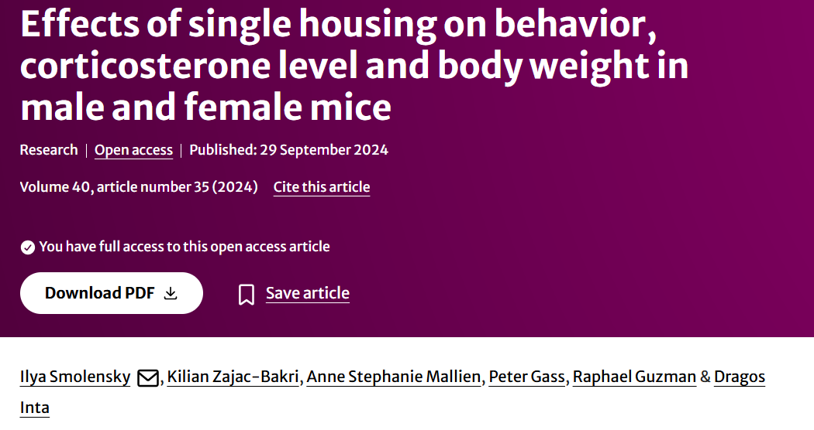
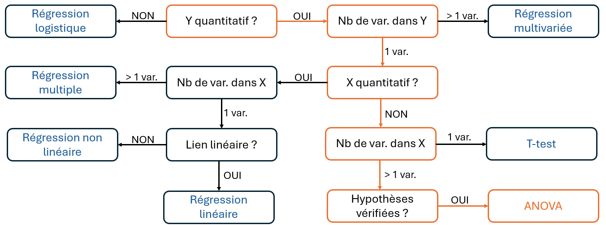

```{r setup}

library(readxl)
library(ggplot2)
library(tidyr)
library(plotly)
library(dplyr)
library(patchwork)
library(car)
```

## 🔍 Introduction : L'ANOVA, qu'est-ce que c'est ?

```{=html}
<div style="height:5px;"></div>
```

> L'[analyse de variance]{.smallcaps} (ANOVA) permet de déterminer l'influence de $k$ modalités d'une ou plusieurs variables explicatives (appelées [facteurs]{.smallcaps}) sur la moyenne d'une variable quantitative à expliquer $Y$.

```{=html}
<div style="height:10px;"></div>
```

. . .

| Questions de recherche | Facteur(s) {modalités} | $Y$ = variable expliquée |
|----|----|----|
| Le type d'alimentation et le médicament donné [influencent]{.smallcaps}-ils la durée de guérison de l'animal ? | Type d'alimentation {granules, foin, ...} +/$\times$ Médicament {A, B} | Durée de guérison |
| La ville et le quartier ont-ils un [effet]{.smallcaps} sur le prix d'un logement ? | Ville {Montpellier, Paris, Toulouse} +/$\times$ Type de quartier {Hyper-centre, Universités, Périphérie} | Prix du logement |
| L'espérance de vie d'un animal [diffère]{.smallcaps}-t-elle selon son sexe ? | Sexe {M stérilisé ou non / F stérilisé ou non} | Espérance de vie |

. . .

::: callout-note
L'objectif de l'ANOVA est de comparer les moyennes de $Y$ pour chacun des groupes ($=$ facteur $\times$ modalité) afin de voir si le(s) facteur(s) étudié(s) a(ont) une influence sur $Y$.
:::

## 🔍 Introduction : L'ANOVA, qu'est-ce que c'est ? {data-visibility="uncounted"}

```{=html}
<div style="height:5px;"></div>
```

> L'[analyse de variance]{.smallcaps} (ANOVA) permet de déterminer l'influence de $k$ modalités d'une ou plusieurs variables explicatives (appelées [facteurs]{.smallcaps}) sur la moyenne d'une variable quantitative à expliquer $Y$.

```{=html}
<div style="height:10px;"></div>
```

::: {#tableau-focus}
| Questions de recherche | Facteur(s) {modalités} | $Y$ = variable expliquée |
|----|----|----|
| Le type d'alimentation et le médicament donné [influencent]{.smallcaps}-ils la durée de guérison de l'animal ? | Type d'alimentation {granules, foin, ...} +/$\times$ Médicament {A, B} | Durée de guérison |
| La ville et le quartier ont-ils un [effet]{.smallcaps} sur le prix d'un logement ? | Ville {Montpellier, Paris, Toulouse} +/$\times$ Type de quartier {Hyper-centre, Universités, Périphérie} | Prix du logement |
| L'espérance de vie d'un animal [diffère]{.smallcaps}-t-elle selon son sexe ? | Sexe {M stérilisé ou non / F stérilisé ou non} | Espérance de vie |
:::

```{=html}
<div style="height:10px;"></div>
```

. . .

::: small-box
Dans ce cours, on va se concentrer sur l'[ANOVA à deux facteurs]{.smallcaps} :

Quels sont les effets de **chacun des 2 facteurs A et B** et celui de leur **interaction** sur **1 variable** $Y$ ?
:::

## 🐁 Application : Présentation des données

```{=html}
<div style="height:5px;"></div>
```

[[Jeu de données utilisé :]{.underline}]{.smallcaps} Sexe, habitat et durée de contact avec des congénères de $40$ souris, collectés à l'Université de Basel (Suisse) [@smolensky2024] .

. . .

::::::::: columns
::::: {.column width="65%"}
```{=html}
<div style="height:30px;"></div>
```

::: fragment
- $Y =$ Durée de contact avec d'autres congénères
:::

::: fragment
- Facteurs :
  - Housing $=$ Type d'hébergement à $2$ modalités
  - Sex $=$ Sexe à $2$ modalités

| Facteur     | Modalité           | Définition                  | Nb. d'individus |
|-------------|--------------------|-----------------------------|-----------------|
| Housing (A) | Group ($k_{A,1}$)  | Souris vivant en communauté | 10              |
| Housing (A) | Single ($k_{A,2}$) | Souris vivant isolée        | 10              |
| Sex (B)     | Female ($k_{B,1}$) | Souris femelle              | 10              |
| Sex (B)     | Male ($k_{B,2}$)   | Souris mâle                 | 10              |
:::
:::::

::::: {.column width="35%"}
:::: columns
::: fragment
```{r}
#| echo: false
#| message: false
#| warning: false

data_mice <- read_excel("data_mice.xlsx", sheet = "Social interaction")

### ON COMPLETE LES DONNES
data_mice$Sex[c(2:20)] <- "Male"
data_mice$Sex[c(22:40)] <- "Female"

data_mice$Housing[c(2:10, 22:30)] <- "Group"
data_mice$Housing[c(12:20, 32:40)] <- "Single"

data_mice <- data_mice %>%
  mutate(
    Sex = factor(Sex, levels = c("Male", "Female")),
    Housing = factor(Housing, levels = c("Group", "Single"))
  ) %>%
  dplyr::select(Mouse, Sex, Housing, contact_time)

colors_groups <- c(
  "Male" = "#009E73",          # vert
  "Female" = "#E69F00",        # orange
  "Group" = "#0072B2",  # bleu
  "Single" = "#CC79A7"  # violet
)

knitr::kable(data_mice[c(20:23, 17:19, 38:40), ])
```
:::
::::
:::::
:::::::::

## 🐁 Application : Question de recherche

:::: center-text
::: highlight-box
**Le sexe et le type d’hébergement des souris ont-ils un effet sur la durée de leurs interactions sociales ? Existe-t-il un effet combiné de ces deux facteurs ?**
:::
::::

## 📖 Objectifs du cours

<br>

<br>

1.  L'ANOVA, un test d'hypothèse ? (Rappel, Définition & Exemple)

. . .

```{=html}
<div style="height:5px;"></div>
```

2.  Comment réaliser une ANOVA à deux facteurs et interpréter ses effets ? (Statistiques F et p-values)

. . .

```{=html}
<div style="height:5px;"></div>
```

3.  Application aux données de souris avec R

. . .

```{=html}
<div style="height:5px;"></div>
```

4.  Conclusion & Exemples concrets de contributions en sciences vétérinaire

## 1️⃣ L'ANOVA, un test d'hypothèse ? Rappels sur les tests

```{=html}
<div style="height:25px;"></div>
```

```{=html}
<div style="height:5px;"></div>
```

::: {style="border: 2px solid #D9E1F2; border-radius: 25px; background: white; box-shadow: 0 2px 8px rgba(100,120,150,0.10); overflow: hidden; padding: 20px;font-size: 0.75em;padding-top: 1px;padding-bottom: 5px;"}
[[Hypothèses (test bilatéral):]{.underline}]{.smallcaps}

$$\small H_0:\mu=\mu_0 \qquad\qquad\qquad H_1:\mu\neq\mu_0$$
:::

```{=html}
<div style="height:20px;"></div>
```

::::::::: columns
:::: {.column width="33%"}
::: {style="border: 2px solid #D9E1F2; border-radius: 25px; background: white; box-shadow: 0 2px 8px rgba(100,120,150,0.10); overflow: hidden; padding: 20px;font-size: 0.75em;padding-top: 1px;padding-bottom: 5px;"}
[[erreurs :]{.underline}]{.smallcaps}

```{=html}
<div style="height:22.75px;"></div>
```

|   | **Ne pas rejeter** $\small H_0$ | **Rejeter** $\small H_0$ |
|----|----|----|
| $\small H_0$ **vraie** | ✅ Bonne décision | ❌ **Type I :** $\small \alpha$ |
| $\small H_0$ **fausse** | ❌ **Type II :** $\small \beta$ | ✅ Bonne décision |

$$\small    \alpha    =        P(\text{rejeter }H_0\mid H_0\text{ vraie})$$

$$\small    \beta    =        P(\text{ne pas rejeter }H_0\mid H_0\text{ fausse})$$
:::
::::

:::: {.column width="33%"}
::: {style="border: 2px solid #D9E1F2; border-radius: 25px; background: white; box-shadow: 0 2px 8px rgba(100,120,150,0.10); overflow: hidden; padding: 20px;font-size: 0.75em;padding-top:1px;padding-bottom: 5px;"}
[[Statistique de test :]{.underline}]{.smallcaps}

```{=html}
<div style="height:0.03px;"></div>
```

$$\small T = \frac{\bar X-\mu_0}{s/\sqrt n}$$

> La statistique de test mesure l'écart à $\small H_0$ relativement à la variabilité de l'estimation.

$$\small H_0 \quad \Longrightarrow \quad T\sim \mathcal{t}(0, 1)$$
:::
::::

:::: {.column width="33%"}
::: {style="border: 2px solid #D9E1F2; border-radius: 25px; background: white; box-shadow: 0 2px 8px rgba(100,120,150,0.10); overflow: hidden; padding: 20px;font-size: 0.75em;padding-top: 1px;padding-bottom: 5px;"}
[[p-value et décision :]{.underline}]{.smallcaps}

```{=html}
<div style="height:0.014px;"></div>
```

$$\small p = P_{H_0} \left( |T|\geq |T_{\mathrm{obs}}| \right)$$

> La p-valeur est le plus petit risque pour lequel on rejetterait $\small H_0$.

$$
\small
\begin{cases}
p < \alpha & \Longrightarrow \text{rejet de } H_0\\
p \geq \alpha & \Longrightarrow \text{non-rejet de } H_0
\end{cases}
$$
:::
::::
:::::::::

## 1️⃣ Quel rapport entre l'ANOVA et un test bilatéral ?

```{=html}
<div style="height:5px;"></div>
```

> L'ANOVA à 2 facteurs permet de [tester]{.smallcaps} si au moins une moyenne diffère des autres selon les modalités du facteur A, du facteur B, ou si l’effet d’un facteur dépend des modalités de l’autre (interaction).

```{=html}
<div style="height:5px;"></div>
```

::: {style="border: 2px solid #D9E1F2; border-radius: 25px; background: white; box-shadow: 0 2px 8px rgba(100,120,150,0.10); overflow: hidden; padding: 20px;font-size: 0.75em;padding-top: 1px;padding-bottom: 5px;"}
[[Hypothèses :]{.underline}]{.smallcaps}

$$
\small
\begin{aligned}
H_0^A &: \mu_{1\cdot}=\mu_{2\cdot}=\cdots=\mu_{I\cdot}
\qquad H_1^A : \text{au moins deux moyennes diffèrent}\\[8pt]
H_0^B &: \mu_{\cdot1}=\mu_{\cdot2}=\cdots=\mu_{\cdot J}
\qquad H_1^B : \text{au moins deux moyennes diffèrent}\\[8pt]
H_0^{A\times B} &: \mu_{ij}-\mu_{i\cdot}-\mu_{\cdot j}+\mu_{\cdot\cdot}=0,\ \forall i,j
\qquad H_1^{A\times B} : \text{au moins une interaction est non nulle}
\end{aligned}
$$
:::

```{=html}
<div style="height:10px;"></div>
```

::::::::: columns
:::: {.column width="33%"}
::: {style="border: 2px solid #D9E1F2; border-radius: 25px; background: white; box-shadow: 0 2px 8px rgba(100,120,150,0.10); overflow: hidden; padding: 20px;font-size: 0.75em;padding-top: 1px;padding-bottom: 5px;"}
[[erreurs :]{.underline}]{.smallcaps}

```{=html}
<div style="height:22.75px;"></div>
```

$$\small    \alpha    =        P(\text{rejeter }H_0\mid H_0\text{ vraie})$$

$$\small    \beta    =        P(\text{ne pas rejeter }H_0\mid H_0\text{ fausse})$$
:::
::::

:::: {.column width="33%"}
::: {style="border: 2px solid #D9E1F2; border-radius: 25px; background: white; box-shadow: 0 2px 8px rgba(100,120,150,0.10); overflow: hidden; padding: 20px;font-size: 0.75em;padding-top:1px;padding-bottom: 5px;"}
[[Statistique de test :]{.underline}]{.smallcaps}

```{=html}
<div style="height:0.03px;"></div>
```

$$
\small F= \frac{\text{variabilité entre les groupes}}
{\text{variabilité au sein des groupes}}
$$

$$
\small H_0\Longrightarrow F\sim\mathcal{F}_{J-1,N-J}
$$
:::
::::

:::: {.column width="33%"}
::: {style="border: 2px solid #D9E1F2; border-radius: 25px; background: white; box-shadow: 0 2px 8px rgba(100,120,150,0.10); overflow: hidden; padding: 20px;font-size: 0.75em;padding-top: 1px;padding-bottom: 5px;"}
[[p-value et décision :]{.underline}]{.smallcaps}

```{=html}
<div style="height:0.014px;"></div>
```

$$\small p = P_{H_0} \left( F \geq F_{\mathrm{obs}} \right)$$

$$
\small
\begin{cases}
p < \alpha & \Longrightarrow \text{rejet de } H_0\\
p \geq \alpha & \Longrightarrow \text{non-rejet de } H_0
\end{cases}
$$
:::
::::
:::::::::

## 1️⃣L'ANOVA, un test d'hypothèse ? Exemple

```{=html}
<div style="height:5px;"></div>
```

::: grande-fig
```{r}
#| echo: false
#| message: false
#| warning: false
#| fig-width: 13
#| fig-height: 6
#| out-width: "100%"
#| fig-align: center

# Données complètes uniquement
data_plot <- data_mice %>%
  filter(
    !is.na(Sex),
    !is.na(Housing),
    !is.na(contact_time)
  )

# Moyenne globale
mean_global <- mean(data_plot$contact_time)

# Style commun
theme_anova <- theme_anova <- theme_classic() +
  theme(
    axis.text = element_text(size = 22),
    axis.title = element_text(size = 24),
    plot.title = element_text(
      size = 25,
      face = "bold",
      hjust = 0.5
    ),
    legend.text = element_text(size = 20),
    legend.title = element_blank(),
    legend.position = "bottom",
    plot.margin = margin(0, 40, 10, 15)
    )

# 1. Effet du sexe
p_sex <- ggplot(
  data_plot,
  aes(x = Sex, y = contact_time, colour = Sex, fill = Sex)
) +
  geom_boxplot(
    alpha = 0.5,
    outlier.alpha = 0,
    linewidth = 1
  ) +
  geom_jitter(width = 0.15, size = 2.5) +
  stat_summary(
    fun = mean,
    geom = "point",
    shape = 16,
    colour = "black",
    size = 4
  ) +
  geom_hline(
    yintercept = mean_global,
    linetype = "dashed",
    linewidth = 1
  ) +
  scale_colour_manual(values = colors_groups) +
  scale_fill_manual(values = colors_groups) +
  labs(
    title = "Effet du facteur A",
    x = "Sexe",
    y = "Durée des contacts sociaux"
  ) +
  theme_anova +
  theme(legend.position = "none")

# 2. Effet de l'hébergement
p_housing <- ggplot(
  data_plot,
  aes(x = Housing, y = contact_time,
      colour = Housing, fill = Housing)
) +
  geom_boxplot(
    alpha = 0.5,
    outlier.alpha = 0,
    linewidth = 1
  ) +
  geom_jitter(width = 0.15, size = 2.5) +
  stat_summary(
    fun = mean,
    geom = "point",
    shape = 16,
    colour = "black",
    size = 4
  ) +
  geom_hline(
    yintercept = mean_global,
    linetype = "dashed",
    linewidth = 1
  ) +
  scale_colour_manual(values = colors_groups) +
  scale_fill_manual(values = colors_groups) +
  labs(
    title = "Effet du facteur B",
    x = "Hébergement",
    y = "Durée des contacts sociaux"
  ) +
  theme_anova +
  theme(legend.position = "none")

# 3. Interaction sexe × hébergement
p_interaction <- ggplot(
  data_plot,
  aes(
    x = Housing,
    y = contact_time,
    colour = Sex,
    group = Sex
  )
) +
  stat_summary(
    fun = mean,
    geom = "line",
    linewidth = 2.5
  ) +
  stat_summary(
    fun = mean,
    geom = "point",
    size = 4
  ) +
  scale_colour_manual(values = colors_groups) +
  labs(
    title = "Effet de l'interaction",
    x = "Hébergement",
    y = "Durée moyenne des contacts"
  ) +
  theme_anova

# Affichage côte à côte
p_sex + plot_spacer() +
  p_housing + plot_spacer() +
  p_interaction +
  plot_layout(
    ncol = 5,
    widths = c(2.75, 1.25, 2.75, 1.25, 2.75)
  )
```
:::

:::: {style="margin-top: -40px;"}
::: callout-note
- Si on teste uniquement l'effet des facteurs **individuels**, on parle de modèle/test [additif]{.smallcaps}

- Si on teste les effets des facteurs **individuels** et celui de l'**interaction**, on parle de modèle/test [complet]{.smallcaps}
:::
::::

## 1️⃣ ANOVA à 2 facteurs : avec ou sans interaction ?

```{=html}
<div style="height:5px;"></div>
```

::::::: columns
:::: {.column width="50%"}
::: {style="text-align: center;"}
[[sans interaction :]{.underline}]{.smallcaps}
:::

```{r}
#| echo: false
#| message: false
#| warning: false
#| fig-align: center
#| fig-width: 5
#| fig-height: 4


data_sans <- expand.grid(
  A = factor(c("A1", "A2"), levels = c("A1", "A2")),
  B = factor(c("B1", "B2"), levels = c("B1", "B2"))
) %>%
  mutate(
    Y = c(30, 45, 50, 65)
  )

ggplot(
  data_sans,
  aes(x = A, y = Y, colour = B, group = B)
) +
  geom_line(linewidth = 2) +
  geom_point(size = 6) +
  scale_colour_manual(
    values = c("B1" = "#0072B2", "B2" = "#E69F00")
  ) +
  coord_cartesian(ylim = c(20, 75)) +
  labs(
    x = "Facteur A",
    y = "Réponse moyenne",
    colour = "Facteur B"
  ) +
  theme_classic(base_size = 16) +
  theme(
    axis.text = element_text(size = 18),
    axis.title = element_text(size = 18),
    legend.position = "bottom",
    plot.margin = margin(0, 15, 10, 15)
  )
```
::::

:::: {.column width="50%"}
::: {style="text-align: center;"}
[[avec interaction :]{.underline}]{.smallcaps}
:::

```{r}
#| echo: false
#| message: false
#| warning: false
#| fig-align: center
#| fig-width: 5
#| fig-height: 4

data_avec <- expand.grid(
  A = factor(c("A1", "A2"), levels = c("A1", "A2")),
  B = factor(c("B1", "B2"), levels = c("B1", "B2"))
) %>%
  mutate(
    Y = c(30, 65, 60, 40)
  )

ggplot(
  data_avec,
  aes(x = A, y = Y, colour = B, group = B)
) +
  geom_line(linewidth = 2) +
  geom_point(size = 6) +
  scale_colour_manual(
    values = c("B1" = "#0072B2", "B2" = "#E69F00")
  ) +
  coord_cartesian(ylim = c(20, 75)) +
  labs(
    x = "Facteur A",
    y = "Réponse moyenne",
    colour = "Facteur B"
  ) +
  theme_classic(base_size = 16) +
  theme(
    axis.text = element_text(size = 18),
    axis.title = element_text(size = 18),
    legend.position = "bottom",
    plot.margin = margin(0, 15, 10, 15)
  )
```
::::
:::::::

::::: fragment
:::: {style="margin-top: -50px;"}
::: callout-important
Tester l'interaction permet de savoir si l'effet d'un facteur dépend de l'autre et adapter l'interprétation des résultats.
:::
::::
:::::

## 1️⃣ Les hypothèses à vérifier avant le test

```{=html}
<div style="height:15px;"></div>
```

::: callout-note
Comme toujours avant un test, il faut s'assurer que les données présentent les bonnes propriétés pour garantir la validité des résultats et des conclusions.
:::

```{=html}
<div style="height:15px;"></div>
```

. . .

::: {style="font-size: 0.85em;"}
Soit $i$ la modalité du facteur A (où $i = 1, ..., I$), $j$ celle du facteur B (où $j = 1, ..., J$) et $k$ le numéro de l'individu observé (où $k = 1, ..., n_{ij}$).
:::

<br>

1.  [[indépendance :]{.underline}]{.smallcaps} Les $\epsilon_{ijk}$ sont indépendants $\longrightarrow$ Les $Y_{ijk}$ sont indépendants

|  |
|:--:|
| La mesure prise sur un individu n'a pas d'influence sur celle prise sur un autre. |

## 1️⃣ Les hypothèses à vérifier avant le test

```{=html}
<div style="height:15px;"></div>
```

::: {style="font-size: 0.85em;"}
Soit $i$ la modalité du facteur A (où $i = 1, ..., I$), $j$ celle du facteur B (où $j = 1, ..., J$) et $k$ le numéro de l'individu observé (où $k = 1, ..., n_{ij}$).
:::

```{=html}
<div style="height:35px;"></div>
```

2.  [[normalité des résidus :]{.underline}]{.smallcaps} Pour chaque $(i,j)$, $\epsilon_{ijk}\sim\mathcal{N}(0,\sigma^2)$ $\longrightarrow$ $Y_{ijk}\sim\mathcal{N}(\mu_{ij},\sigma^2)$

::::: columns
::: {.column width="50%"}
```{r}
#| echo: false
#| message: false
#| warning: false

set.seed(123)

# -------------------------
# Paramètres
# -------------------------

n <- 30

mu_group <- c(
  "A1B1" = 6,
  "A1B2" = 10,
  "A2B1" = 12,
  "A2B2" = 16
)

sigma <- 1.5

colors_groups_ex <- c(
  "A1B1" = "#0072B2",
  "A1B2" = "#E69F00",
  "A2B1" = "#009E73",
  "A2B2" = "#CC79A7"
)

# -------------------------
# Données normales
# -------------------------

data_normal <- data.frame(
  Group = rep(names(mu_group), each = n)
)

data_normal$Group <- factor(
  data_normal$Group,
  levels = names(mu_group)
)

data_normal$x <- as.numeric(data_normal$Group)

data_normal$mu_ij <- mu_group[
  as.character(data_normal$Group)
]

data_normal$Y <- rnorm(
  nrow(data_normal),
  mean = data_normal$mu_ij,
  sd = sigma
)

data_normal$x_plot <- data_normal$x +
  runif(nrow(data_normal), -0.18, 0.18)

# -------------------------
# Distributions normales
# pour chaque combinaison
# -------------------------

normal_curves <- do.call(
  rbind,
  lapply(1:4, function(j) {

    mu_j <- mu_group[j]

    y_grid <- seq(
      mu_j - 4 * sigma,
      mu_j + 4 * sigma,
      length.out = 300
    )

    dens <- dnorm(
      y_grid,
      mean = mu_j,
      sd = sigma
    )

    dens_scaled <- dens / max(dens) * 0.40

    data.frame(
      Group = names(mu_group)[j],
      X = j + dens_scaled,
      Y = y_grid
    )
  })
)

# -------------------------
# Moyennes
# -------------------------

means_group <- data.frame(
  Group = names(mu_group),
  x = 1:4,
  xend = 1:4 + 0.40,
  y = unname(mu_group),
  yend = unname(mu_group),
  label = c(
    "mu[11]",
    "mu[12]",
    "mu[21]",
    "mu[22]"
  )
)

# -------------------------
# Graphique
# -------------------------

ggplot() +

  geom_point(
    data = data_normal,
    aes(
      x = x_plot,
      y = Y,
      colour = Group
    ),
    alpha = 0.65,
    size = 5
  ) +

  geom_path(
    data = normal_curves,
    aes(
      x = X,
      y = Y,
      group = Group
    ),
    colour = "black",
    linewidth = 1.5
  ) +

  geom_segment(
    data = means_group,
    aes(
      x = x,
      xend = xend,
      y = y,
      yend = yend
    ),
    colour = "black",
    linetype = "dashed",
    linewidth = 1.2
  ) +

  geom_text(
    data = means_group,
    aes(
      x = x,
      y = y,
      label = label
    ),
    parse = TRUE,
    colour = "black",
    size = 8,
    nudge_x = -0.15,
    nudge_y = 0.7
  ) +

  scale_colour_manual(
    values = colors_groups_ex
  ) +

  scale_x_continuous(
    breaks = 1:4,
    labels = names(mu_group)
  ) +

  coord_cartesian(
    xlim = c(0.5, 4.6),
    ylim = c(0, 23)
  ) +

  labs(
    title = "Cas normal",
    x = "Groupe",
    y = "Y"
  ) +

  theme_minimal(base_size = 20) +

  theme(
    plot.title = element_text(
      size = 28,
      face = "bold",
      hjust = 0.5
    ),
    axis.title = element_text(size = 24),
    axis.text = element_text(size = 20),
    legend.position = "none"
  )

```
:::

::: {.column width="50%"}
```{r}
#| echo: false
#| message: false
#| warning: false

set.seed(123)

# -------------------------
# Paramètres
# -------------------------

n <- 30

mu_group <- c(
  "A1B1" = 6,
  "A1B2" = 10,
  "A2B1" = 12,
  "A2B2" = 16
)

sigma <- 1.5

colors_groups_ex <- c(
  "A1B1" = "#0072B2",
  "A1B2" = "#E69F00",
  "A2B1" = "#009E73",
  "A2B2" = "#CC79A7"
)

# -------------------------
# Données NON normales
# -------------------------

data_non_normal <- data.frame(
  Group = rep(names(mu_group), each = n)
)

data_non_normal$Group <- factor(
  data_non_normal$Group,
  levels = names(mu_group)
)

data_non_normal$x <- as.numeric(data_non_normal$Group)

data_non_normal$mu_ij <- mu_group[
  as.character(data_non_normal$Group)
]

# -------------------------
# Erreurs non normales
# -------------------------

eps <- rexp(
  nrow(data_non_normal),
  rate = 1 / sigma
) - sigma

data_non_normal$Y <-
  data_non_normal$mu_ij + eps

data_non_normal$x_plot <- data_non_normal$x +
  runif(nrow(data_non_normal), -0.18, 0.18)

# -------------------------
# Distributions non normales
# -------------------------

non_normal_curves <- do.call(
  rbind,
  lapply(1:4, function(j) {

    mu_j <- mu_group[j]

    y_grid <- seq(
      mu_j - sigma,
      mu_j + 5 * sigma,
      length.out = 300
    )

    dens <- dexp(
      y_grid - mu_j + sigma,
      rate = 1 / sigma
    )

    dens_scaled <- dens / max(dens) * 0.40

    data.frame(
      Group = names(mu_group)[j],
      X = j + dens_scaled,
      Y = y_grid
    )
  })
)

# -------------------------
# Moyennes
# -------------------------

means_group <- data.frame(
  Group = names(mu_group),
  x = 1:4,
  xend = 1:4 + 0.40,
  y = unname(mu_group),
  yend = unname(mu_group),
  label = c(
    "mu[11]",
    "mu[12]",
    "mu[21]",
    "mu[22]"
  )
)

# -------------------------
# Graphique
# -------------------------

ggplot() +

  geom_point(
    data = data_non_normal,
    aes(
      x = x_plot,
      y = Y,
      colour = Group
    ),
    alpha = 0.65,
    size = 5
  ) +

  geom_path(
    data = non_normal_curves,
    aes(
      x = X,
      y = Y,
      group = Group
    ),
    colour = "black",
    linewidth = 1.5
  ) +

  geom_segment(
    data = means_group,
    aes(
      x = x,
      xend = xend,
      y = y,
      yend = yend
    ),
    colour = "black",
    linetype = "dashed",
    linewidth = 1.2
  ) +

  geom_text(
    data = means_group,
    aes(
      x = x,
      y = y,
      label = label
    ),
    parse = TRUE,
    colour = "black",
    size = 8,
    nudge_x = -0.15,
    nudge_y = 0.7
  ) +

  scale_colour_manual(
    values = colors_groups_ex
  ) +

  scale_x_continuous(
    breaks = 1:4,
    labels = names(mu_group)
  ) +

  coord_cartesian(
    xlim = c(0.5, 4.6),
    ylim = c(0, 23)
  ) +

  labs(
    title = "Cas non normal",
    x = "Groupe",
    y = "Y"
  ) +

  theme_minimal(base_size = 20) +

  theme(
    plot.title = element_text(
      size = 28,
      face = "bold",
      hjust = 0.5
    ),
    axis.title = element_text(size = 24),
    axis.text = element_text(size = 20),
    legend.position = "none"
  )
```
:::
:::::

|  |
|:--:|
| Pour chaque groupe $(i,j)$, les observations $Y$ suivent une loi normale centrée sur la moyenne $\mu_{ij}$ du groupe. |

## 1️⃣ Les hypothèses à vérifier avant le test

```{=html}
<div style="height:15px;"></div>
```

::: {style="font-size: 0.85em;"}
Soit $i$ la modalité du facteur A (où $i = 1, ..., I$), $j$ celle du facteur B (où $j = 1, ..., J$) et $k$ le numéro de l'individu observé (où $k = 1, ..., n_{ij}$).
:::

```{=html}
<div style="height:25px;"></div>
```

3.  [[homoscédasticité :]{.underline}]{.smallcaps} La variance des $\epsilon_{ijk}$ est la même dans tous les groupes $\longrightarrow$ La variance des $Y_{ijk}$ est la même dans tous les groupes

::::: columns
::: {.column width="50%"}
```{r}
#| echo: false
#| message: false
#| warning: false

set.seed(123)

# -------------------------
# Paramètres
# -------------------------

n <- 30

mu_group <- c(
  "A1B1" = 6,
  "A1B2" = 10,
  "A2B1" = 12,
  "A2B2" = 16
)

sigma <- 1.5

colors_groups_ex <- c(
  "A1B1" = "#0072B2",
  "A1B2" = "#E69F00",
  "A2B1" = "#009E73",
  "A2B2" = "#CC79A7"
)

# -------------------------
# Données
# -------------------------

data <- data.frame(
  Group = rep(names(mu_group), each = n)
)

data$Group <- factor(
  data$Group,
  levels = names(mu_group)
)

data$mu_ij <- mu_group[
  as.character(data$Group)
]

# -------------------------
# Variance constante
# -------------------------

eps <- rnorm(
  nrow(data),
  mean = 0,
  sd = sigma
)

eps <- ave(
  eps,
  data$Group,
  FUN = function(z) {
    (z - mean(z)) / sd(z) * sigma
  }
)

data$Y <- data$mu_ij + eps

# -------------------------
# Min et max par groupe
# -------------------------

width_data <- aggregate(
  Y ~ Group,
  data = data,
  FUN = function(y) c(
    min = min(y),
    max = max(y)
  )
)

width_data <- do.call(
  data.frame,
  width_data
)

names(width_data) <- c(
  "Group",
  "Y_min",
  "Y_max"
)

# -------------------------
# Graphique
# -------------------------

ggplot(
  data,
  aes(
    x = Group,
    y = Y,
    colour = Group
  )
) +

  geom_errorbar(
    data = width_data,
    aes(
      x = Group,
      ymin = Y_min,
      ymax = Y_max
    ),
    width = 0.35,
    colour = "black",
    linetype = "dashed",
    linewidth = 1.3,
    inherit.aes = FALSE
  ) +

  geom_jitter(
    width = 0.18,
    alpha = 0.75,
    size = 5
  ) +

  scale_colour_manual(
    values = colors_groups_ex
  ) +

  coord_cartesian(
    ylim = c(0, 23)
  ) +

  labs(
    title = "Cas homoscédastique",
    x = "Groupe",
    y = "Y"
  ) +

  theme_minimal(base_size = 20) +

  theme(
    plot.title = element_text(
      size = 28,
      face = "bold",
      hjust = 0.5
    ),
    axis.title = element_text(size = 24),
    axis.text = element_text(size = 20),
    legend.position = "none"
  )
```
:::

::: {.column width="50%"}
```{r}
#| echo: false
#| message: false
#| warning: false

set.seed(123)

# -------------------------
# Paramètres
# -------------------------

n <- 30

mu_group <- c(
  "A1B1" = 6,
  "A1B2" = 10,
  "A2B1" = 12,
  "A2B2" = 16
)

sigma_group <- c(
  "A1B1" = 0.6,
  "A1B2" = 1.5,
  "A2B1" = 2.5,
  "A2B2" = 3.5
)

colors_groups_ex <- c(
  "A1B1" = "#0072B2",
  "A1B2" = "#E69F00",
  "A2B1" = "#009E73",
  "A2B2" = "#CC79A7"
)

# -------------------------
# Données
# -------------------------

data <- data.frame(
  Group = rep(names(mu_group), each = n)
)

data$Group <- factor(
  data$Group,
  levels = names(mu_group)
)

data$mu_ij <- mu_group[
  as.character(data$Group)
]

data$sigma_ij <- sigma_group[
  as.character(data$Group)
]

# -------------------------
# Variances différentes
# -------------------------

eps <- rnorm(
  nrow(data),
  mean = 0,
  sd = data$sigma_ij
)

data$Y <- data$mu_ij + eps

# -------------------------
# Min et max par groupe
# -------------------------

width_data <- aggregate(
  Y ~ Group,
  data = data,
  FUN = function(y) c(
    min = min(y),
    max = max(y)
  )
)

width_data <- do.call(
  data.frame,
  width_data
)

names(width_data) <- c(
  "Group",
  "Y_min",
  "Y_max"
)

# -------------------------
# Graphique
# -------------------------

ggplot(
  data,
  aes(
    x = Group,
    y = Y,
    colour = Group
  )
) +

  geom_errorbar(
    data = width_data,
    aes(
      x = Group,
      ymin = Y_min,
      ymax = Y_max
    ),
    width = 0.35,
    colour = "black",
    linetype = "dashed",
    linewidth = 1.3,
    inherit.aes = FALSE
  ) +

  geom_jitter(
    width = 0.18,
    alpha = 0.75,
    size = 5
  ) +

  scale_colour_manual(
    values = colors_groups_ex
  ) +

  coord_cartesian(
    ylim = c(0, 23)
  ) +

  labs(
    title = "Cas hétéroscédastique",
    x = "Groupe",
    y = "Y"
  ) +

  theme_minimal(base_size = 20) +

  theme(
    plot.title = element_text(
      size = 28,
      face = "bold",
      hjust = 0.5
    ),
    axis.title = element_text(size = 24),
    axis.text = element_text(size = 20),
    legend.position = "none"
  )
```
:::
:::::

|  |
|:--:|
| La dispersion des $Y$ autour de leur moyenne est constante quelle que soit la combinaison des deux facteurs. |

## 1️⃣ Vérification des hypothèses sur les données de souris

```{=html}
<div style="height:5px;"></div>
```

:::::::: columns
:::::: {.column width="50%"}
<br>

::: fragment
- [[Indépendance :]{.underline}]{.smallcaps} ⚠️ Supposée : les observations sont considérées comme indépendantes.
:::

```{=html}
<div style="height:5px;"></div>
```

::: fragment
- [[Normalité :]{.underline}]{.smallcaps} ✅ Dans chaque groupe, les durées de contact sont normalement distribués (p-value Shapiro-Wilk $= 0.414$).
:::

```{=html}
<div style="height:5px;"></div>
```

::: fragment
- [[Homoscédasticité :]{.underline}]{.smallcaps} ✅ La dispersion des urées de contact est similaire entre les groupes (p-value Levene $= 0.914$).
:::
::::::

::: {.column width="50%"}
```{r}
#| echo: false
#| message: false
#| warning: false
#| fig-width: 10
#| fig-height: 9


# --------------------------------------------------
# Préparation des données
# --------------------------------------------------

colors_groups <- c(
  "#0072B2",  # bleu
  "#E69F00",  # orange
  "#009E73",  # vert
  "#CC79A7"   # violet
)

mice_plot <- data_mice %>%
  filter(
    !is.na(contact_time),
    !is.na(Sex),
    !is.na(Housing)
  ) %>%
  mutate(
    Sex = factor(Sex),
    Housing = factor(Housing),
    Groupe = interaction(Sex, Housing, sep = " - ")
  )

# Couleurs associées aux groupes
colors_groups <- setNames(
  colors_groups,
  levels(mice_plot$Groupe)
)

mice_plot <- mice_plot %>%
  mutate(
    x = as.numeric(Groupe),
    color = colors_groups[as.character(Groupe)]
  )

# --------------------------------------------------
# Statistiques par groupe
# --------------------------------------------------

group_stats <- mice_plot %>%
  group_by(Groupe) %>%
  summarise(
    x = first(x),
    mu = mean(contact_time),
    sigma = sd(contact_time),
    Y_min = min(contact_time),
    Y_max = max(contact_time),
    .groups = "drop"
  ) %>%
  mutate(
    label = paste0("mu[", seq_len(n()), "]")
  )

# --------------------------------------------------
# Densités normales
# --------------------------------------------------

dens_data <- do.call(
  rbind,
  lapply(seq_len(nrow(group_stats)), function(j) {

    mu_j <- group_stats$mu[j]
    sigma_j <- group_stats$sigma[j]
    x_j <- group_stats$x[j]

    y_norm <- seq(
      mu_j - 4 * sigma_j,
      mu_j + 4 * sigma_j,
      length.out = 300
    )

    dens <- dnorm(
      y_norm,
      mean = mu_j,
      sd = sigma_j
    )

    dens_scaled <- dens / max(dens) * 0.35

    data.frame(
      Groupe = group_stats$Groupe[j],
      x_curve = x_j + dens_scaled,
      contact_time = y_norm
    )
  })
)

# --------------------------------------------------
# Graphique
# --------------------------------------------------

ggplot() +

  # Dispersion min-max : noir
  geom_errorbar(
    data = group_stats,
    aes(
      x = Groupe,
      ymin = Y_min,
      ymax = Y_max
    ),
    width = 0.30,
    colour = "black",
    linetype = "dashed",
    linewidth = 1.5
  ) +

  # Observations : couleur propre à chaque groupe
  geom_jitter(
    data = mice_plot,
    aes(
      x = Groupe,
      y = contact_time,
      colour = color
    ),
    width = 0.18,
    alpha = 0.25,
    size = 4
  ) +

  scale_colour_identity() +

  # Loi normale ajustée : noir
  geom_path(
    data = dens_data,
    aes(
      x = x_curve,
      y = contact_time,
      group = Groupe
    ),
    colour = "black",
    linewidth = 2
  ) +

  # Moyenne : trait horizontal pointillé
  geom_segment(
    data = group_stats,
    aes(
      x = x - 0.25,
      xend = x + 0.35,
      y = mu,
      yend = mu
    ),
    colour = "black",
    linetype = "dashed",
    linewidth = 1.8
  ) +

  # Moyennes des quatre combinaisons
  geom_text(
    data = group_stats,
    aes(
      x = x,
      y = mu,
      label = label
    ),
    parse = TRUE,
    colour = "black",
    size = 10,
    fontface = "bold",
    nudge_x = -0.35,
    nudge_y = 0.7
  ) +

  labs(
    x = "Sexe × Hébergement",
    y = "Temps de contact"
  ) +

  theme_minimal(base_size = 22) +

  theme(
    axis.title = element_text(size = 26),
    axis.text = element_text(size = 22),
    legend.position = "none"
  )

```
:::
::::::::

## 2️⃣ Pourquoi "Analyse de [*variance*]{.smallcaps}" : Intuition

```{=html}
<div style="height:5px;"></div>
```

> Comment déterminer si les facteurs A et B, ainsi que leur éventuelle interaction, ont un effet [suffisamment]{.smallcaps} significatif sur la variable étudiée ?

. . .

::::: columns
::: {.column width="50%"}
```{r}
#| echo: false
#| message: false
#| warning: false
#| fig-height: 5

# Nombre d'observations par combinaison
n <- 50

# Quatre combinaisons des facteurs A et B
groupes <- c("A1B1", "A1B2", "A2B1", "A2B2")

# Moyennes des quatre groupes
mu <- c(5, 7, 9, 13)

# Écarts symétriques autour de zéro
z <- seq(-1, 1, length.out = n)

# Données : forte variabilité résiduelle
data_non_sig <- data.frame(
  groupe = factor(
    rep(groupes, each = n),
    levels = groupes
  ),
  y = rep(mu, each = n) + 15 * rep(z, times = 4)
)

# Moyennes estimées
means_non_sig <- data_non_sig %>%
  group_by(groupe) %>%
  summarise(
    mu_hat = mean(y),
    .groups = "drop"
  ) %>%
  mutate(
    label = paste0(
      "bar(y)[", groupe, "] == ",
      round(mu_hat, 1)
    )
  )

# Graphique
ggplot(
  data_non_sig,
  aes(x = groupe, y = y, colour = groupe)
) +
  geom_jitter(
    width = 0.15,
    size = 3.5,
    alpha = 0.65
  ) +
  geom_crossbar(
    data = means_non_sig,
    aes(
      x = groupe,
      y = mu_hat,
      ymin = mu_hat,
      ymax = mu_hat
    ),
    inherit.aes = FALSE,
    width = 0.5,
    linewidth = 1.7,
    colour = "black"
  ) +
  geom_text(
    data = means_non_sig,
    aes(
      x = groupe,
      y = mu_hat,
      label = label
    ),
    inherit.aes = FALSE,
    parse = TRUE,
    nudge_y = 2.5,
    size = 5,
    colour = "black"
  ) +
  scale_colour_manual(
    values = c(
      "A1B1" = "#0072B2",
      "A1B2" = "#E69F00",
      "A2B1" = "#009E73",
      "A2B2" = "#CC79A7"
    )
  ) +
  coord_cartesian(ylim = c(-12, 30)) +
  labs(
    title = "Forte variabilité",
    x = "Combinaison des facteurs",
    y = "Y"
  ) +
  theme_minimal(base_size = 22) +
  theme(
    legend.position = "none",
    plot.title = element_text(
      size = 25,
      face = "bold",
      hjust = 0.5
    ),
    axis.title = element_text(size = 24),
    axis.text = element_text(size = 20),
    plot.margin = margin(10, 15, 10, 15)
  )
```
:::

::: {.column width="50%"}
```{r}
#| echo: false
#| message: false
#| warning: false
#| fig-height: 5

# Données : faible variabilité résiduelle
data_sig <- data.frame(
  groupe = factor(
    rep(groupes, each = n),
    levels = groupes
  ),
  y = rep(mu, each = n) + rep(z, times = 4)
)

# Moyennes estimées
means_sig <- data_sig %>%
  group_by(groupe) %>%
  summarise(
    mu_hat = mean(y),
    .groups = "drop"
  ) %>%
  mutate(
    label = paste0(
      "bar(y)[", groupe, "] == ",
      round(mu_hat, 1)
    )
  )

# Graphique
ggplot(
  data_sig,
  aes(x = groupe, y = y, colour = groupe)
) +
  geom_jitter(
    width = 0.15,
    size = 3.5,
    alpha = 0.65
  ) +
  geom_crossbar(
    data = means_sig,
    aes(
      x = groupe,
      y = mu_hat,
      ymin = mu_hat,
      ymax = mu_hat
    ),
    inherit.aes = FALSE,
    width = 0.5,
    linewidth = 1.7,
    colour = "black"
  ) +
  geom_text(
    data = means_sig,
    aes(
      x = groupe,
      y = mu_hat,
      label = label
    ),
    inherit.aes = FALSE,
    parse = TRUE,
    nudge_y = 2.5,
    size = 5,
    colour = "black"
  ) +
  scale_colour_manual(
    values = c(
      "A1B1" = "#0072B2",
      "A1B2" = "#E69F00",
      "A2B1" = "#009E73",
      "A2B2" = "#CC79A7"
    )
  ) +
  coord_cartesian(ylim = c(-12, 30)) +
  labs(
    title = "Faible variabilité",
    x = "Combinaison des facteurs",
    y = "Y"
  ) +
  theme_minimal(base_size = 22) +
  theme(
    legend.position = "none",
    plot.title = element_text(
      size = 25,
      face = "bold",
      hjust = 0.5
    ),
    axis.title = element_text(size = 24),
    axis.text = element_text(size = 25),
    plot.margin = margin(10, 15, 10, 15)
  )
```
:::
:::::

. . .

::: callout-warning
[**Comparer uniquement les moyennes ne suffit pas,**]{.smallcaps} il faut également prendre en compte la [variabilité des observations]{.smallcaps}.
:::

## 2️⃣ Variabilité expliquée par les facteurs A et B[^1]

[^1]: On suppose ici que le plan est équilibré (autant d'observations par groupe). Dans le cas où il ne l'est pas : voir prochain cours pour les calculs.

::: {style="font-size: 0.85em;"}
Soient $I$ et $J$ les nombres de modalités des facteurs A et B, $n$ le nombre d'observations par combinaison ($N=IJn$), $y_{ijk}$ la $k$-ième observation de la combinaison $A_iB_j$, $\bar y_{A_i}$ et $\bar y_{B_j}$ les moyennes des modalités $A_i$ et $B_j$, et $\bar y$ la moyenne globale.
:::

::::::::: columns
::::: {.column width="50%"}
::: {style="font-size: 0.95em; text-align:center;"}
[[Effet du facteur A :]{.underline}]{.smallcaps}
:::

```{r}
#| echo: false
#| message: false
#| warning: false
#| fig-height: 3.6

set.seed(123)

n <- 12

data_A <- expand.grid(
  A = factor(c("A1", "A2")),
  B = factor(c("B1", "B2")),
  k = seq_len(n)
) %>%
  dplyr::mutate(
    y = 5 + 4 * (A == "A2") +
      2 * (B == "B2") +
      4 * (A == "A2" & B == "B2") +
      rnorm(dplyr::n(), sd = 1.5)
  )

means_A <- data_A %>%
  dplyr::group_by(A) %>%
  dplyr::summarise(mu = mean(y), .groups = "drop")

mu_global <- mean(data_A$y)

ggplot(means_A, aes(x = A, y = mu)) +
  geom_hline(
    aes(yintercept = mu_global, linetype = "Moyenne globale"),
    colour = "grey40"
  ) +
  geom_segment(
    aes(xend = A, y = mu_global, yend = mu,
        colour = "Écart à la moyenne globale"),
    linewidth = 2.5
  ) +
  geom_point(
    aes(colour = "Moyenne du facteur A"),
    size = 5
  ) +
  scale_colour_manual(
    name = NULL,
    values = c(
      "Écart à la moyenne globale" = "#0072B2",
      "Moyenne du facteur A" = "#0072B2"
    )
  ) +
  scale_linetype_manual(
    name = NULL,
    values = c("Moyenne globale" = "dashed")
  ) +
  guides(
    colour = guide_legend(order = 1),
    linetype = guide_legend(order = 2)
  ) +
  coord_cartesian(ylim = c(0, 16)) +
  labs(x = "Facteur A", y = "Moyenne de Y") +
  theme_minimal(base_size = 20) +
  theme(
    legend.position = "bottom",
    legend.text = element_text(size = 18),
    axis.title = element_text(size = 22),
    axis.text = element_text(size = 19)
  )
```

::: {style="font-size: 0.85em;"}
$$
\color{#0072B2}{
SC_A
=
Jn\sum_{i=1}^{I}
(\bar y_{A_i}-\bar y)^2
}
$$
:::
:::::

::::: {.column width="50%"}
::: {style="font-size: 0.95em; text-align:center;"}
[[Effet du facteur B :]{.underline}]{.smallcaps}
:::

```{r}
#| echo: false
#| message: false
#| warning: false
#| fig-height: 3.6

set.seed(123)

n <- 12

data_B <- expand.grid(
  A = factor(c("A1", "A2")),
  B = factor(c("B1", "B2")),
  k = seq_len(n)
) %>%
  dplyr::mutate(
    y = 5 + 4 * (A == "A2") +
      2 * (B == "B2") +
      4 * (A == "A2" & B == "B2") +
      rnorm(dplyr::n(), sd = 1.5)
  )

means_B <- data_B %>%
  dplyr::group_by(B) %>%
  dplyr::summarise(mu = mean(y), .groups = "drop")

mu_global <- mean(data_B$y)

ggplot(means_B, aes(x = B, y = mu)) +
  geom_hline(
    aes(yintercept = mu_global, linetype = "Moyenne globale"),
    colour = "grey40"
  ) +
  geom_segment(
    aes(xend = B, y = mu_global, yend = mu,
        colour = "Écart à la moyenne globale"),
    linewidth = 2.5
  ) +
  geom_point(
    aes(colour = "Moyenne du facteur B"),
    size = 5
  ) +
  scale_colour_manual(
    name = NULL,
    values = c(
      "Écart à la moyenne globale" = "#009E73",
      "Moyenne du facteur B" = "#009E73"
    )
  ) +
  scale_linetype_manual(
    name = NULL,
    values = c("Moyenne globale" = "dashed")
  ) +
  guides(
    colour = guide_legend(order = 1),
    linetype = guide_legend(order = 2)
  ) +
  coord_cartesian(ylim = c(0, 16)) +
  labs(x = "Facteur B", y = "Moyenne de Y") +
  theme_minimal(base_size = 20) +
  theme(
    legend.position = "bottom",
    legend.text = element_text(size = 18),
    axis.title = element_text(size = 22),
    axis.text = element_text(size = 19)
  )
```

::: {style="font-size: 0.85em;"}
$$
\color{#009E73}{
SC_B
=
In\sum_{j=1}^{J}
(\bar y_{B_j}-\bar y)^2
}
$$
:::
:::::
:::::::::

## 2️⃣ Variabilité expliquée par l'interaction A × B[^2]

[^2]: On suppose ici que le plan est équilibré (autant d'observations par groupe). Dans le cas où il ne l'est pas : voir prochain cours pour les calculs.

::: {style="font-size: 0.85em;"}
Soient $\bar y_{A_i}$ et $\bar y_{B_j}$ les moyennes des modalités $A_i$ et $B_j$, $\bar y_{A_iB_j}$ la moyenne de la combinaison $A_iB_j$, et $\bar y$ la moyenne globale.
:::

```{r}
#| echo: false
#| message: false
#| warning: false
#| fig-align: center
#| fig-height: 3.5

set.seed(123)

n <- 12

# Simulation des données
data_inter <- expand.grid(
  A = factor(c("A1", "A2")),
  B = factor(c("B1", "B2")),
  k = seq_len(n)
) %>%
  mutate(
    y = 5 + 4 * (A == "A2") +
      2 * (B == "B2") +
      4 * (A == "A2" & B == "B2") +
      rnorm(dplyr::n(), sd = 1.5)
  )

# Calcul des moyennes
means_inter <- data_inter %>%
  group_by(A, B) %>%
  summarise(mu_AB = mean(y), .groups = "drop") %>%
  left_join(
    data_inter %>%
      group_by(A) %>%
      summarise(mu_A = mean(y), .groups = "drop"),
    by = "A"
  ) %>%
  left_join(
    data_inter %>%
      group_by(B) %>%
      summarise(mu_B = mean(y), .groups = "drop"),
    by = "B"
  ) %>%
  mutate(
    mu_global = mean(data_inter$y),
    mu_sans_inter = mu_A + mu_B - mu_global,
    groupe = factor(
      paste0(A, B),
      levels = c("A1B1", "A1B2", "A2B1", "A2B2")
    )
  )

# Graphique
ggplot(means_inter, aes(x = groupe)) +

  # Écart lié à l'interaction
  geom_segment(
    aes(
      xend = groupe,
      y = mu_sans_inter,
      yend = mu_AB,
      colour = "Écart à l'interaction"
    ),
    linewidth = 2.5
  ) +

  # Moyenne sans interaction
  geom_point(
    aes(
      y = mu_sans_inter,
      colour = "Moyenne sans interaction",
      shape = "Moyenne sans interaction"
    ),
    size = 5,
    stroke = 1.5
  ) +

  # Moyenne observée
  geom_point(
    aes(
      y = mu_AB,
      colour = "Moyenne observée",
      shape = "Moyenne observée"
    ),
    size = 5
  ) +

  # Couleurs de la légende
  scale_colour_manual(
    name = NULL,
    breaks = c(
      "Moyenne observée",
      "Moyenne sans interaction",
      "Écart à l'interaction"
    ),
    values = c(
      "Moyenne observée" = "#CC79A7",
      "Moyenne sans interaction" = "black",
      "Écart à l'interaction" = "#CC79A7"
    )
  ) +

  # Formes des points
  scale_shape_manual(
    name = NULL,
    values = c(
      "Moyenne observée" = 16,
      "Moyenne sans interaction" = 1
    )
  ) +

  # Légende unique
  guides(
    colour = guide_legend(
      order = 1,
      override.aes = list(
        shape = c(16, 1, NA),
        linetype = c("blank", "blank", "solid"),
        linewidth = c(0, 0, 2.5)
      )
    ),
    shape = "none"
  ) +

  coord_cartesian(ylim = c(3, 17)) +

  labs(
    x = "Combinaison des facteurs",
    y = "Moyenne de Y"
  ) +

  theme_minimal(base_size = 20) +

  theme(
    legend.position = "bottom",
    legend.text = element_text(size = 18),
    axis.title = element_text(size = 22),
    axis.text = element_text(size = 19)
  )
```

::: {style="font-size: 0.85em; text-align:center; margin-top: -75px;"}
$$
\color{#CC79A7}{SC_{AB} = n\sum_{i=1}^{I}\sum_{j=1}^{J} \left[ \bar y_{A_iB_j} - \underbrace{ (\bar y_{A_i}+\bar y_{B_j}-\bar y) }_{\text{Moyenne sans interaction}} \right]^2 }
$$
:::

## 2️⃣ Variabilité résiduelle[^3]

[^3]: On suppose ici que le plan est équilibré (autant d'observations par groupe). Dans le cas où il ne l'est pas : voir prochain cours pour les calculs.

```{=html}
<div style="height:15px;"></div>
```

::::::::: columns
::::: {.column width="50%"}
::: {style="font-size: 0.95em; text-align:center;"}
[[Sans interaction :]{.underline}]{.smallcaps}
:::

```{r}
#| echo: false
#| message: false
#| warning: false
#| fig-height: 4.2

set.seed(123)

n <- 12
groupes <- c("A1B1", "A1B2", "A2B1", "A2B2")
mu <- c(5, 7, 9, 13)

data_res_add <- data.frame(
  groupe = factor(rep(groupes, each = n), levels = groupes),
  y = rep(mu, each = n) + rnorm(4 * n, sd = 1.5)
) %>%
  dplyr::mutate(
    A = substr(as.character(groupe), 1, 2),
    B = substr(as.character(groupe), 3, 4)
  ) %>%
  dplyr::group_by(A) %>%
  dplyr::mutate(mu_A = mean(y)) %>%
  dplyr::ungroup() %>%
  dplyr::group_by(B) %>%
  dplyr::mutate(mu_B = mean(y)) %>%
  dplyr::ungroup() %>%
  dplyr::mutate(
    mu_global = mean(y),
    mu_add = mu_A + mu_B - mu_global
  ) %>%
  dplyr::group_by(groupe) %>%
  dplyr::mutate(
    x_group = as.numeric(groupe),
    x = x_group + seq(-0.18, 0.18, length.out = dplyr::n())
  ) %>%
  dplyr::ungroup()

means_add <- data_res_add %>%
  dplyr::distinct(groupe, x_group, mu_add)

ggplot() +
  geom_segment(
    data = data_res_add,
    aes(x = x, xend = x, y = mu_add, yend = y),
    colour = "#E69F00", linewidth = 1.2, alpha = 0.75
  ) +
  geom_point(
    data = data_res_add,
    aes(x = x, y = y, colour = groupe),
    size = 2.8
  ) +
  geom_segment(
    data = means_add,
    aes(x = x_group - 0.28, xend = x_group + 0.28,
        y = mu_add, yend = mu_add),
    colour = "black", linewidth = 1.8
  ) +
  scale_colour_manual(values = c(
    "A1B1" = "#0072B2", "A1B2" = "#E69F00",
    "A2B1" = "#009E73", "A2B2" = "#CC79A7"
  )) +
  scale_x_continuous(breaks = 1:4, labels = groupes) +
  labs(x = "Combinaison", y = "Y") +
  theme_minimal(base_size = 19) +
  theme(
    legend.position = "none",
    axis.title = element_text(size = 21),
    axis.text = element_text(size = 20)
  )
```

::: {style="font-size: 0.85em;"}
$$
\color{#E69F00}{
SC_{\mathrm{rés,additif}}
=
\sum_{i=1}^{I}\sum_{j=1}^{J}
\sum_{k=1}^{n}
\left(
y_{ijk}-\bar y_{A_i}-\bar y_{B_j}+\bar y
\right)^2
}
$$
:::
:::::

::::: {.column width="50%"}
::: {style="font-size: 0.95em; text-align:center;"}
[[Avec interaction :]{.underline}]{.smallcaps}
:::

```{r}
#| echo: false
#| message: false
#| warning: false
#| fig-height: 4.2

set.seed(123)

n <- 12
groupes <- c("A1B1", "A1B2", "A2B1", "A2B2")
mu <- c(5, 7, 9, 13)

data_res_complet <- data.frame(
  groupe = factor(rep(groupes, each = n), levels = groupes),
  y = rep(mu, each = n) + rnorm(4 * n, sd = 1.5)
) %>%
  dplyr::group_by(groupe) %>%
  dplyr::mutate(
    x_group = as.numeric(groupe),
    x = x_group + seq(-0.18, 0.18, length.out = dplyr::n()),
    mu_cell = mean(y)
  ) %>%
  dplyr::ungroup()

means_complet <- data_res_complet %>%
  dplyr::distinct(groupe, x_group, mu_cell)

ggplot() +
  geom_segment(
    data = data_res_complet,
    aes(x = x, xend = x, y = mu_cell, yend = y),
    colour = "#E69F00", linewidth = 1.2, alpha = 0.75
  ) +
  geom_point(
    data = data_res_complet,
    aes(x = x, y = y, colour = groupe),
    size = 2.8
  ) +
  geom_segment(
    data = means_complet,
    aes(x = x_group - 0.28, xend = x_group + 0.28,
        y = mu_cell, yend = mu_cell),
    colour = "black", linewidth = 1.8
  ) +
  scale_colour_manual(values = c(
    "A1B1" = "#0072B2", "A1B2" = "#E69F00",
    "A2B1" = "#009E73", "A2B2" = "#CC79A7"
  )) +
  scale_x_continuous(breaks = 1:4, labels = groupes) +
  labs(x = "Combinaison", y = "Y") +
  theme_minimal(base_size = 19) +
  theme(
    legend.position = "none",
    axis.title = element_text(size = 21),
    axis.text = element_text(size = 20)
  )
```

::: {style="font-size: 0.85em;"}
$$
\color{#E69F00}{
SC_{\mathrm{rés,complet}}
=
\sum_{i=1}^{I}\sum_{j=1}^{J}
\sum_{k=1}^{n}
\left(y_{ijk}-\bar y_{A_iB_j}\right)^2
}
$$
:::
:::::
:::::::::

## 2️⃣ Statistique de Fisher[^4]

[^4]: On suppose ici que le plan est équilibré (autant d'observations par groupe). Dans le cas où il ne l'est pas : voir prochain cours pour les calculs.

::: callout-warning
Pour comparer les variabilités, on divise chaque somme des carrés (SC) par ses **degrés de liberté** (= nombre d’informations indépendantes utilisées pour le calcul). On obtient ainsi un **carré moyen (CM)**.
:::

```{=html}
<div style="height:5px;"></div>
```

::: {style="font-size: 0.85em;"}
| Effet | Carré moyen | Statistique de Fisher |
|:---|:--:|:--:|
| Facteur A | $\displaystyle CM_A=\frac{SC_A}{I-1}$ | $\displaystyle F_A=\frac{CM_A}{CM_{\mathrm{résiduelle}}}$ |
| Facteur B | $\displaystyle CM_B=\frac{SC_B}{J-1}$ | $\displaystyle F_B=\frac{CM_B}{CM_{\mathrm{résiduelle}}}$ |
| Interaction A × B | $\displaystyle CM_{AB}=\frac{SC_{AB}}{(I-1)(J-1)}$ | $\displaystyle F_{AB}=\frac{CM_{AB}}{CM_{\mathrm{résiduelle}}}$ |
:::

. . .

::::::::::: columns
:::::: {.column width="50%"}
::: {style="font-size: 0.95em; text-align:center;"}
[[sans interaction :]{.underline}]{.smallcaps}
:::

::: {style="font-size: 0.85em;"}
$$
CM_{\mathrm{résiduelle}}
=
\frac{\color{#E69F00}{SC_{\mathrm{rés,additif}}}}{N-I-J+1}
$$
:::

::: {style="font-size: 0.75em; text-align:center;"}
[**TO DO :**]{.underline} 2 tests (1 pour A, 1 pour B)
:::
::::::

:::::: {.column width="50%"}
::: {style="font-size: 0.95em; text-align:center;"}
[[Avec interaction :]{.underline}]{.smallcaps}
:::

::: {style="font-size: 0.85em;"}
$$
CM_{\mathrm{résiduelle}}
=
\frac{\color{#E69F00}{SC_{\mathrm{rés,complet}}}}{N-IJ}
$$
:::

::: {style="font-size: 0.75em; text-align:center;"}
[**TO DO :**]{.underline} 3 tests (1 pour A, 1 pour B, 1 pour A $\times$ B)
:::
::::::
:::::::::::

## 2️⃣ Calcul de la statistique de Fisher - Exemple

<br>

<br>

<br>

```{r}
#| echo: false
#| message: false
#| warning: false

# ANOVA à deux facteurs avec interaction
modele <- aov(contact_time ~  Housing * Sex, data = data_mice)

tab <- summary(modele)[[1]]

# Construction du tableau
tableau_anova <- data.frame(
  Facteur = c("A", "B", "A × B", "Résidus"),
  `Nom du facteur` = c("Type d'hébergement", "Sexe",
                       "Interaction Hébergement × Sexe", "Résidus"),
  ddl = tab[, "Df"],
  SC_X = tab[, "Sum Sq"],
  CM_X = tab[, "Mean Sq"],
  F = tab[, "F value"],
  check.names = FALSE
) %>%
  mutate(
    across(c(SC_X, CM_X, F), ~ round(.x, 3))
  ) 

# Affichage dans Quarto
knitr::kable(
  tableau_anova,
  align = c("l", "l", "c", "r", "r", "r"),
  col.names = c(
    "Facteur", "Nom du facteur", "ddl",
    "SC", "CM", "F"
  )
)
```

$\Longrightarrow$ Si $F \gg 1$, la variabilité expliquée par le facteur est grande devant la variabilité résiduelle.

## 2️⃣ Choix du risque de première espèce $\alpha$

```{=html}
<div style="height:5px;"></div>
```

::: {style="border: 2px solid #D9E1F2; border-radius: 25px; background: white; box-shadow: 0 2px 8px rgba(100,120,150,0.10); overflow: hidden; padding: 20px;font-size: 0.75em;padding-top: 1px;padding-bottom: 5px;"}
[[Rappel du test d'hypothèse :]{.underline}]{.smallcaps}

$$
\small \begin{aligned}
H_0^A &: \mu_{1\cdot}=\mu_{2\cdot}=\cdots=\mu_{I\cdot}
\qquad H_1^A : \text{au moins deux moyennes diffèrent}\\[8pt]
H_0^B &: \mu_{\cdot1}=\mu_{\cdot2}=\cdots=\mu_{\cdot J}
\qquad H_1^B : \text{au moins deux moyennes diffèrent}\\[8pt]
H_0^{A\times B} &: \mu_{ij}-\mu_{i\cdot}-\mu_{\cdot j}+\mu_{\cdot\cdot}=0,\ \forall i,j
\qquad H_1^{A\times B} : \text{au moins une interaction est non nulle}
\end{aligned}
$$
:::

```{=html}
<div style="height:5px;"></div>
```

|   | **Ne pas rejeter** $\small H_0$ | **Rejeter** $\small H_0$ |
|----|----|----|
| $\small H_0$ **vraie** | ✅ Bonne décision | ❌ **Type I :** $\small \alpha$ |
| $\small H_0$ **fausse** | ❌ **Type II :** $\small \beta$ | ✅ Bonne décision |

> $\alpha = P(\text{rejeter }H_0\mid H_0\text{ vraie})$ est le [risque de première espèce]{.smallcaps} : le risque de conclure à un effet alors qu'en réalité cet effet n'existe pas.

::: callout-note
En pratique, on prend généralement $\alpha = 0.05 (5\%)$ ou $\alpha = 0.01 (1\%)$.
:::

## 2️⃣ Calcul de la p-value et conclusion - Définition

```{=html}
<div style="height:2px;"></div>
```

::: {style="font-size: 0.95em;"}
Sous l'hypothèse nulle associée à chaque effet $X\in\{A,B,A\times B\}$, $H_0^X$ $F_X\sim\mathcal F_{ddl_X,\;N-IJ},$ où $ddl_X$ désigne le nombre de degrés de liberté de l'effet testé.
:::

:::::: columns
:::: {.column width="55%"}
[[p-value]{.underline}]{.smallcaps}

La [p-value]{.smallcaps} correspond à la probabilité, **sous** $H_0^X$, d'observer une statistique de Fisher au moins aussi grande que celle obtenue :

$$
p_X=\mathbb P_{H_0^X}\left(F_X\geq F_{X,\mathrm{obs}}\right)
$$

```{=html}
<div style="height:20px;"></div>
```

::: fragment
$\longrightarrow$ Graphiquement, la p-value correspond à **l'aire sous la courbe située à droite de** $F_{X,\mathrm{obs}}$.
:::
::::

::: {.column width="45%"}
```{r}
#| echo: false
#| message: false
#| warning: false
#| fig-height: 5
#| fig-width: 6

# Paramètres de la loi de Fisher
ddl1 <- 3
ddl2 <- 30

# Valeurs de X
x <- seq(0.01, 6, length.out = 800)

# Densité de Fisher f(x)
density_F <- df(
  x,
  df1 = ddl1,
  df2 = ddl2
)

# Probabilité P(X > x)
prob_sup <- pf(
  x,
  df1 = ddl1,
  df2 = ddl2,
  lower.tail = FALSE
)

# Informations affichées au survol
hover_info <- paste0(
  "X = ", round(x, 3),
  "<br>Densité = ", round(density_F, 3),
  "<br>P(X > ", round(x, 3), ") = ", round(prob_sup, 4)
)

# Graphique
plot_ly(
  x = x,
  y = density_F,
  type = "scatter",
  mode = "lines",
  
  line = list(
    color = "#4D4D4D",
    width = 3
  ),
  
  text = hover_info,
  hoverinfo = "text"
  
) %>%
  
  layout(
    
    xaxis = list(
      title = "Statistique F",
      range = c(0, 6),
      tickfont = list(size = 18),
      titlefont = list(size = 20)
    ),
    
    yaxis = list(
      title = "Densité",
      rangemode = "tozero",
      tickfont = list(size = 18),
      titlefont = list(size = 20)
    ),
    
    showlegend = FALSE,
    
    # Permet de tracer des lignes à la main
    dragmode = "drawline",
    
    newshape = list(
      line = list(
        color = "#E69F00",
        width = 3
      )
    ),
    
    margin = list(
      l = 70,
      r = 20,
      b = 60,
      t = 20
    )
  ) %>%
  
  config(
    displayModeBar = TRUE,
    
    modeBarButtonsToAdd = list(
      "drawopenpath",
      "eraseshape"
    ),
    
    displaylogo = FALSE
  )
```
:::
::::::

. . .

[[**Conclusion :**]{.underline}]{.smallcaps} Si $p < \alpha$ on rejette $H_0$, sinon on ne rejette pas $H_0$ (on ne peut pas conclure).

## 2️⃣ Calcul de la p-value et conclusion - Exemple

```{=html}
<div style="height:5px;"></div>
```

::::: columns
::: {.column width="55%"}
<br>

[[Résultats de l'ANOVA :]{.underline}]{.smallcaps}

```{r}
# ANOVA à deux facteurs avec interaction
modele <- aov(contact_time ~ Housing * Sex, data = data_mice)

tab <- summary(modele)[[1]]

# Construction du tableau
tableau_anova <- data.frame(
  Facteur = c("A", "B", "A × B", "Résidus"),
  `Nom du facteur` = c(
    "Type d'hébergement",
    "Sexe",
    "Interaction",
    "Résidus"
  ),
  ddl = tab[, "Df"],
  F_obs = tab[, "F value"],
  p_value = tab[, "Pr(>F)"],
  check.names = FALSE
) %>%
  slice(1:3) %>%
  mutate(
    F_obs = round(F_obs, 3),
    p_value = format.pval(p_value, digits = 3, eps = 0.001)
  )

# Affichage dans Quarto
knitr::kable(
  tableau_anova,
  align = c("c", "l", "c", "r", "r"),
  col.names = c(
    "Facteur",
    "Nom du facteur",
    "ddl",
    "$F_{\\mathrm{obs}}$",
    "$\\mathbb{P}(F \\geq F_{\\mathrm{obs}})$"
  ),
  escape = FALSE
)
```
:::

::: {.column width="45%"}
```{r}
#| echo: false
#| message: false
#| warning: false
#| fig-height: 5
#| fig-width: 6
#| fig-align: right


# ---------------------------------------------------------
# Paramètres
# ---------------------------------------------------------

N <- 40
J <- 2

ddl1 <- J - 1       
ddl2 <- N - J       

F_obs <- 16.645

# ---------------------------------------------------------
# Distribution de Fisher sous H0
# ---------------------------------------------------------

x <- seq(0.001, 6, length.out = 2000)

df_fisher <- data.frame(
  x = x,
  density = df(x, df1 = ddl1, df2 = ddl2)
)

# ---------------------------------------------------------
# Graphique
# ---------------------------------------------------------

ggplot(df_fisher, aes(x = x, y = density)) +

  # Loi de Fisher
  geom_line(
    colour = "#4D4D4D",
    linewidth = 1.4
  ) +

  # Flèche montrant que F_obs est très loin à droite
  annotate(
    "segment",
    x = 4.7,
    xend = 5.9,
    y = 1.08,
    yend = 1.08,
    colour = "#E69F00",
    linewidth = 1.8,
    arrow = arrow(
      length = unit(0.3, "cm"),
      type = "closed"
    )
  ) +

  # Texte F_obs
  annotate(
    "text",
    x = 5.3,
    y = 2,
    label = expression(F[obs] == 16.645),
    colour = "#E69F00",
    size = 6
  ) +

  labs(
    x = "Statistique F",
    y = "Densité"
  ) +

  coord_cartesian(
    xlim = c(0, 6),
    clip = "off"
  ) +

  theme_minimal(base_size = 20) +

  theme(
    axis.title = element_text(size = 22),
    axis.text = element_text(size = 18),
    panel.grid.minor = element_blank(),
    plot.margin = margin(10, 20, 10, 10)
  )
```
:::
:::::

. . .

::: {style="margin-top: -30px;"}
[[**Conclusion :**]{.underline}]{.smallcaps} Au seuil de 5 %, le type d'hébergement a un **effet significatif** sur le temps de contact des souris. En revanche, aucun effet significatif du sexe ni de l'interaction n'est mis en évidence.
:::

## ➕ Bonus : l'ANOVA est en fait un modèle linéaire

```{=html}
<div style="height:15px;"></div>
```

[[Modèle d'analyse de variance à deux facteurs]{.underline}]{.smallcaps}

: Considérons une souris $k$ appartenant au groupe défini par le type d'hébergement $i$ et le sexe $j$. Le [modèle d'analyse de variance]{.smallcaps} décrit son temps de contact $Y_{ijk}$ sous la forme :

$$
\underbrace{Y_{ijk}}_{\text{valeur observée}}
=
\underbrace{\color{#CC79A7}{\mu}}_{\text{moyenne globale}}
+
\underbrace{\color{#0072B2}{\alpha_i}}_{\text{hébergement}}
+
\underbrace{\color{#009E73}{\beta_j}}_{\text{sexe}}
+
\underbrace{\color{#CC79A7}{(\alpha\beta)_{ij}}}_{\text{interaction}}
+
\underbrace{\varepsilon_{ijk}}_{\text{bruit aléatoire}}
$$

La moyenne du temps de contact pour une combinaison hébergement × sexe est :

$$
\mu_{ij}
=
\color{#CC79A7}{\mu}
+
\color{#0072B2}{\alpha_i}
+
\color{#009E73}{\beta_j}
+
\color{#CC79A7}{(\alpha\beta)_{ij}}.
$$

```{=html}
<div style="height:15px;"></div>
```

::: callout-warning
**Modèle ≠ méthode :** le [modèle ANOVA]{.smallcaps} décrit la structure des données. La [méthode ANOVA]{.smallcaps} permet d'estimer les effets, de décomposer la variabilité et de tester leur significativité.
:::

## Application aux données de chats avec R

<br>

<br>

[[**To Do :**]{.underline}]{.smallcaps}

1.  Box-plot (boîte à moustache) pour voir à quoi ressemble nos données

    <br> . . .

2.  Tracer l'interaction pour savoir si on choisit un test additif ou complet

<br> . . .

2.  Vérification des hypothèses de normalité et d'homoscédasticité

    <br>

. . .

3.  Déroulé de l'ANOVA et conclusion

## 🐁 Application aux données de souris - Boxplot

<br>

::::: columns
::: {.column width="45%"}
```{=html}
<div style="height:55px;"></div>
```

``` r
ggplot(
  data_mice,
  aes(y = contact_time, x = Housing, colour = Sex, fill = Sex)
) +
  geom_boxplot(
    alpha = 0.5,
    outlier.alpha = 0,
    linewidth = 1.25
  ) +
  geom_jitter(
    width = 0.25
  ) +
```
:::

::: {.column width="55%"}
```{r}
#| echo: false
#| message: false
#| warning: false
#| fig-height: 8

# Couleurs du cours
colors_groups <- c("#0072B2", "#009E73")
names(colors_groups) <- levels(factor(data_mice$Sex))

ggplot(
  data_mice,
  aes(
    x = Housing,
    y = contact_time,
    colour = Sex,
    fill = Sex
  )
) +
  geom_boxplot(
    alpha = 0.4,
    outlier.shape = NA,
    linewidth = 1.25,
    position = position_dodge(width = 0.8)
  ) +
  geom_point(
    position = position_jitterdodge(
      jitter.width = 0.15,
      dodge.width = 0.8
    ),
    alpha = 0.7,
    size = 2.5
  ) +
  scale_colour_manual(values = colors_groups) +
  scale_fill_manual(values = colors_groups) +
  labs(
    x = "Type d'hébergement",
    y = "Temps de contact",
    colour = "Sexe",
    fill = "Sexe"
  ) +
  theme_minimal(base_size = 18) +
  theme(
    panel.grid.minor = element_blank()
  )
```
:::
:::::

## 🐁 Application aux données de souris - Tracé de l'interaction

<br>

::::: columns
::: {.column width="45%"}
```{=html}
<div style="height:55px;"></div>
```

``` r
ggplot(data_mice,
    aes(y = contact_time, x = Housing, colour = Sex, fill = Sex)
) +
  stat_summary(
    fun = mean,
    geom = "line",
    linewidth = 3.5
  ) +
  stat_summary(
    fun = mean,
    geom = "point",
    size = 8
  ) +
  scale_colour_manual(values = colors_groups) +
  scale_fill_manual(values = colors_groups) +
  labs(
    title = "Effet de l'interaction",
    x = "Hébergement",
    y = "Durée moyenne des contacts"
  ) 
```
:::

::: {.column width="55%"}
```{r}
#| echo: false
#| message: false
#| warning: false
#| fig-height: 8

# Graphique de l'interaction sexe × hébergement
p_interaction <- ggplot(
  data_plot,
  aes(
    x = Housing,
    y = contact_time,
    colour = Sex,
    group = Sex
  )
) +
  stat_summary(
    fun = mean,
    geom = "line",
    linewidth = 3.5
  ) +
  stat_summary(
    fun = mean,
    geom = "point",
    size = 8
  ) +
  scale_colour_manual(values = colors_groups) +
  labs(
    title = "Effet de l'interaction",
    x = "Hébergement",
    y = "Durée moyenne des contacts"
  ) +
  theme_anova

# Affichage à la même taille que le graphique précédent
p_interaction

```
:::
:::::

## 🐁 Application aux données de chats - Vérif. des hypothèses - 1

<br> <br> <br>

- [[Normalité :]{.underline}]{.smallcaps} En pratique, on utilise le test de Shapiro-Wilk défini tel que : \n

::: {style="font-size: 0.85em; text-align:center;"}
$H_0$ : Les résidus sont normalement distribués *vs.* $H_1$ : Les résidus ne sont pas normalement distribués
:::

$\Longrightarrow$ [Objectif :]{.underline} Ne pas rejeter $H_0$ (i.e avoir une p-value \> 0.05)

<br>

::::: columns
::: {.column width="50%"}
```{=html}
<div style="height:15px;"></div>
```

``` r
anova <- aov(data_mice$contact_time ~ data_mice$Housing*data_mice$Sex) 

shapiro.test(anova$residuals)
```
:::

::: {.column width="50%"}
```{r}
#| echo: false
#| message: false
#| warning: false

anova <- aov(data_mice$contact_time ~ data_mice$Housing*data_mice$Sex) 

shapiro.test(anova$residuals)

```
:::
:::::

## 🐁 Application aux données de chats - Vérif. des hypothèses - 2

<br> <br>

- [[Homoscédasticité :]{.underline}]{.smallcaps} En pratique, on utilise le test de Levene défini tel que : \n

::: {style="font-size: 0.85em; text-align:center;"}
$H_0$ : Les données sont homogènement réparties *vs.* $H_1$ : Les données ne sont pas homogènement réparties
:::

$\Longrightarrow$ [Objectif :]{.underline} Ne pas rejeter $H_0$ (i.e avoir une p-value \> 0.05)

<br>

::::: columns
::: {.column width="50%"}
```{=html}
<div style="height:15px;"></div>
```

``` r
leveneTest(contact_time ~ Housing*Sex, data = data_mice)
```
:::

::: {.column width="50%"}
```{r}
#| echo: false
#| message: false
#| warning: false

leveneTest(contact_time ~ Housing*Sex, data = data_mice)
```
:::
:::::

## 🐁 Application aux données de chats - ANOVA & Conclusion

<br> <br> <br> <br>

::::: columns
::: {.column width="50%"}
```{=html}
<div style="height:15px;"></div>
```

``` r
aov <- aov(data_mice$contact_time ~ data_mice$Housing*data_mice$Sex)
summary(aov)
```
:::

::: {.column width="50%"}
```{r}
#| echo: false
#| message: false
#| warning: false

aov <- aov(data_mice$contact_time ~ data_mice$Housing*data_mice$Sex)
summary(aov)
```
:::
:::::

<br>

::: small-box
On peut conclure que **SEUL** le type d'hébergement a un effet significatif sur le temps de contact des souris à un seuil de $5\%$.
:::

## 📝 À quoi sert l'ANOVA à 2 facteurs ?

<br>

[[**Utilisations principales :**]{.underline}]{.smallcaps}

- [Étudier l'effet de deux facteurs sur une variable quantitative]{.smallcaps} - *La durée moyenne des contacts sociaux des souris dépend-elle du type d'hébergement et du sexe ?*

  $\longrightarrow$ Réalisation d'une [ANOVA à deux facteurs]{.smallcaps} pour tester les effets de chaque facteur.

  <br>

. . .

- [Étudier l'interaction entre les deux facteurs]{.smallcaps} - *L'effet du type d'hébergement sur la durée des contacts sociaux dépend-il du sexe des souris ?*

  $\longrightarrow$ Réalisation d'un [test de l'interaction]{.smallcaps}.

  <br>

. . .

- [Identifier les groupes dont les moyennes diffèrent significativement]{.smallcaps} - *Quels types d'hébergement sont associés à des durées moyennes de contact différentes ?*

  $\longrightarrow$ Réalisation de [tests post-hoc (ex. : test de Tukey)]{.smallcaps}, si nécessaire.

## 📑Exemple d'utilisation en sciences vétérinaires - 1

```{=html}
<div style="height:15px;"></div>
```

[[**Exemple issu de :**]{.underline}]{.smallcaps} \@@smolensky2024

```{=html}
<div style="height:10px;"></div>
```

{fig-align="center"}

```{=html}
<div style="height:25px;"></div>
```

::: callout-note
Dans l’ANOVA présentée dans cet article, les auteur.es montrent que le type d’hébergement influence significativement la durée des contacts sociaux chez les souris, contrairement au sexe. De plus, aucune interaction significative entre le type d’hébergement et le sexe n’est mise en évidence.
:::

::: {style="font-size: 0.85em;"}
$\Longrightarrow$ Bonne nouvelle : on obtient la même conclusion que dans l'article 🎉
:::

## 🎯 Conclusion

<br>

{fig-align="center"}

<br> <br>

📌 [[**programme du prochain cours :**]{.underline}]{.smallcaps} Tests de Tukey et ANOVA en cas de plan d'expérience déséquilibré.

## Références
