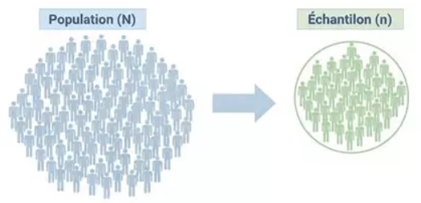
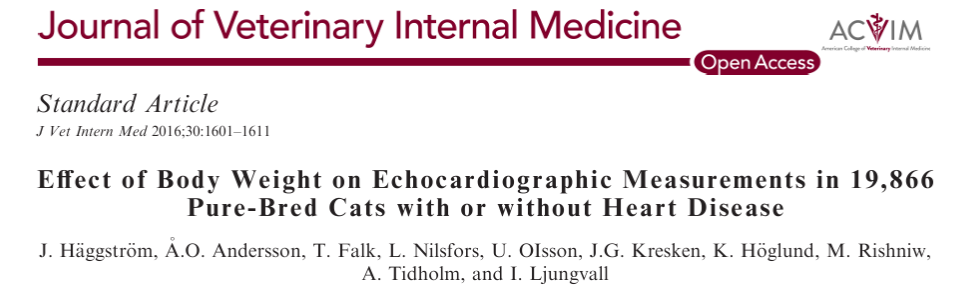

```{r setup}
#| include: false
#| echo: false
#| message: false
#| warning: false


library(MASS)
library(ggplot2)
library(plotly)
library(dplyr)
library(msos)
library(patchwork)
library(kableExtra)

data(cats)
force(cats)
```

## 🔍 Intro : Intervalle de confiance / de prédiction, qu'est-ce c'est ?

```{=html}
<div style="height:5px;"></div>
```

> Les [intervalles de confiance et de prédiction]{.smallcaps} permettent de quantifier l'incertitude associée à l'estimation d'une caractéristique d'une population ou à la prédiction d'une nouvelle observation.

```{=html}
<div style="height:20px;"></div>
```

. . .

| Question de recherche | Méthode utilisée |
|------------------------------------|------------------------------------|
| Quel est le poids moyen des chats persans adulte et en bonne santé ? | Intervalle de confiance |
| Un propriétaire consulte pour un chiot Labrador de 4 mois. Dans quel intervalle peut-on prédire son poids à 6 mois à partir de données de croissance ? | Intervalle de prédiction |
| Vous étudiez deux traitements contre l'arthrose chez le chien. Quelle est la différence moyenne de réduction du score de douleur entre les deux traitements ? | Intervalle de confiance |

. . .

```{=html}
<div style="height:30px;"></div>
```

::: callout-warning
**Intervalle de confiance et intervalle de prédiction ne sont pas interchangeables** : l'un permet d'estimer un paramètre inconnu, tandis que l'autre permet d'encadrer une nouvelle observation.
:::

## 🐈 Application : Présentation des données

```{=html}
<div style="height:5px;"></div>
```

[[Jeu de données utilisé :]{.underline}]{.smallcaps} Mesures anatomiques chez $144$ chats adultes, disponibles dans le package R *MASS* [@fisher1947; @MASS].

. . .

::::::: columns
:::: {.column width="60%"}
```{=html}
<div style="height:40;"></div>
```

- 144 chats étudiés

::: fragment
- Sexe : Femelles (F), Mâles (M)

  |                 | Femelles | Males |
  |-----------------|----------|-------|
  | Nb. d'individus | 47       | 97    |

- 2 mesures morphologiques :

  | Nom | Mesure         | Unité |
  |-----|----------------|-------|
  | Bwt | Poids corporel | kg    |
  | Hwt | Poids du coeur | g     |
:::
::::

:::: {.column width="40%"}
::: columns
```{r}
#| echo: false
#| message: false
#| warning: false


knitr::kable(head(cats, 10))
```
:::
::::
:::::::

. . .

```{=html}
<div style="height:15px;"></div>
```

::: {style="text-align: center; font-size: 0.85em;"}
Dans la suite, on va se concentrer uniquement sur le poids corporel (Bwt) de l'ensemble des chats.
:::

## 🐈 Application : Questions de recherche

:::: center-text
::: highlight-box
1.  **Quel est le poids corporel moyen des animaux de la population étudiée ?**
2.  **Dans quel intervalle peut-on prédire le poids corporel d'un nouvel animal issue de cette même population ?**
:::
::::

## 📖 Objectifs du cours

```{=html}
<br>
<br>
<div style="height:5px;"></div>
```

1.  Pourquoi utiliser des intervalles de confiance et de prédiction ? (Vocabulaire & Objectif)

. . .

```{=html}
<div style="height:5px;"></div>
```

2.  Comment construire un intervalle de confiance ?

. . .

```{=html}
<div style="height:5px;"></div>
```

3.  Comment construire un intervalle de prédiction ?

. . .

```{=html}
<div style="height:5px;"></div>
```

4.  Application aux données de chats avec R

. . .

```{=html}
<div style="height:5px;"></div>
```

5.  Conclusion & Exemple concret d'une contribution en sciences vétérinaire

## 1️⃣ Vocabulaire de l'échantillonnage

::: {style="position: absolute; top: 0px; right: 0px; width: 400px;"}
```{=html}

```
:::

<br> <br>

```{=html}
<div style="height:25px;"></div>
```

Soit $X$ une variable aléatoire (v.a.) décrivant la caractéristique étudiée (poids, taille, etc.) dans la [**population**]{.smallcaps}. On considère un [**échantillon**]{.smallcaps} $X_1,\ldots,X_n$ de v.a. indépendantes et de même loi (que $X$), où $X_i$ désigne la mesure sur le $i$-ème individu.

```{=html}
<div style="height:30px;"></div>
```

|   | Population (paramètre inconnu) | Échantillon (estimateur) |
|:-----------------------|:----------------------:|:----------------------:|
| Moyenne | $\mu_\mathrm{pop} =\mathbb E(X)$ | $\displaystyle M_\mathrm{ech} =\frac1n\sum_{i=1}^nX_i$ |
| Variance | $\sigma^2_\mathrm{pop} =\operatorname{Var}(X)$ | $\displaystyle S^2_\mathrm{ech} =\frac1{n-1}\sum_{i=1}^n(X_i-\mu_{\mathrm{ech}})^2$ |

```{=html}
<div style="height:30px;"></div>
```

::: {style="text-align: center;"}
On note $x_1, \ldots, x_n$ les observations (réalisations de $X_1,\ldots,X_n$). A partir de ces dernières, on peut calculer $\mu_\mathrm{ech}$ et $s^2_\mathrm{ech}$ les [estimations ponctuelles]{.smallcaps} de $\mu$ et de $\sigma^2$.
:::

## 1️⃣ Vocabulaire de l'échantillonnage- Exemple

<br>

| Notion | Application aux données de chats |
|:-----------------------------------|:-----------------------------------|
| [Population]{.smallcaps} | Les $N = 144$ chats du jeu de données `cats` |
| [Échantillon]{.smallcaps} | Un sous-ensemble de chats tirés aléatoirement, de taille $n$ |
|   |   |
| [Variable aléatoire]{.smallcaps} $X$ | Poids corporel (en kg) |
|   |   |
| [Moyenne]{.smallcaps} $\mu_{\mathrm{pop}}$ (inconnue) | Poids corporel moyen des $N$ chats |
| Estimateur $M_{\mathrm{ech}}$ | Moyenne empirique d'un échantillon de chats |
| Estimation ponctuelle $\mu_{\mathrm{ech}}$ (calculée) | Moyenne **calculée** à partir des chats de l'échantillon |
|   |   |
| [Variance]{.smallcaps} $\sigma_{\mathrm{pop}}^2$ (inconnue) | Variance des poids corporels des $N$ chats |
| Estimateur $S_{\mathrm{ech}}^2$ | Variance empirique corrigée d'un échantillon de chats |
| Estimation ponctuelle $s_{\mathrm{ech}}^2$ (calculée) | Variance empirique corrigée **calculée** à partir des chats de l'échantillon |

## 1️⃣ Pourquoi construire ce genre d'intervalles ?

```{=html}
<div style="height:35px;"></div>
```

::::::: columns
:::: {.column width="50%"}
::: {.callout-note title="Intervalle de confiance"}
**Problème :** Comment estimer une caractéristique inconnue d'une population à partir d'un échantillon ?

**Objectif :** Quantifier l'incertitude associée à cette estimation.
:::
::::

:::: {.column width="50%"}
::: {.callout-note title="Intervalle de prédiction"}
**Problème :** Comment prévoir la valeur d'une caractéristique chez un nouvel individu ?

**Objectif :** Quantifier l'incertitude associée à cette prédiction.
:::
::::
:::::::

. . .

::: small-box
Dans ce cours, on suppose que les observations sont [**indépendantes**]{.smallcaps} et [**suivent une loi normale**]{.smallcaps}.
:::

```{=html}
<div style="height:25px;"></div>
```

::: grande-fig
```{r}
#| echo: false
#| message: false
#| warning: false
#| fig-width: 10
#| fig-height: 2.5
#| out-width: "100%"
#| fig-align: center

x <- seq(-5, 5, length.out = 1000)

ggplot(data.frame(x = x), aes(x = x)) +
  geom_line(
    aes(y = dnorm(x)),
    color = "#D17A57",
    linewidth = 1.25
  ) +
  labs(x = "x", y = "Densité") +
  theme_minimal(base_size = 20)

```
:::

## 2️⃣ Pourquoi une estimation ponctuelle ne suffit-elle pas ?

```{=html}
<div style="height:10px;"></div>
```

Supposons qu'on cherche à estimer le poids moyen des $144$ chats à partir de $5$ échantillons aléatoires composés de $5$ chats.

```{=html}
<div style="height:10px;"></div>
```

```{r}
#| echo: false
#| message: false
#| warning: false

set.seed(123)

# Cinq échantillons de cinq chats
echantillons <- lapply(1:5, function(i) {
  sample(cats$Bwt, size = 5, replace = FALSE)
})

# Tableau des observations et des moyennes
tableau <- do.call(rbind, lapply(seq_along(echantillons), function(i) {
  c(echantillons[[i]], mean(echantillons[[i]]))
}))

colnames(tableau) <- c(
  "$x_1$", "$x_2$", "$x_3$", "$x_4$", "$x_5$", "$\\mu_{\\mathrm{ech}}$"
)
rownames(tableau) <- paste("Échantillon", 1:5)

knitr::kable(
  round(tableau, 2),
  align = "c"
  )
```

::: {style="font-size: 0.85em; color: gris;text-align: center"}
$\boxed{ \mu_\mathrm{ech} = \frac1n\sum_{i=1}^n x_i}$
:::

. . .

```{=html}
<div style="height:5px;"></div>
```

::: callout-warning
[**La moyenne empirique varie d'un échantillon à un autre**]{.smallcaps} **:** il faut donner des marges d'erreurs.
:::

## 2️⃣ Espérance et écart-type de la moyenne d'échantillon $M_\mathrm{ech}$

```{=html}
<div style="height:5px;"></div>
```

::: {style="font-size: 0.85em;"}
Soit un échantillon $X_1,\ldots,X_n$ de v.a. indépendantes et de même loi, d'espérance $\mu_{\mathrm{pop}}$ et de variance $\sigma_{\mathrm{pop}}^2$. On note $\displaystyle M_\mathrm{ech} =\frac1n\sum_{i=1}^nX_i$ l'estimateur de la moyenne et $\mu_\mathrm{ech}$ son estimation ponctuelle.
:::

::::::: columns
:::: {.column width="50%"}
::: {style="text-align: center;"}
[[Espérance]{.underline}]{.smallcaps}
:::

$$
\mathbb E(M_{\mathrm{ech}})=\mu_{\mathrm{pop}}
$$
::::

:::: {.column width="50%"}
::: {style="text-align: center;"}
[[Ecart-type]{.underline}]{.smallcaps}
:::

$$
\operatorname{sd}(M_{\mathrm{ech}})
=\frac{\sigma_{\mathrm{pop}}}{\sqrt n}
$$
::::
:::::::

. . .

::::: columns
::: {.column width="50%"}
```{r}
#| echo: false
#| message: false
#| warning: false
#| fig-height: 4.5
#| fig-align: left


set.seed(123)

# Paramètres de la population simulée
mu_pop <- 3
sigma_pop <- 0.6

# Taille de chaque échantillon et nombre de répétitions
n <- 10
N_values <- c(5, 20, 100, 1000)

# Simulation de 1000 moyennes d'échantillons
M_ech <- replicate(
  max(N_values),
  mean(rnorm(n, mean = mu_pop, sd = sigma_pop))
)

# Préparation des données
data_esperance <- dplyr::bind_rows(
  lapply(N_values, function(N) {
    data.frame(
      M_ech = M_ech[1:N],
      N_ech = paste0("Nech = ", N)
    )
  })
)

data_esperance$N_ech <- factor(
  data_esperance$N_ech,
  levels = paste0("Nech = ", N_values)
)

# Moyenne des estimations pour chaque nombre d'échantillons
moyennes <- data_esperance %>%
  dplyr::group_by(N_ech) %>%
  dplyr::summarise(
    moyenne = mean(M_ech),
    .groups = "drop"
  )

# Graphique avec légende
p1 <- ggplot(data_esperance, aes(x = M_ech)) +
  geom_histogram(
    aes(
      y = after_stat(density),
      fill = "Moyennes d'échantillon"
    ),
    binwidth = 0.08,
    color = "white",
    alpha = 0.8
  ) +
  geom_vline(
    aes(
      xintercept = mu_pop,
      color = "Moyenne de la population",
      linetype = "Moyenne de la population"
    ),
    linewidth = 1.2
  ) +
  geom_vline(
    data = moyennes,
    aes(
      xintercept = moyenne,
      color = "Moyenne des estimations",
      linetype = "Moyenne des estimations"
    ),
    linewidth = 1.2
  ) +
  facet_wrap(~N_ech, ncol = 2) +
  coord_cartesian(xlim = c(2, 4)) +
  scale_fill_manual(
    name = NULL,
    values = c(
      "Moyennes d'échantillon" = "#0072B2"
    )
  ) +
  scale_color_manual(
    name = NULL,
    values = c(
      "Moyenne de la population" = "black",
      "Moyenne des estimations" = "#E69F00"
    )
  ) +
  scale_linetype_manual(
    name = NULL,
    values = c(
      "Moyenne de la population" = "dashed",
      "Moyenne des estimations" = "solid"
    )
  ) +
  labs(
    title = "Moyennes d'échantillon selon le nombre d'échantillons simulés",
    x = "Moyennes d'échantillon",
    y = "Densité"
  ) +
  theme_minimal(base_size = 20) +
  theme(
    plot.title = element_text(
      size = 22,
      face = "bold",
      hjust = 0.5
    ),
    strip.text = element_text(size = 22, face = "bold"),
    axis.text = element_text(size = 18),
    axis.title = element_text(size = 20),
    legend.position = "bottom",
    legend.text = element_text(size = 18)
  )

p1
```
:::

::: {.column width="50%"}
```{r}
#| echo: false
#| message: false
#| warning: false
#| fig-height: 4.5
#| fig-align: right


set.seed(123)

mu_pop <- 3
sigma_pop <- 0.6

N <- 2000
tailles <- c(5, 10, 30, 100)

# Simuler les moyennes des échantillons
data_variance <- dplyr::bind_rows(
  lapply(tailles, function(n) {
    data.frame(
      M_ech = replicate(
        N,
        mean(rnorm(n, mean = mu_pop, sd = sigma_pop))
      ),
      Taille = paste0("n = ", n)
    )
  })
)

data_variance$Taille <- factor(
  data_variance$Taille,
  levels = paste0("n = ", tailles)
)

# Graphique avec légende
p2 <- ggplot(data_variance, aes(x = M_ech)) +
  geom_histogram(
    aes(
      y = after_stat(density),
      fill = "Moyennes d'échantillon"
    ),
    binwidth = 0.05,
    color = "white",
    alpha = 0.8
  ) +
  geom_vline(
    aes(
      xintercept = mu_pop,
      linetype = "Moyenne de la population"
    ),
    color = "black",
    linewidth = 1.5
  ) +
  facet_wrap(~Taille, ncol = 2) +
  coord_cartesian(xlim = c(2, 4)) +
  scale_fill_manual(
    name = NULL,
    values = c(
      "Moyennes d'échantillon" = "#0072B2"
    )
  ) +
  scale_linetype_manual(
    name = NULL,
    values = c(
      "Moyenne de la population" = "dashed"
    )
  ) +
  labs(
    title = "Moyennes d'échantillon selon la taille de l'échantillon",
    x = "Moyennes d'échantillon",
    y = "Densité"
  ) +
  theme_minimal(base_size = 20) +
  theme(
    plot.title = element_text(
      size = 22,
      face = "bold",
      hjust = 0.5
    ),
    strip.text = element_text(size = 22, face = "bold"),
    axis.text = element_text(size = 18),
    axis.title = element_text(size = 20),
    legend.position = "bottom",
    legend.text = element_text(size = 18)
  )

p2
```
:::
:::::

## 2️⃣ Théorème central limite

::: small-box
[**Théorème central limite (TCL) :**]{.underline} Soit $X_1,X_2,\ldots,X_n$ un échantillon de $n$ valeurs tirées aléatoirement et indépendamment dans une population de moyenne $\mu_{\mathrm{pop}}$ et d'écart-type $\sigma_{\mathrm{pop}}$.

Alors, lorsque $n\to+\infty$, la moyenne d'échantillon $\displaystyle M_{\mathrm{ech}}=\frac{1}{n}\sum_{i=1}^{n}X_i$ vérifie :

$$
\mathbb P\left(
a\leq
\frac{M_{\mathrm{ech}}-\mu_{\mathrm{pop}}}
{\sigma_{\mathrm{pop}}/\sqrt{n}}
\leq b
\right)
\xrightarrow[n\to+\infty]{}
\mathbb P(a\leq Z\leq b),
$$ où $Z\sim\mathcal N(0,1)$.
:::

::: grande-fig
```{r}
#| echo: false
#| fig-width: 10
#| fig-height: 3.25
#| out-width: "100%"
#| fig-align: center

# Bornes de l'intervalle
a <- -1.5
b <- 1.5

# Densité de la loi normale centrée réduite
x <- seq(-5, 5, length.out = 1000)
data_normale <- data.frame(
  x = x,
  densite = dnorm(x)
)

ggplot(data_normale, aes(x = x, y = densite)) +
  # Aire correspondant à P(a ≤ Z ≤ b)
  geom_area(
    data = subset(data_normale, x >= a & x <= b),
    fill = "#0072B2",
    alpha = 0.35
  ) +
  # Courbe de densité
  geom_line(
    color = "#0072B2",
    linewidth = 1.5
  ) +
  # Bornes a et b
  geom_vline(
    xintercept = c(a, b),
    linetype = "dashed",
    color = "#E69F00",
    linewidth = 1
  ) +
  # Étiquettes des bornes
  annotate(
    "text",
    x = c(a-0.2, b+0.2),
    y = c(0.025, 0.025),
    label = c("a", "b"),
    size = 8,
    color = "#E69F00"
  ) +
  # Probabilité dans la zone colorée
  annotate(
    "text",
    x = (a + b) / 2,
    y = 0.18,
    label = "P(a ≤ Z ≤ b)",
    size = 7,
    fontface = "bold"
  ) +
  labs(
    x = "z",
    y = "Densité"
  ) +
  scale_y_continuous(
    limits = c(0, 0.45),
    expand = c(0, 0)
  ) +
  theme_minimal(base_size = 20)
```
:::

## 2️⃣ Intervalles de fluctuation

```{=html}
<div style="height:5px;"></div>
```

:::::::: columns
::::::: {.column width="65%"}
:::::: {style="font-size: 0.9em; padding: 0; margin: 0;"}
1.  D'après le [Théorème central limite]{.smallcaps}, on a :

::: {style="font-size: 0.85em; margin-top: -27px; margin-bottom: -25px;"}
$$
\frac{M_{\mathrm{ech}}-\mu_{\mathrm{pop}}}
{\sigma_{\mathrm{pop}}/\sqrt n}
\overset{\mathrm{approx.}}{\sim}\mathcal N(0,1).
$$
:::

2.  On cherche $a$ et $b$ tels que :

::: {style="font-size: 0.85em; margin-top: -27px; margin-bottom: -25px;"}
$$
\mathbb P\left(
a\leq\frac{M_{\mathrm{ech}}-\mu_{\mathrm{pop}}}
{\sigma_{\mathrm{pop}}/\sqrt n}\leq b
\right)\approx 1-\alpha.
$$
:::

3.  En réarrangeant les inéquations, on obtient :

::: {style="font-size: 0.85em; margin-top: -27px;"}
$$
\mathbb P\left(
\mu_{\mathrm{pop}}+a\frac{\sigma_{\mathrm{pop}}}{\sqrt n}
\leq M_{\mathrm{ech}}\leq
\mu_{\mathrm{pop}}+b\frac{\sigma_{\mathrm{pop}}}{\sqrt n}
\right)\approx 1-\alpha.
$$
:::

Et finalement,
::::::
:::::::
::::::::

::::: {.column width="30%"}
:::: {style="border: 2px solid #D9E1F2;   border-radius: 25px;   padding: 0;   margin: 20px 0px 0px 50px;   background: white;   box-shadow: 0 2px 8px rgba(100,120,150,0.10);   overflow: hidden;"}
::: {.text-center style="text-align: center;   font-size: 0.75em;"}
[valeurs de]{.smallcaps} $a$ [et]{.smallcaps} $b$ [par niveau de confiance :]{.smallcaps}

| $1-\alpha$ |    $a$     |    $b$    |
|:----------:|:----------:|:---------:|
|    95 %    | $-1{,}96$  | $1{,}96$  |
|    99 %    | $-2{,}576$ | $2{,}576$ |

```{r}
#| echo: false
#| fig-width: 4
#| fig-height: 2.7
#| out-width: "100%"


a <- -1.96
b <- 1.96

data_normale <- data.frame(
  x = seq(-4, 4, length.out = 2000)
)
data_normale$densite <- dnorm(data_normale$x)

ggplot(data_normale, aes(x, densite)) +
  geom_area(
    data = subset(data_normale, x >= a & x <= b),
    fill = "#0072B2",
    alpha = 0.4
  ) +
  geom_line(color = "#0072B2", linewidth = 1.1) +
  geom_vline(
    xintercept = c(a, b),
    linetype = "dashed",
    color = "#E69F00"
  ) +
  annotate(
    "text", x = 0, y = 0.17,
    label = "95 %", size = 6,
    fontface = "bold"
  ) +
  scale_x_continuous(
    breaks = c(a, 0, b),
    labels = c("-1,96", "0", "1,96")
  ) +
  coord_cartesian(
    xlim = c(-3.5, 3.5),
    ylim = c(0, 0.43)
  ) +
  labs(x = "z", y = NULL) +
  theme_minimal(base_size = 14) +
  theme(
    axis.text.y = element_blank(),
    axis.ticks.y = element_blank(),
    panel.grid = element_blank()
  )
```
:::
::::
:::::

::: {style="margin-top: -30px; margin-bottom: -30px;"}
$$
\color{#0072B2}{
\boxed{
IF_{95\%}=
\left[
\mu_{\mathrm{pop}}-1{,}96\frac{\sigma_{\mathrm{pop}}}{\sqrt n}
\,;\,
\mu_{\mathrm{pop}}+1{,}96\frac{\sigma_{\mathrm{pop}}}{\sqrt n}
\right]
}
}
$$
:::

## 2️⃣ Intervalle de confiance

```{=html}
<div style="height:5px;"></div>
```

[[**Objectif :**]{.underline}]{.smallcaps} Encadrer la moyenne inconnue $\mu_\mathrm{obs}$ à partir de la moyenne empirique calculée sur les observations $\mu_\mathrm{ech}$.

- $\sigma_{\mathrm{pop}}$ connu :

::: {style="font-size: 0.95em; margin-top: -30px; margin-bottom: -30px;"}
$$
\color{#0072B2}{\boxed{
IC_{95\%}=
\left[
\mu_{\mathrm{ech}}-1{,}96\frac{\sigma_{\mathrm{pop}}}{\sqrt n}
\,;\,
\mu_{\mathrm{ech}}+1{,}96\frac{\sigma_{\mathrm{pop}}}{\sqrt n}
\right]
}}
$$
:::

- $\sigma_{\mathrm{pop}}$ inconnu :

::: {style="font-size: 0.95em; margin-top: -30px;"}
$$
\color{#D17A57}{
\boxed{
IC_{95\%}=
\left[
\mu_{\mathrm{ech}}-t_{0{,}975,n-1}\frac{s_{\mathrm{ech}}}{\sqrt n}
\,;\,
\mu_{\mathrm{ech}}+t_{0{,}975,n-1}\frac{s_{\mathrm{ech}}}{\sqrt n}
\right]
}}
$$
:::

::: {.callout-note title="Interprétation"}
Sur un grand nombre d'échantillons indépendants, environ 95 % des IC construits contiendraient la véritable moyenne $\mu_{\mathrm{pop}}$.
:::

## 2️⃣ I️ntervalle de confiance - Exemple

```{=html}
<div style="height:2px;"></div>
```

::: {style="font-size: 0.9em;"}
On tire un échantillon de $50$ chats parmi les $144$.
:::

::::::::: columns
::::::: {.column width="50%"}
:::::: {style="font-size: 0.9em; padding: 0; margin: 0;"}
- [Moyenne empirique :]{.underline}

::: {style="font-size: 0.9em; margin-top: -30px; margin-bottom: -30px;"}
$$
\mu_{\mathrm{ech}}
=\frac{1}{50}\sum_{i=1}^{50}x_i
= 2.628
$$
:::

- [Écart-type empirique :]{.underline}

::: {style="font-size: 0.9em; margin-top: -30px; margin-bottom: -30px;"}
$$
s_{\mathrm{ech}}
=\sqrt{\frac{1}{49}\sum_{i=1}^{50}(x_i-\mu_{\mathrm{ech}})^2}
= 0.469
$$
:::

- [Quantile de Student :]{.underline}

::: {style="font-size: 0.9em; margin-top: -30px; margin-bottom: -30px;"}
$$
t_{0{,}975;49}=2.001
$$
:::
::::::
:::::::

::: {.column width="50%"}
```{r}
#| echo: false
#| fig-width: 5
#| fig-height: 5
#| out-width: "95%"
#| fig-align: center

set.seed(123)

# Tirage de 50 chats parmi les 144
echantillon <- cats[
  sample(nrow(cats), 50, replace = FALSE),
]

# Estimations ponctuelles
n <- nrow(echantillon)
mu_ech <- mean(echantillon$Bwt)
s_ech <- sd(echantillon$Bwt)

# IC à 95 % avec correction de population finie
t_crit <- qt(0.975, df = n - 1)
correction <- sqrt((144 - n) / (144 - 1))
marge <- t_crit * s_ech / sqrt(n) * correction

IC <- c(mu_ech - marge, mu_ech + marge)


# Histogramme interactif avec Plotly

# Calcul des effectifs pour définir la hauteur de la ligne
h <- hist(
  echantillon$Bwt,
  breaks = seq(
    floor(min(echantillon$Bwt) * 5) / 5,
    ceiling(max(echantillon$Bwt) * 5) / 5 + 0.2,
    by = 0.2
  ),
  plot = FALSE
)

y_max <- max(h$counts) * 1.1

g <- plotly::plot_ly() %>%
  plotly::add_trace(
    x = echantillon$Bwt,
    type = "histogram",
    xbins = list(size = 0.2),
    marker = list(
      color = "#0072B2",
      line = list(color = "white", width = 1)
    ),
    opacity = 0.8,
    name = "Poids des chats",
    hovertemplate = "Poids : %{x} kg<br>Effectif : %{y}<extra></extra>"
  ) %>%
  plotly::add_trace(
    x = c(mu_ech, mu_ech),
    y = c(0, y_max),
    type = "scatter",
    mode = "lines",
    line = list(
      color = "#E69F00",
      width = 3
    ),
    name = "Moyenne de l'échantillon",
    hovertemplate = paste0(
      "Moyenne : ", round(mu_ech, 3),
      " kg<extra></extra>"
    )
  ) %>% plotly::layout(
  font = list(
    size = 22,
    family = "Arial",
    color = "black"
  ),
  title = list(
  text = "Poids des chats de l'échantillon",
  x = 0.5,
  xanchor = "center",
  font = list(size = 24)
),
  xaxis = list(
    title = list(
      text = "Poids (kg)",
      font = list(size = 20)
    ),
    tickfont = list(size = 20)
  ),
  yaxis = list(
    title = list(
      text = "Effectif",
      font = list(size = 20)
    ),
    tickfont = list(size = 20),
    range = c(0, y_max)
  ),
  bargap = 0.05,
  showlegend = FALSE,
  hovermode = "closest",
  hoverlabel = list(
    font = list(size = 20)
  ),
margin = list(
  t = 75,
  b = 45,
  l = 55,
  r = 10,
  autoexpand = FALSE
)
)

g
```
:::
:::::::::

. . .

::: {style="font-size: 0.9em;"}
$$
IC_{95\%}\approx
\left[
\mu_{\mathrm{ech}}-
t_{0{,}975;49}\frac{s_{\mathrm{ech}}}{\sqrt{50}}
\sqrt{\frac{94}{143}}
\,;\,
\mu_{\mathrm{ech}}+
t_{0{,}975;49}\frac{s_{\mathrm{ech}}}{\sqrt{50}}
\sqrt{\frac{94}{143}}
\right]
=
\boxed{[2{,}688\,;\,2{,}912] \ \mathrm{kg}}
$$
:::

## 3️⃣ Sources de variabilité à prendre en compte dans la prédiction

```{=html}
<div style="height:5px;"></div>
```

[[**Objectif :**]{.underline}]{.smallcaps} Prédire le poids d'un **nouveau chat**, noté $X_{\mathrm{new}}$, à partir de notre échantillon $X_1, \ldots, X_n$.

::::::::::: columns
:::::: {.column width="50%"}
::: {style="text-align: center;"}
[[Incertitude sur la moyenne estimée]{.underline}]{.smallcaps}
:::

::: {style="font-size: 0.9em; margin-top: -20px;"}
$$
\operatorname{Var}(M_{\mathrm{ech}})
=\frac{\sigma_{\mathrm{pop}}^2}{n}
$$
:::

::: {style="font-size:0.85em; text-align: center;"}
$\Longrightarrow$ la moyenne de l'échantillon varie d'un échantillon à l'autre.
:::
::::::

:::::: {.column width="50%"}
::: {style="text-align: center;"}
[[Variabilité individuelle]{.underline}]{.smallcaps}
:::

::: {style="font-size: 0.9em;"}
$$
\operatorname{Var}(X_{\mathrm{new}})
=\sigma_{\mathrm{pop}}^2
$$
:::

::: {style="font-size: 0.85em; text-align: center;"}
$\Longrightarrow$ les valeurs individuelles varient autour de la moyenne de la population.
:::
::::::
:::::::::::

::: {style="font-size: 0.9em; margin-top: -15px;"}
$$
\boxed{\operatorname{Var}(X_{\mathrm{new}}-M_{\mathrm{ech}})
=
\sigma_{\mathrm{pop}}^2+
\frac{\sigma_{\mathrm{pop}}^2}{n}
=
\sigma_{\mathrm{pop}}^2\left(1+\frac{1}{n}\right)}
$$
:::

::: small-box
Plutôt que de prédire une valeur exacte, on cherche un **intervalle dans lequel le poids du nouveau chat pourrait se situer**.
:::

## 3️⃣ Intervalle de prédiction

```{=html}
<div style="height:5px;"></div>
```

::: {style="font-size: 0.9em; padding: 0; margin: 0;"}
1.  D'après les propriétés de la [loi normale]{.smallcaps}, on a :

    ::: {style="font-size: 0.85em; margin-top: -27px; margin-bottom: -27px;"}
    $$
    \frac{X_{\mathrm{new}}-M_{\mathrm{ech}}}
    {\sigma_{\mathrm{pop}}\sqrt{1+\frac{1}{n}}}
    \sim\mathcal N(0,1).
    $$
    :::

2.  On cherche $a$ et $b$ tels que :

    ::: {style="font-size: 0.85em; margin-top: -27px; margin-bottom: -27px;"}
    $$
    \mathbb P\left(
    a\leq
    \frac{X_{\mathrm{new}}-M_{\mathrm{ech}}}
    {\sigma_{\mathrm{pop}}\sqrt{1+\frac{1}{n}}}
    \leq b
    \right)=1-\alpha.
    $$
    :::

3.  En réarrangeant les inéquations, on obtient :

    ::: {style="font-size: 0.85em; margin-top: -27px; margin-bottom: -27px;"}
    $$
    \mathbb P\left(
    M_{\mathrm{ech}}+a\,\sigma_{\mathrm{pop}}\sqrt{1+\frac{1}{n}}
    \leq X_{\mathrm{new}}\leq
    M_{\mathrm{ech}}+b\,\sigma_{\mathrm{pop}}\sqrt{1+\frac{1}{n}}
    \right)=1-\alpha.
    $$
    :::

D'où :
:::

::::::: columns
:::: {.column width="50%"}
$\sigma_{\mathrm{pop}}$ connu :

::: {style="font-size: 0.80em; margin-top: -27px; margin-bottom: -27px;"}
$$
\color{#0072B2}{
\boxed{
IP_{95\%}
=
\mu_{\mathrm{ech}}
\pm 1{,}96\,\sigma_{\mathrm{pop}}
\sqrt{1+\frac{1}{n}}
}}
$$
:::
::::

:::: {.column width="50%"}
$\sigma_{\mathrm{pop}}$ inconnu :

::: {style="font-size: 0.80em; margin-top: -27px; margin-bottom: -27px;"}
$$
\color{#D17A57}{
\boxed{
IP_{95\%}
=
\mu_{\mathrm{ech}}
\pm t_{0{,}975,n-1}\,s_{\mathrm{ech}}
\sqrt{1+\frac{1}{n}}
}}
$$
:::
::::
:::::::

## 3️⃣ Intervalle de prédiction - Exemple

```{=html}
<div style="height:2px;"></div>
```

::: {style="font-size: 0.9em;"}
À partir de notre échantillon de $50$ chats, on souhaite prédire le **poids d'un nouveau chat**.
:::

:::::::::: columns
:::::::: {.column width="50%"}
::::::: {style="font-size: 0.9em; padding: 0; margin: 0;"}
- [Moyenne empirique :]{.underline}

::: {style="font-size: 0.9em; margin-top: -30px; margin-bottom: -30px;"}
$$
\mu_{\mathrm{ech}}=`r round(mu_ech, 3)`\ \mathrm{kg}
$$
:::

- [Écart-type empirique :]{.underline}

::: {style="font-size: 0.9em; margin-top: -30px; margin-bottom: -30px;"}
$$
s_{\mathrm{ech}}=`r round(s_ech, 3)`\ \mathrm{kg}
$$
:::

- [Quantile de Student :]{.underline}

::: {style="font-size: 0.9em; margin-top: -30px; margin-bottom: -30px;"}
$$
t_{0{,}975;49}=`r round(t_crit, 3)`
$$
:::

- [Marge de prédiction :]{.underline}

::: {style="font-size: 0.9em; margin-top: -30px; margin-bottom: -30px;"}
$$
m=t_{0{,}975;49}\,s_{\mathrm{ech}}
\sqrt{1+\frac{1}{50}}
=`r round(qt(0.975, 49) * s_ech * sqrt(1 + 1/50), 3)`
$$
:::
:::::::
::::::::

::: {.column width="50%"}
```{r}
#| echo: false
#| fig-width: 5
#| fig-height: 5
#| out-width: "95%"
#| fig-align: center

# Même échantillon que pour l'IC
n <- nrow(echantillon)
mu_ech <- mean(echantillon$Bwt)
s_ech <- sd(echantillon$Bwt)
t_crit <- qt(0.975, df = n - 1)

# Intervalle de prédiction à 95 %
marge_IP <- t_crit * s_ech * sqrt(1 + 1/n)
IP <- c(mu_ech - marge_IP, mu_ech + marge_IP)

# Histogramme
h <- hist(
  echantillon$Bwt,
  breaks = seq(
    floor(min(echantillon$Bwt) * 5) / 5,
    ceiling(max(echantillon$Bwt) * 5) / 5 + 0.2,
    by = 0.2
  ),
  plot = FALSE
)

y_max <- max(h$counts) * 1.1

g_IP <- plotly::plot_ly() %>%
  plotly::add_trace(
    x = echantillon$Bwt,
    type = "histogram",
    xbins = list(size = 0.2),
    marker = list(
      color = "#0072B2",
      line = list(color = "white", width = 1)
    ),
    opacity = 0.8,
    name = "Poids des chats",
    hovertemplate = "Poids : %{x} kg<br>Effectif : %{y}<extra></extra>"
  ) %>%
  plotly::add_trace(
    x = c(mu_ech, mu_ech),
    y = c(0, y_max),
    type = "scatter",
    mode = "lines",
    line = list(color = "#E69F00", width = 3),
    name = "Moyenne de l'échantillon",
    hovertemplate = paste0(
      "Moyenne : ", round(mu_ech, 3),
      " kg<extra></extra>"
    )
  ) %>%
  plotly::layout(
    font = list(
      size = 22,
      family = "Arial",
      color = "black"
    ),
    title = list(
      text = "Poids des chats de l'échantillon",
      x = 0.5,
      xanchor = "center",
      font = list(size = 24)
    ),
    xaxis = list(
      title = list(text = "Poids (kg)", font = list(size = 20)),
      tickfont = list(size = 20)
    ),
    yaxis = list(
      title = list(text = "Effectif", font = list(size = 20)),
      tickfont = list(size = 20),
      range = c(0, y_max)
    ),
    shapes = list(
      list(
        type = "rect",
        x0 = IP[1], x1 = IP[2],
        y0 = 0, y1 = 1,
        yref = "paper",
        fillcolor = "#D17A57",
        opacity = 0.15,
        line = list(width = 0),
        layer = "below"
      ),
      list(
        type = "line",
        x0 = IP[1], x1 = IP[1],
        y0 = 0, y1 = 1,
        yref = "paper",
        line = list(
          color = "#D17A57",
          dash = "dash",
          width = 2
        )
      ),
      list(
        type = "line",
        x0 = IP[2], x1 = IP[2],
        y0 = 0, y1 = 1,
        yref = "paper",
        line = list(
          color = "#D17A57",
          dash = "dash",
          width = 2
        )
      )
    ),
    bargap = 0.05,
    showlegend = FALSE,
    hovermode = "closest",
    hoverlabel = list(font = list(size = 20)),
    margin = list(
      t = 75,
      b = 45,
      l = 55,
      r = 10,
      autoexpand = FALSE
    )
  )

g_IP
```
:::
::::::::::

. . .

::: {style="font-size: 0.9em;"}
$$
IP_{95\%}=
\left[
\mu_{\mathrm{ech}}-
t_{0{,}975;49}s_{\mathrm{ech}}\sqrt{1+\frac{1}{50}}
\,;\,
\mu_{\mathrm{ech}}+
t_{0{,}975;49}s_{\mathrm{ech}}\sqrt{1+\frac{1}{50}}
\right]
=
\color{#D17A57}{
\boxed{
[`r round(IP[1], 3)`\,;\,`r round(IP[2], 3)`]\ \mathrm{kg}
}}
$$
:::

## ➕ Bonus : C'est quoi "*avoir suffisamment d'observation"* ?

```{=html}
<div style="height:2px;"></div>
```

::: callout-important
Dans ce cours, on utilise beaucoup la formulation *"pour* $n$ *grand"*, mais en pratique à partir de quelle taille $n$ est-il [vraiment]{.smallcaps} grand ?
:::

. . .

```{=html}
<div style="height:10px;"></div>
```

::: {style="text-align: center;"}
**⁉️ Il n'y a pas de réponse universelle à cette question, tout dépend du problème ⁉️**
:::

. . .

```{=html}
<div style="height:10px;"></div>
```

| Valeur de $n$ | Suffisant ou non ? |
|---------------|--------------------|
| 10            | ❌                 |
| 20            | ❌                 |
| 30            | ça peut aller      |
| 45            | ça peut aller      |
| 50            | ✅                 |
| 100 et +      | ✅                 |

```{=html}
<div style="height:10px;"></div>
```

. . .

::: callout-tip
Dans tous les cas, on attend une vision critique du nombre d'observations disponibles.
:::

## 🐈 Application aux données de chats avec R

<br>

**To Do :**

. . .

1.  Tirage aléatoire d'un échantillon et visualisation des données

    <br>

. . .

2.  Calcul des estimations ponctuelles : moyenne et écart-type

    <br>

. . .

3.  Construction des intervalles de confiance et de prédiction à 95 %

    <br>

. . .

4.  Interprétation et comparaison des intervalles

## 🐈 Application aux données de chats - 1 - Visualisation

<br>

::::: columns
::: {.column width="50%"}
``` r
# Tirage de 50 chats parmi les 144
set.seed(123)

echantillon <- cats[
  sample(nrow(cats), 50, replace = FALSE),
]

# Histogramme des poids
ggplot(echantillon, aes(x = Bwt)) +
  geom_histogram(
    binwidth = 0.2,
    fill = "#0072B2",
    color = "white"
  ) +
  labs(
    x = "Poids (kg)",
    y = "Effectif"
  ) +
  theme_minimal(base_size = 20)
```
:::

::: {.column width="50%"}
```{r}
#| echo: false
#| fig-height: 5
#| out-width: "100%"

set.seed(123)
echantillon <- cats[
  sample(nrow(cats), 50, replace = FALSE),
]

ggplot(echantillon, aes(x = Bwt)) +
  geom_histogram(
    binwidth = 0.2,
    fill = "#0072B2",
    color = "white"
  ) +
  labs(
    x = "Poids (kg)",
    y = "Effectif"
  ) +
  theme_minimal(base_size = 20)
```
:::
:::::

## 🐈 Application aux données de chats - 2 - Estimations

<br>

::::: columns
::: {.column width="50%"}
``` r
# Taille de l'échantillon
n <- length(echantillon$Bwt)

# Moyenne empirique
mu_ech <- mean(echantillon$Bwt)

# Écart-type empirique corrigé
s_ech <- sd(echantillon$Bwt)

n
mu_ech
s_ech
```
:::

::: {.column width="50%"}
[[Sortie :]{.underline}]{.smallcaps}

```{r}
#| echo: false


# Taille de l'échantillon
n <- length(echantillon$Bwt)

# Moyenne empirique
mu_ech <- mean(echantillon$Bwt)

# Écart-type empirique corrigé
s_ech <- sd(echantillon$Bwt)

n
mu_ech
s_ech
```
:::
:::::

## 🐈 Application aux données de chats - 3 - Intervalles

<br>

::::: columns
::: {.column width="50%"}
``` r
# IC à 95 % avec correction de population finie
n <- nrow(echantillon)
N <- nrow(cats)

mu_ech <- mean(echantillon$Bwt)
s_ech <- sd(echantillon$Bwt)
t_crit <- qt(0.975, df = n - 1)

correction <- sqrt((N - n) / (N - 1))

IC <- mu_ech + c(-1, 1) *
  t_crit * s_ech / sqrt(n) * correction

# IP à 95 % : formule du modèle i.i.d. normal
IP <- mu_ech + c(-1, 1) *
  t_crit * s_ech * sqrt(1 + 1/n)

IC
IP
```
:::

::: {.column width="50%"}
[[Sortie :]{.underline}]{.smallcaps}

```{r}
#| echo: false

n <- nrow(echantillon)
N <- nrow(cats)
mu_ech <- mean(echantillon$Bwt)
s_ech <- sd(echantillon$Bwt)
t_crit <- qt(0.975, n - 1)

IC <- mu_ech + c(-1, 1) *
  t_crit * s_ech / sqrt(n) *
  sqrt((N - n) / (N - 1))

IP <- mu_ech + c(-1, 1) *
  t_crit * s_ech * sqrt(1 + 1/n)

cat("IC à 95 % :", round(IC, 3), "kg\n")
cat("IP à 95 % :", round(IP, 3), "kg\n")
```
:::
:::::

## 🐈 Application aux données de chats - 4 - Interprétation

<br>

- On cherche à estimer **le poids moyen des 144 chats**.

$$
IC_{95\%}\approx
[`r round(IC[1], 3)`\,;\,`r round(IC[2], 3)`]\ \mathrm{kg}
$$ <br>

- On cherche à prédire **le poids d'un nouveau chat**.

$$
IP_{95\%}\approx
[`r round(IP[1], 3)`\,;\,`r round(IP[2], 3)`]\ \mathrm{kg}
$$

::: callout-note
**L'intervalle de prédiction est plus large que l'intervalle de confiance** car il tient compte de la variabilité individuelle.
:::

## 📝 À quoi servent les intervalles de confiance et de prédiction ?

<br> <br>

[[**Utilisations principales :**]{.underline}]{.smallcaps}

- [Estimer une caractéristique inconnue de la population]{.smallcaps} - *Quel est le poids moyen des chats de la population ?*

  $\longrightarrow$ Construction d'un [intervalle de confiance]{.smallcaps}.

  <br>

. . .

- [Prédire la valeur d'une nouvelle observation]{.smallcaps} - *Quel sera le poids d'un nouveau chat ?*

  $\longrightarrow$ Construction d'un [intervalle de prédiction]{.smallcaps}.

## 📑 Exemple d'utilisation en sciences vétérinaires

```{=html}
<div style="height:20px;"></div>
```

[[**Exemple issu de :**]{.underline}]{.smallcaps} @häggström2016

```{=html}
<div style="height:15px;"></div>
```

{fig-align="center"}

```{=html}
<div style="height:15px;"></div>
```

::: callout-note
Dans la régression linéaire présentée dans cet article on s'intéresse à la question : *La production de lait en début de lactation permet-elle d'expliquer la production de lait sur l'ensemble de la lactation ?*
:::

## 🎯 Conclusion

```{=html}
<div style="height:5px;"></div>
```

::::::::::: columns
:::::: {.column width="50%"}
::: {style="text-align: center;"}
[[**Intervalle de confiance (IC)**]{.underline}]{.smallcaps}
:::

[[Objectif :]{.underline}]{.smallcaps} Encadrer la moyenne de la population.

- $\sigma_{\mathrm{pop}}$ **connu** :

::: {style="font-size: 0.80em; margin-top: -27px; margin-bottom: -27px;"}
$$
\color{#0072B2}{
\boxed{
IC_{95\%}=
\mu_{\mathrm{ech}}\pm
1{,}96\frac{\sigma_{\mathrm{pop}}}{\sqrt n}
}}
$$
:::

- $\sigma_{\mathrm{pop}}$ **inconnu** :

::: {style="font-size: 0.80em; margin-top: -27px; margin-bottom: -27px;"}
$$
\color{#D17A57}{
\boxed{
IC_{95\%}=
\mu_{\mathrm{ech}}\pm
t_{0{,}975,n-1}\frac{s_{\mathrm{ech}}}{\sqrt n}
}}
$$
:::
::::::

:::::: {.column width="50%"}
::: {style="text-align: center;"}
[[**Intervalle de prédiction (IP)**]{.underline}]{.smallcaps}
:::

[[Objectif :]{.underline}]{.smallcaps} Encadrer la prédiction d'une nouvelle observation.

- $\sigma_{\mathrm{pop}}$ **connu** :

::: {style="font-size: 0.80em; margin-top: -27px; margin-bottom: -27px;"}
$$
\color{#0072B2}{
\boxed{
IP_{95\%}=
\mu_{\mathrm{ech}}\pm
1{,}96\,\sigma_{\mathrm{pop}}
\sqrt{1+\frac1n}
}}
$$
:::

- $\sigma_{\mathrm{pop}}$ **inconnu** :

::: {style="font-size: 0.80em; margin-top: -27px; margin-bottom: -27px;"}
$$
\color{#D17A57}{
\boxed{
IP_{95\%}=
\mu_{\mathrm{ech}}\pm
t_{0{,}975,n-1}s_{\mathrm{ech}}
\sqrt{1+\frac1n}
}}
$$
:::
::::::
:::::::::::

```{=html}
<div style="height:45px;"></div>
```

📌 [[**programme du prochain cours :**]{.underline}]{.smallcaps} Tests d'hypothèses

## Références
