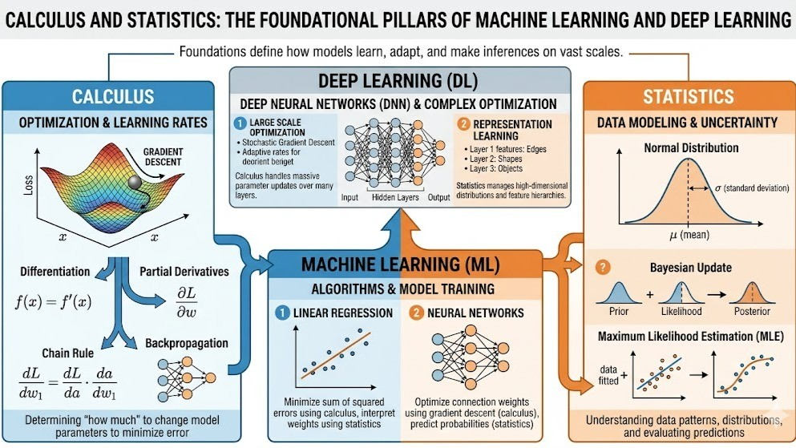
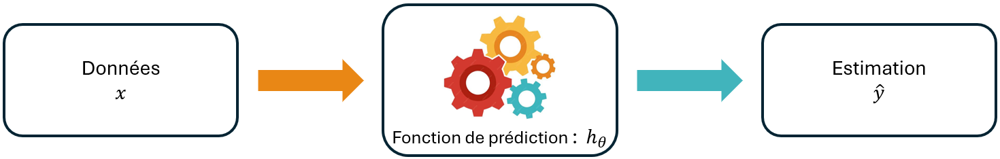
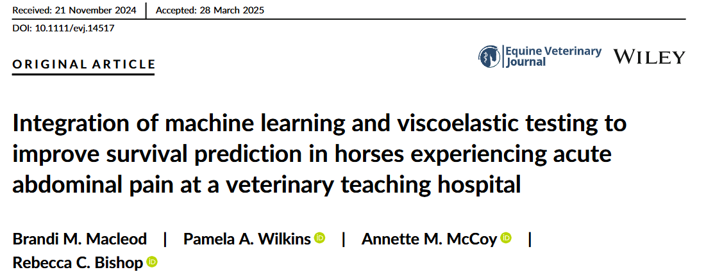

```{r setup}
#| include: false
#| echo: false
#| message: false
#| warning: false


library(ggplot2)
library(plotly)
library(dplyr)
library(patchwork)
library(kableExtra)
library(GSE)


data(horse)

```

## 🔍 Introduction : Le Machine Learning (ML), qu'est-ce que c'est ?

```{=html}
<div style="height:2px;"></div>
```

> Le [machine learning (ML)]{.smallcaps} ou [apprentissage automatique]{.smallcaps}, regroupe des méthodes permettant d'apprendre des relations ou des structures à partir de données, notamment pour réaliser des prédictions sur de nouvelles observations.

```{=html}
<div style="height:7px;"></div>
```

. . .

| Question de recherche | Type de méthode associé |
|------------------------------------|------------------------------------|
| Peut-on prédire le prix de vente d'un appartement à partir de sa superficie, de sa localisation et du nombre de pièces ? | Prédiction (régression) |
| Peut-on déterminer si un âne souffrant de coliques présente une infection à partir de sa température et de sa fréquence cardiaque ? | Classification |
| Peut-on reconnaître le chiffre (de 0 à 9) représenté sur une image manuscrite ? | Reconnaissance d'image (classification) |
| Peut-on identifier différents profils cliniques parmi les animaux hospitalisés dans un même CHUV à partir de leur bilan sanguin ? | Classification non supervisée |

. . .

```{=html}
<div style="height:10px;"></div>
```

::: callout-note
Il existe [différentes méthodes de ML]{.smallcaps}, dont le choix dépend de la question de recherche, de la nature des données et de l'objectif de l'analyse.
:::

## 🐎 Application : Présentation des données

```{=html}
<div style="height:5px;"></div>
```

[[Jeu de données utilisé :]{.underline}]{.smallcaps} Données cliniques de $368$ chevaux souffrant de coliques, issues de @marymcleish1989, disponibles dans le package R *GSE*.

. . .

```{=html}
<div style="height:20px;"></div>
```

::::: columns
::: {.column width="55%"}
- 7 mesures cliniques quantitatives $X$ :

  | Type de mesure | Variables |
  |------------------------------------------|------------------------------|
  | Signes vitaux | Température rectale, fréquences cardiaque et respiratoire |
  | Mesures digestives | pH du reflux nasogastrique |
  | Analyses sanguines | Hématocrite, protéines totales |
  | Analyse du liquide abdominal | Protéines totales |

- 1 variable qualitative binaire $Y$ :

  **Présence d'une lésion chirurgicale** : Oui / Non
:::

::: {.column width="45%"}
```{=html}
<div style="height:5px;"></div>
```

```{r}
#| echo: false
#| message: false
#| warning: false

horse <- horse %>% 
  rename(surgical_lesion = surgical_leison) %>%
  mutate(surgical_lesion = surgical_lesion - 1)

knitr::kable(
  head(horse, 10),
  digits = 2
)
```
:::
:::::

## 🐎 Application : Questions de recherche

:::: center-text
::: highlight-box
**Peut-on prédire si un cheval souffrant de coliques présente une lésion chirurgicale à partir de ses caractéristiques cliniques ?**
:::
::::

## 📖 Objectifs du cours

```{=html}
<br>
<br>
<div style="height:5px;"></div>
```

1.  Pourquoi utiliser le machine learning ? (Définitions & Objectifs)

. . .

```{=html}
<div style="height:5px;"></div>
```

2.  Comment construire un modèle de ML et évaluer sa qualité ? (Théorie)

. . .

```{=html}
<div style="height:5px;"></div>
```

3.  En pratique : Faire du Machine Learning avec R

. . .

```{=html}
<div style="height:5px;"></div>
```

4.  Conclusion & Exemple concret d'une contribution en sciences vétérinaires

## 1️⃣ Pourquoi utiliser le ML ? - Intuition

```{=html}
<div style="height:30px;"></div>
```

Le [machine learning]{.smallcaps} est particulièrement intéressant pour :

- **Analyser des données complexes et de grande dimension** : nombreuses variables, relations non linéaires et interactions.

  *Exemple : prédire une maladie à partir de milliers de mesures génomiques.*

. . .

- **Améliorer les performances prédictives** : construire des modèles capables de prédire correctement de nouvelles observations.

  *Exemple : prédire le risque de complications chez un cheval souffrant de coliques.*

. . .

- **Exploiter des données non structurées** : images, textes ou signaux.

  *Exemple : détecter des anomalies sur des radiographies vétérinaires.*

## 1️⃣ Statistique, ML et Deep-Learning : quelles relations ?

```{=html}
<div style="height:30px;"></div>
```

{width="160%" fig-align="center"}

::: {style="text-align: center; font-size: 0.6em; color: gray;"}
Figure Prakasha S. (2026).
:::

```{=html}
<div style="height:10px;"></div>
```

| Domaine | Définition |
|--------------------------|----------------------------------------------|
| **Statistique** | Décrire, modéliser et analyser des données pour réaliser des inférences et des prédictions. |
| **Machine learning (ML)** | Apprendre des relations ou des structures à partir des données, notamment pour prédire. |
| **Deep learning (DL)** | Sous-domaine du ML utilisant des réseaux de neurones à plusieurs couches. |

## 1️⃣ Quelles méthodes de ML pour quelles questions ?

<br>

::::::: columns
:::: {.column width="50%"}
::: {style="text-align: center;"}
[[**Apprentissage supervisé**]{.underline}]{.smallcaps}

```{=html}
<div style="height:30px;"></div>
```

La variable réponse $Y$ est connue.

```{=html}
<div style="height:20px;"></div>
```

- Prédire un rendement,
- Prédire un type de cancer,
- Sélectionner des bio-marqueurs.

```{=html}
<div style="height:40px;"></div>
```

$\color{#E69F00}{\Longrightarrow}$ Régression, classification
:::
::::

:::: {.column width="50%"}
::: {style="text-align: center;"}
[[**Apprentissage non supervisé**]{.underline}]{.smallcaps}

```{=html}
<div style="height:20px;"></div>
```

Aucune variable réponse $Y$ n'est définie.

```{=html}
<div style="height:20px;"></div>
```

- Découvrir des groupes,
- Étudier les similarités,
- Visualiser des données.

```{=html}
<div style="height:40px;"></div>
```

$\color{#E69F00}{\Longrightarrow}$ Clustering, visualisation
:::
::::
:::::::

## 2️⃣ Définir le problème : Quelles sont les données $X$ et $Y$ ?

```{=html}
<div style="height:2px;"></div>
```

En [apprentissage supervisé]{.smallcaps}, on dispose d'un échantillon de $n$ individus supposés i.i.d., pour lesquels on observe $p$ variables explicatives et une variable réponse.

```{=html}
<div style="height:10px;"></div>
```

::::::::: columns
::::: {.column width="60%"}
::: {style="text-align: center;"}
[**Matrice des variables explicatives**]{.smallcaps}
:::

::: {style="margin-top: -10px; margin-bottom: -20px;"}
$$
X =
\begin{pmatrix}
x_{11} & \cdots & x_{1p} \\
\vdots & \ddots & \vdots \\
x_{n1} & \cdots & x_{np}
\end{pmatrix}
$$
:::
:::::

::::: {.column width="40%"}
:::: {style="text-align: center;"}
[**Vecteur des réponses**]{.smallcaps}

::: {style="margin-top: -10px; margin-bottom: -20px;"}
$$
Y =
\begin{pmatrix}
y_1 \\
\vdots \\
y_n
\end{pmatrix}
$$
:::

- [$Y$ quantitatif : Régression]{style="color: #009E73;"}

- [$Y$ qualitatif : Classification]{style="color: #CC79A7;"}
::::
:::::
:::::::::

. . .

:::: {style="margin-top: -10px; margin-bottom: -20px;"}
::: small-box
[[**Objectif :**]{.underline}]{.smallcaps} à partir des couples observés $(x_i,y_i)$, apprendre une [fonction de prédiction/]{.smallcaps} un [modèle]{.smallcaps} pour prédire la réponse d'un **nouvel individu** à partir de ses variables explicatives.
:::
::::

## 2️⃣ Choisir un modèle : Comment prédire $Y$ ?

::: {style="margin-bottom: -25px;"}
{fig-align="center"}
:::

. . .

[[modèle de prédiction]{.underline}]{.smallcaps}

: En apprentissage supervisé, on choisit une famille de fonctions, de [modèles de prédiction]{.smallcaps} $h_\theta$, paramétrés par $\theta$, tels que :

::: {style="margin-top: -20px; margin-bottom: -20px;"}
$$
  h_\theta : x \longmapsto \hat y = h_\theta(x)
$$
:::

où $\theta$ désigne les paramètres inconnus à estimer à partir des données.

. . .

::: callout-note
En pratique, le [modèle de prédiction]{.smallcaps} qu'on utilise dépend de la nature de la sortie et de l'objectif.
:::

## 2️⃣Différents modèles pour prédire $Y$

```{=html}
<div style="height:5px;"></div>
```

::: callout-note
En pratique, le [modèle de prédiction]{.smallcaps} qu'on utilise dépend de la nature de la sortie et de l'objectif.
:::

```{=html}
<div style="height:50px;"></div>
```

| Type de sortie $Y$ | Objectif | Exemple de modèle |
|:-----------------------|:-----------------------|:-----------------------|
| Quantitative | Régression | Régression linéaire |
| Quantitative | Régression | Arbre de régression |
| Quantitative | Régression | Forêt aléatoire |
| Binaire | Classification | Régression logistique |
| Binaire | Classification | Arbre de classification |
| Binaire | Classification | Forêt aléatoire |
| Qualitative (plusieurs classes) | Classification | Régression logistique multinomiale |
| Qualitative (plusieurs classes) | Classification | Arbre de classification |
| Qualitative (plusieurs classes) | Classification | Forêt aléatoire |

## 2️⃣ Définition du problème et choix du modèle - Exemple

::: {style="margin-bottom: -20px;"}
{height="4cm" fig-align="center"}
:::

[[Données d'entrée :]{.underline}]{.smallcaps} $7$ variables explicatives $x$ (données cliniques).

```{=html}
<div style="height:5px;"></div>
```

[[Sortie :]{.underline}]{.smallcaps} $1$ variable réponse binaire $y$ (présence d'une lésion : Oui/Non).

```{=html}
<div style="height:10px;"></div>
```

[[Modèle de prédiction :]{.underline}]{.smallcaps} La [**régression logistique**]{.smallcaps} est utilisée pour la **classification binaire**, et est définie par:

::: {style="margin-top: -20px; margin-bottom: -20px;"}
$$
\begin{aligned}
h_\theta : \mathbb{R}^p &\longrightarrow ]0,1[\\
x &\longmapsto
\frac{1}{1+\exp\left(-\left(\theta_0+\sum_{j=1}^{p}\theta_j x_j\right)\right)}
\end{aligned}
$$
:::

## 2️⃣ Entraîner le modèle : Comment estimer les paramètres ?

```{=html}
<div style="height:5px;"></div>
```

[[**Objectif :**]{.underline}]{.smallcaps} Déterminer les paramètres $\theta$ de la fonction de prédiction $h_\theta$ à partir des données observées.

```{=html}
<div style="height:10px;"></div>
```

[[**Deux approches mathématiques :**]{.underline}]{.smallcaps}

| Méthode | Problème résolu |
|:-------------------------------|:--------------------------------------:|
| **Minimisation d'une erreur de prédiction** | $\displaystyle \hat{\theta}=\arg\min_{\theta\in\Theta}\sum_{i=1}^{n} ||y_i-h_\theta(x_i))||$ |
| **Maximum de vraisemblance** | $\displaystyle \hat{\theta}=\arg\max_{\theta\in\Theta}\prod_{i=1}^{n}\mathbb{P}_\theta(Y_i=y_i\mid X_i=x_i)$ |

```{=html}
<div style="height:10px;"></div>
```

. . .

[[**Deux modes de résolution :**]{.underline}]{.smallcaps}

| Mode | Principe |
|:-----------------------------------|:-----------------------------------|
| **Solution analytique** | Formule explicite permettant de calculer $\hat{\theta}$ |
| **Résolution numérique** | Algorithme d'optimisation permettant d'approcher $\hat{\theta}$ |

## 2️⃣ Entraînement du modèle — Exemple

```{=html}
<div style="height:5px;"></div>
```

[[**Objectif :**]{.underline}]{.smallcaps} On cherche à prédire la présence d'une lésion chirurgicale ($Y=1$) chez un cheval à partir de $7$ variables cliniques, avec une régression logistique :

::: {style="margin-top: -20px;"}
$$
h_\theta(x_i)=\mathbb{P}_\theta(Y_i=1\mid X_i=x_i)
$$
:::

. . .

[[**Méthode choisie : Maximum de vraisemblance**]{.underline}]{.smallcaps}

On suppose que $Y_i \mid X_i=x_i$ suit une loi de Bernoulli de paramètre $h_\theta(x_i)$. La log-vraisemblance s'écrit :

::: {style="margin-top: -20px; "}
$$
\ell(\theta)=
\sum_{i=1}^{n}
\left[
y_i\log h_\theta(x_i)
+(1-y_i)\log\left(1-h_\theta(x_i)\right)
\right]
$$
:::

. . .

[[**Estimation des paramètres :**]{.underline}]{.smallcaps} On résout **numériquement**

::: {style="margin-top: -20px;"}
$$ 
\hat{\theta} = \arg\max_{\theta\in\mathbb R^{p+1}} \ell(\theta)
$$
:::

## 2️⃣ Évaluer le modèle : Comment mesurer la qualité des prédictions ?

```{=html}
<div style="height:2px;"></div>
```

[[**Objectif :**]{.underline}]{.smallcaps} Mesurer la qualité des prédictions $\hat{y_i}$ en les comparant aux réponses observées $y_i$.

```{=html}
<div style="height:5px;"></div>
```

. . .

[[**Différents indicateurs selon le problème :**]{.underline}]{.smallcaps}

| Type de problème | Indicateur | Principe |
|:-----------------------|:-----------------------|:-----------------------|
| **Régression** | Erreur quadratique moyenne (MSE) | Moyenne des erreurs au carré |
| **Régression** | Erreur absolue moyenne (MAE) | Moyenne des erreurs absolues |
| **Régression** | Coefficient $R^2$ | Qualité de l'ajustement par rapport à une prédiction constante |
| **Classification** | Accuracy | Proportion de prédictions correctes |
| **Classification** | Sensibilité | Proportion de positifs correctement identifiés |
| **Classification** | Spécificité | Prop. de négatifs correctement identifiés |

```{=html}
<div style="height:2px;"></div>
```

. . .

::: callout-note
Les indicateurs de performance dépendent du **type de problème** et de **l'objectif de prédiction**. Ils sont généralement calculés sur des données non utilisées pour entraîner le modèle.
:::

## 3️⃣ Quelles sont les étapes pour entraîner et évaluer un modèle de ML ?

<br>

**To Do :**

. . .

1.  Préparer et nettoyer les données

```{=html}
<div style="height:5px;"></div>
```

. . .

2.  Séparer les données en jeu d'entraînement et de test

```{=html}
<div style="height:5px;"></div>
```

. . .

3.  Estimer les paramètres du modèle

```{=html}
<div style="height:5px;"></div>
```

. . .

4.  Effectuer une validation croisée (si nécessaire)

```{=html}
<div style="height:5px;"></div>
```

. . .

5.  Calculer et interpréter les indicateurs de performance sur les données de test

## 3️⃣ Préparer les données : Quelles vérifications effectuer ?

<br>

[[**Objectif :**]{.underline}]{.smallcaps} Obtenir des données exploitables pour entraîner un modèle de ML.

<br>

. . .

[[**Principales étapes :**]{.underline}]{.smallcaps}

1.  **Sélectionner les variables** : identifier les variables explicatives $X$ et la réponse $Y$ (éventuellement la recoder).

2.  **Explorer les données**.

3.  **Contrôler la qualité des données** : repérer les valeurs manquantes, les incohérences et les doublons.

## 3️⃣ Application - Préparer les données

```{=html}
<div style="height:5px;"></div>
```

::::: columns
::: {.column width="50%"}
``` r
library(GSE)
library(dplyr)
library(ggplot2)

# 1. Récupérer les données
donnees <- data("horse", package = "GSE")  %>%
  mutate(
    surgical_lesion = case_when(
      surgical_lesion == 1 ~ 1L,
      surgical_lesion == 2 ~ 0L,
      TRUE ~ NA_integer_
    )
  ) %>%
  filter(!is.na(surgical_lesion))

# 2. Explorer les données
summary(donnees)

# 3. Contrôler la qualité
colSums(is.na(donnees))
sum(duplicated(donnees))
```
:::

::: {.column width="50%"}
```{r}
#| echo: false
#| message: false
#| warning: false

# Résumé des données
knitr::kable(summary(horse))

#cat("Nombre d'observations :", nrow(horse))
#cat("\nNombre de doublons :", sum(duplicated(horse)))
```
:::
:::::

```{=html}
<div style="height:5px;"></div>
```

. . .

::: {style="font-size: 0.85em;"}
On exclut les deux variables `Abdomcentesis_total_protein`, `Nasogastric_reflux_PH`.
:::

## 3️⃣ Séparer les données :Comment organiser l'entraînement ?

```{=html}
<div style="height:15px;"></div>
```

[[**Objectif :**]{.underline}]{.smallcaps} Évaluer la capacité du modèle à prédire de nouvelles observations.

```{=html}
<div style="height:10px;"></div>
```

. . .

[[**1. Séparer les données :**]{.underline}]{.smallcaps} Diviser aléatoirement les données en deux ensembles :

| Ensemble | Utilisation | Exemple de répartition |
|:-----------------------|:-----------------------|:-----------------------|
| **Entraînement (*train*)** | Estimer les paramètres $\theta$ du modèle | $80\%$ des observations |
| **Test (*test*)** | Évaluer la qualité des prédictions sur de nouvelles observations | $20\%$ des observations |

```{=html}
<div style="height:10px;"></div>
```

. . .

[[**2. Prétraiter les données :**]{.underline}]{.smallcaps}

- **Données d'entraînement** : Transformer les données de certaines colonnes (ex. imputation, standardisation, encodage) pour gérer les valeurs manquantes, les différences d'échelle et les variables qualitatives.

- **Données de test** : Appliquer les mêmes transformations, en utilisant les valeurs calculées sur les données d'entraînement.

## 3️⃣ Application - Séparer les données

<br>

::::: columns
::: {.column width="50%"}
``` r
# Conserver les 5 variables explicatives
donnees <- horse %>%
  dplyr::select(
    Rectal_temperature,
    Pulse,
    Respiratory_rate,
    Packed_cell_volume,
    Total_protein,
    surgical_lesion
  ) %>%
  filter(!is.na(surgical_lesion))

# Séparation entraînement / test
set.seed(123) # pour la reproductibilitlé

id_train <- donnees %>%
  mutate(id = row_number()) %>%
  group_by(surgical_lesion) %>%
  slice_sample(prop = 0.8) %>%
  pull(id)

train <- donnees[id_train, ]
test <- donnees[-id_train, ]

# Traitement des valeurs manquantes
variables <- setdiff(names(train), "surgical_lesion")

med <- sapply(train[variables], median,
              na.rm = TRUE)

for (v in variables) {
  train[[v]][is.na(train[[v]])] <- med[v]
  test[[v]][is.na(test[[v]])] <- med[v]
}

# Effectifs
df <- data.frame(
  Ensemble = c("Entraînement", "Test"),
  Effectif = c(nrow(train), nrow(test))
)

knitr::kable(df)
```
:::

::: {.column width="50%"}
<br> <br> <br> <br>

```{r}
#| echo: false
#| message: false
#| warning: false

# Conserver les 5 variables explicatives
donnees <- horse %>%
  dplyr::select(
    Rectal_temperature,
    Pulse,
    Respiratory_rate,
    Packed_cell_volume,
    Total_protein,
    surgical_lesion
  ) 

# Séparation entraînement / test
set.seed(123) # pour la réplicabilité

id_train <- donnees %>%
  mutate(id = row_number()) %>%
  group_by(surgical_lesion) %>%
  slice_sample(prop = 0.8) %>%
  pull(id)

train <- donnees[id_train, ]
test <- donnees[-id_train, ]

# Traitement des valeurs manquantes
variables <- setdiff(names(train), "surgical_lesion")

med <- sapply(train[variables], median,
              na.rm = TRUE)

for (v in variables) {
  train[[v]][is.na(train[[v]])] <- med[v]
  test[[v]][is.na(test[[v]])] <- med[v]
}

# Effectifs
df <- data.frame(
  Ensemble = c("Entraînement", "Test"),
  Effectif = c(nrow(train), nrow(test))
)

knitr::kable(df)
```
:::
:::::

## 3️⃣ Entraîner le modèle : Comment estimer les paramètres en pratique ?

```{=html}
<div style="height:20px;"></div>
```

[[**Objectif :**]{.underline}]{.smallcaps} Estimer les paramètres $\theta$ de la régression logistique à partir des données d'entraînement.

```{=html}
<div style="height:20px;"></div>
```

. . .

[[**Méthode utilisée :**]{.underline}]{.smallcaps}

- **Critère d'estimation** : maximisation de la log-vraisemblance.
- **Algorithme** : moindres carrés itérativement repondérés (*IRLS*).
- **Principe** : mettre à jour successivement les paramètres jusqu'à convergence.

. . .

```{=html}
<div style="height:20px;"></div>
```

::: callout-note
Dans R, la fonction `glm(..., family = binomial())` réalise automatiquement cette estimation numérique.
:::

## 3️⃣ Application - Entraîner le modèle

<br> <br>

::::: columns
::: {.column width="50%"}
``` r
# Estimation de la régression logistique
modele <- glm(
  surgical_lesion ~ .,
  data = train,
  family = binomial()
)

# Coefficients estimés
round(coef(modele), 3)
```
:::

::: {.column width="50%"}
```{r}
#| echo: false
#| message: false
#| warning: false

# Estimation de la régression logistique
modele <- glm(
  surgical_lesion ~ .,
  data = train,
  family = binomial()
)

# Coefficients estimés
round(coef(modele), 3)
```
:::
:::::

<br>

. . .

::: {.callout-note title="Interprétation"}
Puisqu'on s'intéresse à la qualité de prédiction, on n'interprète pas les coefficients estimés.
:::

## 3️⃣ Validation croisée : Comment optimiser les performances ?

```{=html}
<div style="height:5px;"></div>
```

[[**Objectif :**]{.underline}]{.smallcaps} Évaluer la capacité du modèle à prédire de nouvelles observations et, si nécessaire, **sélectionner les hyperparamètres** offrant les meilleures performances.

. . .

```{=html}
<div style="height:15px;"></div>
```

[[**Principe : Validation croisée à**]{.underline}]{.smallcaps} [$K$ blocs]{.underline}

1.  Diviser les données d'entraînement en $K$ blocs.

2.  Estimer les paramètres sur $K-1$ blocs et évaluer les prédictions sur le bloc restant.

3.  Répéter l'opération $K$ fois, en changeant le bloc utilisé pour l'évaluation.

4.  Calculer la **performance moyenne** obtenue sur les $K$ blocs.

. . .

```{=html}
<div style="height:10px;"></div>
```

::: callout-important
En pratique, la validation croisée est **facultative** pour la régression logistique sans hyperparamètre, mais on va la réaliser avec $K = 5$ et calculer l'[accuracy]{.smallcaps} (i.e le % de bonnes prédictions) pour évaluer la qualité.
:::

## 3️⃣ Application - Validation croisée

::::: columns
::: {.column width="50%"}
``` r
# Données avant imputation
train_cv <- donnees[id_train, ]

# Création de 5 blocs
set.seed(123)
K <- 5
blocs <- sample(rep(
  1:K, length.out = nrow(train_cv)
))

# Validation croisée
accuracy <- sapply(1:K, function(k) {

  app <- train_cv[blocs != k, ]
  val <- train_cv[blocs == k, ]

  # Imputation
  med <- sapply(app[variables],
                median, na.rm = TRUE)

  for (v in variables) {
    app[[v]][is.na(app[[v]])] <- med[v]
    val[[v]][is.na(val[[v]])] <- med[v]
  }

  # Estimation
  m <- glm(surgical_lesion ~ .,
           data = app,
           family = binomial())

  # Prédiction
  pred <- predict(m, val,
                  type = "response") >= 0.5

  mean(pred == val$surgical_lesion)
})

# Accuracy par bloc et moyenne
round(c(accuracy, Moyenne = mean(accuracy)), 3)
```
:::

::: {.column width="50%"}
<br> <br>

```{r}
#| echo: false
#| message: false
#| warning: false

# Données avant imputation
train_cv <- donnees[id_train, ]

# Création de 5 blocs
set.seed(123)
K <- 5
blocs <- sample(rep(
  1:K, length.out = nrow(train_cv)
))

# Validation croisée
accuracy <- sapply(1:K, function(k) {

  app <- train_cv[blocs != k, ]
  val <- train_cv[blocs == k, ]

  # Imputation
  med <- sapply(app[variables],
                median, na.rm = TRUE)

  for (v in variables) {
    app[[v]][is.na(app[[v]])] <- med[v]
    val[[v]][is.na(val[[v]])] <- med[v]
  }

  # Estimation
  m <- glm(surgical_lesion ~ .,
           data = app,
           family = binomial())

  # Prédiction
  pred <- predict(m, val,
                  type = "response") >= 0.5

  mean(pred == val$surgical_lesion)
})

# Accuracy par bloc et moyenne
# Tableau des accuracies
data.frame(
  Bloc = c(paste0("Bloc ", 1:K), "Moyenne"),
  Accuracy = round(c(accuracy, mean(accuracy)), 3)
) %>%
  knitr::kable()
```
:::
:::::

. . .

::: {.callout-note title="Interprétation"}
L'[**accuracy**]{.smallcaps} **moyenne est de 64,9 %** : le modèle classe donc correctement la présence de lésion pour 57 % à 70 % des chevaux, selon les découpages entrainement/test.
:::

## 3️⃣ Évaluer le modèle : Comment mesurer la qualité des prédictions ?

```{=html}
<div style="height:5px;"></div>
```

[[**Principe :**]{.underline}]{.smallcaps} Comparer les réponses observées $y_i$ aux classes prédites $\hat y_i$, puis calculer des indicateurs de performance avec la [matrice de confusion]{.smallcaps} :

|   | Prédit : $Y=1$ (présence de lésion) | Prédit : $Y=0$ (absence de lésion) |
|:--------------------|:------------------------:|:------------------------:|
| **Observé :** $Y=1$ (présence de lésion) | Vrai positif (VP) | Faux négatif (FN) |
| **Observé :** $Y=0$ (absence de lésion) | Faux positif (FP) | Vrai négatif (VN) |

```{=html}
<div style="height:15px;"></div>
```

. . .

[[**Indicateurs de performance :**]{.underline}]{.smallcaps}

| Indicateur | Formule | Interprétation |
|:---------------------|:--------------------------:|:---------------------|
| **Accuracy** | $\dfrac{VP+VN}{VP+VN+FP+FN}$ | Proportion de prédictions correctes |
| **Sensibilité** | $\dfrac{VP}{VP+FN}$ | Proportion de positifs correctement identifiés |
| **Spécificité** | $\dfrac{VN}{VN+FP}$ | Proportion de négatifs correctement identifiés |

## 3️⃣ Application - Évaluer le modèle

```{=html}
<div style="height:10px;"></div>
```

:::::: columns
::: {.column width="50%"}
``` r
# Prédictions sur les données de test
prob <- predict(
  modele,
  newdata = test,
  type = "response"
)

pred <- as.integer(prob >= 0.5)

# Matrice de confusion
conf <- table(
  Observe = factor(test$surgical_lesion,
                   levels = 0:1),
  Predit = factor(pred, levels = 0:1)
)

VN <- conf[1, 1]
FP <- conf[1, 2]
FN <- conf[2, 1]
VP <- conf[2, 2]

# Indicateurs de performance
df <- data.frame(
  Indicateur = c("Accuracy", "Sensibilité",
                 "Spécificité"),
  Valeur = round(c(
    (VP + VN) / sum(conf),
    VP / (VP + FN),
    VN / (VN + FP)
  ), 3)
)

knitr::kable(df)
```
:::

:::: {.column width="50%"}
<br>

```{=html}
<div style="height:15px;"></div>
```

```{r}
#| echo: false
#| message: false
#| warning: false

# Prédictions sur les données de test
prob <- predict(
  modele,
  newdata = test,
  type = "response"
)

pred <- as.integer(prob >= 0.5)

# Matrice de confusion
conf <- table(
  Observe = factor(test$surgical_lesion,
                   levels = 0:1),
  Predit = factor(pred, levels = 0:1)
)

VN <- conf[1, 1]
FP <- conf[1, 2]
FN <- conf[2, 1]
VP <- conf[2, 2]

# Indicateurs de performance
df <- data.frame(
  Indicateur = c("Accuracy", "Sensibilité",
                 "Spécificité"),
  Valeur = round(c(
    (VP + VN) / sum(conf),
    VP / (VP + FN),
    VN / (VN + FP)
  ), 3)
)

knitr::kable(df)
```

```{=html}
<div style="height:15px;"></div>
```

::: {.callout-note title="Interprétation"}
Le modèle détecte la présence de lésion pour *21,4 % des chevaux*, tandis qu'il détecte l'absence de lésion pour *89,4 % d'entre eux*.
:::
::::
::::::

. . .

```{=html}
<div style="height:10px;"></div>
```

::: {.callout-important title="Conclusion"}
Malgré une [accuracy]{.smallcaps} de 64 %, le modèle détecte mal la présence d'une lésion chirurgicale.
:::

## 📝 À quoi sert le Machine Learning ?

<br>

[[**Utilisations principales :**]{.underline}]{.smallcaps}

- [Prédire une valeur quantitative]{.smallcaps} - *Quelle sera la production laitière d'une vache ?*

  $\longrightarrow$ [Régression]{.smallcaps}.

```{=html}
<div style="height:5px;"></div>
```

. . .

- [Prédire une catégorie]{.smallcaps} - *Un cheval présentant des coliques a-t-il une lésion chirurgicale ?*

  $\longrightarrow$ [Classification]{.smallcaps}.

```{=html}
<div style="height:5px;"></div>
```

. . .

- [Identifier des groupes dans les données]{.smallcaps} - *Existe-t-il différents profils cliniques parmi les animaux ?*

  $\longrightarrow$ [Apprentissage non supervisé]{.smallcaps}.

## 📑 Exemple d'utilisation en sciences vétérinaires

```{=html}
<div style="height:35px;"></div>
```

[[**Exemple issu de :**]{.underline}]{.smallcaps} @macleod2025

```{=html}
<div style="height:15px;"></div>
```

{fig-align="center"}

```{=html}
<div style="height:35px;"></div>
```

::: callout-note
Dans cet article, des modèles de *machine-learning*, notamment des forêts aléatoires, sont utilisés pour prédire la *survie de chevaux présentant des coliques à partir de données cliniques et de tests de coagulation*.
:::

## 🎯 Conclusion

```{=html}
<div style="height:20px;"></div>
```

[[**A retenir (5 étapes pour construire et évaluer la qualité d'un modèle) :**]{.underline}]{.smallcaps}

1.  **Préparer les données** : sélectionner les variables et vérifier leur qualité.
2.  **Séparer les données** : entraînement et test.
3.  **Entraîner le modèle** : estimer ses paramètres.
4.  **Effectuer une validation croisée** : évaluer les performances et ajuster les hyperparamètres si nécessaire.
5.  **Évaluer le modèle** : mesurer les performances sur les données de test.

```{=html}
<div style="height:65px;"></div>
```

📌 [[**Programme du prochain cours :**]{.underline}]{.smallcaps} Introduction à l'apprentissage non supervisé.

## Références
