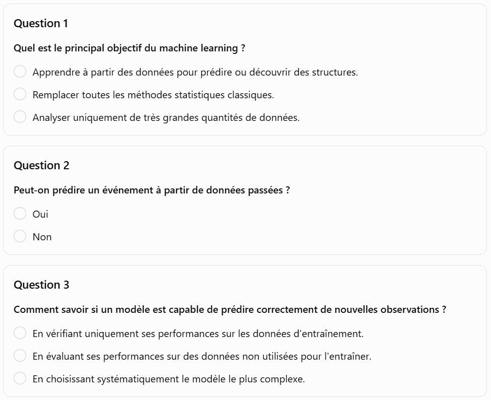
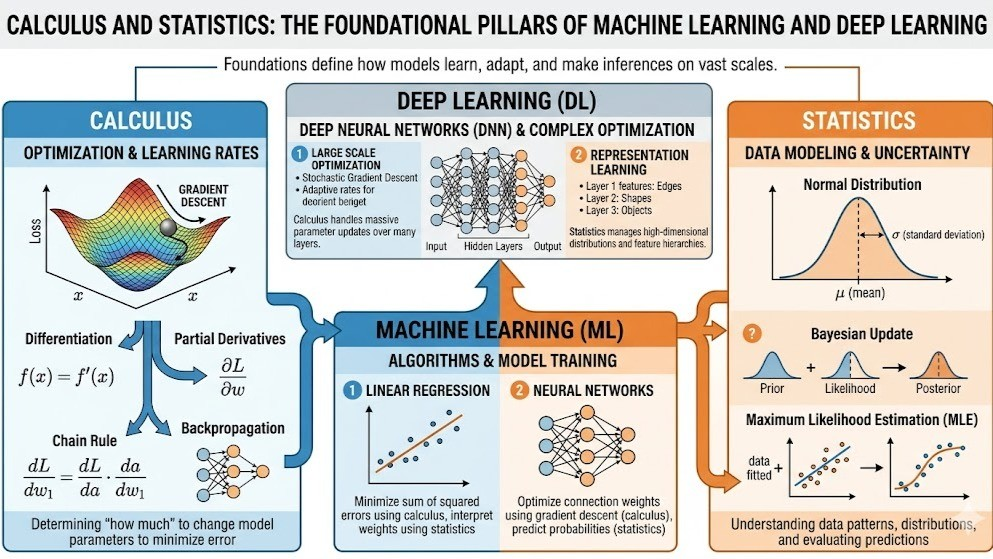
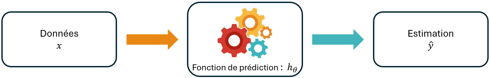
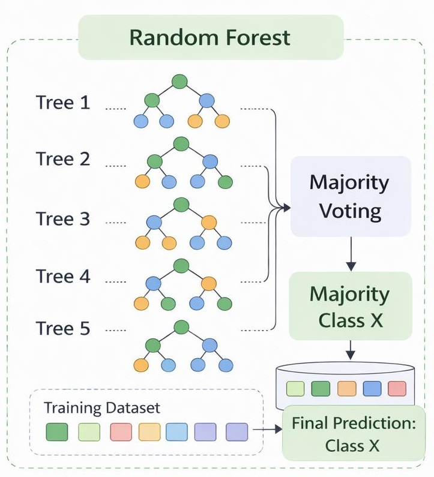
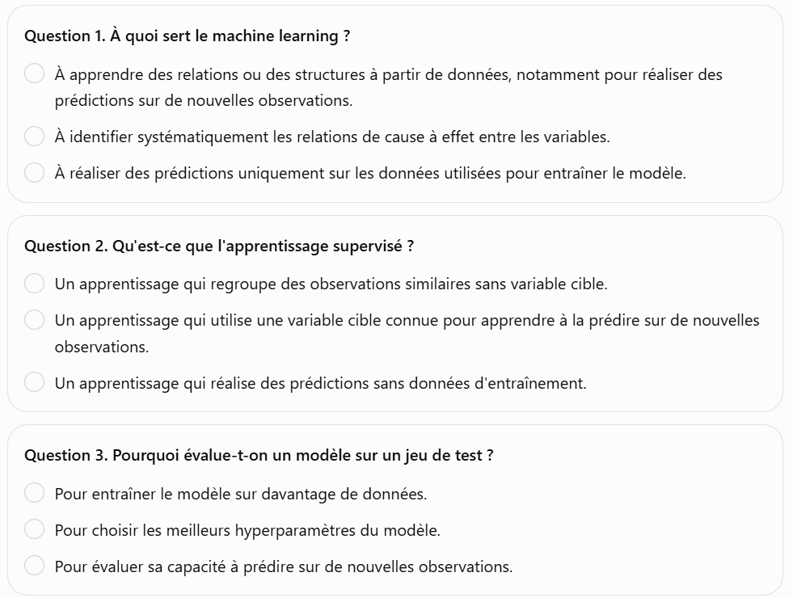

```{r setup}
#| include: false
#| echo: false
#| message: false
#| warning: false


library(ggplot2)
library(plotly)
library(dplyr)
library(patchwork)
library(kableExtra)
library(GSE)

data(horse)

```

## 📚 Organisation et évaluation de l'UE

```{=html}
<div style="height:12px;"></div>
```

[[**Organisation :**]{.underline}]{.smallcaps} Cette UE de **30 heures** alternera :

- **Cours (15 h)** : présentation des concepts et méthodes de machine learning.
- **Travaux pratiques (10 h)** : application des méthodes sur des jeux de données réels.
- **Projet Kaggle (5 h)** : construction d'un modèle prédictif et comparaison des performances.

```{=html}
<div style="height:17px;"></div>
```

[[**Évaluation :**]{.underline}]{.smallcaps}

- **Participation (bonus de 2 points sur la note finale)** : valorisation de l'implication.
- **Soutenance orale (40% de la note)** : présentation et analyse du projet Kaggle.
- **Examen pratique (60% de la note)** : analyse de données avec R, en salle informatique sans accès à Internet.

```{=html}
<div style="height:17px;"></div>
```

::: small-box
L'UE privilégie une **approche pratique**, fondée sur des données vétérinaires.
:::

## 📖 Programme de l'UE

<br>

[[**Quatre grandes parties :**]{.underline}]{.smallcaps}

1.  **Introduction au machine learning** : principes, objectifs et démarche générale.

```{=html}
<div style="height:5px;"></div>
```

2.  **Apprentissage supervisé** : régression, classification et évaluation des modèles.

```{=html}
<div style="height:5px;"></div>
```

3.  **Apprentissage non supervisé** : exploration des données, réduction de dimension et clustering.

```{=html}
<div style="height:5px;"></div>
```

4.  **Introduction au deep learning** : principes des réseaux de neurones et premières applications.

<br>

::: small-box
Chaque partie associera **notions théoriques et applications pratiques avec R**, à partir de données réelles.
:::

## ✔️ Objectifs de l'UE

<br>

<br>

À l'issue de cette UE, vous serez capables de :

<br>

1.  **Comprendre** les principes des principales méthodes étudiées.

```{=html}
<div style="height:20px;"></div>
```

2.  **Choisir** une méthode adaptée à une question et aux données disponibles.

```{=html}
<div style="height:20px;"></div>
```

3.  **Appliquer** ces méthodes sur des données réelles avec R.

```{=html}
<div style="height:20px;"></div>
```

4.  **Interpréter et évaluer** les résultats obtenus.

## 💭 Avant de commencer

```{=html}
<div style="height:30px;"></div>
```

::::::: columns
:::: {.column width="65%"}
- [[**Retour sur le quiz du dernier cours :**]{.underline}]{.smallcaps}

::: {style="margin-top: -25px;"}
{fig-align="center" width="100%"}
:::
::::

:::: {.column width="35%"}
. . .

<br> <br>

```{=html}
<div style="height:20px;"></div>
```

- [[**Un petit exemple concret :**]{.underline}]{.smallcaps}

| Journée   | Température | Humidité |  Pluie  |
|:----------|------------:|---------:|:-------:|
| Lundi     |       12 °C |     90 % |   Oui   |
| Mardi     |       25 °C |     35 % |   Non   |
| Mercredi  |       14 °C |     85 % |   Oui   |
| **Jeudi** |   **16 °C** | **80 %** | **???** |

::: {style="text-align: center; color: #52525B;"}
Va-t-il pleuvoir jeudi ?
:::
::::
:::::::

## 🔍 Intro : Qu'est-ce que le Machine Learning (ML) ?

```{=html}
<div style="height:15px;"></div>
```

> Le [machine learning (ML)]{.smallcaps} ou [apprentissage automatique]{.smallcaps}, regroupe des méthodes permettant d'apprendre des relations ou des structures à partir de données, notamment pour réaliser des prédictions sur de nouvelles observations.

```{=html}
<div style="height:40px;"></div>
```

. . .

+-------------------------------------------------------------------------------------------------------------------------------------+-----------------------------------------+
| Question de recherche                                                                                                               | Type de méthode associé                 |
+=====================================================================================================================================+=========================================+
| Peut-on prédire le prix de vente d'un appartement à partir de sa superficie, de sa localisation et du nombre de pièces ?            | Prédiction (régression)                 |
+-------------------------------------------------------------------------------------------------------------------------------------+-----------------------------------------+
| Peut-on déterminer si un âne souffrant de coliques présente une infection à partir de sa température et de sa fréquence cardiaque ? | Classification                          |
+-------------------------------------------------------------------------------------------------------------------------------------+-----------------------------------------+
| Peut-on reconnaître le chiffre (de 0 à 9) représenté sur une image manuscrite ?                                                     | Reconnaissance d'image (classification) |
+-------------------------------------------------------------------------------------------------------------------------------------+-----------------------------------------+
| Peut-on identifier différents profils cliniques parmi les animaux hospitalisés dans un même CHUV à partir de leur bilan sanguin ?   | Classification non supervisée           |
+-------------------------------------------------------------------------------------------------------------------------------------+-----------------------------------------+

. . .

```{=html}
<div style="height:25px;"></div>
```

::: callout-note
Il existe [différentes méthodes de ML]{.smallcaps}, dont le choix dépend de la question de recherche, de la nature des données et de l'objectif de l'analyse.
:::

## 🐎 Application : Présentation des données

```{=html}
<div style="height:5px;"></div>
```

[[Jeu de données utilisé :]{.underline}]{.smallcaps} Données cliniques de $368$ chevaux souffrant de coliques, issues de @marymcleish1989, disponibles dans le package R *GSE*.

. . .

```{=html}
<div style="height:20px;"></div>
```

:::::: columns
::: {.column width="55%"}
- 7 mesures cliniques quantitatives $X$ :

  +-----------------------------------------+-----------------------------------------------------------+
  | Type de mesure                          | Variables                                                 |
  +=========================================+===========================================================+
  | Signes vitaux                           | Température rectale, fréquences cardiaque et respiratoire |
  +-----------------------------------------+-----------------------------------------------------------+
  | Mesures digestives                      | pH du reflux nasogastrique                                |
  +-----------------------------------------+-----------------------------------------------------------+
  | Analyses sanguines                      | Hématocrite, protéines totales                            |
  +-----------------------------------------+-----------------------------------------------------------+
  | Analyse du liquide abdominal            | Protéines totales                                         |
  +-----------------------------------------+-----------------------------------------------------------+

- 1 variable qualitative binaire $Y$ :

  **Présence d'une lésion chirurgicale** : Oui / Non
:::

::: {.column width="10%"}
:::

::: {.column width="35%"}
```{=html}
<div style="height:25px;"></div>
```

```{r}
#| echo: false
#| message: false
#| warning: false

horse <- horse %>% 
  rename(id = Hospital_Number) %>%
  rename(surgical_lesion = surgical_leison) %>%
  mutate(surgical_lesion = surgical_lesion - 1)

knitr::kable(
  head(horse, 10),
  digits = 2
)
```
:::
::::::

## 🐎 Application : Questions de recherche

:::: center-text
::: highlight-box
**Peut-on prédire la présence d’une lésion chirurgicale chez un cheval souffrant de coliques à partir de ses mesures cliniques ?**
:::
::::

## 📖 Objectifs du cours

```{=html}
<br>
<br>
<div style="height:45px;"></div>
```

1.  Pourquoi faire du Machine Learning ? (Intérêt & Exemple de méthodes)

. . .

```{=html}
<div style="height:25px;"></div>
```

2.  Comment construire un modèle de ML et évaluer sa qualité ? (Théorie)

. . .

```{=html}
<div style="height:25px;"></div>
```

3.  Pratique : Construire un modèle de ML et évaluer sa qualité avec R

. . .

```{=html}
<div style="height:25px;"></div>
```

4.  Conclusion & Exemple concret d'une contribution en sciences vétérinaires

## 📖 Objectifs du cours

```{=html}
<br>
<br>
<div style="height:45px;"></div>
```

**1. Pourquoi faire du Machine Learning ? (Intérêt & Exemple de méthodes)**

```{=html}
<div style="height:25px;"></div>
```

::: {style="color: #A1A1AA;"}
2.  Comment construire un modèle de ML et évaluer sa qualité ? (Théorie)
:::

```{=html}
<div style="height:25px;"></div>
```

::: {style="color: #A1A1AA;"}
3.  Pratique : Construire un modèle de ML et évaluer sa qualité avec R
:::

```{=html}
<div style="height:25px;"></div>
```

::: {style="color: #A1A1AA;"}
4.  Exemple concret d'une contribution en sciences vétérinaires & Conclusion
:::

## 1️⃣ Pourquoi faire du Machine Learning ? - Intuition

```{=html}
<div style="height:40px;"></div>
```

Le [machine learning]{.smallcaps} est particulièrement intéressant pour :

- **Analyser des données complexes et de grande dimension** : nombreuses variables, relations non linéaires et interactions.

  *Exemple : prédire une maladie à partir de milliers de mesures génomiques.*

```{=html}
<div style="height:10px;"></div>
```

. . .

- **Améliorer les performances prédictives** : construire des modèles capables de prédire correctement de nouvelles observations.

  *Exemple : prédire le risque de complications chez un cheval souffrant de coliques.*

```{=html}
<div style="height:10px;"></div>
```

. . .

- **Exploiter des données non structurées** : images, textes ou signaux.

  *Exemple : détecter des anomalies sur des radiographies vétérinaires.*

## 1️⃣ Statistique, ML et Deep-Learning : quelles relations ?

```{=html}
<div style="height:30px;"></div>
```

{width="160%" fig-align="center"}

::: {style="text-align: center; font-size: 0.6em; color: gray;"}
Figure Prakasha S. (2026).
:::

<br>

::: small-box
Les frontières entre la statistique, le machine-learning et le deep-learning sont souvent floues : ces disciplines partagent de nombreuses méthodes et leurs objectifs se recoupent.
:::

## 1️⃣ Quelles méthodes de ML pour quelles questions ?

<br>

::::::: columns
:::: {.column width="50%"}
::: {style="text-align: center;"}
[[**Apprentissage supervisé**]{.underline}]{.smallcaps}

```{=html}
<div style="height:30px;"></div>
```

La variable réponse $Y$ est connue.

```{=html}
<div style="height:20px;"></div>
```

- Prédire un rendement,
- Prédire un type de cancer,
- Sélectionner des bio-marqueurs.

```{=html}
<div style="height:40px;"></div>
```

$\color{#E69F00}{\Longrightarrow}$ Régression, classification
:::
::::

:::: {.column width="50%"}
::: {style="text-align: center;"}
[[**Apprentissage non supervisé**]{.underline}]{.smallcaps}

```{=html}
<div style="height:20px;"></div>
```

Aucune variable réponse $Y$ n'est définie.

```{=html}
<div style="height:20px;"></div>
```

- Découvrir des groupes,
- Étudier les similarités,
- Visualiser des données.

```{=html}
<div style="height:40px;"></div>
```

$\color{#E69F00}{\Longrightarrow}$ Clustering, visualisation
:::
::::
:::::::

## 📖 Objectifs du cours

```{=html}
<br>
<br>
<div style="height:45px;"></div>
```

::: {style="color: #A1A1AA;"}
1.  Pourquoi faire du Machine Learning ? (Intérêt & Exemple de méthodes)
:::

```{=html}
<div style="height:25px;"></div>
```

**2. Comment construire un modèle de ML et évaluer sa qualité ? (Théorie)**

```{=html}
<div style="height:25px;"></div>
```

::: {style="color: #A1A1AA;"}
3.  Pratique : Construire un modèle de ML et évaluer sa qualité avec R
:::

```{=html}
<div style="height:25px;"></div>
```

::: {style="color: #A1A1AA;"}
4.  Exemple concret d'une contribution en sciences vétérinaires & Conclusion
:::

## 2️⃣ Définir le problème : Quelles sont les données ?

```{=html}
<div style="height:5px;"></div>
```

En [apprentissage supervisé]{.smallcaps}, on dispose d'un échantillon de $n$ individus supposés i.i.d., pour lesquels on observe $p$ variables explicatives et une variable réponse.

```{=html}
<div style="height:15px;"></div>
```

::::::: columns
:::: {.column width="60%"}
::: {style="text-align: center;"}
[**Matrice des variables explicatives**]{.smallcaps}
:::

$$
X =
\begin{pmatrix}
x_{11} & \cdots & x_{1p} \\
\vdots & \ddots & \vdots \\
x_{n1} & \cdots & x_{np}
\end{pmatrix}
$$
::::

:::: {.column width="40%"}
::: {style="text-align: center;"}
[**Vecteur des réponses**]{.smallcaps}

$$
Y =
\begin{pmatrix}
y_1 \\
\vdots \\
y_n
\end{pmatrix}
$$

- [$Y$ quantitatif : Régression]{style="color: #009E73;"}

- [$Y$ qualitatif : Classification]{style="color: #CC79A7;"}
:::
::::
:::::::

. . .

```{=html}
<div style="height:15px;"></div>
```

::: small-box
[[**Objectif :**]{.underline}]{.smallcaps} à partir des couples observés $(x_i,y_i)$, apprendre une [fonction de prédiction/]{.smallcaps} un [modèle]{.smallcaps} pour prédire la réponse d'un **nouvel individu** à partir de ses variables explicatives.
:::

## 2️⃣ Choisir un modèle : Comment prédire $Y$ ?

```{=html}
<div style="height:5px;"></div>
```

{fig-align="center"}

```{=html}
<div style="height:5px;"></div>
```

. . .

[[modèle de prédiction]{.underline}]{.smallcaps}

: En apprentissage supervisé, on choisit une famille de fonctions, de [modèles de prédiction]{.smallcaps} $h_\theta$, paramétrés par $\theta$, tels que : $$
  h_\theta : x \longmapsto \hat y = h_\theta(x)
  $$

où $\theta$ désigne les paramètres inconnus à estimer à partir des données.

```{=html}
<div style="height:25px;"></div>
```

. . .

::: callout-note
En pratique, le [modèle de prédiction]{.smallcaps} qu'on utilise dépend de la nature de la sortie et de l'objectif.
:::

## 2️⃣ Différents modèles pour prédire $Y$

```{=html}
<div style="height:20px;"></div>
```

::: callout-note
En pratique, le [modèle de prédiction]{.smallcaps} qu'on utilise dépend de la nature de la sortie et de l'objectif.
:::

```{=html}
<div style="height:50px;"></div>
```


<table style="border-collapse: collapse; border-bottom: 1px solid currentColor;">
  <thead>
    <tr>
      <th>Type de sortie Y</th>
      <th>Objectif</th>
      <th>Exemple de modèle</th>
    </tr>
  </thead>
  <tbody>
    <tr>
      <td rowspan="3" style="vertical-align: middle;">Quantitative</td>
      <td rowspan="3" style="vertical-align: middle;">Régression</td>
      <td>Régression linéaire</td>
    </tr>
    <tr>
      <td>Arbre de régression</td>
    </tr>
    <tr>
      <td>Forêt aléatoire</td>
    </tr>

    <tr>
      <td rowspan="3" style="vertical-align: middle;">Binaire</td>
      <td rowspan="6" style="vertical-align: middle;">Classification</td>
      <td>Régression logistique</td>
    </tr>
    <tr>
      <td>Arbre de classification</td>
    </tr>
    <tr>
      <td>Forêt aléatoire</td>
    </tr>

    <tr>
      <td rowspan="3" style="vertical-align: middle;">Qualitative (plusieurs classes)</td>
      <td>Régression logistique multinomiale</td>
    </tr>
    <tr>
      <td>Arbre de classification</td>
    </tr>
    <tr>
      <td>Forêt aléatoire</td>
    </tr>
  </tbody>
</table>


## 2️⃣ Zoom sur les arbres de décision & forêts aléatoires

{width="100%" fig-align="center"}

::: {style="text-align: center; margin-top: -15px; font-size: 0.6em; color: gray;"}
Source : Virtual Labs <https://virtual-labs.github.io/exp-random-forest-dei/theory.html>.
:::

## 2️⃣ Données et choix du modèle — Exemple

<br>

:::::: columns
::: {.column width="44%"}
[[**Données du problème (pour un cheval)**]{.underline}]{.smallcaps}

- **Entrées** $x$ - Mesures cliniques :

  | Variables                                                 |
  |:----------------------------------------------------------|
  | Température rectale, fréquences cardiaque et respiratoire |
  | pH du reflux nasogastrique                                |
  | Hématocrite, protéines totales                            |

```{=html}
  <div style="height:15px;"></div>
```

- **Sortie** $y$ - Présence d'une lésion chirurgicale :

  ::: {style="text-align: center;"}
  Oui ($y = 1$) / Non ($y = 0$)
  :::
:::

::: {.column width="8%"}
:::

::: {.column width="44%"}
[[**Modèle choisi : Forêt aléatoire**]{.underline}]{.smallcaps}

{fig-align="center"}
:::
::::::

## 2️⃣ Entraîner le modèle : Comment estimer les paramètres ?

[[**Objectif :**]{.underline}]{.smallcaps} Apprendre les paramètres ou les règles du modèle $h_\theta$ à partir des observations $(x_i,y_i)$.

```{=html}
<div style="height:5px;"></div>
```

[[**Principales approches :**]{.underline}]{.smallcaps}

+------------------------------------------+-----------------------------------------------------------------------------------------------------------+------------------------------------------+
| Approche                                 | Principe mathématique (ex. de fonctions)                                                                  | Exemples                                 |
+:=========================================+:=========================================================================================================:+:=========================================+
| **Minimisation d'une fonction de perte** | $\displaystyle \hat\theta=\arg\min_{\theta\in\Theta}\sum_{i=1}^{n} (y_i - h_\theta(x_i))^2$               | Régression linéaire, réseaux de neurones |
+------------------------------------------+-----------------------------------------------------------------------------------------------------------+------------------------------------------+
| **Maximum de vraisemblance**             | $\displaystyle \hat\theta=\arg\max_{\theta\in\Theta}\prod_{i=1}^{n}\mathbb P_\theta(Y_i=y_i\mid X_i=x_i)$ | Régression logistique                    |
+------------------------------------------+-----------------------------------------------------------------------------------------------------------+------------------------------------------+
| **Construction successive de règles**    | $\text{Meilleure règle}                                                                                   | Arbres de décision, forêts aléatoires    |
|                                          | = \text{celle qui sépare le mieux les deux classes}$                                                      |                                          |
+------------------------------------------+-----------------------------------------------------------------------------------------------------------+------------------------------------------+
| **Entraînement séquentiel de modèles**   | $h^{(m)}(x)=h^{(m-1)}(x)+\eta\,\operatorname{Correction}_m(x)$                                            | Gradient boosting                        |
+------------------------------------------+-----------------------------------------------------------------------------------------------------------+------------------------------------------+

```{=html}
<div style="height:3px;"></div>
```

. . .

::: callout-note
L'entraînement consiste à **apprendre automatique un modèle à partir des données**, mais la méthode utilisée dépend du modèle choisi.
:::

## 2️⃣ Entraînement d'une forêt aléatoire — Exemple

::: {style="margin-top: -100px;"}
:::

```{dot}
digraph {
  graph [rankdir=TB, bgcolor="transparent", newrank=true,
         nodesep=0.12, ranksep=0.12, pad=0,
         outputorder=edgesfirst]

  node [shape=box, style="rounded,filled",
        fontname="Arial", fontsize=15,
        margin="0.12,0.08",
        color="#4C78A8", fillcolor="#EAF2FB"]

  edge [fontname="Arial", fontsize=12, arrowsize=0.6,
        color="transparent", fontcolor="transparent"]

  subgraph cluster_1 {
    label="Arbre 1";
    fontsize=17; fontname="Arial";
    style=rounded; color="#AAAAAA";

    A1 [label="Fréquence cardiaque\n≤ 55 ?", width=2.5]
    B1 [label="Lésion : Oui", style=invis]
    C1 [label="Fréquence respiratoire\n< 49 ?", width=2.5, style=invis]
    D1 [label="Lésion : Oui", style=invis]
    E1 [label="Lésion : Non", style=invis]

    A1 -> B1 [label="Oui"]
    A1 -> C1 [label="Non"]
    C1 -> D1 [label="Oui"]
    C1 -> E1 [label="Non"]

    P1 [label=<<B>Prédiction</B><BR/>Oui>,
        width=3.5, style=invis]

    D1 -> P1 [style=invis]
    E1 -> P1 [style=invis]
  }

  subgraph cluster_2 {
    label="Arbre 2";
    fontsize=17; fontname="Arial";
    style=rounded; color="#AAAAAA";

    A2 [label="Fréquence respiratoire\n< 49 ?"]
    B2 [label="Hématocrite\n< 44,5 ?", width=3.0, style=invis]
    C2 [label="Lésion : Non", style=invis]
    D2 [label="Lésion : Oui", width=2.0, style=invis]
    E2 [label="Lésion : Non", width=2.0, style=invis]

    A2 -> B2 [label="Oui"]
    A2 -> C2 [label="Non"]
    B2 -> D2 [label="Oui"]
    B2 -> E2 [label="Non"]

    P2 [label=<<B>Prédiction</B><BR/>Non>,
        width=4.4, style=invis]

    D2 -> P2 [style=invis]
    E2 -> P2 [style=invis]
    C2 -> P2 [style=invis]
  }

  subgraph cluster_3 {
    label="Arbre 3";
    fontsize=17; fontname="Arial";
    style=rounded; color="#AAAAAA";

    A3 [label="Protéines totales\n< 50,5 ?"]
    B3 [label="Fréquence cardiaque\n< 68 ?", style=invis]
    C3 [label="Fréquence respiratoire\n< 13 ?", style=invis]
    D3 [label="Lésion : Non", style=invis]
    E3 [label="Lésion : Oui", style=invis]
    F3 [label="Lésion : Oui", style=invis]
    G3 [label="Lésion : Non", style=invis]

    A3 -> B3 [label="Oui"]
    A3 -> C3 [label="Non"]
    B3 -> D3 [label="Oui"]
    B3 -> E3 [label="Non"]
    C3 -> F3 [label="Oui"]
    C3 -> G3 [label="Non"]

    P3 [label=<<B>Prédiction</B><BR/>Oui>,
        width=4.4, style=invis]

    D3 -> P3 [style=invis]
    E3 -> P3 [style=invis]
    F3 -> P3 [style=invis]
    G3 -> P3 [style=invis]
  }

  {rank=same; P1; P2; P3}
  P1 -> P2 -> P3 [style=invis, constraint=false]
}
```

```{=html}
<div style="height:43px;"></div>
```

::: callout-note
- Chaque arbre est entraîné sur un sous-ensemble de données différents (*échantillon bootstrap*),

- A chaque nœud on sélection $m$ variables explicatives pour trouver la bonne règle entre elles (ici 2)

$\longrightarrow$ On obtient ainsi plusieurs arbres, qui apprennent des règles différentes, puis combinent leurs prédictions.
:::

## 2️⃣ Entraînement d'une forêt aléatoire — Exemple {data-visibility="uncounted"}

::: {style="margin-top: -100px;"}
:::

```{dot}
digraph {
  graph [rankdir=TB, bgcolor="transparent", newrank=true,
         nodesep=0.12, ranksep=0.12, pad=0,
         outputorder=edgesfirst]

  node [shape=box, style="rounded,filled",
        fontname="Arial", fontsize=15,
        margin="0.12,0.08",
        color="#4C78A8", fillcolor="#EAF2FB"]

  edge [fontname="Arial", fontsize=12, arrowsize=0.6,
        color="transparent", fontcolor="transparent"]

  subgraph cluster_1 {
    label="Arbre 1";
    fontsize=17; fontname="Arial";
    style=rounded; color="#AAAAAA";

    A1 [label="Fréquence cardiaque\n≤ 55 ?", width=2.5]
    B1 [label="Lésion : Oui", fillcolor="#F9E4EC"]
    C1 [label="Fréquence respiratoire\n< 49 ?", width=2.5]
    D1 [label="Lésion : Oui", style=invis]
    E1 [label="Lésion : Non", style=invis]

    A1 -> B1 [label="Oui", color="#666666", fontcolor="#333333"]
    A1 -> C1 [label="Non", color="#666666", fontcolor="#333333"]
    C1 -> D1 [label="Oui"]
    C1 -> E1 [label="Non"]

    P1 [label=<<B>Prédiction</B><BR/>Oui>,
        width=3.5, style=invis]

    D1 -> P1 [style=invis]
    E1 -> P1 [style=invis]
  }

  subgraph cluster_2 {
    label="Arbre 2";
    fontsize=17; fontname="Arial";
    style=rounded; color="#AAAAAA";

    A2 [label="Fréquence respiratoire\n< 49 ?"]
    B2 [label="Hématocrite\n< 44,5 ?", width=3.0]
    C2 [label="Lésion : Non", fillcolor="#E4F3E8"]
    D2 [label="Lésion : Oui", width=2.0, style=invis]
    E2 [label="Lésion : Non", width=2.0, style=invis]

    A2 -> B2 [label="Oui", color="#666666", fontcolor="#333333"]
    A2 -> C2 [label="Non", color="#666666", fontcolor="#333333"]
    B2 -> D2 [label="Oui"]
    B2 -> E2 [label="Non"]

    P2 [label=<<B>Prédiction</B><BR/>Non>,
        width=4.4, style=invis]

    D2 -> P2 [style=invis]
    E2 -> P2 [style=invis]
    C2 -> P2 [style=invis]
  }

  subgraph cluster_3 {
    label="Arbre 3";
    fontsize=17; fontname="Arial";
    style=rounded; color="#AAAAAA";

    A3 [label="Protéines totales\n< 50,5 ?"]
    B3 [label="Fréquence cardiaque\n< 68 ?"]
    C3 [label="Fréquence respiratoire\n< 13 ?"]
    D3 [label="Lésion : Non", style=invis]
    E3 [label="Lésion : Oui", style=invis]
    F3 [label="Lésion : Oui", style=invis]
    G3 [label="Lésion : Non", style=invis]

    A3 -> B3 [label="Oui", color="#666666", fontcolor="#333333"]
    A3 -> C3 [label="Non", color="#666666", fontcolor="#333333"]
    B3 -> D3 [label="Oui"]
    B3 -> E3 [label="Non"]
    C3 -> F3 [label="Oui"]
    C3 -> G3 [label="Non"]

    P3 [label=<<B>Prédiction</B><BR/>Oui>,
        width=4.4, style=invis]

    D3 -> P3 [style=invis]
    E3 -> P3 [style=invis]
    F3 -> P3 [style=invis]
    G3 -> P3 [style=invis]
  }

  {rank=same; P1; P2; P3}
  P1 -> P2 -> P3 [style=invis, constraint=false]
}
```

```{=html}
<div style="height:43px;"></div>
```

::: callout-note
- Chaque arbre est entraîné sur un sous-ensemble de données différents (*échantillon bootstrap*),

- A chaque nœud on sélection $m$ variables explicatives pour trouver la bonne règle entre elles (ici 2)

$\longrightarrow$ On obtient ainsi plusieurs arbres, qui apprennent des règles différentes, puis combinent leurs prédictions.
:::

## 2️⃣ Entraînement d'une forêt aléatoire — Exemple {data-visibility="uncounted"}

::: {style="margin-top: -100px;"}
:::

```{dot}
digraph {
  graph [rankdir=TB, bgcolor="transparent", newrank=true,
         nodesep=0.12, ranksep=0.12, pad=0,
         outputorder=edgesfirst]

  node [shape=box, style="rounded,filled",
        fontname="Arial", fontsize=15,
        margin="0.12,0.08",
        color="#4C78A8", fillcolor="#EAF2FB"]

  edge [fontname="Arial", fontsize=12, arrowsize=0.6,
        color="#666666", fontcolor="#333333"]

  subgraph cluster_1 {
    label="Arbre 1";
    fontsize=17; fontname="Arial";
    style=rounded; color="#AAAAAA";

    A1 [label="Fréquence cardiaque\n≤ 55 ?", width=2.5]
    B1 [label="Lésion : Oui", fillcolor="#F9E4EC"]
    C1 [label="Fréquence respiratoire\n< 49 ?", width=2.5]
    D1 [label="Lésion : Oui", fillcolor="#F9E4EC"]
    E1 [label="Lésion : Non", fillcolor="#E4F3E8"]

    A1 -> B1 [label="Oui"]
    A1 -> C1 [label="Non"]
    C1 -> D1 [label="Oui"]
    C1 -> E1 [label="Non"]

    P1 [label=<<B>Prédiction</B><BR/>Oui>,
        width=3.5, style=invis]

    D1 -> P1 [style=invis]
    E1 -> P1 [style=invis]
  }

  subgraph cluster_2 {
    label="Arbre 2";
    fontsize=17; fontname="Arial";
    style=rounded; color="#AAAAAA";

    A2 [label="Fréquence respiratoire\n< 49 ?"]
    B2 [label="Hématocrite\n< 44,5 ?", width=3.0]
    C2 [label="Lésion : Non", fillcolor="#E4F3E8"]
    D2 [label="Lésion : Oui", width=2.0, fillcolor="#F9E4EC"]
    E2 [label="Lésion : Non", width=2.0, fillcolor="#E4F3E8"]

    A2 -> B2 [label="Oui"]
    A2 -> C2 [label="Non"]
    B2 -> D2 [label="Oui"]
    B2 -> E2 [label="Non"]

    P2 [label=<<B>Prédiction</B><BR/>Non>,
        width=4.4, style=invis]

    D2 -> P2 [style=invis]
    E2 -> P2 [style=invis]
    C2 -> P2 [style=invis]
  }

  subgraph cluster_3 {
    label="Arbre 3";
    fontsize=17; fontname="Arial";
    style=rounded; color="#AAAAAA";

    A3 [label="Protéines totales\n< 50,5 ?"]
    B3 [label="Fréquence cardiaque\n< 68 ?"]
    C3 [label="Fréquence respiratoire\n< 13 ?"]
    D3 [label="Lésion : Non", fillcolor="#E4F3E8"]
    E3 [label="Lésion : Oui", fillcolor="#F9E4EC"]
    F3 [label="Lésion : Oui", fillcolor="#F9E4EC"]
    G3 [label="Lésion : Non", fillcolor="#E4F3E8"]

    A3 -> B3 [label="Oui"]
    A3 -> C3 [label="Non"]
    B3 -> D3 [label="Oui"]
    B3 -> E3 [label="Non"]
    C3 -> F3 [label="Oui"]
    C3 -> G3 [label="Non"]

    P3 [label=<<B>Prédiction</B><BR/>Oui>,
        width=4.4, style=invis]

    D3 -> P3 [style=invis]
    E3 -> P3 [style=invis]
    F3 -> P3 [style=invis]
    G3 -> P3 [style=invis]
  }

  {rank=same; P1; P2; P3}
  P1 -> P2 -> P3 [style=invis, constraint=false]
}
```

```{=html}
<div style="height:43px;"></div>
```

::: callout-note
- Chaque arbre est entraîné sur un sous-ensemble de données différents (*échantillon bootstrap*),

- A chaque nœud on sélection $m$ variables explicatives pour trouver la bonne règle entre elles (ici 2)

$\longrightarrow$ On obtient ainsi plusieurs arbres, qui apprennent des règles différentes, puis combinent leurs prédictions.
:::

## 2️⃣ Entraînement d'une forêt aléatoire — Exemple {data-visibility="uncounted"}

::: {style="margin-top: -100px;"}
:::

```{dot}
digraph {
  graph [rankdir=TB, bgcolor="transparent", newrank=true,
         nodesep=0.12, ranksep=0.12, pad=0,
         outputorder=edgesfirst]

  node [shape=box, style="rounded,filled",
        fontname="Arial", fontsize=15,
        margin="0.12,0.08",
        color="#4C78A8", fillcolor="#EAF2FB"]

  edge [fontname="Arial", fontsize=12, arrowsize=0.6,
        color="#666666", fontcolor="#333333"]

  subgraph cluster_1 {
    label="Arbre 1";
    fontsize=17; fontname="Arial";
    style=rounded; color="#AAAAAA";

    A1 [label="Fréquence cardiaque\n≤ 55 ?", width=2.5]
    B1 [label="Lésion : Oui", fillcolor="#F9E4EC"]
    C1 [label="Fréquence respiratoire\n< 49 ?", width=2.5]

    D1 [label="Lésion : Oui", fillcolor="#F9E4EC",
        color="#D55E00", penwidth=3]

    E1 [label="Lésion : Non", fillcolor="#E4F3E8"]

    A1 -> B1 [label="Oui"]
    A1 -> C1 [label="Non", color="#D55E00", penwidth=2.5]
    C1 -> D1 [label="Oui", color="#D55E00", penwidth=2.5]
    C1 -> E1 [label="Non"]

    P1 [
      label=<<B>Prédiction</B><BR/>Oui>,
      width=3.5,
      fillcolor="#F9E4EC",
      color="#CC79A7",
      penwidth=2
    ]

    D1 -> P1 [style=invis]
    E1 -> P1 [style=invis]
  }

  subgraph cluster_2 {
    label="Arbre 2";
    fontsize=17; fontname="Arial";
    style=rounded; color="#AAAAAA";

    A2 [label="Fréquence respiratoire\n< 49 ?"]
    B2 [label="Hématocrite\n< 44,5 ?", width=3.0]
    C2 [label="Lésion : Non", fillcolor="#E4F3E8"]
    D2 [label="Lésion : Oui", width=2.0, fillcolor="#F9E4EC"]

    E2 [label="Lésion : Non", width=2.0,
        fillcolor="#E4F3E8", color="#D55E00", penwidth=3]

    A2 -> B2 [label="Oui", color="#D55E00", penwidth=2.5]
    A2 -> C2 [label="Non"]
    B2 -> D2 [label="Oui"]
    B2 -> E2 [label="Non", color="#D55E00", penwidth=2.5]

    P2 [
      label=<<B>Prédiction</B><BR/>Non>,
      width=4.4,
      fillcolor="#E4F3E8",
      color="#009E73",
      penwidth=2
    ]

    D2 -> P2 [style=invis]
    E2 -> P2 [style=invis]
    C2 -> P2 [style=invis]
  }

  subgraph cluster_3 {
    label="Arbre 3";
    fontsize=17; fontname="Arial";
    style=rounded; color="#AAAAAA";

    A3 [label="Protéines totales\n< 50,5 ?"]
    B3 [label="Fréquence cardiaque\n< 68 ?"]
    C3 [label="Fréquence respiratoire\n< 13 ?"]
    D3 [label="Lésion : Non", fillcolor="#E4F3E8"]

    E3 [label="Lésion : Oui", fillcolor="#F9E4EC",
        color="#D55E00", penwidth=3]

    F3 [label="Lésion : Oui", fillcolor="#F9E4EC"]
    G3 [label="Lésion : Non", fillcolor="#E4F3E8"]

    A3 -> B3 [label="Oui", color="#D55E00", penwidth=2.5]
    A3 -> C3 [label="Non"]
    B3 -> D3 [label="Oui"]
    B3 -> E3 [label="Non", color="#D55E00", penwidth=2.5]
    C3 -> F3 [label="Oui"]
    C3 -> G3 [label="Non"]

    P3 [
      label=<<B>Prédiction</B><BR/>Oui>,
      width=4.4,
      fillcolor="#F9E4EC",
      color="#CC79A7",
      penwidth=2
    ]

    D3 -> P3 [style=invis]
    E3 -> P3 [style=invis]
    F3 -> P3 [style=invis]
    G3 -> P3 [style=invis]
  }

  {rank=same; P1; P2; P3}
  P1 -> P2 -> P3 [style=invis, constraint=false]
}
```

::::: fragment
```{=html}
<div style="width:90%; height:25px; margin:-110px auto 0;">
<svg viewBox="0 0 1000 60" width="100%" height="100%"
     preserveAspectRatio="none">
  <path d="M 10 5 Q 10 35 70 35 L 445 35
           Q 480 35 500 55 Q 520 35 555 35
           L 930 35 Q 990 35 990 5"
        fill="none" stroke="#42699a" stroke-width="4"/>
</svg>
</div>
```

::: {style="text-align:center; font-size:0.65em; line-height:1.3; margin-top:0;"}
**Vote majoritaire : 2 Oui / 1 Non**
:::

::: {style="width:65%; margin:5px auto 0; padding:10px; background-color:#E4F3E8; border:3px solid #009E73; border-radius:10px; text-align:center; font-size:0.65em;"}
**Prédiction finale : Lésion présente**
:::
:::::

```{=html}
<div style="height:10px;"></div>
```

::: callout-note
- Chaque arbre est entraîné sur un sous-ensemble de données différents (*échantillon bootstrap*),

- A chaque nœud on sélection $m$ variables explicatives pour trouver la bonne règle entre elles (ici 2)

$\longrightarrow$ On obtient ainsi plusieurs arbres, qui apprennent des règles différentes, puis combinent leurs prédictions.
:::

## 2️⃣ Évaluer le modèle : Comment mesurer la qualité des prédictions ?

```{=html}
<div style="height:5px;"></div>
```

[[**Objectif :**]{.underline}]{.smallcaps} Mesurer la qualité des prédictions $\hat{y_i}$ par rapport aux réponses observées $y_i$.

```{=html}
<div style="height:10px;"></div>
```

. . .

[[**Différents indicateurs selon le problème :**]{.underline}]{.smallcaps}

<table style="border-collapse: collapse; border-bottom: 1px solid currentColor;">
  <thead>
    <tr>
      <th>Type de problème</th>
      <th>Indicateur</th>
      <th>Principe</th>
    </tr>
  </thead>
  <tbody>
    <tr>
      <td rowspan="3" style="vertical-align: middle;"><strong>Régression</strong></td>
      <td>Erreur quadratique moyenne (MSE)</td>
      <td>Moyenne des erreurs au carré</td>
    </tr>
    <tr>
      <td>Erreur absolue moyenne (MAE)</td>
      <td>Moyenne des erreurs absolues</td>
    </tr>
    <tr>
      <td>Coefficient R²</td>
      <td>Qualité de l'ajustement par rapport à une prédiction constante</td>
    </tr>
    <tr>
      <td rowspan="3" style="vertical-align: middle;"><strong>Classification</strong></td>
      <td>Accuracy</td>
      <td>Proportion de prédictions correctes</td>
    </tr>
    <tr>
      <td>Sensibilité</td>
      <td>Proportion de positifs correctement identifiés</td>
    </tr>
    <tr>
      <td>Spécificité</td>
      <td>Proportion de négatifs correctement identifiés</td>
    </tr>
  </tbody>
</table>

```{=html}
<div style="height:10px;"></div>
```

. . .

::: callout-note
Les indicateurs de performance dépendent du **type de problème** et de **l'objectif de prédiction**. Ils sont généralement calculés sur des données non utilisées pour entraîner le modèle.
:::

## 2️⃣ Évaluer une forêt aléatoire — Exemple

```{dot}
digraph {
  graph [
    rankdir=LR,
    bgcolor="transparent",
    nodesep=0.25,
    ranksep=0.55,
    pad=0.05
  ]

  node [shape=plain, fontname="Arial"]

  matrice [label=<
    <TABLE BORDER="0" CELLBORDER="0" CELLSPACING="5" CELLPADDING="12">
      <TR>
        <TD COLSPAN="3">
          <FONT POINT-SIZE="19" COLOR="#213B68"><B>Matrice de confusion</B></FONT>
        </TD>
      </TR>
      <TR>
        <TD BGCOLOR="#EAF2FB"><FONT POINT-SIZE="13"><B>Préd./Obs.</B></FONT></TD>
        <TD BGCOLOR="#EAF2FB"><FONT POINT-SIZE="13"><B>Lésion</B></FONT></TD>
        <TD BGCOLOR="#EAF2FB"><FONT POINT-SIZE="13"><B>Sans lésion</B></FONT></TD>
      </TR>
      <TR>
        <TD BGCOLOR="#EAF2FB"><FONT POINT-SIZE="13"><B>Lésion</B></FONT></TD>
        <TD BGCOLOR="#DDF3E5">
          <FONT POINT-SIZE="40" COLOR="#176B43"><B>10</B></FONT><BR/>
          <FONT POINT-SIZE="11">Vrais positifs</FONT>
        </TD>
        <TD BGCOLOR="#FBE5E5">
          <FONT POINT-SIZE="25" COLOR="#AD3840"><B>18</B></FONT><BR/>
          <FONT POINT-SIZE="11">Faux positifs</FONT>
        </TD>
      </TR>
      <TR>
        <TD BGCOLOR="#EAF2FB"><FONT POINT-SIZE="13"><B>Sans lésion</B></FONT></TD>
        <TD BGCOLOR="#FBE5E5">
          <FONT POINT-SIZE="25" COLOR="#AD3840"><B>7</B></FONT><BR/>
          <FONT POINT-SIZE="11">Faux négatifs</FONT>
        </TD>
        <TD BGCOLOR="#DDF3E5">
          <FONT POINT-SIZE="25" COLOR="#176B43"><B>40</B></FONT><BR/>
          <FONT POINT-SIZE="11">Vrais négatifs</FONT>
        </TD>
      </TR>
    </TABLE>
  >]

  metriques [label=<
    <TABLE BORDER="0" CELLBORDER="0" CELLSPACING="7" CELLPADDING="7">
      <TR>
        <TD COLSPAN="2">
          <FONT POINT-SIZE="19" COLOR="#213B68"><B>Performances obtenues</B></FONT>
        </TD>
      </TR>
      <TR>
        <TD BGCOLOR="#DCEAF8" ALIGN="LEFT" WIDTH="185">
          <FONT POINT-SIZE="15"><B>Accuracy</B></FONT>
        </TD>
        <TD BGCOLOR="#DCEAF8" WIDTH="85">
          <FONT POINT-SIZE="19" COLOR="#2563A0"><B>66.7 %</B></FONT>
        </TD>
      </TR>
      <TR>
        <TD BGCOLOR="#F9E4EC" ALIGN="LEFT">
          <FONT POINT-SIZE="15"><B>Sensibilité</B></FONT>
        </TD>
        <TD BGCOLOR="#F9E4EC">
          <FONT POINT-SIZE="19" COLOR="#AD3840"><B>35.7 %</B></FONT>
        </TD>
      </TR>
      <TR>
        <TD BGCOLOR="#DDF3E5" ALIGN="LEFT">
          <FONT POINT-SIZE="15"><B>Spécificité</B></FONT>
        </TD>
        <TD BGCOLOR="#DDF3E5">
          <FONT POINT-SIZE="19" COLOR="#176B43"><B>85.1 %</B></FONT>
        </TD>
      </TR>
      <TR>
        <TD BGCOLOR="#FFF0DA" ALIGN="LEFT">
          <FONT POINT-SIZE="15"><B>Précision</B></FONT>
        </TD>
        <TD BGCOLOR="#FFF0DA">
          <FONT POINT-SIZE="19" COLOR="#A76412"><B>80 %</B></FONT>
        </TD>
      </TR>
    </TABLE>
  >]

  matrice -> metriques [style=invis]
}
```

::: callout-tip
Ici par exemple, c'est la sensibilité qui nous intéresse car on ne veut pas rater des lésions.
:::

## 📖 Objectifs du cours

```{=html}
<br>
<br>
<div style="height:45px;"></div>
```

::: {style="color: #A1A1AA;"}
1.  Pourquoi faire du Machine Learning ? (Intérêt & Exemple de méthodes)
:::

```{=html}
<div style="height:25px;"></div>
```

::: {style="color: #A1A1AA;"}
2.  Comment construire un modèle de ML et évaluer sa qualité ? (Théorie)
:::

```{=html}
<div style="height:25px;"></div>
```

**3. Pratique : Construire un modèle de ML et évaluer sa qualité avec R**

```{=html}
<div style="height:25px;"></div>
```

::: {style="color: #A1A1AA;"}
4.  Exemple concret d'une contribution en sciences vétérinaires & Conclusion
:::

## 3️⃣ Quelles sont les étapes pour entraîner et évaluer un modèle de ML ?

::: small-box
**Peut-on prédire la présence d’une lésion chirurgicale chez un cheval souffrant de coliques à partir de ses mesures cliniques ?**
:::

```{=html}
<div style="height:5px;"></div>
```

**To Do :**

. . .

1.  Préparer et nettoyer les données

```{=html}
<div style="height:5px;"></div>
```

. . .

2.  Séparer les données en jeu d'entraînement et de test

```{=html}
<div style="height:5px;"></div>
```

. . .

3.  Estimer les paramètres du modèle

```{=html}
<div style="height:5px;"></div>
```

. . .

4.  Effectuer une validation croisée (si nécessaire)

```{=html}
<div style="height:5px;"></div>
```

. . .

5.  Calculer et interpréter les indicateurs de performance sur les données de test

## 3️⃣ Préparer les données : Quelles vérifications effectuer ?

<br>

[[**Objectif :**]{.underline}]{.smallcaps} Obtenir des données exploitables pour entraîner un modèle de ML.

<br>

. . .

[[**Principales étapes :**]{.underline}]{.smallcaps}

1.  **Sélectionner les variables** : identifier les variables explicatives $X$ et la réponse $Y$ (éventuellement la recoder).

2.  **Explorer les données**.

3.  **Contrôler la qualité des données** : repérer les valeurs manquantes, les incohérences et les doublons.

## 3️⃣ Application - Préparer les données

::::: columns
::: {.column width="50%"}
```{=html}
<div style="height:25px;"></div>
```

``` r
library(GSE)
library(dplyr)
library(ggplot2)

# 1. Récupérer les données
data("horse", package = "GSE")

donnees <- horse %>%
  rename(surgical_lesion = surgical_leison) %>%
  mutate(
    surgical_lesion = factor(
      surgical_lesion,
      levels = c(1, 0),
      labels = c("Oui", "Non")
    )
  ) %>%
  filter(!is.na(surgical_lesion))

# 2. Explorer les données
summary(donnees)

# 3. Contrôler la qualité
colSums(is.na(donnees))
sum(duplicated(donnees))
```
:::

::: {.column width="50%"}
```{r}
#| echo: false
#| message: false
#| warning: false

# Résumé des données
knitr::kable(summary(horse))

#cat("Nombre d'observations :", nrow(horse))
#cat("\nNombre de doublons :", sum(duplicated(horse)))
```
:::
:::::

. . .

::: small-box
On exclut donc `Abdomcentesis_total_protein`, `Nasogastric_reflux_PH`, qui présentent de nombreuses valeurs manquantes.
:::

## 3️⃣ Séparer les données : Comment organiser l'entraînement ?

```{=html}
<div style="height:15px;"></div>
```

[[**Objectif :**]{.underline}]{.smallcaps} Évaluer la capacité du modèle à prédire de nouvelles observations.

```{=html}
<div style="height:10px;"></div>
```

. . .

[[**1. Séparer les données :**]{.underline}]{.smallcaps} Diviser aléatoirement les observations en deux ensembles :

+----------------------------+-------------------------------------------------------+------------------------+
| Ensemble                   | Utilisation                                           | Exemple de répartition |
+:===========================+:======================================================+:=======================+
| **Entraînement (*train*)** | Construire les arbres de la forêt                     | $80\%$                 |
+----------------------------+-------------------------------------------------------+------------------------+
| **Test (*test*)**          | Évaluer les prédictions sur de nouvelles observations | $20\%$                 |
+----------------------------+-------------------------------------------------------+------------------------+

```{=html}
<div style="height:10px;"></div>
```

. . .

[[**2. Prétraiter les données :**]{.underline}]{.smallcaps}

- **Entraînement** : Traiter les valeurs manquantes (ex. imputation) et encoder les variables si nécessaire.

- **Test** : Appliquer les mêmes transformations, en utilisant uniquement les informations calculées sur l'entraînement.

## 3️⃣ Application - Séparer les données

```{=html}
<div style="height:5px;"></div>
```

::::: columns
::: {.column width="50%"}
``` r
# 1. Sélectionner les variables
donnees <- donnees %>%
  dplyr::select(
    Rectal_temperature,
    Pulse,
    Respiratory_rate,
    Packed_cell_volume,
    Total_protein,
    surgical_lesion
  ) %>%
  filter(!is.na(surgical_lesion)) %>%
  mutate(surgical_lesion = factor(surgical_lesion))

# 2. Séparer les données (80 % / 20 %)
set.seed(123)

id_train <- donnees %>%
  mutate(id = row_number()) %>%
  group_by(surgical_lesion) %>%
  slice_sample(prop = 0.8) %>%
  ungroup() %>%
  pull(id)

train <- donnees[id_train, ]
test <- donnees[-id_train, ]

# 3. Imputer les valeurs manquantes
variables <- setdiff(names(train), "surgical_lesion")

med <- sapply(train[variables], median, na.rm = TRUE)

for (v in variables) {
  train[[v]][is.na(train[[v]])] <- med[v]
  test[[v]][is.na(test[[v]])] <- med[v]
}
```
:::

::: {.column width="50%"}
<br> <br> <br>

[[**Répartition des observations :**]{.underline}]{.smallcaps}

```{r}
#| echo: false

donnees <- horse %>%
  mutate(
    surgical_lesion = factor(
      surgical_lesion,
      levels = c(0, 1),
      labels = c("Non", "Oui")
    )
  ) %>%
  filter(!is.na(surgical_lesion))

# 1. Sélectionner les variables
donnees <- donnees %>%
  dplyr::select(
    Rectal_temperature,
    Pulse,
    Respiratory_rate,
    Packed_cell_volume,
    Total_protein,
    surgical_lesion
  ) %>%
  filter(!is.na(surgical_lesion)) %>%
  mutate(surgical_lesion = factor(surgical_lesion))

# 2. Séparer les données (80 % / 20 %)
set.seed(123)

id_train <- donnees %>%
  mutate(id = row_number()) %>%
  group_by(surgical_lesion) %>%
  slice_sample(prop = 0.8) %>%
  ungroup() %>%
  pull(id)

train <- donnees[id_train, ]
test <- donnees[-id_train, ]

# 3. Imputer les valeurs manquantes
variables <- setdiff(names(train), "surgical_lesion")

med <- sapply(train[variables], median, na.rm = TRUE)

for (v in variables) {
  train[[v]][is.na(train[[v]])] <- med[v]
  test[[v]][is.na(test[[v]])] <- med[v]
}

df <- data.frame(
  Ensemble = c("Entraînement", "Test"),
  Effectif = c(nrow(train), nrow(test))
)

knitr::kable(df)
```
:::
:::::

. . .

::: small-box
Les valeurs manquantes sont remplacées par les **médianes calculées uniquement sur les données d'entraînement**.
:::

## 3️⃣ Entraîner le modèle : Comment construire la forêt en pratique ?

```{=html}
<div style="height:20px;"></div>
```

[[**Objectif :**]{.underline}]{.smallcaps} Construire une forêt aléatoire à partir des données d'entraînement.

```{=html}
<div style="height:20px;"></div>
```

. . .

[[**Méthode utilisée :**]{.underline}]{.smallcaps}

- **Échantillonnage bootstrap** : tirer aléatoirement des observations pour chaque arbre.
- **Construction des arbres** : rechercher à chaque nœud la meilleure séparation parmi un sous-ensemble aléatoire de variables.
- **Répétition** : construire plusieurs arbres pour constituer la forêt.

. . .

```{=html}
<div style="height:20px;"></div>
```

::: callout-note
Dans R, la fonction `ranger()` construit automatiquement la forêt aléatoire. Les prédictions en classification sont obtenues par **vote majoritaire**.
:::

## 3️⃣ Application - Entraîner le modèle

<br> <br> <br>

::::: columns
::: {.column width="50%"}
``` r
library(ranger)

# Entraînement de la forêt aléatoire
set.seed(123)

modele <- ranger(
  surgical_lesion ~ .,
  data = train,
  num.trees = 500,
  mtry = 2,
  importance = "impurity"
)

# Résumé du modèle
modele
```
:::

::: {.column width="50%"}
<br> <br>

```{r}
#| echo: false
#| message: false
#| warning: false

library(ranger)

# Entraînement de la forêt aléatoire
set.seed(123)

modele <- ranger(
  surgical_lesion ~ .,
  data = train,
  num.trees = 500,
  mtry = 2
)

# Résumé du modèle
cat(
  "Type :", "Classification", "\n",
  "Nombre d'arbres :", modele$num.trees, "\n",
  "Nombre d'observations :", nrow(train), "\n",
  "Nombre de variables explicatives :", ncol(train) - 1, "\n",
  "Mtry :", modele$mtry, "\n"
)
```
:::
:::::

. . .

::: small-box
La forêt aléatoire est constituée de 500 arbres, chacun construit à partir d'un échantillon aléatoire des données et de sous-ensembles de variables.
:::

## 3️⃣ Validation croisée : Comment optimiser les performances ?

```{=html}
<div style="height:15px;"></div>
```

[[**Objectif :**]{.underline}]{.smallcaps} Évaluer la capacité du modèle à prédire de nouvelles observations et, si nécessaire, **sélectionner les meilleurs hyperparamètres**.

. . .

```{=html}
<div style="height:15px;"></div>
```

[[**Principe : Validation croisée à**]{.underline}]{.smallcaps} [$K$ blocs]{.underline}

1.  Diviser les données d'entraînement en $K$ blocs.

2.  **Entraîner la forêt** sur $K-1$ blocs et évaluer les prédictions sur le bloc restant.

3.  Répéter l'opération $K$ fois, en changeant le bloc utilisé pour l'évaluation.

4.  Calculer la **performance moyenne** obtenue sur les $K$ blocs.

. . .

```{=html}
<div style="height:10px;"></div>
```

::: callout-note
On réalise une validation croisée à $K=5$ blocs pour comparer différentes valeurs de `mtry` et retenir celle qui maximise l'accuracy moyenne.
:::

## 3️⃣ Application - Validation croisée

```{=html}
<div style="height:5px;"></div>
```

::::: columns
::: {.column width="50%"}
``` r
# Données avant imputation
train_cv <- donnees[id_train, ]

variables <- setdiff(
  names(train_cv), "surgical_lesion"
)

# Création de 5 blocs
set.seed(123)
K <- 5
blocs <- sample(rep(
  1:K, length.out = nrow(train_cv)
))

# Comparer différentes valeurs de mtry
mtry_test <- 1:length(variables)

accuracy <- sapply(mtry_test, function(mtry) {

  mean(sapply(1:K, function(k) {

    app <- train_cv[blocs != k, ]
    val <- train_cv[blocs == k, ]

    # Imputation
    med <- sapply(app[variables],
                  median, na.rm = TRUE)

    for (v in variables) {
      app[[v]][is.na(app[[v]])] <- med[v]
      val[[v]][is.na(val[[v]])] <- med[v]
    }

    # Entraînement
    m <- ranger(
      surgical_lesion ~ .,
      data = app,
      num.trees = 500,
      mtry = mtry,
      seed = 123 + k
    )

    # Prédiction et accuracy
    pred <- predict(m, data = val)$predictions
    mean(pred == val$surgical_lesion)

  }))
})

# Sélection du meilleur mtry
mtry_opt <- mtry_test[which.max(accuracy)]

round(accuracy, 3)
mtry_opt
```
:::

::: {.column width="50%"}
<br> <br>

```{r}
#| echo: false
#| message: false
#| warning: false

library(ranger)

# Données avant imputation
train_cv <- donnees[id_train, ]

variables <- setdiff(
  names(train_cv), "surgical_lesion"
)

# Création de 5 blocs
set.seed(123)
K <- 5
blocs <- sample(rep(
  1:K, length.out = nrow(train_cv)
))

# Comparer différentes valeurs de mtry
mtry_test <- 1:length(variables)

accuracy <- sapply(mtry_test, function(mtry) {

  mean(sapply(1:K, function(k) {

    app <- train_cv[blocs != k, ]
    val <- train_cv[blocs == k, ]

    # Imputation
    med <- sapply(app[variables],
                  median, na.rm = TRUE)

    for (v in variables) {
      app[[v]][is.na(app[[v]])] <- med[v]
      val[[v]][is.na(val[[v]])] <- med[v]
    }

    # Entraînement
    m <- ranger(
      surgical_lesion ~ .,
      data = app,
      num.trees = 500,
      mtry = mtry,
      seed = 123 + k
    )

    # Prédiction et accuracy
    pred <- predict(m, data = val)$predictions
    mean(pred == val$surgical_lesion)

  }))
})

# Sélection du meilleur mtry
mtry_opt <- mtry_test[which.max(accuracy)]

# Résultats
data.frame(
  mtry = mtry_test,
  Accuracy = round(accuracy, 3)
) %>%
  knitr::kable()
```
:::
:::::

. . .

::: small-box
La validation croisée sélectionne `mtry` = 1, avec une accuracy moyenne de 72 % : à chaque séparation, une seule variable est tirée aléatoirement parmi les 5 disponibles.
:::

## 3️⃣ Évaluer le modèle : Comment mesurer la qualité des prédictions ?

```{=html}
<div style="height:5px;"></div>
```

[[**Principe :**]{.underline}]{.smallcaps} Comparer les classes prédites $\hat y_i$ aux réponses observées $y_i$ sur le **jeu de test**, à l'aide d'une [matrice de confusion]{.smallcaps}.


<table style="border-collapse: collapse; border-bottom: 1px solid currentColor;">
  <thead>
    <tr>
      <th></th>
      <th>Prédit : Lésion ($\hat Y=1$)</th>
      <th>Prédit : Pas de lésion ($\hat Y=0$)</th>
    </tr>
  </thead>
  <tbody>
    <tr>
      <td><strong>Observé : Lésion ($Y=1$)</strong></td>
      <td>Vrai positif (VP)</td>
      <td>Faux négatif (FN)</td>
    </tr>
    <tr>
      <td><strong>Observé : Pas de lésion ($Y=0$)</strong></td>
      <td>Faux positif (FP)</td>
      <td>Vrai négatif (VN)</td>
    </tr>
  </tbody>
</table>


```{=html}
<div style="height:15px;"></div>
```

. . .

[[**Indicateurs de performance :**]{.underline}]{.smallcaps}


<table style="border-collapse: collapse; border-bottom: 1px solid currentColor;">
  <thead>
    <tr>
      <th>Indicateur</th>
      <th>Formule</th>
      <th>Interprétation</th>
    </tr>
  </thead>
  <tbody>
    <tr>
      <td><strong>Accuracy</strong></td>
      <td>$\dfrac{VP+VN}{VP+VN+FP+FN}$</td>
      <td>Proportion de prédictions correctes</td>
    </tr>
    <tr>
      <td><strong>Sensibilité</strong></td>
      <td>$\dfrac{VP}{VP+FN}$</td>
      <td>Proportion de lésions détectées</td>
    </tr>
    <tr>
      <td><strong>Spécificité</strong></td>
      <td>$\dfrac{VN}{VN+FP}$</td>
      <td>Proportion d'absences de lésion correctement identifiées</td>
    </tr>
  </tbody>
</table>


## 3️⃣ Application - Évaluer le modèle

::::: columns
::: {.column width="50%"}
``` r
# Entraîner avec le meilleur mtry
modele <- ranger(
  surgical_lesion ~ .,
  data = train,
  num.trees = 500,
  mtry = mtry_opt,
  seed = 123
)

# Prédictions sur le jeu de test
pred <- predict(
  modele, data = test
)$predictions

# Matrice de confusion
conf <- table(
  Observe = factor(test$surgical_lesion,
                   levels = c("Oui", "Non")),
  Predit = factor(pred,
                  levels = c("Oui", "Non"))
)

VN <- conf["Non", "Non"]
FP <- conf["Non", "Oui"]
FN <- conf["Oui", "Non"]
VP <- conf["Oui", "Oui"]

# Indicateurs de performance
df <- data.frame(
  Indicateur = c("Accuracy", "Sensibilité",
                 "Spécificité"),
  Valeur = round(c(
    (VP + VN) / sum(conf),
    VP / (VP + FN),
    VN / (VN + FP)
  ), 3)
)

knitr::kable(df)
```
:::

::: {.column width="50%"}
<br>

[[**Matrice de confusion :**]{.underline}]{.smallcaps}

```{r}
#| echo: false
#| message: false
#| warning: false

# Entraîner avec le meilleur mtry
modele <- ranger(
  surgical_lesion ~ .,
  data = train,
  num.trees = 500,
  mtry = mtry_opt,
  seed = 123
)

# Prédictions sur le jeu de test
pred <- predict(
  modele, data = test
)$predictions

# Matrice de confusion
conf <- table(
  Observe = factor(test$surgical_lesion,
                   levels = c("Oui", "Non")),
  Predit = factor(pred,
                  levels = c("Oui", "Non"))
)

VN <- conf["Non", "Non"]
FP <- conf["Non", "Oui"]
FN <- conf["Oui", "Non"]
VP <- conf["Oui", "Oui"]

knitr::kable(conf)
```

```{=html}
<div style="height:15px;"></div>
```

[[**Indicateurs de performance :**]{.underline}]{.smallcaps}

```{r}
#| echo: false
#| message: false
#| warning: false

df <- data.frame(
  Indicateur = c("Accuracy", "Sensibilité",
                 "Spécificité"),
  Valeur = round(c(
    (VP + VN) / sum(conf),
    VP / (VP + FN),
    VN / (VN + FP)
  ), 3)
)

knitr::kable(df)
```
:::
:::::

. . .

::: small-box
La forêt aléatoire classe correctement **66,7 % des chevaux** sur le jeu de test. Cependant, elle détecte seulement **35,7 % des chevaux présentant une lésion**, contre **85,1 % des chevaux sans lésion**.
:::

## 3️⃣ Conclusion sur les données de chevaux

<br> <br>

::: small-box
**Peut-on prédire la présence d’une lésion chirurgicale chez un cheval souffrant de coliques à partir de ses mesures cliniques ?**
:::

<br> <br>

. . .

::: {style="text-align:center; padding:20px; border:2px solid #CC557C; border-radius:10px; background-color:#FFF3F5;"}
**Les mesures cliniques permettent certaines prédictions, mais la forêt aléatoire détecte mal les chevaux présentant une lésion chirurgicale.**
:::

##  ➕ Bonus : Visualisation de l'arbre de classification associé

```{r}
#| echo: false
#| message: false
#| warning: false

# Récupérer le premier arbre de la forêt entraînée
arbre <- ranger::treeInfo(modele, tree = 1)

# Construire les nœuds
noeuds <- sapply(seq_len(nrow(arbre)), function(i) {

  n <- arbre[i, ]

  if (n$terminal) {
    label <- paste("Classe :", n$prediction)
    couleur <- "#E4F3E8"
  } else {
    label <- paste0(
      n$splitvarName, " <= ",
      round(n$splitval, 2), " ?"
    )
    couleur <- "#EAF2FB"
  }

  sprintf(
    '%d [label="%s", fillcolor="%s"]',
    n$nodeID, label, couleur
  )
})

# Construire toutes les branches
liens <- unlist(lapply(seq_len(nrow(arbre)), function(i) {

  n <- arbre[i, ]

  if (n$terminal) return(NULL)

  c(
    sprintf(
      '%d -> %d [label="Oui"]',
      n$nodeID, n$leftChild
    ),
    sprintf(
      '%d -> %d [label="Non"]',
      n$nodeID, n$rightChild
    )
  )
}))

# Afficher l'arbre complet
DiagrammeR::grViz(paste0(
  'digraph {
    graph [rankdir=TB, nodesep=0.15, ranksep=0.3]
    node [
      shape=box,
      style="rounded,filled",
      fontname="Arial",
      fontsize=10
    ]
    edge [fontname="Arial", fontsize=9]
    ',
  paste(noeuds, collapse = ";"),
  ";",
  paste(liens, collapse = ";"),
  "}"
))
```

## 📖 Objectifs du cours

```{=html}
<br>
<br>
<div style="height:45px;"></div>
```

::: {style="color: #A1A1AA;"}
1.  Pourquoi faire du Machine Learning ? (Intérêt & Exemple de méthodes)
:::

```{=html}
<div style="height:25px;"></div>
```

::: {style="color: #A1A1AA;"}
2.  Comment construire un modèle de ML et évaluer sa qualité ? (Théorie)
:::

```{=html}
<div style="height:25px;"></div>
```

::: {style="color: #A1A1AA;"}
3.  Pratique : Construire un modèle de ML et évaluer sa qualité avec R
:::

```{=html}
<div style="height:25px;"></div>
```

**4. Exemple concret d'une contribution en sciences vétérinaires & Conclusion**

## 📑 Exemple d'utilisation en sciences vétérinaires

```{=html}
<div style="height:35px;"></div>
```

[[**Exemple issu de :**]{.underline}]{.smallcaps} @macleod2025

```{=html}
<div style="height:15px;"></div>
```

{fig-align="center"}

```{=html}
<div style="height:35px;"></div>
```

::: callout-note
Dans cet article, une forêt aléatoire est utilisée pour *prédire la survie de 57 chevaux présentant des coliques*, à partir de données cliniques et sanguines.

Avec une **sensibilité de 90,9 %** et une **spécificité de 83,3 %**, la forêt aléatoire identifie correctement la majorité des chevaux qui survivront et de ceux qui décéderont.
:::

## 🎯 Conclusion

<br>

[[**A retenir (5 étapes pour construire et évaluer la qualité d'un modèle) :**]{.underline}]{.smallcaps}

1.  **Préparer les données** : sélectionner les variables et vérifier leur qualité.
2.  **Séparer les données** : entraînement et test.
3.  **Entraîner le modèle** : estimer ses paramètres.
4.  **Effectuer une validation croisée** : évaluer les performances et ajuster les hyperparamètres si nécessaire.
5.  **Évaluer le modèle** : mesurer les performances sur les données de test.

```{=html}
<div style="height:65px;"></div>
```

📌 [[**Programme du prochain cours :**]{.underline}]{.smallcaps} Catalogue de méthodes d'apprentissage supervisé.


## 📝 Quiz de fin de séance

{fig-align="center"}


## Références
