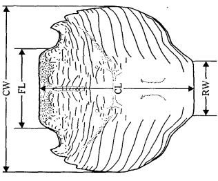
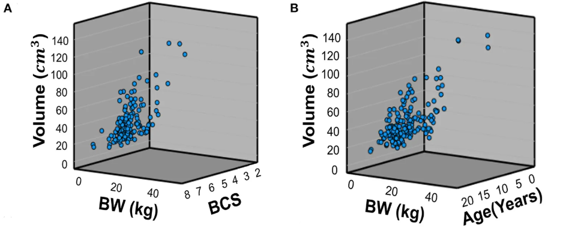
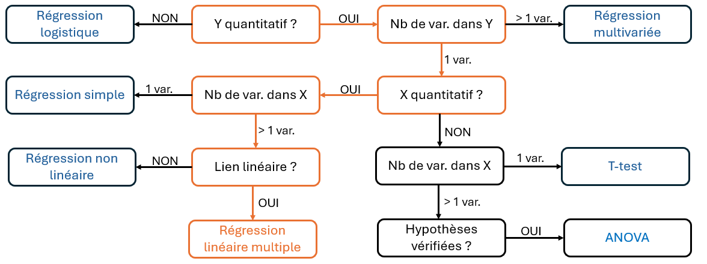

```{r setup}

library(ggplot2)
library(plotly)
library(dplyr)
library(patchwork)
library(pdftools)

library(msos)

```

## 🔍 Introduction : Un modèle linéaire, qu'est-ce c'est ?

```{=html}
<div style="height:5px;"></div>
```

> Un [modèle linéaire]{.smallcaps} cherche à expliquer une variable $Y$ à partir d’une ou plusieurs variables explicatives $X$, en supposant qu’il existe une relation linéaire entre elles.

. . .

| Questions de recherche | $X$ = variable(s) explicative(s) | $Y$ = variable expliquée |
|----|----|----|
| Peut-on [prédire]{.smallcaps} le prix d'un appartement en fonction de sa superficie et de sa distance au centre ville ? | Superficie/Distance | Prix |
| La taille et le poids [varient]{.smallcaps}-ils avec l'âge ? | Taille/Poids | Âge |
| La production de lait d'une vache au cours des 3 premières semaines de lactation permet-elle d'[expliquer]{.smallcaps} la production sur l'ensemble de la période de lactation ? | Production moyenne semaines 1 à 3 | Production moyenne sur toute la lactation (par semaine) |
| Le type d'alimentation (granules, foin, ...) est-il [lié]{.smallcaps} à la vitesse de croissance de l'animal ? | Type d'alimentation | Vitesse de croissance |

. . .

```{=html}
<div style="height:7px;"></div>
```

::: callout-warning
Un modèle linéaire décrit un [lien linéaire]{.smallcaps} entre des variables et **non** un effet/une causalité.
:::

## 🔍 Introduction : Un modèle linéaire, qu'est-ce c'est ? {data-visibility="uncounted"}

```{=html}
<div style="height:5px;"></div>
```

> Un [modèle linéaire]{.smallcaps} cherche à expliquer une variable $Y$ à partir d’une ou plusieurs variables explicatives $X$, en supposant qu’il existe une relation linéaire entre elles.

::: {#tableau-focus}
| Questions de recherche | $X$ = variable(s) explicative(s) | $Y$ = variable expliquée |
|----|----|----|
| La taille et le poids [varient]{.smallcaps}-ils avec l'âge ? | Taille/Poids | Âge |
| Peut-on [prédire]{.smallcaps} le prix d'un appartement en fonction de sa superficie ? | Superficie | Prix |
| La production de lait d'une vache au cours des 3 premières semaines de lactation permet-elle d'[expliquer]{.smallcaps} la production moyenne de lait sur l'ensemble de la période de lactation ? | Production moyenne semaines 1 à 3 | Production moyenne sur toute la lactation (par semaine) |
| Le type d'alimentation (granules, foin, ...) est-il [lié]{.smallcaps} à la vitesse de croissance de l'animal ? | Type d'alimentation | Vitesse de croissance |
:::

. . .

::: small-box
Dans ce cours, on va se concentrer sur la [régression linéaire simple]{.smallcaps} :

**Plusieurs variables explicatives** $X_1,\ldots,X_J$ et **1 variable à expliquer** $Y$.
:::

## 🦀 Application : Présentation des données

```{=html}
<div style="height:5px;"></div>
```

[[Jeu de données utilisé :]{.underline}]{.smallcaps} Mesures morphologiques chez les crabes *Leptograpsus variegatus*, collectés à Fremantle en Australie [@campbell1974].

. . .

::::::: columns
:::: {.column width="60%"}
<br>

- 200 crabes étudiés (50 $\times$ 2 sexes $\times$ 2 couleurs)

::: fragment
- 5 mesures morphologiques

{fig-align="center"}
:::
::::

:::: {.column width="40%"}
::: columns
```{r}
#| echo: false
#| message: false
#| warning: false

knitr::kable(head(crabs, 10))
```
:::
::::
:::::::

## 🦀 Application : Question de recherche

:::: center-text
::: highlight-box
**La longueur du lobe frontal (FL) et le sexe sont-ils [associés]{.smallcaps} à la longueur de la carapace (CL) des crabes ?**
:::
::::

## 📖 Objectifs du cours

```{=html}
<br>
<br>
<div style="height:5px;"></div>
```

1.  Comment construire un modèle linéaire ? (Définition & Exemple)

. . .

```{=html}
<div style="height:5px;"></div>
```

2.  Comment trouver les coefficients qui décrivent le mieux les données ? (Méthode des moindres carrés)

. . .

```{=html}
<div style="height:5px;"></div>
```

3.  Comment évaluer la qualité du modèle ? (Coefficient de détermination $R^2$ et $R^2$ ajusté)

. . .

```{=html}
<div style="height:5px;"></div>
```

4.  Application aux données de crabe avec R

. . .

```{=html}
<div style="height:5px;"></div>
```

5.  Conclusion & Exemple concret d'une contribution en sciences vétérinaire

```{r}
#| echo: false
#| message: false
#| warning: false
#| results: asis


pdf <- "documents/document.pdf"

dir.create("slides", showWarnings = FALSE)

pages <- pdf_convert(
  pdf,
  format = "png",
  dpi = 200,
  verbose = FALSE,
  filenames = sprintf(
    "slides/page-%03d.png",
    seq_len(pdf_info(pdf)$pages)
  )
)

for (page in pages) {
  cat(
    '\n\n## {background-image="', page,
    '" background-size="contain"}\n\n',
    sep = ""
  )
}

```

## 📝 À quoi sert la régression linéaire multiple ?

<br>

[[**Utilisations principales :**]{.underline}]{.smallcaps}

- [Prédire]{.smallcaps} $Y$ [pour de nouvelles valeurs des variables explicatives]{.smallcaps} - *Quelle sera la longueur de la carapace d'un nouveau crabe mâle dont le lobe frontal mesure 15 mm ?*

  $\longrightarrow$ Construction d'un [intervalle de prédiction]{.smallcaps}.

  <br>

. . .

- [Estimer la moyenne de]{.smallcaps} $Y$ [pour des valeurs fixées des variables explicatives]{.smallcaps} - *Quelle est la longueur moyenne de la carapace des crabes mâles dont le lobe frontal mesure 15 mm ?*

  $\longrightarrow$ Construction d'un [intervalle de confiance]{.smallcaps}.

## 📑Exemple d'utilisation en sciences vétérinaires

```{=html}
<div style="height:10px;"></div>
```

[[**Exemple issu de :**]{.underline}]{.smallcaps} @ji2022a

```{=html}
<div style="height:15px;"></div>
```

::::: columns
::: {.column width="50%"}
{fig-align="left"}
:::

::: {.column width="50%"}
{fig-align="right"}
:::
:::::

```{=html}
<div style="height:25px;"></div>
```

::: {.callout-note style="margin-top:-65px;"}
Dans cet article, une [régression linéaire multiple]{.smallcaps} est utilisée pour étudier l'association du *poids* et du *score d'état corporel* avec le *volume rénal des chiens*.
:::

## 🎯 Conclusion

<br>

{fig-align="center"}

<br>

📌 [[**programme du prochain cours :**]{.underline}]{.smallcaps} Régression linéaire multivariée.

## Références
