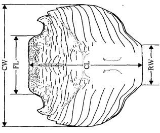
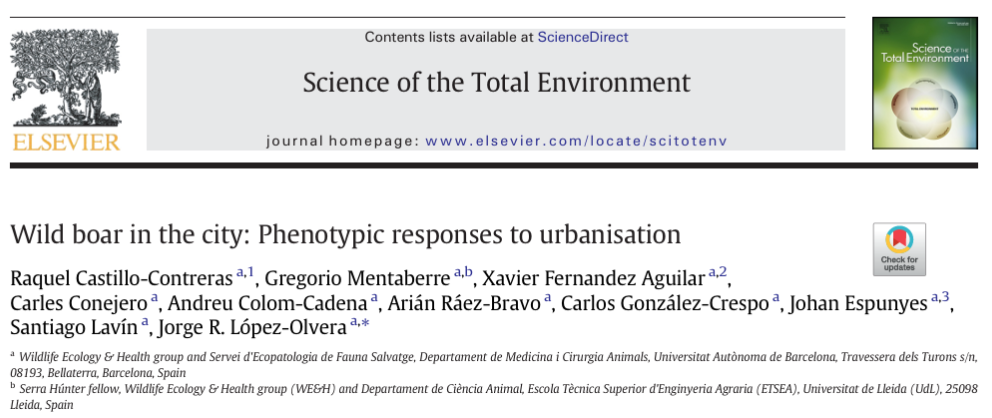
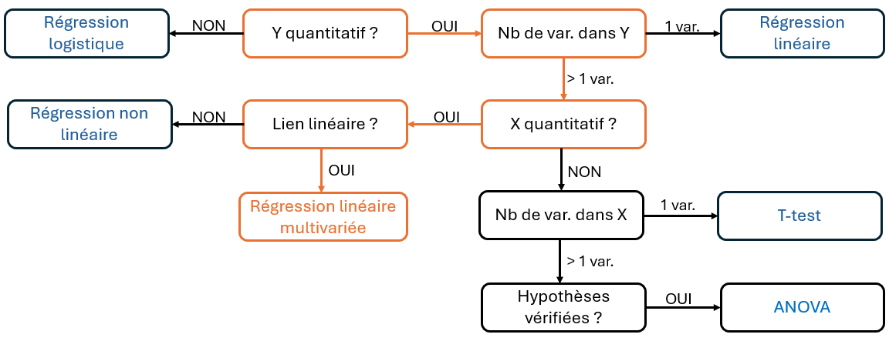

```{r setup}
#| include: false
#| echo: false
#| message: false
#| warning: false

library(MASS)
library(ggplot2)
library(plotly)
library(dplyr)
library(msos)
library(patchwork)
library(kableExtra)
library(pdftools)

```

## 🔍 Introduction : Un modèle linéaire, qu'est-ce c'est ?

```{=html}
<div style="height:5px;"></div>
```

> Un [modèle linéaire]{.smallcaps} cherche à expliquer une variable $Y$ à partir d’une ou plusieurs variables explicatives $X$, en supposant qu’il existe une relation linéaire entre elles.

. . .

| Questions de recherche | $X$ = variable(s) explicative(s) | $Y$ = variable(s) expliquée(s) |
|------------------------|------------------------|------------------------|
| L'âge et le sexe sont-ils [associés]{.smallcaps} à la taille et au poids d'un animal ? | Âge, sexe | Taille, poids |
| Le type d'alimentation est-il [associé]{.smallcaps} à la glycémie et au taux de cholestérol d'un chien ? | Type d'alimentation | Glycémie, cholestérol |
| Peut-on [prédire]{.smallcaps} le prix d'un appartement en fonction de sa superficie ? | Superficie | Prix |
| Le poids et l'âge d'un chien sont-ils [associés]{.smallcaps} à son volume rénal ? | Poids, âge | Volume rénal |

. . .

```{=html}
<div style="height:7px;"></div>
```

::: callout-warning
Un modèle linéaire décrit un [lien linéaire]{.smallcaps} entre des variables et **non** un effet/une causalité.
:::

## 🔍 Introduction : Un modèle linéaire, qu'est-ce c'est ? {data-visibility="uncounted"}

```{=html}
<div style="height:5px;"></div>
```

> Un [modèle linéaire]{.smallcaps} cherche à expliquer une variable $Y$ à partir d’une ou plusieurs variables explicatives $X$, en supposant qu’il existe une relation linéaire entre elles.

::: {#tableau-focus}
| Questions de recherche | $X$ = variable(s) explicative(s) | $Y$ = variable(s) expliquée(s) |
|------------------------|------------------------|------------------------|
| L'âge et le sexe sont-ils [associés]{.smallcaps} à la taille et au poids d'un animal ? | Âge, sexe | Taille, poids |
| Le type d'alimentation est-il [associé]{.smallcaps} à la glycémie et au taux de cholestérol d'un chien ? | Type d'alimentation | Glycémie, cholestérol |
| Peut-on [prédire]{.smallcaps} le prix d'un appartement en fonction de sa superficie ? | Superficie | Prix |
| Le poids et l'âge d'un chien sont-ils [associés]{.smallcaps} à son volume rénal ? | Poids, âge | Volume rénal |
:::

. . .

::: small-box
Dans ce cours, on va se concentrer sur la [régression linéaire simple]{.smallcaps} :

**Une ou plusieurs variables explicatives** $X_1,\ldots,X_J$ et **plusieurs variables à expliquer** $Y_1,\ldots,Y_K$.
:::

## 🦀 Application : Présentation des données

```{=html}
<div style="height:5px;"></div>
```

[[Jeu de données utilisé :]{.underline}]{.smallcaps} Mesures morphologiques chez les crabes *Leptograpsus variegatus*, collectés à Fremantle en Australie [@campbell1974].

. . .

::::::: columns
:::: {.column width="60%"}
<br>

- 200 crabes étudiés (50 $\times$ 2 sexes $\times$ 2 couleurs)

::: fragment
- 5 mesures morphologiques

{fig-align="center"}
:::
::::

:::: {.column width="40%"}
::: columns
```{r}
#| echo: false
#| message: false
#| warning: false

knitr::kable(head(crabs, 10))
```
:::
::::
:::::::

## 🦀 Application : Question de recherche

:::: center-text
::: highlight-box
**La longueur du lobe frontal (FL) et le sexe sont-ils [associés conjointement]{.smallcaps} à la longueur (CL) et à la largeur (CW) de la carapace des crabes ?**
:::
::::

## 📖 Objectifs du cours

```{=html}
<br>
<br>
<div style="height:5px;"></div>
```

1.  Comment construire un modèle linéaire multivarié ? (Définition & Hypothèses)

. . .

```{=html}
<div style="height:5px;"></div>
```

2.  Comment estimer les coefficients pour chaque variable réponse ? (Méthode des moindres carrés)

. . .

```{=html}
<div style="height:5px;"></div>
```

3.  Comment évaluer la qualité du modèle et étudier conjointement les réponses ? ($R^2$ et tests multivariés)

. . .

```{=html}
<div style="height:5px;"></div>
```

4.  Application aux données de crabes avec R

. . .

```{=html}
<div style="height:5px;"></div>
```

5.  Conclusion & Exemple concret d'une contribution en sciences vétérinaires

```{r}
#| echo: false
#| message: false
#| warning: false
#| results: asis


pdf <- "documents/document.pdf"

dir.create("slides", showWarnings = FALSE)

pages <- pdf_convert(
  pdf,
  format = "png",
  dpi = 200,
  verbose = FALSE,
  filenames = sprintf(
    "slides/page-%03d.png",
    seq_len(pdf_info(pdf)$pages)
  )
)

for (page in pages) {
  cat(
    '\n\n## {background-image="', page,
    '" background-size="contain"}\n\n',
    sep = ""
  )
}

```

## 📝 À quoi sert la régression linéaire multivariée ?

<br>

[[**Utilisations principales :**]{.underline}]{.smallcaps}

- [Étudier conjointement plusieurs variables réponses]{.smallcaps} - *La longueur du lobe frontal et le sexe sont-ils associés à la longueur et à la largeur de la carapace des crabes ?*

  $\longrightarrow$ Réalisation d'un [test multivarié]{.smallcaps} tenant compte des corrélations entre les réponses.

  <br>

. . .

- [Prédire plusieurs variables réponses simultanément]{.smallcaps} - *Quelles seront la longueur et la largeur de la carapace d'un nouveau crabe mâle dont le lobe frontal mesure 15 mm ?*

  $\longrightarrow$ Construction de [prédictions conjointes]{.smallcaps}.

## 📑Exemple d'utilisation en sciences vétérinaires

```{=html}
<div style="height:20px;"></div>
```

[[**Exemple issu de :**]{.underline}]{.smallcaps} @castillo-contreras2021

```{=html}
<div style="height:25px;"></div>
```

{fig-align="center"}

```{=html}
<div style="height:25px;"></div>
```

::: {.callout-note}
Dans cet article, une [régression linéaire multivariée]{.smallcaps} est utilisée pour étudier conjointement l'association du *milieu de vie*, de *l'âge* et du *sexe* avec plusieurs caractéristiques morphologiques des sangliers.
:::

## 🎯 Conclusion

<br>

{fig-align="center"}

<br>

📌 [[**programme du prochain cours :**]{.underline}]{.smallcaps} Modèles à effets mixtes.

## Références
