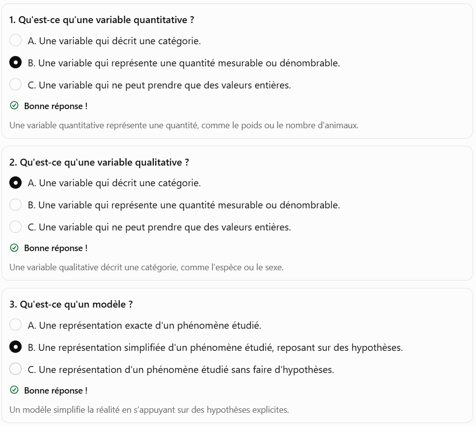
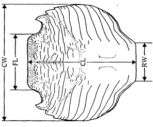
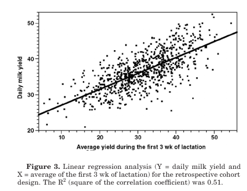
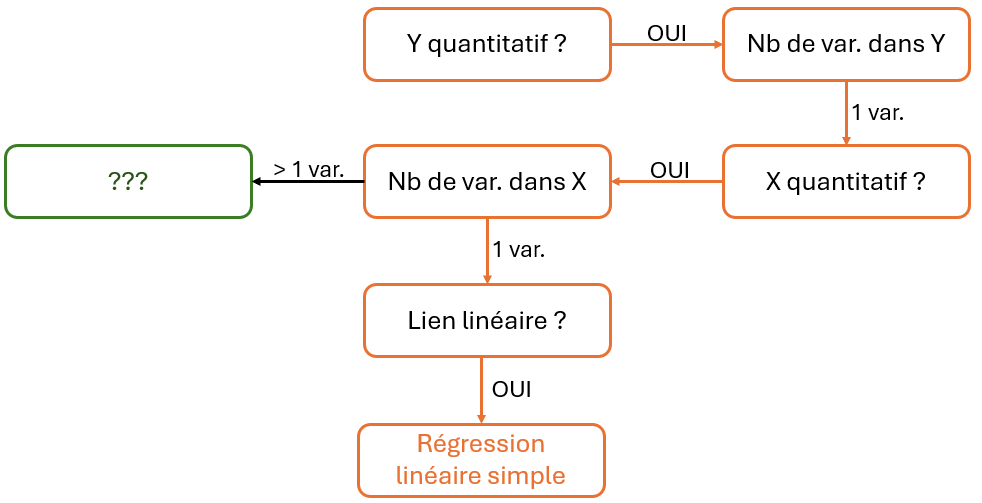
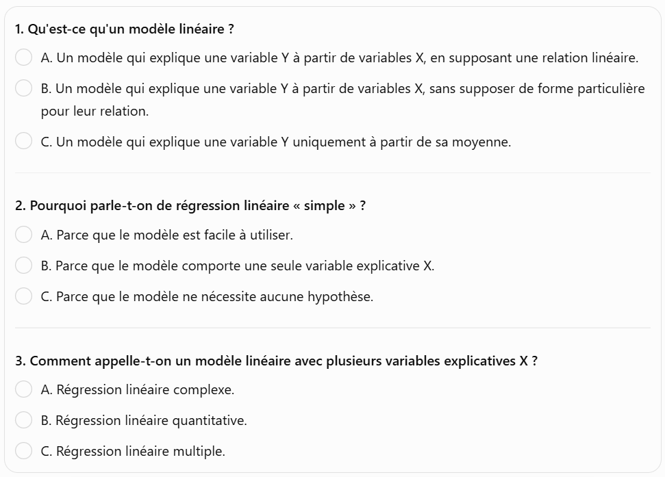

```{r setup}

library(ggplot2)
library(plotly)
library(dplyr)
library(jsonlite)
library(msos)
library(patchwork)
```

## 💭 Avant de commencer

:::::::: columns
:::: {.column width="65%"}
- [[**Retour sur le quiz du dernier cours :**]{.underline}]{.smallcaps}

::: {style="margin-top: -25px;"}
{fig-align="center" width="100%"}
:::
::::

::::: {.column width="35%"}
. . .

<br>

- [[**Un petit exemple concret :**]{.underline}]{.smallcaps}

::: {style="margin-top: -25px; font-size: 0.7em"}
$$
\small
\begin{array}{c|ccccccc}
\small \text{Taille} &
\small \boxed{155} & \small \boxed{160} & \small \boxed{160} &
\small \boxed{163} & \small \boxed{165} & \small \boxed{170} & \small \boxed{175} \\[8pt]
\text{Poids} &
\small \boxed{70} & \small \boxed{75} & \small \boxed{76} &
\small \boxed{78} & \small \boxed{80} & \small \boxed{85} & \small \boxed{??}
\end{array}
$$
:::

. . .

::: grande-fig
```{r}
#| echo: false
#| message: false
#| warning: false
#| fig-height: 3
#| fig-width: 2.5

# Données
df <- data.frame(
  Taille = c(155, 160, 160, 163, 165, 170),
  Poids = c(70, 75, 76, 78, 80, 85)
)

p <- plot_ly(
  data = df,
  x = ~Taille,
  y = ~Poids,
  type = "scatter",
  mode = "markers",
  marker = list(
    color = "#0072B2",
    size = 10
  ),
  hovertemplate = paste(
    "Taille : %{x} cm",
    "<br>Poids : %{y} kg",
    "<extra></extra>"
  )
) %>%
  layout(
    xaxis = list(
      title = "Taille (cm)",
      range = c(153, 175),
      dtick = 5,
      fixedrange = TRUE
    ),
    yaxis = list(
      title = "Poids (kg)",
      range = c(65, 91),
      dtick = 5,
      fixedrange = TRUE
    ),
    showlegend = FALSE,
    newshape = list(
      line = list(
        color = "#E69F00",
        width = 4
      )
    )
  ) %>%
  config(
    modeBarButtonsToAdd = c(
      "drawline",
      "eraseshape"
    )
  )

p
```
:::
:::::
::::::::

## 🔍 Introduction : Un modèle linéaire, qu'est-ce c'est ?

```{=html}
<div style="height:25px;"></div>
```

> Un [modèle linéaire]{.smallcaps} cherche à expliquer une variable $Y$ à partir d’une ou plusieurs variables explicatives $X$, en supposant qu’il existe une relation linéaire entre elles.

```{=html}
<div style="height:35px;"></div>
```

. . .

| Questions de recherche | $X$ = variable(s) explicative(s) | $Y$ = variable expliquée |
|------------------------|------------------------|------------------------|
| Peut-on prédire le prix d'un appartement en fonction de sa superficie ? | Superficie | Prix |
| La production de lait d'une vache au cours des 3 premières semaines de lactation permet-elle d'expliquer la production moyenne de lait sur l'ensemble de la période de lactation ? | Production moyenne semaines 1 à 3 | Production moyenne sur toute la lactation (par semaine) |
| La taille et le poids varient-ils avec l'âge ? | Taille/Poids | Âge |
| Le type d'alimentation (granules, foin, ...) est-il lié à la vitesse de croissance de l'animal ? | Type d'alimentation | Vitesse de croissance |

## 🔍 Introduction : Un modèle linéaire, qu'est-ce c'est ? {data-visibility="uncounted"}

```{=html}
<div style="height:35px;"></div>
```

::: {#tableau-focus}
| Questions de recherche | $X$ = variable(s) explicative(s) | $Y$ = variable expliquée |
|------------------------|------------------------|------------------------|
| Peut-on prédire le prix d'un appartement en fonction de sa superficie ? | Superficie | Prix |
| La production de lait d'une vache au cours des 3 premières semaines de lactation permet-elle d'expliquer la production moyenne de lait sur l'ensemble de la période de lactation ? | Production moyenne semaines 1 à 3 | Production moyenne sur toute la lactation (par semaine) |
| La taille et le poids varient-ils avec l'âge ? | Taille/Poids | Âge |
| Le type d'alimentation (granules, foin, ...) est-il lié à la vitesse de croissance de l'animal ? | Type d'alimentation | Vitesse de croissance |
:::

```{=html}
<div style="height:5px;"></div>
```

. . .

::: small-box
Dans ce cours, on va se concentrer sur la [régression linéaire simple]{.smallcaps} :

**1 variable explicative** $X$ et **1 variable à expliquer** $Y$.
:::

## 🦀 Application : Présentation des données

```{=html}
<div style="height:15px;"></div>
```

[[Jeu de données utilisé :]{.underline}]{.smallcaps} Mesures morphologiques chez les crabes *Leptograpsus variegatus*, collectés à Fremantle en Australie [@campbell1974a].

. . .

::::::: columns
:::: {.column width="60%"}
<br>

- 200 crabes étudiés (50 $\times$ 2 sexes $\times$ 2 couleurs)

::: fragment
- 5 mesures morphologiques

{fig-align="center"}
:::
::::

:::: {.column width="40%"}
::: columns
```{r}
#| echo: false
#| message: false
#| warning: false

crabs <- crabs %>% select(-BD)

knitr::kable(head(crabs, 10))
```
:::
::::
:::::::

## 🦀 Application : Question de recherche

:::: center-text
::: highlight-box
**Y a-t-il un lien [linéaire]{.smallcaps} entre la longueur de la carapace (CL) et celle du lobe frontal (FL) ?**
:::
::::

## 📖 Objectifs du cours

```{=html}
<br>
<br>
<div style="height:15px;"></div>
```

1.  Comment construire un modèle linéaire ? (Exemple & Définition)

. . .

```{=html}
<div style="height:5px;"></div>
```

2.  Comment trouver la droite qui décrit le mieux les données ? (Moindres carrés)

. . .

```{=html}
<div style="height:5px;"></div>
```

3.  Comment savoir si cette droite est de bonne qualité ? (Coefficient de détermination R²)

. . .

```{=html}
<div style="height:5px;"></div>
```

4.  Quelles sont les hypothèses à vérifier avant de faire la régression ?

. . .

```{=html}
<div style="height:5px;"></div>
```

5.  Application aux données de crabe avec R

. . .

```{=html}
<div style="height:5px;"></div>
```

6.  Exemple de contribution en sciences vétérinaire & Conclusion

## 📖 Objectifs du cours

```{=html}
<br>
<br>
<div style="height:15px;"></div>
```

**1. Comment construire un modèle linéaire ? (Exemple & Définition)**

```{=html}
<div style="height:5px;"></div>
```

::: {style="color: #A1A1AA;"}
2.  Comment trouver la droite qui décrit le mieux les données ? (Moindres carrés)
:::

```{=html}
<div style="height:5px;"></div>
```

::: {style="color: #A1A1AA;"}
3.  Comment savoir si cette droite est de bonne qualité ? (Coefficient de détermination R²)
:::

```{=html}
<div style="height:5px;"></div>
```

::: {style="color: #A1A1AA;"}
4.  Quelles sont les hypothèses à vérifier avant de faire la régression ?
:::

```{=html}
<div style="height:5px;"></div>
```

::: {style="color: #A1A1AA;"}
5.  Application aux données de crabe avec R
:::

```{=html}
<div style="height:5px;"></div>
```

::: {style="color: #A1A1AA;"}
6.  Exemple de contribution en sciences vétérinaire & Conclusion
:::

## 1️⃣ Écriture du modèle : Intuition

```{=html}
<div style="height:5px;"></div>
```

On considère $n$ individus et on utilise $_i$ pour décrire le $i-$ème (avec $i = \{1, ..., n\}$).

::: grande-fig
```{r}
#| echo: false
#| message: false
#| warning: false
#| fig-width: 6
#| fig-height: 5
#| width: 100%


p <- plot_ly() %>%
  add_trace(
    data = crabs,
    x = ~FL,
    y = ~CL,
    type = "scatter",
    mode = "markers",
    text = ~paste(
      "<b>Individu :", row.names(crabs), "</b>",
      "<br>FL :", FL,
      "<br>CL :", CL
    ),
    hoverinfo = "text",
    marker = list(
      size = 6,
      color = "#0072B2"
    )
  ) %>%
  layout(
    xaxis = list(
      title = "X = Longueur du lobe frontal (FL)",
      titlefont = list(size = 20),
      tickfont = list(size = 17)
    ),
    yaxis = list(
      title = "Y = Longueur de la carapace (CL)",
      titlefont = list(size = 20),
      tickfont = list(size = 17)
    ),
    showlegend = FALSE,
    uirevision = "zoom",
    newshape = list(
      line = list(
        color = "#E69F00",
        width = 4
      )
    )
  )

p %>%
  config(
    modeBarButtonsToAdd = c(
      "drawline",
      "drawopenpath",
      "eraseshape"
    )) %>%
  layout(
    xaxis = list(
      fixedrange = TRUE
    ),
    yaxis = list(
      fixedrange = TRUE
    )
  )
```
:::

$$
CL_i = \cdots \ FL_i
$$

## 1️⃣ Écriture du modèle : Intuition {data-visibility="uncounted"}

```{=html}
<div style="height:5px;"></div>
```

On considère $n$ individus et on utilise $_i$ pour décrire le $i-$ème (avec $i = \{1, ..., n\}$).

::::::: columns
::: {.column width="60%"}
```{r}
#| echo: false
#| message: false
#| warning: false
#| fig-width: 6
#| fig-height: 5
#| width: 100%


mod <- lm(CL ~ FL, data = crabs)

ggplot(crabs, aes(x = FL, y = CL)) +
  geom_point(
    color = "#0072B2",
    size = 2
  ) +
  geom_abline(
    intercept = coef(mod)[1],
    slope = coef(mod)[2],
    color = "#E69F00",
    linewidth = 1.3
  ) +
  labs(
    x = "X = Longueur du lobe frontal (FL)",
    y = "Y = Longueur de la carapace (CL)"
  ) +
  theme_minimal(base_size = 17) +
  theme(
    panel.grid.minor = element_blank(),
    axis.title = element_text(size = 20),
    axis.text = element_text(size = 17)
  )
```
:::

::::: {.column width="40%"}
:::: {style="text-align:center; border: 2px solid #D9E1F2;   border-radius: 25px;   padding: 0;   margin: 20px 0px 0px 50px;   background: white;   box-shadow: 0 2px 8px rgba(100,120,150,0.10);   overflow: hidden;"}
::: {.text-center style="text-align: center;   font-size: 0.8em;"}
[[équation d'une droite :]{.underline}]{.smallcaps}

$$
y = \color{#CC79A7}{\beta_0}  + \color{#009E73}{\beta_1} \times x
$$

```{r}
#| echo: false
#| message: false
#| warning: false
#| fig-height: 9
#| fig-width: 12


# Paramètres de la droite
a <- 1.25
b <- 0.75

# Droite
x <- seq(-1, 5, length.out = 100)
df <- data.frame(
  x = x,
  y = a * x + b
)

# Points utilisés pour illustrer le coefficient directeur
x1 <- 1
x2 <- 2
y1 <- a * x1 + b
y2 <- a * x2 + b

ggplot(df, aes(x, y)) +

  # Droite
  geom_line(
    color = "#E69F00",
    linewidth = 3.5
  ) +

  # Point correspondant à l'ordonnée à l'origine
  annotate(
    "point",
    x = 0, y = b,
    size = 13,
    color = "#CC79A7"
  ) +

  # Triangle : Δx
  annotate(
    "segment",
    x = x1, xend = x2,
    y = y1, yend = y1,
    linewidth = 3.5,
    color = "#009E73"
  ) +

  # Triangle : Δy
  annotate(
    "segment",
    x = x2, xend = x2,
    y = y1, yend = y2,
    linewidth = 3.5,
    color = "#009E73"
  ) +

  # Δx
  annotate(
    "text",
    x = (x1 + x2) / 2,
    y = y1 - 0.3,
    label = expression(Delta*x),
    color = "#009E73",
    fontface = "bold",
    size = 10
  ) +

  # Δy
  annotate(
    "text",
    x = x2 + 0.45,
    y = (y1 + y2) / 2,
    label = expression(Delta*y),
    color = "#009E73",
    fontface = "bold",
    size = 10
  ) +

  # b : ordonnée à l'origine
  annotate(
    "label",
    x = 1.38,
    y = 4.0,
    label = "'Ordonnée à l\\'origine'~beta[0]",
    parse = TRUE,
    color = "#CC79A7",
    size = 14
  ) +

  # Flèche vers b
  annotate(
    "segment",
    x = 1.38, xend = 0.1,
    y = 3.6, yend = 1,
    color = "#CC79A7",
    linewidth = 2.8,
    arrow = arrow(length = unit(0.5, "cm"))
  ) +

  # a : coefficient directeur
  annotate(
    "label",
    x = 2.7,
    y = 0.5,
    label = "'Coefficient directeur'~beta[1] == Delta*y/Delta*x",
    parse = TRUE,
    color = "#009E73",
    size = 14
  ) +

  # Flèche vers le triangle
  annotate(
    "segment",
    x = 2.7, xend = 2.1,
    y = 1, yend = 1.9,
    color = "#009E73",
    linewidth = 2.8,
    arrow = arrow(length = unit(0.5, "cm"))
  ) +

  # Axe x avec flèche
  annotate(
    "segment",
    x = -1, xend = 5,
    y = 0, yend = 0,
    linewidth = 2.6,
    arrow = arrow(length = unit(0.5, "cm"))
  ) +

  # Axe y avec flèche
  annotate(
    "segment",
    x = 0, xend = 0,
    y = -1, yend = 5,
    linewidth = 2.6,
    arrow = arrow(length = unit(0.5, "cm"))
  ) +

  # x
  annotate(
    "text",
    x = 4.8, y = -0.3,
    label = "x",
    fontface = "italic",
    size = 13
  ) +

  # y
  annotate(
    "text",
    x = -0.3, y = 4.8,
    label = "y",
    fontface = "italic",
    size = 13
  ) +

  # Limites
  coord_cartesian(
    xlim = c(-1, 5.1),
    ylim = c(-1, 5.1),
    expand = FALSE
  ) +

  # Graduations
  scale_x_continuous(
    breaks = -1:5
  ) +

  scale_y_continuous(
    breaks = -1:5
  ) +

  # Thème
  theme_minimal(base_size = 31) +

  theme(
    panel.grid.major = element_line(
      color = "#D9E1F2",
      linewidth = 1,
      linetype = "dashed"
    ),
    panel.grid.minor = element_line(
      color = "#E9EEF5",
      linewidth = 0.7,
      linetype = "dashed"
    ),
    axis.title = element_blank(),
    axis.text = element_text(
      color = "#333333",
      size = 23
    ),
    plot.margin = margin(30, 35, 30, 30)
  )
```
:::
::::
:::::
:::::::

. . .

$$
CL_i = \color{#CC79A7}{\beta_0} + \color{#009E73}{\beta_1}FL_i
$$

## 1️⃣ Écriture du modèle : Intuition {data-visibility="uncounted"}

```{=html}
<div style="height:5px;"></div>
```

On considère $n$ individus et on utilise $_i$ pour décrire le $i-$ème (avec $i = \{1, ..., n\}$).

::::::: columns
::: {.column width="60%"}
```{r}
#| echo: false
#| message: false
#| warning: false
#| fig-width: 6
#| fig-height: 5
#| width: 100%


mod <- lm(CL ~ FL, data = crabs)

ggplot(crabs, aes(x = FL, y = CL)) +
  geom_point(
    color = "#0072B2",
    size = 2
  ) +
  geom_abline(
    intercept = coef(mod)[1],
    slope = coef(mod)[2],
    color = "#E69F00",
    linewidth = 1.3
  ) +
  labs(
    x = "X = Longueur du lobe frontal (FL)",
    y = "Y = Longueur de la carapace (CL)"
  ) +
  theme_minimal(base_size = 17) +
  theme(
    panel.grid.minor = element_blank(),
    axis.title = element_text(size = 20),
    axis.text = element_text(size = 17)
  )
```
:::

::::: {.column width="40%"}
:::: {style="text-align:center; border: 2px solid #D9E1F2;   border-radius: 25px;   padding: 0;   margin: 20px 0px 0px 50px;   background: white;   box-shadow: 0 2px 8px rgba(100,120,150,0.10);   overflow: hidden;"}
::: {.text-center style="text-align: center;   font-size: 0.8em;"}
[[équation d'une droite :]{.underline}]{.smallcaps}

$$
y = \color{#CC79A7}{\beta_0}  + \color{#009E73}{\beta_1} \times x
$$

```{r}
#| echo: false
#| message: false
#| warning: false
#| fig-height: 9
#| fig-width: 12


# Paramètres de la droite
a <- 1.25
b <- 0.75

# Droite
x <- seq(-1, 5, length.out = 100)
df <- data.frame(
  x = x,
  y = a * x + b
)

# Points utilisés pour illustrer le coefficient directeur
x1 <- 1
x2 <- 2
y1 <- a * x1 + b
y2 <- a * x2 + b

ggplot(df, aes(x, y)) +

  # Droite
  geom_line(
    color = "#E69F00",
    linewidth = 3.5
  ) +

  # Point correspondant à l'ordonnée à l'origine
  annotate(
    "point",
    x = 0, y = b,
    size = 13,
    color = "#CC79A7"
  ) +

  # Triangle : Δx
  annotate(
    "segment",
    x = x1, xend = x2,
    y = y1, yend = y1,
    linewidth = 3.5,
    color = "#009E73"
  ) +

  # Triangle : Δy
  annotate(
    "segment",
    x = x2, xend = x2,
    y = y1, yend = y2,
    linewidth = 3.5,
    color = "#009E73"
  ) +

  # Δx
  annotate(
    "text",
    x = (x1 + x2) / 2,
    y = y1 - 0.3,
    label = expression(Delta*x),
    color = "#009E73",
    fontface = "bold",
    size = 10
  ) +

  # Δy
  annotate(
    "text",
    x = x2 + 0.45,
    y = (y1 + y2) / 2,
    label = expression(Delta*y),
    color = "#009E73",
    fontface = "bold",
    size = 10
  ) +

  # b : ordonnée à l'origine
  annotate(
    "label",
    x = 1.38,
    y = 4.0,
    label = "'Ordonnée à l\\'origine'~beta[0]",
    parse = TRUE,
    color = "#CC79A7",
    size = 14
  ) +

  # Flèche vers b
  annotate(
    "segment",
    x = 1.38, xend = 0.1,
    y = 3.6, yend = 1,
    color = "#CC79A7",
    linewidth = 2.8,
    arrow = arrow(length = unit(0.5, "cm"))
  ) +

  # a : coefficient directeur
  annotate(
    "label",
    x = 2.7,
    y = 0.5,
    label = "'Coefficient directeur'~beta[1] == Delta*y/Delta*x",
    parse = TRUE,
    color = "#009E73",
    size = 14
  ) +

  # Flèche vers le triangle
  annotate(
    "segment",
    x = 2.7, xend = 2.1,
    y = 1, yend = 1.9,
    color = "#009E73",
    linewidth = 2.8,
    arrow = arrow(length = unit(0.5, "cm"))
  ) +

  # Axe x avec flèche
  annotate(
    "segment",
    x = -1, xend = 5,
    y = 0, yend = 0,
    linewidth = 2.6,
    arrow = arrow(length = unit(0.5, "cm"))
  ) +

  # Axe y avec flèche
  annotate(
    "segment",
    x = 0, xend = 0,
    y = -1, yend = 5,
    linewidth = 2.6,
    arrow = arrow(length = unit(0.5, "cm"))
  ) +

  # x
  annotate(
    "text",
    x = 4.8, y = -0.3,
    label = "x",
    fontface = "italic",
    size = 13
  ) +

  # y
  annotate(
    "text",
    x = -0.3, y = 4.8,
    label = "y",
    fontface = "italic",
    size = 13
  ) +

  # Limites
  coord_cartesian(
    xlim = c(-1, 5.1),
    ylim = c(-1, 5.1),
    expand = FALSE
  ) +

  # Graduations
  scale_x_continuous(
    breaks = -1:5
  ) +

  scale_y_continuous(
    breaks = -1:5
  ) +

  # Thème
  theme_minimal(base_size = 31) +

  theme(
    panel.grid.major = element_line(
      color = "#D9E1F2",
      linewidth = 1,
      linetype = "dashed"
    ),
    panel.grid.minor = element_line(
      color = "#E9EEF5",
      linewidth = 0.7,
      linetype = "dashed"
    ),
    axis.title = element_blank(),
    axis.text = element_text(
      color = "#333333",
      size = 23
    ),
    plot.margin = margin(30, 35, 30, 30)
  )
```
:::
::::
:::::
:::::::

$$
CL_i = \color{#CC79A7}{\beta_0} + \color{#009E73}{\beta_1}FL_i + \epsilon_i
$$

## 1️⃣ Écriture du modèle : Définition

```{=html}
<div style="height:50px;"></div>
```

[[Définition : Modèle linéaire]{.underline}]{.smallcaps}

On mesure sur un individu $i$ $Y_i$ la *variable à expliquer* et $X_i$ la *variable explicative*. Le [modèle linéaire]{.smallcaps} décrit la relation (linéaire) entre $Y_i$ et $X_i$ sous la forme :

$$
  Y_i = \color{#CC79A7}{\beta_0} + \color{#009E73}{\beta_1}X_i + \epsilon_i
$$

où $\color{#CC79A7}{\beta_0}$ est l'ordonnée à l'origine, $\color{#009E73}{\beta_1}$ le coefficient directeur et $\epsilon$ un bruit (aléatoire).

```{=html}
<div style="height:100px;"></div>
```

. . .

::: callout-note
La [régression linéaire]{.smallcaps} désigne l'estimation de paramètres $\color{#CC79A7}{\beta_0}$ et $\color{#009E73}{\beta_1}$ à partir des données observées.
:::

## 📖 Objectifs du cours

```{=html}
<br>
<br>
<div style="height:15px;"></div>
```

::: {style="color: #A1A1AA;"}
1.  Comment construire un modèle linéaire ? (Exemple & Définition)
:::

```{=html}
<div style="height:5px;"></div>
```

**2. Comment trouver la droite qui décrit le mieux les données ? (Moindres carrés)**

```{=html}
<div style="height:5px;"></div>
```

::: {style="color: #A1A1AA;"}
3.  Comment savoir si cette droite est de bonne qualité ? (Coefficient de détermination R²)
:::

```{=html}
<div style="height:5px;"></div>
```

::: {style="color: #A1A1AA;"}
4.  Quelles sont les hypothèses à vérifier avant de faire la régression ?
:::

```{=html}
<div style="height:5px;"></div>
```

::: {style="color: #A1A1AA;"}
5.  Application aux données de crabe avec R
:::

```{=html}
<div style="height:5px;"></div>
```

::: {style="color: #A1A1AA;"}
6.  Exemple de contribution en sciences vétérinaire & Conclusion
:::

## 2️⃣ Estimation par moindres carrés : Intuition

<br>

> La [régression linéaire]{.smallcaps} permet de trouver la droite d'équation $y = \beta_0 + \beta_1x$ qui décrit le **mieux** les données.

```{=html}
<div style="height:20px;"></div>
```

::: center
```{r}
#| echo: false
#| message: false
#| warning: false
#| fig-height: 4.5
#| fig-width: 10
# -------------------------
# Régression linéaire
# -------------------------

mod_lm <- lm(CL ~ FL, data = crabs)

coef_lm <- coef(mod_lm)

x_grid <- seq(
  min(crabs$FL),
  max(crabs$FL),
  length.out = 200
)

# Bonne droite estimée par lm()
y_lm <- coef_lm[1] + coef_lm[2] * x_grid


# -------------------------
# Autres modèles candidats
# -------------------------

# Modèle A : droite classique x=y
#y_A <- 1 * x_grid + 7

# Modèle B : droite plate
y_B <- 0.02 * x_grid + 27

# Modèle C : droite trop pentue
y_C <- 2.5 * x_grid - 5


# -------------------------
# Graphique interactif
# -------------------------

p <- plot_ly() %>%

  # -----------------------
  # Données
  # -----------------------
  add_trace(
    data = crabs,
    x = ~FL,
    y = ~CL,
    type = "scatter",
    mode = "markers",
    showlegend = FALSE,
    text = ~paste(
      "<b>Individu :", row.names(crabs), "</b>",
      "<br>FL :", FL,
      "<br>CL :", CL
    ),
    hoverinfo = "text",
    marker = list(
      size = 6,
      color = "#0072B2"
    )
  ) %>%
  
    # -----------------------
  # Bonne droite : lm()
  # -----------------------
  add_trace(
    x = x_grid,
    y = y_lm,
    type = "scatter",
    mode = "lines",
    name = "Droite A",
    line = list(
      color = "#E69F00",
      width = 5
    )
  ) %>%

  # -----------------------
  # Mauvais modèle B
  # -----------------------
  add_trace(
    x = x_grid,
    y = y_B,
    type = "scatter",
    mode = "lines",
    name = "Droite B",
    line = list(
      color = "#009E73",
      width = 4
    )
  ) %>%
  
   # -----------------------
  # Mauvais modèle C
  # -----------------------
  add_trace(
    x = x_grid,
    y = y_C,
    type = "scatter",
    mode = "lines",
    name = "Droite C",
    line = list(
      color = "#CC79A7",
      width = 4
    )
  ) %>%

  # -----------------------
  # Mise en forme
  # -----------------------
  layout(
    xaxis = list(
      title = "X = Longueur du lobe frontal (FL)",
      titlefont = list(size = 20),
      tickfont = list(size = 17)
    ),

    yaxis = list(
      title = "Y = Longueur de la carapace (CL)",
      titlefont = list(size = 20),
      tickfont = list(size = 17)
    ),

    legend = list(
      font = list(size = 17)
    ),

    uirevision = "zoom"
  )


# -------------------------
# Interaction
# -------------------------

p %>%
  config(
    modeBarButtonsToAdd = c(
      "drawline",
      "drawopenpath",
      "eraseshape"
    ),
    displayModeBar = FALSE,
    scrollZoom = FALSE,
    doubleClick = FALSE
  ) %>%
  layout(
    xaxis = list(
      fixedrange = TRUE
    ),
    yaxis = list(
      fixedrange = TRUE
    )
  )
```
:::

## 2️⃣ Estimation par moindres carrés : Notations[^1]

[^1]: ⚠️ici on a que 10% des observations

```{=html}
<div style="height:5px;"></div>
```

:::::::: columns
:::::: {.column width="60%"}
```{=html}
<div style="height:5px;"></div>
```

[[Notations :]{.underline}]{.smallcaps}

::: fragment
- $y_i$ est l'[observation]{.smallcaps} pour l'individu $i$

  $\longrightarrow \hat{y_i}$ est l'[observation **estimée**]{.smallcaps} pour l'individu $i$
:::

::: fragment
- $\beta_0$ et $\beta_1$ sont les [paramètres]{.smallcaps}

  $\longrightarrow \hat{\beta_0}$ et $\hat{\beta_1}$ sont les [paramètres **estimés**]{.smallcaps}
:::

::: fragment
- $e_i = y_i - \hat{y_i}$ est l'[erreur]{.smallcaps}/[résidu]{.smallcaps} pour l'individu $i$
:::
::::::

::: {.column width="40%"}
```{r}
#| echo: false
#| results: asis
#| message: false
#| warning: false

set.seed(123)
df <- crabs[sample(nrow(crabs), 20), c("FL", "CL")]
mod <- lm(CL ~ FL, data = df)

json <- toJSON(
  list(
    x = df$FL,
    y = df$CL,
    beta0 = unname(coef(mod)[1]),
    beta1 = unname(coef(mod)[2])
  ),
  auto_unbox = TRUE,
  digits = 10
)

cat('<script type="application/json" id="reg-data">')
cat(json)
cat('</script>')
```

```{=html}
<div id="reg-interactive" style="width:100%;">

  <!-- Graphique -->
  <div id="reg-plot"
       style="width:100%; height:390px;">
  </div>

  <!-- Paramètres et somme des carrés -->
  <div style="
    display:flex;
    justify-content:center;
    align-items:center;
    gap:12px;
    margin-top:5px;
    font-size:17px;
    flex-wrap:wrap;
  ">

    <label>
      β₀ :
      <input id="reg-b0"
             type="number"
             step="0.5"
             value="0"
             style="width:75px; font-size:16px;">
    </label>

    <label>
      β₁ :
      <input id="reg-b1"
             type="number"
             step="0.1"
             value="0"
             style="width:75px; font-size:16px;">
    </label>

    <button id="reg-play"
            type="button"
            title="Animer vers les moindres carrés"
            style="font-size:15px; padding:3px 8px;">
      ▶
    </button>

    <span id="reg-errors"
          style="font-size:17px; white-space:nowrap;">
    </span>

  </div>
</div>

<script src="https://cdn.plot.ly/plotly-2.35.2.min.js"></script>

<script>
(function () {

  function initializeRegression() {

    const container = document.getElementById("reg-interactive");
    const source = document.getElementById("reg-data");

    if (!container || !source || !window.Plotly) return;
    if (container.dataset.initialized === "true") return;

    const data = JSON.parse(source.textContent);

    const x = data.x;
    const y = data.y;

    const beta0OLS = data.beta0;
    const beta1OLS = data.beta1;

    const b0 = document.getElementById("reg-b0");
    const b1 = document.getElementById("reg-b1");

    const xmin = Math.min(...x) - 1;
    const xmax = Math.max(...x) + 1;

    let animationId = null;

    function update() {

      const beta0 = Number(b0.value);
      const beta1 = Number(b1.value);

      if (!Number.isFinite(beta0) ||
          !Number.isFinite(beta1)) return;

      // Valeurs prédites
      const yhat = x.map(v => beta0 + beta1 * v);

      // Segments des résidus
      const residualX = [];
      const residualY = [];

      for (let i = 0; i < x.length; i++) {
        residualX.push(x[i], x[i], null);
        residualY.push(y[i], yhat[i], null);
      }

      // Somme des erreurs au carré
      const SCR = y.reduce(
        (sum, yi, i) => sum + (yi - yhat[i]) ** 2,
        0
      );

      document.getElementById("reg-errors").innerHTML =
        "∑(y<sub>i</sub> − ŷ<sub>i</sub>)² = " +
        SCR.toFixed(2);

      // Étiquettes roses des résidus
      const residualLabels = x.map((xi, i) => ({
        x: xi,
        y: (y[i] + yhat[i]) / 2,
        text: "e<sub>" + (i + 1) + "</sub>",
        showarrow: false,
        xshift: -13,
        font: {
          color: "#CC79A7",
          size: 12
        }
      }));

      // Traces Plotly
      const traces = [

        // Résidus roses
        {
          x: residualX,
          y: residualY,
          type: "scatter",
          mode: "lines",
          line: {
            color: "#CC79A7",
            width: 2,
            dash: "dash"
          },
          hoverinfo: "skip",
          name: "Résidus"
        },

        // Valeurs prédites
        {
          x: x,
          y: yhat,
          type: "scatter",
          mode: "markers",
          marker: {
            color: "black",
            size: 6
          },
          name: "Prédictions"
        },

        // Observations
        {
          x: x,
          y: y,
          type: "scatter",
          mode: "markers",
          marker: {
            color: "#0072B2",
            size: 10
          },
          name: "Observations"
        },

        // Droite orange au premier plan
        {
          x: [xmin, xmax],
          y: [
            beta0 + beta1 * xmin,
            beta0 + beta1 * xmax
          ],
          type: "scatter",
          mode: "lines",
          line: {
            color: "#E69F00",
            width: 5
          },
          name: "Droite"
        }
      ];

      Plotly.react(
        "reg-plot",
        traces,
        {
          margin: {
            l: 55,
            r: 10,
            t: 10,
            b: 50
          },

          xaxis: {
            title: "FL",
            range: [xmin, xmax],
            fixedrange: true,
            zeroline: false
          },

          yaxis: {
            title: "CL",
            range: [0, 60],
            fixedrange: true,
            zeroline: false
          },

          annotations: residualLabels,

          showlegend: false,

          font: {
            size: 16
          },

          paper_bgcolor: "rgba(0,0,0,0)",
          plot_bgcolor: "rgba(0,0,0,0)",

          uirevision: "regression"
        },
        {
          responsive: true,
          displayModeBar: false
        }
      );
    }

    // Arrêter l'animation
    function stopAnimation() {
      if (animationId !== null) {
        cancelAnimationFrame(animationId);
        animationId = null;
      }
    }

    // Animation vers les moindres carrés
    function play() {

      stopAnimation();

      const start0 = Number(b0.value);
      const start1 = Number(b1.value);

      if (!Number.isFinite(start0) ||
          !Number.isFinite(start1)) return;

      const duration = 2000;
      const startTime = performance.now();

      function animate(now) {

        const t = Math.min(
          (now - startTime) / duration,
          1
        );

        // Interpolation fluide
        const progress = t * t * (3 - 2 * t);

        b0.value = (
          start0 + (beta0OLS - start0) * progress
        ).toFixed(4);

        b1.value = (
          start1 + (beta1OLS - start1) * progress
        ).toFixed(4);

        update();

        if (t < 1) {
          animationId = requestAnimationFrame(animate);
        } else {
          animationId = null;
        }
      }

      animationId = requestAnimationFrame(animate);
    }

    // Modification manuelle
    b0.addEventListener("input", () => {
      stopAnimation();
      update();
    });

    b1.addEventListener("input", () => {
      stopAnimation();
      update();
    });

    // Bouton Play
    document.getElementById("reg-play")
      .addEventListener("click", play);

    // Initialisation à 0
    b0.value = "0";
    b1.value = "0";

    container.dataset.initialized = "true";

    update();
  }

  // Attendre le chargement de Plotly
  function waitForPlotly() {

    if (window.Plotly) {
      initializeRegression();
    } else {
      setTimeout(waitForPlotly, 100);
    }
  }

  if (document.readyState === "loading") {
    document.addEventListener(
      "DOMContentLoaded",
      waitForPlotly
    );
  } else {
    waitForPlotly();
  }

  // Redimensionnement Reveal.js
  document.addEventListener(
    "slidechanged",
    function () {

      if (window.Plotly) {

        initializeRegression();

        const plot = document.getElementById("reg-plot");

        if (plot && plot.data) {
          Plotly.Plots.resize(plot);
        }
      }
    }
  );

})();
</script>
```
:::
::::::::

. . .

::: {style="margin-top: -10px:"}
:::

:::: small-box
On cherche $\hat{\beta_0}$ et $\hat{\beta_1}$ tels que la somme des erreurs au carré pour chaque individu est la plus petite possible :

. . .

::: {style="margin-top: -23px; margin-bottom: -25px; font-size: 0.95em;"}
$$
\hat{\beta_0}, \hat{\beta_1}
= \arg\min_{\beta_0, \beta_1}
\sum_{i=1}^{N}
\left[
y_i -
\underbrace{(\hat{\beta}_0+\hat{\beta}_1 x_i)}_{\hat{y}_i}
\right]^2.
$$
:::
::::

## 2️⃣ Estimation par moindres carrés : Résolution

```{=html}
<div style="height:5px;"></div>
```

::::: small-box
::: {style="font-size: 1.15em;"}
On cherche $\hat{\beta_0}$ et $\hat{\beta_1}$ tels que la somme des erreurs au carré est minimale, c'est-à-dire que :
:::

::: {style="margin-top: -25px; margin-bottom: -25px; font-size: 1.15em;"}
$$
\hat{\beta_0}, \hat{\beta_1}
= \arg\min_{\beta_0, \beta_1}
\sum_{i = 1}^N (y_i - \hat{y_i})^2.
$$
:::
:::::

```{=html}
<div style="height:15px;"></div>
```

En dérivant, on obtient comme solution :

$$
\color{#CC79A7}{\hat{\beta_0}} = \bar{y} - \hat{\beta_1} \bar{x},
$$

où $\bar{y}$ et $\bar{x}$ désigne la moyenne des $y$ et $x$. Et :

$$
\color{#009E73}{\hat{\beta_1}} = \frac{\sum_{i = 1}^N (x_i - \bar{x})(y_i - \bar{y})}{\sum_{i = 1}^N (x_i - \bar{x})^2}.
$$

## 2️⃣Estimation par moindres carrés : Exemple

<br>

:::::: columns
:::: {.column width="50%"}
::: {style="height:5px;"}
:::

```{=html}
<div style="height:20px;"></div>
```

- $\color{#009E73}{\hat{\beta_1}} = \frac{\sum_{i = 1}^N (x_i - \bar{x})(y_i - \bar{y})}{\sum_{i = 1}^N (x_i - \bar{x})^2}$

  $= \frac{4846.979}{2431.242}$

  $= 1.994 \quad (= \frac{\Delta y}{\Delta x}).$

```{=html}
<div style="height:15px;"></div>
```

- $\color{#CC79A7}{\hat{\beta_0}} = \bar{y} - \hat{\beta_1}\bar{x}$

  $= 32.106 - \hat{\beta_1} \times 15.583$

  $= 1.039 \quad ( = \text{ordonnée à l'origine}).$
::::

::: {.column width="50%"}
```{r}
#| echo: false
#| message: false
#| warning: false
#| fig-height: 6
#| fig-width: 6

# Régression
mod <- lm(CL ~ FL, data = crabs)

beta0 <- coef(mod)[1]
beta1 <- coef(mod)[2]

# Deux points espacés de Δx = 5
x1 <- 10
x2 <- 15

y1 <- beta0 + beta1 * x1
y2 <- beta0 + beta1 * x2

# Valeurs
delta_x <- x2 - x1
delta_y <- y2 - y1
slope <- delta_y / delta_x

# Graphique
ggplot(crabs, aes(x = FL, y = CL)) +

  # Observations
  geom_point(
    color = "#0072B2",
    alpha = 0.45,
    size = 2.5
  ) +

  # Droite de régression
  geom_abline(
    intercept = beta0,
    slope = beta1,
    color = "#E69F00",
    linewidth = 1.5
  ) +

  # Deux points sur la droite
  geom_point(
    data = data.frame(
      FL = c(x1, x2),
      CL = c(y1, y2)
    ),
    color = "#009E73",
    size = 5
  ) +

  # Segment Δx
  annotate(
    "segment",
    x = x1, xend = x2,
    y = y1, yend = y1,
    color = "#009E73",
    linewidth = 1.2
  ) +

  # Segment Δy
  annotate(
    "segment",
    x = x2, xend = x2,
    y = y1, yend = y2,
    color = "#009E73",
    linewidth = 1.2
  ) +

  # Annotation β0
  annotate(
    "segment",
    x = 1.5, xend = 0,
    y = beta0 + 2, yend = beta0,
    arrow = arrow(length = grid::unit(0.2, "cm")),
    color = "#CC79A7"
  ) +

  annotate(
    "text",
    x = 2,
    y = beta0 + 2.5,
    label = round(beta0, 3),
    color = "#CC79A7",
    fontface = "bold",
    size = 6
  ) +

  # Annotation Δx
  annotate(
    "text",
    x = (x1 + x2) / 2,
    y = y1 - 2,
    label = paste0("Δx = ", round(delta_x, 1)),
    fontface = "bold",
    size = 6
  ) +

  # Annotation Δy
  annotate(
    "text",
    x = x2 + 2,
    y = (y1 + y2) / 2,
    label = paste0("Δy = ", round(delta_y, 2)),
    fontface = "bold",
    size = 6
  ) +

  # Axes
  coord_cartesian(
    xlim = c(0, 21),
    ylim = c(0, 40)
  ) +

  labs(
    x = "FL",
    y = "CL"
  ) +

  theme_minimal(base_size = 20) +

  theme(
    axis.title = element_text(size = 26),
    axis.text = element_text(size = 20),
    panel.grid.minor = element_blank()
  )
```
:::
::::::

## 📖 Objectifs du cours

```{=html}
<br>
<br>
<div style="height:15px;"></div>
```

::: {style="color: #A1A1AA;"}
1.  Comment construire un modèle linéaire ? (Exemple & Définition)
:::

```{=html}
<div style="height:5px;"></div>
```

::: {style="color: #A1A1AA;"}
2.  Comment trouver la droite qui décrit le mieux les données ? (Moindres carrés)
:::

```{=html}
<div style="height:5px;"></div>
```

**3. Comment savoir si cette droite est de bonne qualité ? (Coefficient de détermination R²)**

```{=html}
<div style="height:5px;"></div>
```

::: {style="color: #A1A1AA;"}
4.  Quelles sont les hypothèses à vérifier avant de faire la régression ?
:::

```{=html}
<div style="height:5px;"></div>
```

::: {style="color: #A1A1AA;"}
5.  Application aux données de crabe avec R
:::

```{=html}
<div style="height:5px;"></div>
```

::: {style="color: #A1A1AA;"}
6.  Exemple de contribution en sciences vétérinaire & Conclusion
:::

## 3️⃣ Qualité de la droite de régression avec $R^2$ : Intuition

```{=html}
<div style="height:25px;"></div>
```

> Pour évaluer la qualité de la droite de régression on calcule le [coefficient de détermination]{.smallcaps} ou $R^2$ qui mesure à quel point le modèle explique les données.

```{=html}
<div style="height:15px;"></div>
```

::: {style="justify-content: center;"}
```{r}
#| echo: false
#| message: false
#| warning: false
#| fig-height: 6.5
#| fig-width: 18

set.seed(123)

# ============================================================
# Données
# ============================================================

n <- 30
X <- seq(1, 10, length.out = n)

# Partie expliquée par X
signal <- X

# ------------------------------------------------------------
# Fonction pour construire Y avec un R² donné
# ------------------------------------------------------------

make_data <- function(X, R2) {

  x_centered <- X - mean(X)

  # Vecteur orthogonal à X
  z <- rnorm(length(X))
  z <- z - mean(z)

  # Retirer la composante parallèle à X
  z <- z - sum(z * x_centered) / sum(x_centered^2) * x_centered

  # Centrer et normaliser
  z <- z - mean(z)
  z <- z / sd(z)

  # Signal centré
  signal <- x_centered
  signal <- signal / sd(signal)

  if (R2 == 1) {

    Y <- signal

  } else {

    # Rapport signal / bruit donnant exactement R²
    Y <- sqrt(R2) * signal +
      sqrt(1 - R2) * z
  }

  data.frame(
    X = X,
    Y = Y
  )
}


# ============================================================
# Trois jeux de données
# ============================================================

data_0   <- make_data(X, 0)
data_05  <- make_data(X, 0.5)
data_1   <- make_data(X, 1)


# Vérification
#summary(lm(Y ~ X, data = data_0))$r.squared
#summary(lm(Y ~ X, data = data_05))$r.squared
#summary(lm(Y ~ X, data = data_1))$r.squared


# ============================================================
# Fonction pour faire un graphique
# ============================================================

plot_R2 <- function(data, R2) {

  mod <- lm(Y ~ X, data = data)

  ggplot(data, aes(X, Y)) +

    geom_point(
      size = 4.5,
      color = "#0072B2"
    ) +

    geom_smooth(
      method = "lm",
      se = FALSE,
      color = "#E69F00",
      linewidth = 2
    ) +

    labs(
      title = paste0("R² = ", R2),
      x = "X",
      y = "Y"
    ) +

    coord_cartesian(
      ylim = c(-3, 3)
    ) +

    theme_minimal(base_size = 20) +

    theme(
      plot.title = element_text(
        size = 28,
        face = "bold",
        hjust = 0.5
      ),
      axis.title = element_text(
        size = 22
      ),
      axis.text = element_text(
        size = 18
      )
    )
}


p1 <- plot_R2(data_0, 0)
p2 <- plot_R2(data_05, 0.5)
p3 <- plot_R2(data_1, 1)

p1 + p2 + p3
```
:::

::: callout-note
La valeur du $R^2$ vaut entre $0$ et $1$ et décrit la proportion de variabilité de $Y$ expliqué par le modèle.
:::

## 3️⃣ Qualité de la droite de régression avec $R^2$ : Calcul

```{=html}
<div style="height:2px;"></div>
```

$$
R^2 = \frac{\sum_{i = 1}^{N} (\hat{y_i} - \bar{y})^2}{\sum_{i = 1}^{N} (\hat{y_i} - y_i)^2} = 1 - \frac{\sum_{i = 1}^{N} (y_i - \hat{y_i})^2}{\sum_{i = 1}^{N} (y_i - \bar{y})^2},
$$

où :

. . .

- $\sum_{i = 1}^{N} (\hat{y_i} - y_i)^2 =$ somme des erreurs/résidus

  $\longrightarrow$ Erreur de prédiction du modèle linéaire.

. . .

- $\sum_{i = 1}^{N} (\hat{y_i} - \bar{y})^2 =$ somme des carrés expliqués

  $\longrightarrow$ Erreur de prédiction si on prédit toujours la moyenne $\bar{y}$.

. . .

- $\sum_{i = 1}^{N} (y_i - \bar{y})^2 =\sum_{i = 1}^{N} (\hat{y_i} - \bar{y})^2 + \sum_{i = 1}^{N} (\hat{y_i} - y_i)^2.$

::: small-box
Le $R^2$ indique à quel point le modèle linéaire prédit mieux les observations que si on les prédisait toujours la moyenne $\bar y$. »
:::

## 3️⃣ Qualité de la droite de régression avec $R^2$ : Exemple

<br>

::::: columns
::: {.column width="50%"}
<br>

<br>

$R^2 =1 - \frac{\sum_{i = 1}^{N} (y_i - \hat{y_i})^2}{\sum_{i = 1}^{N} (y_i - \bar{y})^2}$

$= 1 - \frac{422.259}{10085.3}$

$= 0.958.$
:::

::: {.column width="50%"}
```{r}
#| echo: false
#| message: false
#| warning: false
#| fig-height: 8

y <- crabs$CL
y_hat <- predict(mod)
y_bar <- mean(y)

# Somme des carrés des résidus
SCR <- sum((y - y_hat)^2)

# Somme des carrés totale
SCT <- sum((y - y_bar)^2)

# Calcul "à la main" du R²
R2 <- 1 - SCR / SCT

mod <- lm(CL ~ FL, data = crabs)

ggplot(crabs, aes(x = FL, y = CL)) +
  geom_point(
    size = 4,
    color = "#0072B2",
    alpha = 0.6
  ) +
  geom_smooth(
    method = "lm",
    se = FALSE,
    color = "#E69F00",
    linewidth = 2
  ) +
  labs(
    title = bquote(R^2 == .(round(summary(mod)$r.squared, 3))),
    x = "FL",
    y = "CL"
  ) +
  theme_minimal(base_size = 20) +
  theme(
    plot.title = element_text(
      size = 28,
      face = "bold",
      hjust = 0.5
    ),
    axis.title = element_text(size = 24),
    axis.text = element_text(size = 20)
  )
```
:::
:::::

## 3️⃣ Qualité de la droite de régression avec $R^2$ - Bonus

<br>

> La [corrélation]{.smallcaps}, notée $r$, quantifie la force d'un lien entre deux variables $X$ et $Y$.

$$
r = signe(\beta_1)\sqrt(R^2).
$$

<br>

::: callout-note
La valeur de la corrélation vaut entre $-1$ et $+1$ et mesure à quel point et dans quel sens $X$ et $Y$ sont liés.
:::

## 📖 Objectifs du cours

```{=html}
<br>
<br>
<div style="height:15px;"></div>
```

::: {style="color: #A1A1AA;"}
1.  Comment construire un modèle linéaire ? (Exemple & Définition)
:::

```{=html}
<div style="height:5px;"></div>
```

::: {style="color: #A1A1AA;"}
2.  Comment trouver la droite qui décrit le mieux les données ? (Moindres carrés)
:::

```{=html}
<div style="height:5px;"></div>
```

::: {style="color: #A1A1AA;"}
3.  Comment savoir si cette droite est de bonne qualité ? (Coefficient de détermination R²)
:::

```{=html}
<div style="height:5px;"></div>
```

**4. Quelles sont les hypothèses à vérifier avant de faire la régression ?**

```{=html}
<div style="height:5px;"></div>
```

::: {style="color: #A1A1AA;"}
5.  Application aux données de crabe avec R
:::

```{=html}
<div style="height:5px;"></div>
```

::: {style="color: #A1A1AA;"}
6.  Exemple de contribution en sciences vétérinaire & Conclusion
:::

## 4️⃣ Pourquoi vérifier les hypothèses du modèle avant de le réaliser ?

<br>

[[Objectif :]{.underline}]{.smallcaps} S'assurer que les résultats du modèle sont fiables.

<br>

[[Pourquoi est-ce important ?]{.underline}]{.smallcaps}

- Vérifier qu'utiliser un modèle linéaire est adapté aux données qu'on étudie.

- Pouvoir faire confiance aux conclusions quand on interprète les résultats.

- Eviter de tirer des conclusions trompeuses sur de nouvelles observations lorsqu'on fait de la prédiction.

<br>

$\longrightarrow$ **Une droite qui semble bien ajustée aux données ne garantit pas que les conclusions sont correctes !**

## 4️⃣ 1^ère^ hypothèse à vérifier : Indépendance

<br>

- [[Que signifie cette hypothèse ?]{.underline}]{.smallcaps} Les observations ne doivent pas dépendre les unes des autres.

```{=html}
<div style="height:15px;"></div>
```

::: {style="color: #52525B; font-size: 0.85em"}
*Exemple : si on mesure plusieurs fois le même animal, les mesures risquent de se ressembler davantage que celles provenant d'animaux différents.*
:::

<br>

|  |
|:----------------------------------------------------------------------:|
| La mesure prise sur un individu n'a pas d'influence sur celle prise sur un autre. |

<br>

- [[Que faire si l'hypothèse n'est pas vérifiée ?]{.underline}]{.smallcaps} Regrouper les données par individu ou utiliser un **autre** modèle qui prend en compte les dépendances entre observations.

## 4️⃣ 2^ème^ hypothèse à vérifier : Linéarité

```{=html}
<div style="height:15px;"></div>
```

- [[Que signifie cette hypothèse ?]{.underline}]{.smallcaps} Le lien entre $X$ et $Y$ peut être, globalement (en moyenne), représenté par une droite.

```{=html}
<div style="height:15px;"></div>
```

::::: columns
::: {.column width="50%"}
```{r}
#| echo: false
#| message: false
#| warning: false

set.seed(123)

# -------------------------
# Points classiques
# -------------------------
n_classic <- 140

data_classic <- data.frame(
  X = c(
    runif(n_classic / 2, 2, 5.75),
    runif(n_classic / 2, 6.25, 8)
  )
)

data_classic$Y <- 2 + 1.2 * data_classic$X +
  rnorm(n_classic, 0, 1.0)


# -------------------------
# Points à X = 6
# -------------------------
n <- 30

data_lin <- data.frame(
  X = rep(6, n)
)

# Erreurs symétriques → moyenne exactement 9.2
eps <- rnorm(n / 2, 0, 2.8)
eps <- c(eps, -eps)

data_lin$Y <- 2 + 1.2 * data_lin$X + eps

# Jitter horizontal uniquement pour l'affichage
data_lin$X_plot <- data_lin$X +
  runif(n, -0.25, 0.25)

mean_x6 <- mean(data_lin$Y)


# -------------------------
# Graphique
# -------------------------
ggplot() +

  # Ligne verticale : X fixé à 6
  geom_vline(
    xintercept = 6,
    linetype = "dashed",
    linewidth = 1.2,
    color = "black"
  ) +

  # Points classiques
  geom_point(
    data = data_classic,
    aes(X, Y),
    color = "#9ECAE1",
    alpha = 0.65,
    size = 5
  ) +

  # Points à X = 6
  geom_point(
    data = data_lin,
    aes(X_plot, Y),
    color = "#2171B5",
    size = 5.5
  ) +

  # Droite de moyenne
  geom_abline(
    intercept = 2,
    slope = 1.2,
    color = "#E69F00",
    linewidth = 2
  ) +

  # Moyenne à X = 6
  geom_point(
    aes(x = 6, y = mean_x6),
    color = "black",
    shape = 4,
    size = 11,
    stroke = 3
  ) +

  # Annotation
  annotate(
    "text",
    x = 6.26,
    y = mean_x6 - 1.25,
    label = expression(bar(y) ~ "à" ~ x ~ "fixé"),
    hjust = 0,
    size = 12
  ) +

  coord_cartesian(xlim = c(2, 8)) +

  labs(
    title = "Lien linéaire",
    x = "X",
    y = "Y"
  ) +

  theme_minimal(base_size = 20) +

  theme(
    plot.title = element_text(
      size = 28,
      face = "bold",
      hjust = 0.5
    ),
    axis.title = element_text(size = 24),
    axis.text = element_text(size = 20)
  )
```
:::

::: {.column width="50%"}
```{r}
#| echo: false
#| message: false
#| warning: false

set.seed(123)

# -------------------------
# Points classiques
# -------------------------
n_classic <- 140

data_classic <- data.frame(
  X = c(
    runif(n_classic / 2, 2, 5.75),
    runif(n_classic / 2, 6.25, 8)
  )
)

# Relation très non linéaire
data_classic$Y <- 2 * data_classic$X^2 -
  20 * data_classic$X + 58 +
  rnorm(n_classic, 0, 1.5)


# -------------------------
# Points à X = 6
# -------------------------
n <- 30

data_lin <- data.frame(
  X = rep(6, n)
)

# Grande dispersion verticale
# Erreurs symétriques → moyenne exactement sur la courbe
eps <- rnorm(n / 2, 0, 4.0)
eps <- c(eps, -eps)

data_lin$Y <- 2 * data_lin$X^2 -
  20 * data_lin$X + 58 + eps

# Jitter horizontal uniquement pour l'affichage
data_lin$X_plot <- data_lin$X +
  runif(n, -0.25, 0.25)

mean_x6 <- mean(data_lin$Y)


# -------------------------
# Régression linéaire
# -------------------------
data_reg <- rbind(
  data_classic[, c("X", "Y")],
  data_lin[, c("X", "Y")]
)

mod <- lm(Y ~ X, data = data_reg)


# -------------------------
# Graphique
# -------------------------
ggplot() +

  # X fixé à 6
  geom_vline(
    xintercept = 6,
    linetype = "dashed",
    linewidth = 1.2,
    color = "black"
  ) +

  # Points classiques
  geom_point(
    data = data_classic,
    aes(X, Y),
    color = "#9ECAE1",
    alpha = 0.65,
    size = 5
  ) +

  # Points à X = 6
  geom_point(
    data = data_lin,
    aes(X_plot, Y),
    color = "#2171B5",
    size = 5.5
  ) +

  # Régression linéaire classique
  geom_abline(
    intercept = coef(mod)[1],
    slope = coef(mod)[2],
    color = "#E69F00",
    linewidth = 2,
    linetype = "solid"
  ) +

  # Vraie relation moyenne non linéaire
  stat_function(
    fun = function(x) 2 * x^2 - 20 * x + 58,
    color = "#D55E00",
    linewidth = 2.2,
    linetype = "dashed"
  ) +

  # Moyenne à X = 6
  geom_point(
    aes(x = 6, y = mean_x6),
    color = "black",
    shape = 4,
    size = 11,
    stroke = 3
  ) +

  # Annotation
  annotate(
    "text",
    x = 6.26,
    y = mean_x6 - 1.5,
    label = expression(bar(y) ~ "à" ~ x ~ "fixé"),
    hjust = 0,
    size = 12
  ) +

  coord_cartesian(xlim = c(2, 8)) +

  labs(
    title = "Lien non linéaire",
    x = "X",
    y = "Y"
  ) +

  theme_minimal(base_size = 20) +

  theme(
    plot.title = element_text(
      size = 28,
      face = "bold",
      hjust = 0.5
    ),
    axis.title = element_text(size = 24),
    axis.text = element_text(size = 20)
  )
```
:::
:::::

```{=html}
<div style="height:15px;"></div>
```

|  |
|:----------------------------------------------------------------------:|
| A $x$ fixé, les points observés $y$ sont « groupés » autour de la droite de régression. |

```{=html}
<div style="height:35px;"></div>
```

[[Que faire si l'hypothèse n'est pas vérifiée ?]{.underline}]{.smallcaps} Transformer $X$ ou $Y$ (ex. : logarithme) pour rendre la relation plus linéaire, ou utiliser un modèle adapté aux relations non linéaires.

## 4️⃣ 3^ème^ hypothèse à vérifier : Egalité de la dispersion des données

```{=html}
<div style="height:15px;"></div>
```

- [[Que signifie cette hypothèse ?]{.underline}]{.smallcaps} Toutes les observations sont dispersées de manière similaire autour de la droite.

::::: columns
::: {.column width="50%"}
```{r}
#| echo: false
#| message: false
#| warning: false

set.seed(123)

n_x <- 15
n_rep <- 5

data <- data.frame(
  X = rep(seq(2, 8, length.out = n_x), each = n_rep)
)

# -------------------------
# Variance constante
# -------------------------

sigma <- 1.5

eps <- rnorm(nrow(data), 0, sigma)

# Même variance pour chaque X,
# mais moyenne libre
eps <- ave(
  eps,
  data$X,
  FUN = function(z) {
    z / sd(z) * sigma
  }
)

data$Y <- 2 + 1.2 * data$X + eps


# -------------------------
# Min et max observés
# pour CHAQUE valeur de X
# -------------------------

width_data <- aggregate(
  Y ~ X,
  data = data,
  FUN = function(y) c(
    min = min(y),
    max = max(y)
  )
)

width_data <- do.call(
  data.frame,
  width_data
)

names(width_data) <- c(
  "X",
  "Y_min",
  "Y_max"
)


# -------------------------
# Tracé
# -------------------------

ggplot(data, aes(X, Y)) +

  # Segment entre le minimum et le maximum
  # pour chaque X
  geom_segment(
    data = width_data,
    aes(
      x = X,
      xend = X,
      y = Y_min,
      yend = Y_max
    ),
    linetype = "dashed",
    linewidth = 1
  ) +

  # Points
  geom_point(
    color = "#2171B5",
    alpha = 0.75,
    size = 5
  ) +

  # Droite de moyenne
  geom_abline(
    intercept = 2,
    slope = 1.2,
    color = "#E69F00",
    linewidth = 2
  ) +

  coord_cartesian(
    xlim = c(2, 8)
  ) +

  labs(
    title = "Egalité de la dispersion",
    x = "X",
    y = "Y"
  ) +

  theme_minimal(base_size = 20) +

  theme(
    plot.title = element_text(
      size = 28,
      face = "bold",
      hjust = 0.5
    ),
    axis.title = element_text(size = 24),
    axis.text = element_text(size = 20)
  )
```
:::

::: {.column width="50%"}
```{r}
#| echo: false
#| message: false
#| warning: false

set.seed(123)

n_x <- 15
n_rep <- 5

data <- data.frame(
  X = rep(seq(2, 8, length.out = n_x), each = n_rep)
)

sigma_x <- 0.3 + 0.8 * (data$X - 2)

data$Y <- 2 + 1.2 * data$X +
  rnorm(nrow(data), 0, sigma_x)


# Min et max observés pour chaque X
width_data <- aggregate(
  Y ~ X,
  data = data,
  FUN = function(x) c(min = min(x), max = max(x))
)

width_data <- do.call(
  data.frame,
  width_data
)

names(width_data) <- c("X", "Y_min", "Y_max")


# -------------------------
# Graphique
# -------------------------

ggplot(data, aes(X, Y)) +

  # Min-max pour chaque X
  geom_segment(
    data = width_data,
    aes(
      x = X,
      xend = X,
      y = Y_min,
      yend = Y_max
    ),
    linetype = "dashed",
    linewidth = 1
  ) +

  geom_point(
    color = "#2171B5",
    alpha = 0.75,
    size = 5
  ) +

  geom_abline(
    intercept = 2,
    slope = 1.2,
    color = "#E69F00",
    linewidth = 2
  ) +

  labs(
    title = "Non égalité de la dispersion",
    x = "X",
    y = "Y"
  ) +

  theme_minimal(base_size = 20) +

  theme(
    plot.title = element_text(
      size = 28,
      face = "bold",
      hjust = 0.5
    ),
    axis.title = element_text(size = 24),
    axis.text = element_text(size = 20)
  )
```
:::
:::::

```{=html}
<div style="height:15px;"></div>
```

|  |
|:----------------------------------------------------------------------:|
| La dispersion des $Y$ est constante quelque soit la valeur de $X$ : c'est l'**homoscédasticité**. |

```{=html}
<div style="height:35px;"></div>
```

[[Que faire si l'hypothèse n'est pas vérifiée ?]{.underline}]{.smallcaps} Transformer $Y$ (ex. logarithme) ou utiliser une régression qui tient compte des différences de dispersion.

## 4️⃣ Vérification des hypothèses sur les données de crabes

```{=html}
<div style="height:5px;"></div>
```

::::::: columns
::::: {.column width="50%"}
```{=html}
<div style="height:40px;"></div>
```

- [[Indépendance :]{.underline}]{.smallcaps} ✅ \e SUPPOSE Les crabes n'ont pas de lien entre (ex. ils n'appartiennent pas à la même famille).

```{=html}
<div style="height:5px;"></div>
```

::: fragment
- [[Linéarité :]{.underline}]{.smallcaps} ✅ Aelien entre $x$ et \^$y$ est linéaire.

```{=html}
<div style="height:5px;"></div>
```
:::

::: fragment
- [[Homoscédasticité :]{.underline}]{.smallcaps} ✅ La dispersion des $y$ est constante.
:::
:::::

::: {.column width="50%"}
```{r}
#| echo: false
#| message: false
#| warning: false
#| fig-height: 10

# --------------------------------------------------
# Régression linéaire
# --------------------------------------------------

mod <- lm(CL ~ FL, data = crabs)

# --------------------------------------------------
# Segments min-max pour chaque valeur entière de FL
# --------------------------------------------------

dispersion <- crabs %>%
  mutate(FL_int = round(FL)) %>%
  group_by(FL_int) %>%
  summarise(
    Y_min = min(CL),
    Y_max = max(CL),
    .groups = "drop"
  )

# --------------------------------------------------
# Zone sélectionnée autour d'une valeur de X
# --------------------------------------------------

x0 <- 15
delta <- 0.5

data_focus <- crabs %>%
  filter(
    FL >= x0 - delta,
    FL <= x0 + delta
  )

# Moyenne observée
mean_y <- mean(data_focus$CL)

# Valeur prédite par la régression
y_hat <- predict(
  mod,
  newdata = data.frame(FL = x0)
)

# --------------------------------------------------
# Graphique
# --------------------------------------------------

ggplot(crabs, aes(FL, CL)) +

  # Données
  geom_point(
    color = "grey70",
    alpha = 0.5,
    size = 4
  ) +

  # Dispersion min-max à chaque valeur entière de FL
  geom_segment(
    data = dispersion,
    aes(
      x = FL_int,
      xend = FL_int,
      y = Y_min,
      yend = Y_max
    ),
    color = "#CC79A7",
    linetype = "dashed",
    linewidth = 1.3,
    inherit.aes = FALSE
  ) +

  # Observations autour de x0
  geom_point(
    data = data_focus,
    aes(FL, CL),
    color = "#0072B2",
    size = 6,
    inherit.aes = FALSE
  ) +

  # Droite de régression
  geom_smooth(
    method = "lm",
    se = FALSE,
    color = "#E69F00",
    linewidth = 2.5
  ) +

  # Moyenne observée : croix noire
  geom_point(
    aes(x = x0, y = mean_y),
    shape = 4,
    color = "black",
    size = 8,
    stroke = 2.5
  )  +

  # Écart entre moyenne observée et valeur prédite
  geom_segment(
    aes(
      x = x0,
      xend = x0,
      y = mean_y,
      yend = y_hat
    ),
    color = "black",
    linetype = "dashed",
    linewidth = 1.3
  )  +

  labs(
    x = "Longueur du lobe frontal (FL)",
    y = "Longueur de la carapace (CL)"
  ) +
  
  scale_x_continuous(
  breaks = seq(
    floor(min(crabs$FL)),
    ceiling(max(crabs$FL)),
    by = 5
    )
  ) +
  
  scale_y_continuous(
    breaks = seq(
      floor(min(crabs$CL)),
      ceiling(max(crabs$CL)),
      by = 5
    )
  ) +

  theme_minimal(base_size = 22) +

  theme(
    axis.title = element_text(size = 26),
    axis.text = element_text(size = 22)
  )
```
:::
:::::::

## 📖 Objectifs du cours

```{=html}
<br>
<br>
<div style="height:15px;"></div>
```

::: {style="color: #A1A1AA;"}
1.  Comment construire un modèle linéaire ? (Exemple & Définition)
:::

```{=html}
<div style="height:5px;"></div>
```

::: {style="color: #A1A1AA;"}
2.  Comment trouver la droite qui décrit le mieux les données ? (Moindres carrés)
:::

```{=html}
<div style="height:5px;"></div>
```

::: {style="color: #A1A1AA;"}
3.  Comment savoir si cette droite est de bonne qualité ? (Coefficient de détermination R²)
:::

```{=html}
<div style="height:5px;"></div>
```

::: {style="color: #A1A1AA;"}
4.  Quelles sont les hypothèses à vérifier avant de faire la régression ?
:::

```{=html}
<div style="height:5px;"></div>
```

**5. Application aux données de crabe avec R**

```{=html}
<div style="height:5px;"></div>
```

::: {style="color: #A1A1AA;"}
6.  Exemple de contribution en sciences vétérinaire & Conclusion
:::

## 🦀 Application aux données de crabe avec R

```{=html}
<div style="height:5px;"></div>
```

::: small-box
**Y a-t-il un lien [linéaire]{.smallcaps} entre la longueur de la carapace (CL) et celle du lobe frontal (FL) ?**
:::

```{=html}
<div style="height:5px;"></div>
```

[[**To Do :**]{.underline}]{.smallcaps}

1.  Tracer le nuage de points des données pour voir le lien entre les variables

```{=html}
<div style="height:5px;"></div>
```

2.  Vérifier les hypothèses du modèle

```{=html}
<div style="height:5px;"></div>
```

3.  Calculer la droite régression et analyse de sa qualité

```{=html}
<div style="height:5px;"></div>
```

4.  Interpréter les résultats

## 🦀 Application aux données de crabe - 1 - Visualisation

<br>

::::: columns
::: {.column width="45%"}
<br>

``` r
# Plot
ggplot(
  crabs, # le nom du dataframe (tableau)
  aes(x = FL, y = CL)  
) +
  geom_point( # on veut faire un nuage de point
    size = 4,
    color = "#0072B2"
  ) +
  labs( # titre des axes
    x = "X = Longueur du lobe frontal (FL)",
    y = "Y = Longueur de la carapace (CL)"
  ) +
  theme_minimal(base_size = 20) # taille
```
:::

::: {.column width="55%"}
```{r}
#| echo: false
#| message: false
#| warning: false
#| fig-height: 8

# Plot
ggplot(
  crabs, # le nom du dataframe (tableau)
  aes(x = FL, y = CL)  
) +
  geom_point( # on veut faire un nuage de point
    size = 4,
    color = "#0072B2"
  ) +
  labs( # titre des axes
    x = "X = Longueur du lobe frontal (FL)",
    y = "Y = Longueur de la carapace (CL)"
  )  +
  theme_minimal(base_size = 20) # taille 
```
:::
:::::

## 🦀 Application aux données de crabe - 2 - Vérifier les hypothèses

<br> <br> <br>

::: {.callout-tip title="PETIT TEASER :)"}
Dans un prochain cours, nous verrons comment vérifier **automatiquement** les hypothèses du modèle, pour l'instant on regarde juste le profil des données.
:::

## 🦀 Application aux données de crabe - 3 - Régression

```{=html}
<div style="height:45px;"></div>
```

:::::::: columns
:::: {.column width="45%"}
``` r
# Régression linéaire
mod <- lm(CL ~ FL, data = crabs) 

# Affichage des valeurs
# Intercept = beta0, FL = beta1
# R² = Multiple R-squared
summary(mod)
```

```{=html}
<div style="height:15px;"></div>
```

- $\color{#CC79A7}{\hat{\beta_0}} = 1.038$

  ::: {style="font-size: 0.85em;"}
  $\longrightarrow$ [[Interprétation :]{.underline}]{.smallcaps} Quand le lobe frontal (FL) mesure $0$cm, la carapace (CL) en mesure $1.038$ {Pas forcément d'interprétation sensée}.
  :::

```{=html}
<div style="height:15px;"></div>
```

::: fragment
- $\color{#009E73}{\hat{\beta_1}} = 1.993$

  ::: {style="font-size: 0.85em;"}
  $\longrightarrow$ [[Interprétation :]{.underline}]{.smallcaps} Si le lobe frontal (FL) grandit d'1cm, la carapace va grandir de $1.993$cm.
  :::
:::
::::

::::: {.column width="55%"}
```{r}
#| echo: false
#| message: false
#| warning: false
#| fig-height: 10


# Régression linéaire
mod <- lm(CL ~ FL, data = crabs) 

# Affichage des valeurs 
# Intercept = beta0, FL = beta1
# R² = Multiple R-squared
summary(mod)
```

```{=html}
<div style="height:25px;"></div>
```

:::: fragment
- $R^2 = 0.958$

::: {style="font-size: 0.85em;"}
$\longrightarrow$ [[Interprétation :]{.underline}]{.smallcaps} On explique $95.8\%$ des données avec la droite.
:::
::::
:::::
::::::::

## 🦀 Application aux données de crabe - 4 - Conclusion

```{=html}
<div style="height:5px;"></div>
```

::::: columns
::: {.column width="45%"}
```{=html}
<div style="height:15px;"></div>
```

``` {.r code-line-numbers="15-20"}
# même plot qu'au début
ggplot( 
  crabs, # nom du dataframe (tableau)
  aes(x = FL, y = CL)  
) +
  geom_point( # on veut faire un nuage de point
    size = 4,
    color = "#0072B2"
  ) +
  labs( # titre des axes
    x = "X = Longueur du lobe frontal (FL)",
    y = "Y = Longueur de la carapace (CL)"
  ) +
  theme_minimal(base_size = 20) + # taille
   geom_smooth( # droite de régression
    method = "lm",
    se = FALSE,
    color = "#E69F00",
    linewidth = 2
   )
```
:::

::: {.column width="55%"}
```{r}
#| echo: false
#| message: false
#| warning: false
#| fig-height: 8

# même plot qu'au début
ggplot( 
  crabs, # nom du dataframe (tableau)
  aes(x = FL, y = CL)  
) +
  geom_point( # on veut faire un nuage de point
    size = 4,
    color = "#0072B2"
  ) +
  labs( # titre des axes
    x = "X = Longueur du lobe frontal (FL)",
    y = "Y = Longueur de la carapace (CL)"
  ) +
  theme_minimal(base_size = 20) + # taille de l'écriture
   geom_smooth( # on ajoute la droite de régression
    method = "lm",
    se = FALSE,
    color = "#E69F00",
    linewidth = 2
   )
```
:::
:::::

::: small-box
**Il y a un lien [linéaire]{.smallcaps} entre la longueur de la carapace (CL) et celle du lobe frontal (FL) donnée par la relation :**

$CL_i = \color{#CC79A7}{1.039} + \color{#009E73}{1.994} \times FL_i + \epsilon_i$.
:::

## 📖 Objectifs du cours

```{=html}
<br>
<br>
<div style="height:15px;"></div>
```

::: {style="color: #A1A1AA;"}
1.  Comment construire un modèle linéaire ? (Exemple & Définition)
:::

```{=html}
<div style="height:5px;"></div>
```

::: {style="color: #A1A1AA;"}
2.  Comment trouver la droite qui décrit le mieux les données ? (Moindres carrés)
:::

```{=html}
<div style="height:5px;"></div>
```

::: {style="color: #A1A1AA;"}
3.  Comment savoir si cette droite est de bonne qualité ? (Coefficient de détermination R²)
:::

```{=html}
<div style="height:5px;"></div>
```

::: {style="color: #A1A1AA;"}
4.  Quelles sont les hypothèses à vérifier avant de faire la régression ?
:::

```{=html}
<div style="height:5px;"></div>
```

::: {style="color: #A1A1AA;"}
5.  Application aux données de crabe avec R
:::

```{=html}
<div style="height:5px;"></div>
```

**6. Exemple de contribution en sciences vétérinaire & Conclusion**

## 📑 Exemple d'utilisation en sciences vétérinaires

```{=html}
<div style="height:10px;"></div>
```

[[**Exemple issu de :**]{.underline}]{.smallcaps} @bicalho2008

```{=html}
<div style="height:5px;"></div>
```

::::: columns
::: {.column width="50%"}
{fig-align="left"}
:::

::: {.column width="50%"}
{fig-align="right"}
:::
:::::

::: callout-note
Dans la régression linéaire présentée dans cet article on s'intéresse à la question : *La production de lait en début de lactation permet-elle d'expliquer la production de lait sur l'ensemble de la lactation ?*
:::

## 🎯 Conclusion

<br>

{fig-align="center"}

<br>

📌 [[**programme du prochain cours :**]{.underline}]{.smallcaps} Régression linéaire multiple.

## 📝 Quiz de fin de séance

{fig-align="center"}

## Références
