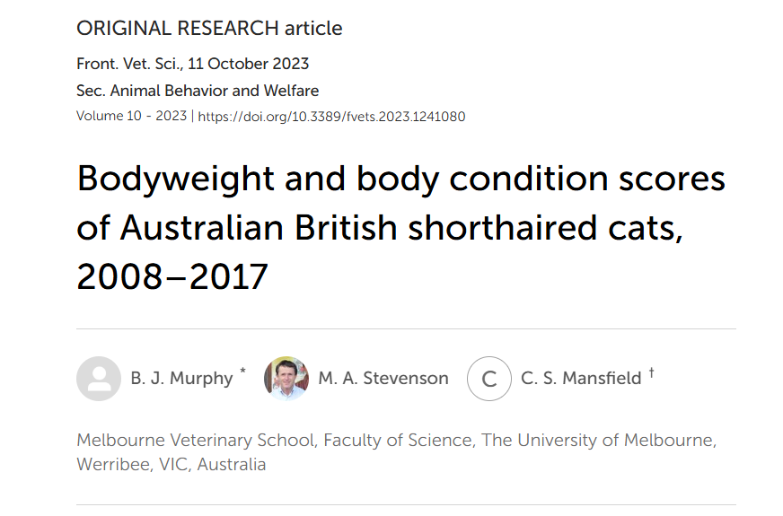

```{r setup}
#| include: false
#| echo: false
#| message: false
#| warning: false

library(MASS)
library(ggplot2)
library(plotly)
library(dplyr)
library(msos)
library(patchwork)
library(kableExtra)

data(cats)
force(cats)
```

## 🔍 Introduction : Un test d'hypothèse, qu'est-ce c'est ?

```{=html}
<div style="height:30px;"></div>
```

> Un [test d'hypothèse]{.smallcaps} permet d'évaluer, à partir d'un échantillon, si les données apportent suffisamment d'éléments pour répondre par "oui" ou par "non" à une question sur la population.

. . .

```{=html}
<div style="height:50px;"></div>
```

+------------------------------------------------------------------------------+------------------------------+
|                                                                              |                              |
+==============================================================================+==============================+
| # Question de recherche                                                      | # Méthode utilisée           |
+------------------------------------------------------------------------------+------------------------------+
| Le poids moyen des chats diffère-t-il selon leur sexe ?                      | Test de Student              |
+------------------------------------------------------------------------------+------------------------------+
| La proportion de chiens présentant une maladie est-elle différente de 20 % ? | Test d'une proportion        |
+------------------------------------------------------------------------------+------------------------------+
| La présence d'une maladie est-elle associée au statut vaccinal ?             | Test $\chi^2$ d'indépendance |
+------------------------------------------------------------------------------+------------------------------+
| Le type d'alimentation influence-t-il la durée de guérison de l'animal ?     | ANOVA                        |
+------------------------------------------------------------------------------+------------------------------+

. . .

```{=html}
<div style="height:50px;"></div>
```

::: callout-warning
Il existe de nombreux tests d'hypothèse, dont le choix dépend de la question posée et de la nature des données.
:::

## 🐈 Application : Présentation des données

```{=html}
<div style="height:5px;"></div>
```

[[Jeu de données utilisé :]{.underline}]{.smallcaps} Mesures anatomiques chez $144$ chats adultes, disponibles dans le package R *MASS* [@MASS; @fisher1947].

. . .

::::::: columns
:::: {.column width="60%"}
```{=html}
<div style="height:40;"></div>
```

- 144 chats étudiés

::: fragment
- Sexe : Femelles (F), Mâles (M)

  |                 | Femelles | Males |
  |-----------------|----------|-------|
  | Nb. d'individus | 47       | 97    |

- 2 mesures morphologiques :

  | Nom | Mesure         | Unité |
  |-----|----------------|-------|
  | Bwt | Poids corporel | kg    |
  | Hwt | Poids du coeur | g     |
:::
::::

:::: {.column width="40%"}
::: columns
```{r}
#| echo: false
#| message: false
#| warning: false


knitr::kable(head(cats, 10))
```
:::
::::
:::::::

. . .

```{=html}
<div style="height:15px;"></div>
```

::: {style="text-align: center; font-size: 0.85em;"}
Dans la suite, on va se concentrer uniquement sur le poids corporel (Bwt) de l'ensemble des chats.
:::

## 🐈 Application : Question de recherche

:::: center-text
::: highlight-box
Le poids corporel moyen des chats diffère-t-il entre les mâles et les femelles ?
:::
::::

## 📖 Objectifs du cours

```{=html}
<br>
<br>
```

1.  Qu'est-ce qu'un test d'hypothèse ?

. . .

```{=html}
<div style="height:5px;"></div>
```

2.  Comment réaliser et interpréter un test d'hypothèse ?

. . .

```{=html}
<div style="height:5px;"></div>
```

3.  Présentation des différents tests d'hypothèses

. . .

```{=html}
<div style="height:5px;"></div>
```

4.  Application aux données avec R

. . .

```{=html}
<div style="height:5px;"></div>
```

5.  Conclusion & Exemple concret en sciences vétérinaires

## 1️⃣ Qu'est-ce qu'un test d'hypothèse : Intuition

```{=html}
<div style="height:5px;"></div>
```

> Comment déterminer si les moyennes des groupes estimées sont [suffisamment]{.smallcaps} différentes pour dire que c'est *significatif* ?

. . .

```{r}
#| echo: false
#| message: false
#| warning: false
#| fig-height: 3.5
#| fig-align: center

data_cats <- cats %>%
  mutate(Sex = factor(
    Sex,
    levels = c("F", "M"),
    labels = c("Femelle", "Mâle")
  ))

means_cats <- data_cats %>%
  group_by(Sex) %>%
  summarise(
    mu_hat = mean(Bwt),
    .groups = "drop"
  )

ggplot(data_cats, aes(x = Sex, y = Bwt, colour = Sex)) +
  geom_jitter(
    width = 0.15,
    size = 3,
    alpha = 0.6
  ) +
  geom_crossbar(
    data = means_cats,
    aes(
      x = Sex,
      y = mu_hat,
      ymin = mu_hat,
      ymax = mu_hat
    ),
    inherit.aes = FALSE,
    width = 0.45,
    linewidth = 1.5,
    colour = "black"
  ) +
  scale_colour_manual(
    values = c(
      "Femelle" = "#E69F00",
      "Mâle" = "#009E73"
    )
  ) +
  labs(
    x = "Sexe",
    y = "Poids corporel (kg)"
  ) +
  theme_minimal(base_size = 24) +
  theme(
    legend.position = "none",
    plot.margin = margin(5, 5, 0, 5)
  )
```

. . .

:::: {style="margin-top: -40px;"}
::: callout-warning
[**Comparer uniquement les moyennes ne suffit pas**]{.smallcaps} : il faut également tenir compte de la variabilité des observations et de la taille des échantillons.
:::
::::

## 1️⃣ Test d'hypothèse : Définition

```{=html}
<div style="height:2px;"></div>
```

[[Notations :]{.underline}]{.smallcaps} Soit $X$ une variable aléatoire représentant une caractéristique quantitative d'intérêt dans une population et $X_1,\ldots,X_n$ l'échantillon associé. On pose :

- $\mu_{\mathrm{pop}}$ : Moyenne inconnue de la population.
- $\mu_0$ : Valeur de référence de la moyenne.
- $\mu_{\mathrm{éch}}=\frac{1}{n}\sum_{i=1}^n X_i$ : Moyenne de l'échantillon.

[[Hypothèses (test bilatéral) :]{.underline}]{.smallcaps}

::: {style="margin-top: -20px;"}
$$
\underbrace{H_0:\mu_{\mathrm{pop}}=\mu_0}_{\substack{\text{Hypothèse nulle}\\
\text{Hypothèse de référence à tester}}}
\qquad\qquad
\underbrace{H_1:\mu_{\mathrm{pop}}\neq\mu_0}_{\substack{\text{Hypothèse alternative}\\
\text{Opposée à }H_0}}
$$
:::

::: small-box
Un test d'hypothèse conduit à deux décisions possibles : rejeter $H_0$ ou ne pas rejeter $H_0$.
:::

## 1️⃣ Test d'hypothèse : Exemple

```{=html}
<div style="height:10px;"></div>
```

[[Notations :]{.underline}]{.smallcaps}

- $X_{F,1},\ldots,X_{F,n_F}$ : Poids corporels des $n_F=47$ femelles de l'échantillon.

- $X_{M,1},\ldots,X_{M,n_M}$ : Poids corporels des $n_M=97$ mâles de l'échantillon.

- $\mu_F$ et $\mu_M$ : Poids corporels moyens inconnus des populations.

```{=html}
<div style="height:2px;"></div>
```

[[Hypothèses (test bilatéral) :]{.underline}]{.smallcaps} $$
\boxed{
\underbrace{H_0:\mu = \mu_F-\mu_M=0}_{\substack{\text{Hypothèse nulle}\\
\text{Hypothèse de référence à tester}}}
\qquad\qquad
\underbrace{H_1:\mu = \mu_F-\mu_M\neq 0}_{\substack{\text{Hypothèse alternative}}}
}
$$

## 2️⃣ Méthode basée sur les IC : Intuition

```{=html}
<div style="height:2px;"></div>
```

[[Rappel des hypothèses (test bilatéral) :]{.underline}]{.smallcaps} $\ H_0:\mu_{\mathrm{pop}}=\mu_0 \qquad H_1:\mu_{\mathrm{pop}}\neq\mu_0$

```{=html}
<div style="height:10px;"></div>
```

[[Objectif :]{.underline}]{.smallcaps} Construire un intervalle de confiance pour $\mu_{\mathrm{pop}}$ et vérifier s'il contient la valeur $\mu_0$.

$$
IC_{95\%}(\mu_\mathrm{pop})
=
\left[
\mu_{\mathrm{éch}}-1.96\frac{\sigma_{\mathrm{pop}}}{\sqrt{n}}
\ ;\
\mu_{\mathrm{éch}}+1.96\frac{\sigma_{\mathrm{pop}}}{\sqrt{n}}
\right]
$$

```{=html}
<div style="height:5px;"></div>
```

::::::: columns
:::: {.column width="50%"}
::: {style="text-align: center"}
[[Cas 1 :]{.underline}]{.smallcaps} $\ \mu_0 \in IC_{95\%}(\mu_{\mathrm{pop}})$ et $n$ grand
:::

```{r}
#| echo: false
#| message: false
#| warning: false
#| fig-height: 2.5
#| out-width: "100%"


ggplot() +
  # Intervalle de confiance horizontal
  geom_segment(
    aes(x = -1.5, xend = 2.5, y = 0, yend = 0),
    colour = "black",
    linewidth = 2
  ) +
  # Barres aux extrémités
  geom_segment(
    aes(x = c(-1.5, 2.5), xend = c(-1.5, 2.5),
        y = -0.08, yend = 0.08),
    colour = "black",
    linewidth = 2
  ) +
  # Moyenne échantillonnale
  geom_point(
    aes(x = 0.5, y = 0),
    size = 5,
    colour = "#0072B2"
  ) +
  # Valeur sous H0
  geom_vline(
    xintercept = 0,
    colour = "#E69F00",
    linetype = "dashed",
    linewidth = 1.5
  ) +
  # Annotation mu_0
  annotate(
    "text", x = -0.25, y = 0.28,
    label = "mu[0]", parse = TRUE,
    size = 14, colour = "#E69F00"
  ) +
  # Annotation mu_ech
  annotate(
    "text", x = 0.5, y = 0.18,
    label = "mu[ech]", parse = TRUE,
    size = 14, colour = "#0072B2"
  ) +
  # Annotation IC
  annotate(
    "text", x = 0.5, y = -0.28,
    label = "IC[95*'%']", parse = TRUE,
    size = 14
  ) +
  coord_cartesian(
    xlim = c(-3, 4),
    ylim = c(-0.5, 0.5)
  ) +
  theme_void()

```
::::

:::: {.column width="50%"}
::: {style="text-align: center"}
[[Cas 2 :]{.underline}]{.smallcaps} $\ \mu_0 \notin IC_{95\%}(\mu_{\mathrm{pop}})$ et $n$ grand
:::

```{r}
#| echo: false
#| message: false
#| warning: false
#| fig-height: 2.5
#| out-width: "100%"


ggplot() +
  # Intervalle de confiance horizontal
  geom_segment(
    aes(x = 1, xend = 3, y = 0, yend = 0),
    colour = "black",
    linewidth = 2
  ) +
  # Barres aux extrémités
  geom_segment(
    aes(x = c(1, 3), xend = c(1, 3),
        y = -0.08, yend = 0.08),
    colour = "black",
    linewidth = 2
  ) +
  # Moyenne échantillonnale
  geom_point(
    aes(x = 2, y = 0),
    size = 5,
    colour = "#0072B2"
  ) +
  # Valeur sous H0
  geom_vline(
    xintercept = 0,
    colour = "#E69F00",
    linetype = "dashed",
    linewidth = 1.5
  ) +
  # Annotation mu_0
  annotate(
    "text", x = -0.25, y = 0.28,
    label = "mu[0]", parse = TRUE,
    size = 14, colour = "#E69F00"
  ) +
  # Annotation mu_ech
  annotate(
    "text", x = 2, y = 0.18,
    label = "mu[ech]", parse = TRUE,
    size = 14, colour = "#0072B2"
  ) +
  # Annotation IC
  annotate(
    "text", x = 2, y = -0.28,
    label = "IC[95*'%']", parse = TRUE,
    size = 14
  ) +
  coord_cartesian(
    xlim = c(-3, 4),
    ylim = c(-0.5, 0.5)
  ) +
  theme_void()

```
::::
:::::::

:::: {style="margin-top: -15px;"}
::: small-box
Quelle décision prendre concernant $H_0$ selon que $\mu_0$ appartient ou non à l'intervalle de confiance ?
:::
::::

## 2️⃣ Méthode basée sur les IC : Décision

```{=html}
<div style="height:5px;"></div>
```

[[Rappel des hypothèses (test bilatéral) :]{.underline}]{.smallcaps} $\ H_0:\mu_{\mathrm{pop}}=\mu_0 \qquad H_1:\mu_{\mathrm{pop}}\neq\mu_0$

```{=html}
<div style="height:10px;"></div>
```

[[Règle de décision]{.underline}]{.smallcaps} [(risque $\alpha=5\%$) :]{.underline} $\ \begin{cases}\mu_0 \in IC_{95\%}(\mu_{\mathrm{pop}})&\Longrightarrow \text{Non-rejet de }H_0 \\[6pt]\mu_0 \notin IC_{95\%}(\mu_{\mathrm{pop}})&\Longrightarrow \text{Rejet de }H_0\end{cases}$

```{=html}
<div style="height:15px;"></div>
```

::::::::: columns
::::: {.column width="50%"}
::: {style="text-align: center"}
[[Cas 1 :]{.underline}]{.smallcaps} $\ \mu_0 \in IC_{95\%}(\mu_{\mathrm{pop}})$ et $n$ grand
:::

```{r}
#| echo: false
#| message: false
#| warning: false
#| fig-height: 2
#| out-width: "100%"


ggplot() +
  # Intervalle de confiance horizontal
  geom_segment(
    aes(x = -1.5, xend = 2.5, y = 0, yend = 0),
    colour = "black",
    linewidth = 2
  ) +
  # Barres aux extrémités
  geom_segment(
    aes(x = c(-1.5, 2.5), xend = c(-1.5, 2.5),
        y = -0.08, yend = 0.08),
    colour = "black",
    linewidth = 2
  ) +
  # Moyenne échantillonnale
  geom_point(
    aes(x = 0.5, y = 0),
    size = 5,
    colour = "#0072B2"
  ) +
  # Valeur sous H0
  geom_vline(
    xintercept = 0,
    colour = "#E69F00",
    linetype = "dashed",
    linewidth = 1.5
  ) +
  # Annotation mu_0
  annotate(
    "text", x = -0.25, y = 0.28,
    label = "mu[0]", parse = TRUE,
    size = 14, colour = "#E69F00"
  ) +
  # Annotation mu_ech
  annotate(
    "text", x = 0.5, y = 0.18,
    label = "mu[ech]", parse = TRUE,
    size = 14, colour = "#0072B2"
  ) +
  # Annotation IC
  annotate(
    "text", x = 0.5, y = -0.28,
    label = "IC[95*'%']", parse = TRUE,
    size = 14
  ) +
  coord_cartesian(
    xlim = c(-3, 4),
    ylim = c(-0.5, 0.5)
  ) +
  theme_void()

```

::: {style="text-align: center; margin-top: -10px;"}
$\Longrightarrow$ **Non-rejet de** $H_0$
:::
:::::

::::: {.column width="50%"}
::: {style="text-align: center"}
[[Cas 2 :]{.underline}]{.smallcaps} $\ \mu_0 \notin IC_{95\%}(\mu_{\mathrm{pop}})$ et $n$ grand
:::

```{r}
#| echo: false
#| message: false
#| warning: false
#| fig-height: 2
#| out-width: "100%"


ggplot() +
  # Intervalle de confiance horizontal
  geom_segment(
    aes(x = 1, xend = 3, y = 0, yend = 0),
    colour = "black",
    linewidth = 2
  ) +
  # Barres aux extrémités
  geom_segment(
    aes(x = c(1, 3), xend = c(1, 3),
        y = -0.08, yend = 0.08),
    colour = "black",
    linewidth = 2
  ) +
  # Moyenne échantillonnale
  geom_point(
    aes(x = 2, y = 0),
    size = 5,
    colour = "#0072B2"
  ) +
  # Valeur sous H0
  geom_vline(
    xintercept = 0,
    colour = "#E69F00",
    linetype = "dashed",
    linewidth = 1.5
  ) +
  # Annotation mu_0
  annotate(
    "text", x = -0.25, y = 0.28,
    label = "mu[0]", parse = TRUE,
    size = 14, colour = "#E69F00"
  ) +
  # Annotation mu_ech
  annotate(
    "text", x = 2, y = 0.18,
    label = "mu[ech]", parse = TRUE,
    size = 14, colour = "#0072B2"
  ) +
  # Annotation IC
  annotate(
    "text", x = 2, y = -0.28,
    label = "IC[95*'%']", parse = TRUE,
    size = 14
  ) +
  coord_cartesian(
    xlim = c(-3, 4),
    ylim = c(-0.5, 0.5)
  ) +
  theme_void()

```

::: {style="text-align: center; margin-top: -10px;"}
$\Longrightarrow$ **Rejet de** $H_0$
:::
:::::
:::::::::

. . .

::: callout-warning
[**Attention à la taille de l'échantillon**]{.smallcaps}$n$ : Si $n$ est trop petit, l'IC peut être trop large pour conclure.
:::

## 2️⃣ Méthode basée sur les IC : Exemple

```{=html}
<div style="height:5px;"></div>
```

[[Rappel des hypothèses :]{.underline}]{.smallcaps} $\ H_0:\mu = \mu_F-\mu_M=0 \qquad H_1: \mu = \mu_F-\mu_M\neq 0$

```{=html}
<div style="height:10px;"></div>
```

. . .

[[Construction de l'IC à 95 % :]{.underline}]{.smallcaps}

::: {style="margin-top: -20px;font-size: 0.9em"}
$$
IC_{95\%}(\mu)
=
\left[
(\underbrace{\mu_{\mathrm{éch},F}-\mu_{\mathrm{éch},M}}_{\mu_{\mathrm{ech}}})
\pm
1.96\sqrt{
\frac{\sigma_F^2}{\color{#E69F00}{47}}+
\frac{\sigma_M^2}{\color{#E69F00}{97}}
}
\right]
$$
:::

```{=html}
<div style="height:5px;"></div>
```

[[Règle de décision]{.underline}]{.smallcaps} [(risque $\alpha=5\%$) :]{.underline} $\begin{cases}0\in IC_{95\%}(\mu)&\Longrightarrow \text{Non-rejet de }H_0\\[6pt]0\notin IC_{95\%}(\mu)&\Longrightarrow \text{Rejet de }H_0\end{cases}$

. . .

```{=html}
<div style="height:5px;"></div>
```

::::: columns
::: {.column width="50%"}
```{r}
#| echo: false
#| message: false
#| warning: false
#| fig-height: 3


# Vecteurs des deux groupes
xF <- data_cats %>% filter(Sex == "Femelle") %>% pull(Bwt)
xM <- data_cats %>% filter(Sex == "Mâle") %>% pull(Bwt)

# Test t et intervalle de confiance
test_IC <- t.test(xF, xM, conf.level = 0.95)

# Quantités d'intérêt
mu0 <- 0
mu_ech <- unname(mean(xF) - mean(xM))
IC_inf <- unname(test_IC$conf.int[1])
IC_sup <- unname(test_IC$conf.int[2])

# Pour ajuster automatiquement la fenêtre du graphique
xmin_plot <- min(IC_inf, mu0) - 0.5
xmax_plot <- max(IC_sup, mu0) + 0.5

ggplot() +
  # Intervalle de confiance horizontal
  geom_segment(
    aes(x = IC_inf, xend = IC_sup, y = 0, yend = 0),
    colour = "black",
    linewidth = 2
  ) +
  # Barres aux extrémités
  geom_segment(
    aes(x = c(IC_inf, IC_sup), xend = c(IC_inf, IC_sup),
        y = -0.08, yend = 0.08),
    colour = "black",
    linewidth = 2
  ) + # Valeurs des bornes de l'IC
  annotate(
    "text",
    x = IC_inf-0.1, y = -0.20,
    label = round(IC_inf, 2),
    size = 16,
    colour = "black"
  ) +
  annotate(
    "text",
    x = IC_sup+0.1, y = -0.20,
    label = round(IC_sup, 2),
    size = 16,
    colour = "black"
  ) +
  # Moyenne échantillonnale
  geom_point(
    aes(x = mu_ech, y = 0),
    size = 5,
    colour = "#0072B2"
  ) +
  # Valeur sous H0
  geom_vline(
    xintercept = mu0,
    colour = "#E69F00",
    linetype = "dashed",
    linewidth = 1.5
  ) +
  # Annotation mu_0
  annotate(
    "text", x = mu0+0.08, y = 0.25,
    label = "mu[0]==0", parse = TRUE,
    size = 16, colour = "#E69F00"
  ) +
  # Annotation mu_ech
  annotate(
    "text", x = mu_ech, y = 0.25,
    label = paste0("mu[ech]==", round(mu_ech, 2)),
    parse = TRUE,
    size = 16, colour = "#0072B2"
  )  +
  coord_cartesian(
    xlim = c(xmin_plot, xmax_plot),
    ylim = c(-0.5, 0.5)
  ) +
  theme_void()
```
:::

::: {.column width="50%"}
<br>

$\Longrightarrow$ **Rejet de** $H_0$

Les poids des mâles et des femelles sont $\ne$.
:::
:::::

## 2️⃣ Méthode basée sur les observations atypiques : Intuition

```{=html}
<div style="height:2px;"></div>
```

[[Rappel des hypothèses (test bilatéral) :]{.underline}]{.smallcaps} $H_0:\mu_{\mathrm{pop}}=\mu_0 \qquad H_1:\mu_{\mathrm{pop}}\neq\mu_0$

```{=html}
<div style="height:10px;"></div>
```

[[Objectif :]{.underline}]{.smallcaps} Déterminer quelles valeurs de $\mu_{\mathrm{éch}}$ sont atypiques lorsque $H_0$ est supposée vraie.

. . .

```{r}
#| echo: false
#| message: false
#| warning: false
#| fig-height: 3.15
#| fig-width: 10
#| out-width: "100%"
#| fig-align: center


# Paramètres illustratifs
mu0 <- 0
sigma <- 1

# Distribution de la moyenne sous H0
data_dist <- data.frame(
  x = seq(-4, 4, length.out = 1000)
)

data_dist$densite <- dnorm(
  data_dist$x,
  mean = mu0,
  sd = sigma
)

ggplot(data_dist, aes(x = x, y = densite)) +
  geom_line(
    colour = "#0072B2",
    linewidth = 1.6
  ) +
  geom_vline(
    xintercept = mu0,
    colour = "#E69F00",
    linetype = "dashed",
    linewidth = 1.3
  ) +
  # Moyenne proche de H0
  geom_point(
    aes(x = 0.5, y = dnorm(0.5)),
    colour = "#009E73",
    size = 5
  ) +
  # Moyenne atypique sous H0
  geom_point(
    aes(x = 3, y = dnorm(3)),
    colour = "#CC79A7",
    size = 5
  ) +
  annotate(
    "text",
    x =-0.2, y = 0.44,
    label = "mu[0]",
    parse = TRUE,
    size = 9,
    colour = "#E69F00"
  ) +
  annotate(
    "text",
    x = 0.8, y = 0.3,
    label = "Valeur proche",
    size = 7,
    colour = "#009E73"
  ) +
  annotate(
    "text",
    x = 3, y = 0.08,
    label = "Valeur atypique",
    size = 7,
    colour = "#CC79A7"
  ) +
  scale_x_continuous(
    breaks = c(-3, 0, 0.5, 3),
    labels = c("-3", "0", "0.5", "3")
  ) +
  labs(
    x = expression(mu[ech]),
    y = "Densité"
  ) +
  coord_cartesian(
    ylim = c(0, 0.47)
  ) +
  theme_minimal(base_size = 24) +
  theme(
    panel.grid = element_blank()
  )
```

. . .

:::: {style="margin-top: -75px;"}
::: small-box
À partir de quand l’écart entre $\mu_\mathrm{éch}$ et $\mu_0$ est-il suffisamment important pour rejeter $H_0$ ?
:::
::::

## 2️⃣ Méthode basée sur les obs. atypiques : Statistique de test

```{=html}
<div style="height:5px;"></div>
```

::: {style="font-size: 0.85em"}
On considère un échantillon $X_1,\ldots,X_n$ de v.a. indépendantes et de même loi, avec $n$ grand.
:::

```{=html}
<div style="height:10px;"></div>
```

[Statistique de test]{.smallcaps}

: Une [statistique de test]{.smallcaps} est une v.a., qui dépend de l'échantillon. Elle est utilisée pour construire une règle de décision sur $H_0$. Pour un test bilatéral, on utilise la statistique de test suivante :

$$ 
T=\frac{\mu_{\mathrm{éch}}-\mu_0} {\sigma_{\mathrm{pop}}/\sqrt{n}},
$$ où $\sigma_{\mathrm{pop}}/\sqrt{n}$ est l'écart-type de la moyenne d'échantillon.

```{=html}
<div style="height:10px;"></div>
```

. . .

[[Application du théorème central limite :]{.underline}]{.smallcaps} Sous $H_0$, $T \sim \mathcal{N}(0, 1)$.

::: {style="text-align:center; font-size: 0.85em"}
Si $\ T \approx 0$, $\mu_{\mathrm{éch}}$ est proche de $\mu_0$ et si $\ |T|$ est grand, $\mu_{\mathrm{éch}}$ est une observation atypique.
:::

## 2️⃣ Méthode basée sur les obs. atypiques : Risques d'erreur

```{=html}
<div style="height:5px;"></div>
```

[[Explication :]{.underline}]{.smallcaps} Un test d'hypothèse repose sur une décision prise à partir d'un échantillon, il peut donc être erroné.

```{=html}
<div style="height:5px;"></div>
```

[[Objectif :]{.underline}]{.smallcaps} Contrôler les erreurs.

```{=html}
<div style="height:5px;"></div>
```

::: {style="text-align: center"}
+-------------------------+---------------------------------+---------------------------------+
|                         | **Ne pas rejeter** $\small H_0$ | **Rejeter** $\small H_0$        |
+=========================+=================================+=================================+
| $\small H_0$ **vraie**  | ✅ Bonne décision               | ❌ **Type I :** $\small \alpha$ |
+-------------------------+---------------------------------+---------------------------------+
| $\small H_0$ **fausse** | ❌ **Type II :** $\small \beta$ | ✅ Bonne décision               |
+-------------------------+---------------------------------+---------------------------------+
:::

```{=html}
<div style="height:5px;"></div>
```

[[On distingue deux risques :]{.underline}]{.smallcaps}

- Risque de première espèce : $\alpha=\mathbb{P}(\text{rejeter }H_0\mid H_0\text{ vraie})$
- Risque de deuxième espèce : $\beta=\mathbb{P}(\text{ne pas rejeter }H_0\mid H_1\text{ vraie})$

. . .

::: callout-note
En pratique, on fixe généralement le risque de première espèce $\alpha=5\,\%$ ou $\alpha=1\,\%$ avant de réaliser le test.
:::

## 2️⃣ Méthode basée sur les obs. atypiques : Décision avec $T_\mathrm{obs}$

```{=html}
<div style="height:2px;"></div>
```

::: {style="font-size: 0.85em; text-align: center;"}
Sous $H_0$, $T \sim \mathcal{N}(0, 1)$, donc $\mathbb{P}(-1.96\leq T\leq1.96)=0.95$.
:::

```{=html}
<div style="height:2px;"></div>
```

[[Règle de décision (risque]{.underline}]{.smallcaps} [$\alpha=5\%$) :]{.underline}

::: {style="margin-top: -20px; margin-bottom: -20px;font-size: 0.9em"}
$$
\begin{cases}
|T_{\mathrm{obs}}|\leq1.96
&\Longrightarrow \text{Non-rejet de }H_0 \\[6pt]
|T_{\mathrm{obs}}|>1.96
&\Longrightarrow \text{Rejet de }H_0
\end{cases}
$$
:::

::: grande-fig
```{r}
#| echo: false
#| message: false
#| warning: false
#| fig-align: center
#| fig-height: 2.75
#| fig-width: 8

# Distribution sous H0
data_norm <- data.frame(
  x = seq(-4, 4, length.out = 1000)
)

data_norm$y <- dnorm(data_norm$x)

# Régions de rejet
data_rejet <- subset(
  data_norm,
  x <= -1.96 | x >= 1.96
)

ggplot(data_norm, aes(x = x, y = y)) +
  # Zones de rejet
  geom_area(
    data = data_rejet,
    aes(group = x > 0),
    fill = "#CC79A7",
    alpha = 0.6
  ) +
  # Courbe de la loi normale
  geom_line(
    colour = "#0072B2",
    linewidth = 3
  ) +
  # Seuils critiques
  geom_vline(
    xintercept = c(-1.96, 1.96),
    colour = "#CC79A7",
    linetype = "dashed",
    linewidth = 2
  ) +
  # Probabilités
  annotate(
    "text",
    x = 0, y = 0.22,
    label = "95 %",
    colour = "#0072B2",
    size = 12,
    fontface = "bold"
  ) +
  annotate(
    "text",
    x = -2.7, y = 0.065,
    label = "2,5 %",
    colour = "#CC79A7",
    size = 8,
    fontface = "bold"
  ) +
  annotate(
    "text",
    x = 2.7, y = 0.065,
    label = "2,5 %",
    colour = "#CC79A7",
    size = 8,
    fontface = "bold"
  ) +
  scale_x_continuous(
    breaks = c(-1.96, 0, 1.96),
    labels = c("-1,96", "0", "1,96")
  ) +
  labs(
    x = "Statistique de test T",
    y = "Densité"
  ) +
  coord_cartesian(
    xlim = c(-3.5, 3.5),
    ylim = c(0, 0.45)
  ) +
  theme_minimal(base_size = 24) +
  theme(
    panel.grid = element_blank(),
    axis.title.x = element_text(size = 26, margin = margin(t = 15)),
    axis.title.y = element_text(size = 26, margin = margin(r = 15)),
    axis.text.x = element_text(size = 22),
    axis.text.y = element_text(size = 20),
    plot.margin = margin(15, 25, 15, 25)
  )
```
:::

. . .

:::: {style="margin-top: -60px; "}
::: callout-warning
Ne pas rejeter $H_0$ ne signifie pas que $H_0$ est vraie.
:::
::::

## 2️⃣ Méthode basée sur les obs. atyp. : Décision avec la p-valeur

```{=html}
<div style="height:10px;"></div>
```

[[p-valeur]{.underline}]{.smallcaps}

: La [p-valeur]{.smallcaps} est la probabilité, sous $H_0$, d'obtenir une statistique de test au moins aussi extrême que celle observée. C'est le plus petit risque pour lequel on rejetterait $H_0$.

$$
p=\mathbb{P}_{H_0}\left(|T|\geq|T_{\mathrm{obs}}|\right)  
$$

[[Règle de décision (risque]{.underline}]{.smallcaps} [$\alpha=5\%$) :]{.underline}

$$
    \boxed{
        \begin{cases}
        p<0.05 &\Longrightarrow \text{Rejet de }H_0\\[6pt]
        p\geq0.05 &\Longrightarrow \text{Non-rejet de }H_0
        \end{cases}
    }
$$

```{=html}
<div style="height:5px;"></div>
```

. . .

::: callout-warning
La p-valeur n'est pas la probabilité que $H_0$ soit vraie.
:::

## 2️⃣ Méthode basée sur les obs. atypiques : Exemple

```{=html}
<div style="height:5px;"></div>
```

[[Rappel des hypothèses :]{.underline}]{.smallcaps} $\ H_0:\mu=\mu_F-\mu_M=0 \qquad H_1:\mu=\mu_F-\mu_M\neq0$

```{=html}
<div style="height:15px;"></div>
```

. . .

::::::: columns
:::: {.column width="50%"}
::: {style="text-align:center;"}
[[Calcul de la statistique de test :]{.underline}]{.smallcaps}
:::

$$
T_{\mathrm{obs}}=
\frac{
\mu_{\mathrm{éch}
}}{
\sqrt{
\frac{s_F^2}{\color{#E69F00}{47}}+
\frac{s_M^2}{\color{#E69F00}{97}}
}
}
$$
::::

:::: {.column width="50%"}
::: {style="text-align:center;"}
[[Règle de décision]{.underline}]{.smallcaps} [(risque $\alpha=5\%$) :]{.underline}
:::

$$
\begin{cases}
p\geq0.05 &\Longrightarrow \text{Non-rejet de }H_0\\[6pt]
p<0.05 &\Longrightarrow \text{Rejet de }H_0
\end{cases}
$$
::::
:::::::

. . .

::::: columns
::: {.column width="50%"}
<br>

```{r}
#| echo: false
#| message: false
#| warning: false
#| fig-height: 3
#| fig-width: 8
#| out-width: "100%"


# Vecteurs des deux groupes
xF <- data_cats %>%
  filter(Sex == "Femelle") %>%
  pull(Bwt)

xM <- data_cats %>%
  filter(Sex == "Mâle") %>%
  pull(Bwt)

# Test de Welch
test_T <- t.test(xF, xM)

# Statistique observée et p-valeur
T_obs <- unname(test_T$statistic)
p_value <- test_T$p.value
ddl <- unname(test_T$parameter)

# Distribution de Student sous H0
data_dist <- data.frame(
  x = seq(-10, 10, length.out = 2000)
)

data_dist$y <- dt(data_dist$x, df = ddl)

# Zones correspondant à la p-valeur
data_p <- subset(
  data_dist,
  abs(x) >= abs(T_obs)
)

# Seuils critiques : 2,5 % dans chaque queue
seuil <- qt(0.975, df = ddl)

# Régions de rejet
data_rejet <- subset(
  data_dist,
  x <= -seuil | x >= seuil
)

ggplot(data_dist, aes(x = x, y = y)) +
  # Zones de la p-valeur
  geom_area(
    data = data_p,
    aes(group = x > 0),
    fill = "#CC79A7",
    alpha = 0.6
  ) +
  # Distribution sous H0
  geom_line(
    colour = "#0072B2",
    linewidth = 2.5
  ) +
  # Statistique observée
  geom_vline(
    xintercept = T_obs,
    colour = "#E69F00",
    linetype = "dashed",
    linewidth = 1.8
  ) +
    # Zones de rejet (2,5 % de chaque côté)
  geom_area(
    data = data_rejet,
    aes(group = x > 0),
    fill = "#CC79A7",
    alpha = 0.6
  ) +
  annotate(
    "text",
    x = T_obs,
    y = 0.14,
    label = paste0(
      "T = ",
      round(T_obs, 2)
    ),
    colour = "#E69F00",
    size = 10,
    hjust = ifelse(T_obs < 0, 0, 1)
  ) +
  scale_x_continuous(
    breaks = pretty(c(-10, 10), n = 5)
  ) +
  labs(
    x = "Statistique de test T",
    y = "Densité"
  ) +
  coord_cartesian(
    xlim = c(
      min(-10, T_obs - 0.5),
      max(10, T_obs + 0.5)
    ),
    ylim = c(0, 0.43)
  ) +
  theme_minimal(base_size = 24) +
  theme(
    panel.grid = element_blank(),
    axis.title = element_text(size = 25),
    axis.text = element_text(size = 22),
    plot.margin = margin(15, 25, 15, 25)
  )
```
:::

::: {.column width="50%"}
<br>

```{=html}
<div style="height:15px;"></div>
```

```{r}
#| echo: false
#| results: asis

cat(
  "$T_{\\mathrm{obs}}=",
  round(T_obs, 2),
  "$ et $p=",
  format.pval(p_value, digits = 3),
  "$.\n\n",
  sep = ""
)

if (p_value < 0.05) {
  cat("$\\Longrightarrow$ **Rejet de $H_0$**\n\n")
  cat("Le poids moyen diffère significativement entre mâles et femelles.")
} else {
  cat("$\\Longrightarrow$ **Non-rejet de $H_0$**\n\n")
  cat("On ne met pas en évidence de différence significative entre les poids corporels moyens des mâles et des femelles.")
}
```
:::
:::::

## 2️⃣ Comparaison des deux approches

```{=html}
<div style="height:35px;"></div>
```

+----------------------------+--------------------------------------------------+--------------------------------------------------------------------------+
|                            | **Méthode basée sur les IC**                     | **Méthode basée sur les obs. atypiques**                                 |
+:===========================+:=================================================+:=========================================================================+
| **Principe**               | Construire un IC pour $\mu_{\mathrm{pop}}$       | Mesurer l'écart entre $\mu_{\mathrm{éch}}$ et $\mu_0$                    |
+----------------------------+--------------------------------------------------+--------------------------------------------------------------------------+
| **Outil**                  | Intervalle de confiance                          | Statistique de test                                                      |
+----------------------------+--------------------------------------------------+--------------------------------------------------------------------------+
| **Décision directe**       | Rejeter $H_0$ si $\mu_0$ n'appartient pas à l'IC | Rejeter $H_0$ si la statistique observée appartient à la région de rejet |
+----------------------------+--------------------------------------------------+--------------------------------------------------------------------------+
| **Décision avec p-valeur** | —                                                | Rejeter $H_0$ si $p<\alpha$                                              |
+----------------------------+--------------------------------------------------+--------------------------------------------------------------------------+

```{=html}
<div style="height:25px;"></div>
```

[[À retenir :]{.underline}]{.smallcaps} Pour le test bilatéral considéré, avec un risque $\alpha=5\%$, les deux approches conduisent à la **même décision** :

$$
\boxed{
\mu_0\notin IC_{95\%}(\mu_{\mathrm{pop}})
\quad\Longleftrightarrow\quad
|T_{\mathrm{obs}}|>1.96
\quad\Longleftrightarrow\quad
p<0.05
}
$$

```{=html}
<div style="height:25px;"></div>
```

. . .

::: callout-note
En pratique, on utilise la méthode basée sur les observations atypiques et on décide avec la p-valeur.
:::

## 3️⃣ Les principaux tests d'hypothèses

```{=html}
<div style="height:5px;"></div>
```

+------------------------------+-------------------------------------------------------------+-----------------------------------------------------+------------------------------------------------+----------------------------------------------------------------+
| **Test**                     | **Objectif**                                                | **Nature des variables**                            | **Taille de l'échantillon**                    | **Hypothèses statistiques**                                    |
+:=============================+:============================================================+:====================================================+:===============================================+:===============================================================+
| **Test Z**                   | Comparer une moyenne à une valeur de référence              | 1 variable quantitative                             | Tout $n$ si normalité et variance connue       | $H_0:\mu=\mu_0$ ; $H_1:\mu\neq\mu_0$                           |
+------------------------------+-------------------------------------------------------------+-----------------------------------------------------+------------------------------------------------+----------------------------------------------------------------+
| **Student (1 échantillon)**  | Comparer une moyenne à une valeur de référence              | 1 variable quantitative                             | $n\geq2$ ; normalité requise pour un petit $n$ | $H_0:\mu=\mu_0$ ; $H_1:\mu\neq\mu_0$                           |
+------------------------------+-------------------------------------------------------------+-----------------------------------------------------+------------------------------------------------+----------------------------------------------------------------+
| **Student (2 échantillons)** | Comparer deux moyennes                                      | 1 variable quantitative + 1 qualitative (2 groupes) | $n_1,n_2\geq2$                                 | $H_0:\mu_1=\mu_2$ ; $H_1:\mu_1\neq\mu_2$                       |
+------------------------------+-------------------------------------------------------------+-----------------------------------------------------+------------------------------------------------+----------------------------------------------------------------+
| **Welch**                    | Comparer deux moyennes (variances possiblement différentes) | 1 variable quantitative + 1 qualitative (2 groupes) | $n_1,n_2\geq2$                                 | $H_0:\mu_1=\mu_2$ ; $H_1:\mu_1\neq\mu_2$                       |
+------------------------------+-------------------------------------------------------------+-----------------------------------------------------+------------------------------------------------+----------------------------------------------------------------+
| **Student apparié**          | Comparer deux mesures sur les mêmes individus               | 2 mesures quantitatives appariées                   | $n\geq2$ paires                                | $H_0:\mu_D=0$ ; $H_1:\mu_D\neq0$                               |
+------------------------------+-------------------------------------------------------------+-----------------------------------------------------+------------------------------------------------+----------------------------------------------------------------+
| **ANOVA à 1 facteur**        | Comparer plusieurs moyennes                                 | 1 quantitative + 1 qualitative ($k\geq3$ groupes)   | Effectifs suffisants dans chaque groupe        | $H_0:\mu_1=\cdots=\mu_k$ ; $H_1:$ au moins une moyenne diffère |
+------------------------------+-------------------------------------------------------------+-----------------------------------------------------+------------------------------------------------+----------------------------------------------------------------+
| **Shapiro-Wilk**             | Tester la normalité d'une distribution                      | 1 variable quantitative                             | $3\leq n\leq5000$ sous R                       | $H_0:$ normalité ; $H_1:$ non-normalité                        |
+------------------------------+-------------------------------------------------------------+-----------------------------------------------------+------------------------------------------------+----------------------------------------------------------------+

[[Conditions d’application :]{.underline}]{.smallcaps} Indépendance et normalité des observations (ou des différences appariées). Égalité des variances pour le Student à deux échantillons et l’ANOVA classique.

## ➕ Bonus : C'est quoi "*avoir suffisamment d'observation"* ?

```{=html}
<div style="height:2px;"></div>
```

::: callout-important
Dans ce cours, on utilise beaucoup la formulation *"pour* $n$ *grand"*, mais en pratique à partir de quelle taille $n$ est-il [vraiment]{.smallcaps} grand ?
:::

. . .

```{=html}
<div style="height:10px;"></div>
```

::: {style="text-align: center;"}
**⁉️ Il n'y a pas de réponse universelle à cette question, tout dépend du problème ⁉️**
:::

. . .

```{=html}
<div style="height:10px;"></div>
```

| Valeur de $n$ | Suffisant ou non ? |
|---------------|--------------------|
| 10            | ❌                 |
| 20            | ❌                 |
| 30            | ça peut aller      |
| 45            | ça peut aller      |
| 50            | ✅                 |
| 100 et +      | ✅                 |

```{=html}
<div style="height:10px;"></div>
```

. . .

::: callout-tip
Dans tous les cas, on attend une vision critique du nombre d'observations disponibles.
:::

## 🐈 Application aux données de chats avec R

<br>

**To Do :**

. . .

1.  Formulation des hypothèses $H_0$ et $H_1$ et reflexion sur la taille de l'échantillon $n$

```{=html}
<div style="height:10px;"></div>
```

. . .

2.  Visualisation des données

```{=html}
<div style="height:10px;"></div>
```

. . .

3.  Choix du test statistique et calcul de la statistique de test

```{=html}
<div style="height:10px;"></div>
```

. . .

4.  Calcul de la p-valeur et prise de décision au seuil de 5 %

```{=html}
<div style="height:10px;"></div>
```

. . .

5.  Interprétation des résultats dans le contexte de l'étude

## 🐈 Application aux données de chats - 1 - Hypothèses

```{=html}
<div style="height:5px;"></div>
```

[[Question :]{.underline}]{.smallcaps} Le poids corporel moyen des chats diffère-t-il entre les mâles et les femelles ?

```{=html}
<div style="height:5px;"></div>
```

::::: columns
::: {.column width="50%"}
[[Hypothèse nulle]{.underline}]{.smallcaps} [$H_0$ :]{.underline}

Le poids corporel moyen est identique chez les chats mâles et femelles.

$$
\boxed{H_0:\mu_F-\mu_M=0}
$$
:::

::: {.column width="50%"}
[[Hypothèse alternative]{.underline}]{.smallcaps} [$H_1$ :]{.underline}

Le poids corporel moyen diffère entre les chats mâles et femelles.

$$
\boxed{H_1:\mu_F-\mu_M\neq0}
$$
:::
:::::

::: callout-note
On réalise un **test bilatéral**, car on cherche une différence sans présumer de son sens. La taille des échantillons influence la précision des estimations et la capacité du test à détecter une différence.
:::

::: callout-important
Avec $n_F=47$ femelles et $n_M=97$ mâles, les effectifs permettent d'envisager un test de comparaison des moyennes.
:::

## 🐈 Application aux données de chats - 2 - Visualisation

<br> <br>

::::: columns
::: {.column width="50%"}
``` r
library(MASS)
library(ggplot2)

data(cats)

# Visualisation des poids selon le sexe
ggplot(cats, aes(x = Sex, y = Bwt, fill = Sex)) +
  geom_boxplot(
    alpha = 0.5,
    width = 0.5,
    outlier.shape = NA
  ) +
  geom_jitter(
    width = 0.12,
    size = 2.5,
    alpha = 0.7
  ) 
```
:::

::: {.column width="50%"}
<br>

```{r}
#| echo: false
#| message: false
#| warning: false
#| fig-height: 5
#| out-width: "100%"


data(cats)

ggplot(cats, aes(x = Sex, y = Bwt, fill = Sex)) +
  geom_boxplot(
    alpha = 0.5,
    width = 0.5,
    outlier.shape = NA
  ) +
  geom_jitter(
    width = 0.12,
    size = 2.5,
    alpha = 0.7
  ) +
  scale_fill_manual(
    values = c("F" = "#E69F00",
               "M" = "#009E73")
  ) +
  scale_x_discrete(
    labels = c("F" = "Femelles",
               "M" = "Mâles")
  ) +
  labs(
    x = "Sexe",
    y = "Poids (kg)"
  ) +
  theme_minimal(base_size = 20) +
  theme(legend.position = "none")
```
:::
:::::

## 🐈 Application aux données de chats - 3 - Choix du test et calcul

```{=html}
<div style="height:25px;"></div>
```

[[Choix du test :]{.underline}]{.smallcaps} On utilise le **test t de Welch** pour comparer les poids moyens de deux groupes indépendants, sans supposer l'égalité des variances.

<br>

:::::: columns
::: {.column width="50%"}
``` r
# Test de Welch
test <- t.test(
  Bwt ~ Sex,
  data = cats,
  var.equal = FALSE
)

# Statistique de test
T_obs <- unname(test$statistic)
T_obs

# Degrés de liberté
ddl <- unname(test$parameter)
ddl
```
:::

:::: {.column width="50%"}
::: {style="text-align: center;"}
[[Statistique de test :]{.underline}]{.smallcaps}
:::

$$
T_{\mathrm{obs}} =
\frac{
\mu_{\mathrm{éch},F}-\mu_{\mathrm{éch},M}
}{
\sqrt{
\frac{s_F^2}{47}+\frac{s_M^2}{97}
}
}
$$

```{r}
#| echo: false
#| results: asis

test <- t.test(
  Bwt ~ Sex,
  data = cats,
  var.equal = FALSE
)

cat(
  "$$T_{\\mathrm{obs}} = ",
  round(unname(test$statistic), 3),
  "$$\n\n",
  sep = ""
)

cat(
  "$$\\nu \\approx ",
  round(unname(test$parameter), 2),
  "$$\n",
  sep = ""
)
```
::::
::::::

## 🐈 Application aux données de chats - 4 - p-valeur et décision

```{=html}
<div style="height:10px;"></div>
```

[[Règle de décision (risque]{.underline}]{.smallcaps} [$\alpha=5\%$) :]{.underline} $\begin{cases}p < 0.05 &\Longrightarrow \text{Rejet de }H_0\\[6pt]p \geq 0.05 &\Longrightarrow \text{Non-rejet de }H_0\end{cases}$

<br>

:::::: columns
::: {.column width="50%"}
``` r

# Test de Welch
test <- t.test(
  Bwt ~ Sex,
  data = cats,
  var.equal = FALSE
)

# Extraction de la p-valeur
p_value <- test$p.value
p_value

# Décision au seuil de 5 %
p_value < 0.05
```
:::

:::: {.column width="50%"}
::: {style="text-align: center;"}
[[Résultats :]{.underline}]{.smallcaps}

```{r}
#| echo: false
#| results: asis

p_value <- test$p.value

cat(
  "$$p ",
  format.pval(p_value, digits = 3, eps = 0.001),
  "$$\n\n",
  sep = ""
)

if (p_value < 0.05) {
  cat("$\\Longrightarrow$ **Rejet de $H_0$**\n\n")
  cat("La différence entre les poids moyens des mâles et des femelles est statistiquement significative au seuil de 5 %.")
} else {
  cat("$\\Longrightarrow$ **Non-rejet de $H_0$**\n\n")
  cat("La différence entre les poids moyens des mâles et des femelles n'est pas statistiquement significative au seuil de 5 %.")
}
```
:::
::::
::::::

## 🐈 Application aux données de chats - 5 - Interprétation

```{=html}
<div style="height:10px;"></div>
```

[[Question de recherche :]{.underline}]{.smallcaps} Le poids corporel moyen des chats diffère-t-il entre les mâles et les femelles ?

<br>

::::: columns
::: {.column width="50%"}
``` r
# Moyennes par sexe
aggregate(Bwt ~ Sex, data = cats, FUN = mean)

# Différence des moyennes
diff_moy <- with(
  cats,
  mean(Bwt[Sex == "F"]) -
  mean(Bwt[Sex == "M"])
)

diff_moy

# Intervalle de confiance à 95 %
test$conf.int
```
:::

::: {.column width="50%"}
[[Résultats et interprétation :]{.underline}]{.smallcaps}

```{r}
#| echo: false
#| results: asis

mu_F <- mean(cats$Bwt[cats$Sex == "F"])
mu_M <- mean(cats$Bwt[cats$Sex == "M"])

cat(
  "- Poids moyen des femelles : **",
  round(mu_F, 2), " kg**\n\n",
  "- Poids moyen des mâles : **",
  round(mu_M, 2), " kg**\n\n",
  sep = ""
)

if (test$p.value < 0.05) {
  cat(
    "Au seuil de 5 %, on rejette $H_0$. ",
    "Les poids moyens des mâles et des femelles  ",
    "diffèrent significativement. \n\n"
  )
} else {
  cat(
    "Au seuil de 5 %, on ne rejette pas $H_0$. ",
    "Les données ne permettent pas de conclure à une ",
    "différence significative entre les poids moyens.\n\n"
  )
}
```
:::
:::::

<br>

::: {style="text-align: center;"}
Dans cet échantillon, les mâles sont en moyenne plus lourds que les femelles.
:::

## 📝 À quoi servent les tests d'hypothèses ?

```{=html}
<div style="height:20px;"></div>
```

[[**Utilisations principales :**]{.underline}]{.smallcaps}

- [Comparer une moyenne à une valeur de référence]{.smallcaps} - *Le poids moyen des chats est-il différent de 4 kg ?*

  $\longrightarrow$ Réalisation d'un [test sur une moyenne]{.smallcaps}.

```{=html}
<div style="height:10px;"></div>
```

. . .

- [Comparer les moyennes de deux groupes]{.smallcaps} - *Le poids moyen des chats diffère-t-il entre les mâles et les femelles ?*

  $\longrightarrow$ Réalisation d'un [test de Student ou de Welch]{.smallcaps}.

```{=html}
<div style="height:10px;"></div>
```

. . .

- [Comparer les moyennes de plusieurs groupes]{.smallcaps} - *Le poids moyen diffère-t-il selon la race des chats ?*

  $\longrightarrow$ Réalisation d'une [ANOVA]{.smallcaps}.

## 📑 Exemple d'utilisation en sciences vétérinaires

```{=html}
<div style="height:20px;"></div>
```

[[**Exemple issu de :**]{.underline}]{.smallcaps} @murphy2023

```{=html}
<div style="height:20px;"></div>
```

{fig-align="center"}

```{=html}
<div style="height:20px;"></div>
```

::: callout-note
Dans cet article, les ateur.es utilisent un **t-Test** pour mettre en évidence une différence significative entre les poids moyens des chats mâles et femelles ($p<0{,}01$).
:::

## 🎯 Conclusion

<br>

[[**Les étapes d'un test d'hypothèse :**]{.underline}]{.smallcaps}

1.  Formuler les hypothèses $H_0$ et $H_1$.
2.  Choisir un test et vérifier ses conditions d'application (en particulier la valeur de $n$).
3.  Calculer la statistique de test et la p-valeur.
4.  Décider au seuil $\alpha$ et interpréter les résultats.

```{=html}
<div style="height:10px;"></div>
```

::: small-box
[[**Règle de décision :**]{.underline}]{.smallcaps} $p<\alpha$ $\Rightarrow$ Rejet de $H_0$ ; sinon, Non-rejet de $H_0$.
:::

<br>

📌 [[**Programme du prochain cours :**]{.underline}]{.smallcaps} Catalogue de test & ANOVA à 1 facteur.

## Références
